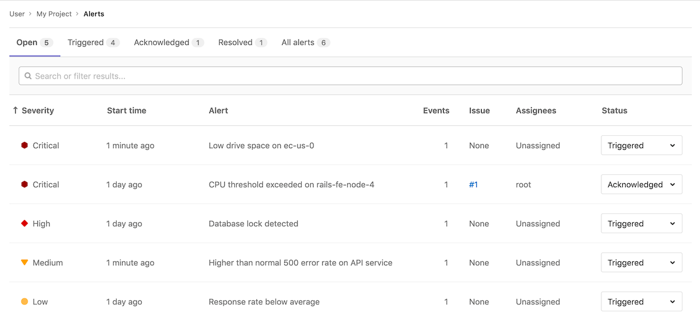
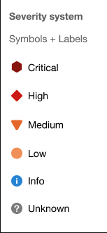
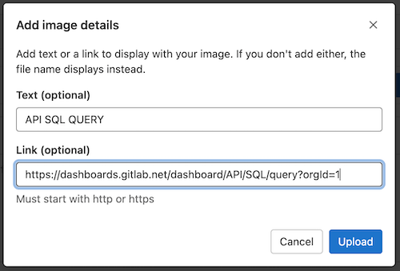
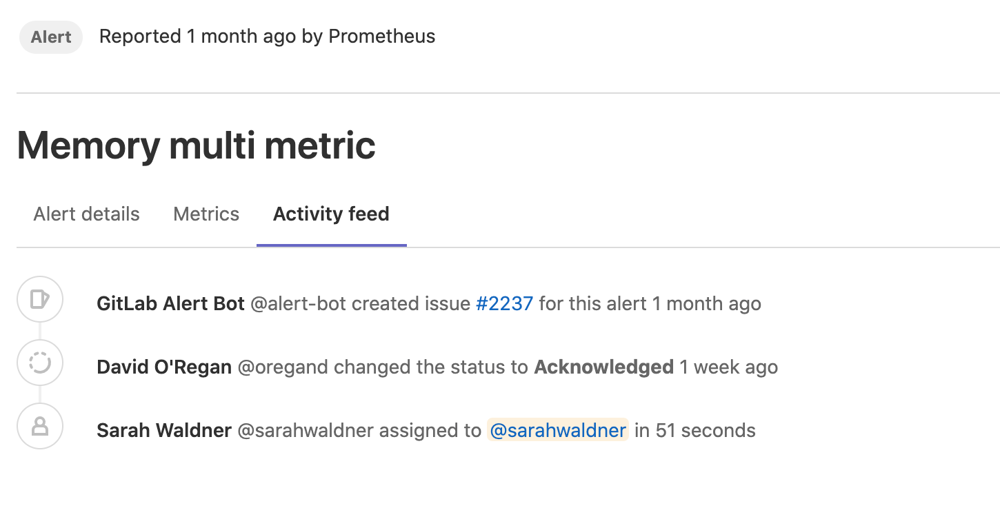
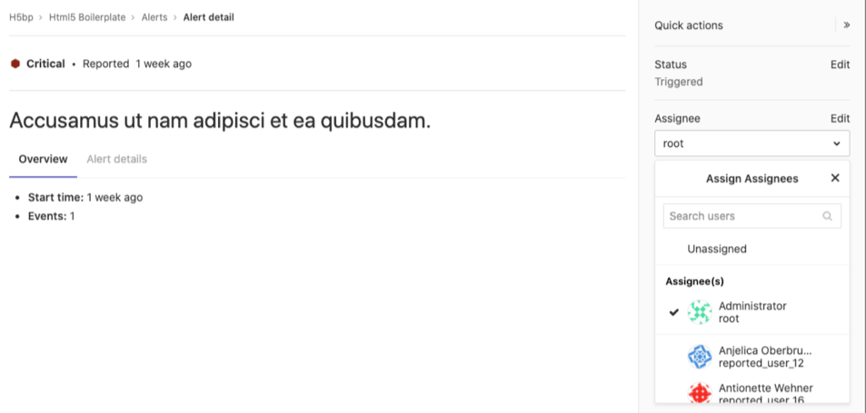



- Tier: 基础版，专业版，旗舰版
- Offering: JihuLab.com，私有化部署



告警是事件管理工作流中的关键实体。它们代表可能表明服务中断或故障的值得注意的事件。极狐GitLab 提供列表视图用于排查，以及详情视图用于更深入地调查所发生的情况。

## 告警列表

拥有开发者、维护者或所有者角色的用户可以在项目边栏中选择**监控** > **告警**来访问告警列表。告警列表按开始时间排序显示告警，但您可以通过选择告警列表中的表头来更改排序顺序。

告警列表显示以下信息：

- **搜索**：告警列表支持对标题、描述、监控工具和服务字段进行简单的自由文本搜索。
- **严重性**：告警当前的重要程度以及应受到的关注程度。有关所有状态的列表，请阅读[告警管理严重性](#alert-severity)。
- **开始时间**：告警触发至今的时间。此字段使用极狐GitLab 标准的 `X time ago` 格式，但会根据用户的语言环境提供更精细的日期/时间工具提示。
- **告警描述**：告警的描述，尝试捕获最有意义的数据。
- **事件计数**：告警触发的次数。
- **议题**：指向为该告警创建的事件议题的链接。
- **状态**：告警的当前状态：
  - **已触发**：尚未开始调查。
  - **已确认**：有人正在积极调查该问题。
  - **已解决**：无需进一步处理。
  - **已忽略**：不对该告警采取任何操作。

## 告警严重性

每个级别的告警都包含形状独特且带有颜色编码的图标，帮助您识别特定告警的严重性。这些严重性图标可帮助您立即识别应优先调查哪些告警：

告警包含以下图标之一：

<!-- vale gitlab_base.SubstitutionWarning = NO -->

| 严重性 | 图标                    | 颜色（十六进制） |
|----------|-------------------------|---------------------|
| 严重 |  | `#8b2615`           |
| 高     |      | `#c0341d`           |
| 中   |    | `#fca429`           |
| 低      |       | `#fdbc60`           |
| 信息     |      | `#418cd8`           |
| 未知  |   | `#bababa`           |

<!-- vale gitlab_base.SubstitutionWarning = YES -->

## 告警详情页面

访问[告警列表](#alert-list)并从列表中选择一个告警，即可进入告警详情视图。您需要拥有开发者、维护者或所有者角色才能访问告警。选择列表中的任意告警以查看其告警详情页面。

告警提供**概览**和**告警详情**标签页，为您提供所需的信息量。

### 告警详情标签页

**告警详情**标签页包含两个部分。顶部部分提供关键详情的简短列表，例如严重性、开始时间、事件数量和来源监控工具。第二部分显示完整的告警负载。

### 指标标签页

在许多情况下，告警与指标相关联。您可以在**指标**标签页中上传指标图表的截图。

为此，您可以：

- 选择**上传**，然后从文件浏览器中选择一个图像。
- 从文件浏览器中拖动文件并将其放入拖放区域。

上传图像时，您可以向图像添加文本并将其链接到原始图表。

如果您添加了链接，它会显示在上传的图像上方。

### 活动动态标签页

**活动动态**标签页是告警活动的日志。当您对告警执行操作时，会记录为系统评论。这为您提供告警调查和指派历史的线性时间线。

以下操作会产生系统评论：

- [更新告警状态](#change-an-alerts-status)
- [基于告警创建事件](manage_incidents.md#from-an-alert)
- [将告警指派给用户](#assign-an-alert)
- [将告警升级给值班响应者](paging.md#escalating-an-alert)

## 告警操作

极狐GitLab 中提供不同的操作，帮助排查和响应告警。

### 更改告警状态

您可以更改告警的状态。

可用的状态有：

- 已触发（新告警的默认状态）
- 已确认
- 已解决

先决条件：

- 您必须拥有开发者、维护者或所有者角色。

要更改告警状态：

- 从[告警列表](#alert-list)中：
  1. 在**状态**列中，在某个告警旁边，选择状态下拉列表。
  1. 选择一个状态。
- 从[告警详情页面](#alert-details-page)中：
  1. 在右侧边栏中，选择**编辑**。
  1. 选择一个状态。

要在[已启用电子邮件通知](paging.md#email-notifications-for-alerts)的项目中停止告警再次发生时的电子邮件通知，请将告警状态从**已触发**更改为其他状态。

#### 通过关闭关联事件来解决告警

先决条件：

- 您必须拥有报告者、开发者、维护者或所有者角色。

当您[关闭](manage_incidents.md#close-an-incident)与告警关联的事件时，极狐GitLab 会[将告警状态更改](#change-an-alerts-status)为**已解决**。随后该告警的状态更改会记入您的名下。

#### 作为值班响应者



- Tier: 专业版，旗舰版
- Offering: JihuLab.com，私有化部署



值班响应者可以通过更改告警状态来响应[告警寻呼](paging.md#escalating-an-alert)。

更改状态会产生以下影响：

- 更改为**已确认**：根据项目的[升级策略](escalation_policies.md)限制值班寻呼。
- 更改为**已解决**：静默该告警的所有值班寻呼。
- 从**已解决**更改为**已触发**：重新开始该告警的升级。

更新[关联了事件的告警](manage_incidents.md#from-an-alert)的状态不会更新事件状态。事件状态独立于告警状态。

### 指派告警

在大型团队中，告警由多人共同负责，很难跟踪谁在调查和处理它。指派告警通过指明哪个用户负责该告警，便于协作和委派。极狐GitLab 每个告警仅支持一个指派人。

要指派告警：

1. 显示当前告警列表：

   1. 在顶部栏中，选择**搜索或跳转到**并找到您的项目。
   1. 选择**监控** > **告警**。

1. 选择您想要的告警以显示其详情。

   

1. 如果右侧边栏未展开，请选择
   **展开边栏**（）以展开它。

1. 在右侧边栏中，找到**指派人**，然后选择**编辑**。
   从列表中选择您要指派给该告警的每个用户。
   极狐GitLab 会为每个用户创建一个[待办事项](../../user/todos.md)。

在完成其调查或修复告警的部分工作后，用户可以自行取消指派。要移除指派人，请选择**指派人**下拉列表旁边的**编辑**，并从指派人列表中清除该用户，或选择**未指派**。

### 从告警创建待办事项

您可以从告警手动为自己创建一个[待办事项](../../user/todos.md)，稍后在您的**待办事项列表**中查看。

要添加待办事项，请在右侧边栏中选择**添加待办事项**。

### 从告警触发操作



- Tier: 旗舰版
- Offering: JihuLab.com，私有化部署



开启在告警触发时自动创建[事件](incidents.md)的功能。

先决条件：

- 您必须拥有项目的维护者或所有者角色。

要配置这些操作：

1. 在顶部栏中，选择**搜索或跳转到**并找到您的项目。
1. 在左侧边栏中，选择**设置** > **监控**。
1. 展开**告警**部分，然后选择**告警设置**标签页。
1. 选中**创建事件**复选框。
1. 可选。要自定义事件，请从**事件模板**中选择一个模板，将其
   追加到[事件摘要](incidents.md#summary)。
   如果下拉列表为空，
   请先[创建议题模板](../../user/project/description_templates.md#create-a-description-template)。
1. 可选。要发送[电子邮件通知](paging.md#email-notifications-for-alerts)，请选中
   **为新告警向所有者和维护者发送单封电子邮件通知**复选框。
1. 选择**保存更改**。
