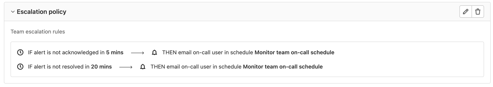



- Tier: 专业版，旗舰版
- Offering: JihuLab.com，私有化部署



升级策略可保护您的公司免于遗漏关键告警。升级策略包含限时步骤，如果上一步骤中的响应者未响应，这些步骤会自动呼叫升级步骤中的下一位响应者。您可以在管理[值班计划](oncall_schedules.md)的极狐GitLab 项目中创建升级策略。

## 添加升级策略

先决条件：

- 您必须具有维护者或所有者角色。
- 您必须有一个[值班计划](oncall_schedules.md)。

要创建升级策略：

1. 在顶部栏中，选择**搜索或跳转到**，然后找到您的项目。
1. 在左侧边栏中，选择**监控** > **升级策略**。
1. 选择**添加升级策略**。
1. 输入策略的名称和描述，以及当主要响应者错过告警时要遵循的升级规则。
1. 选择**添加升级策略**。

### 选择升级规则的响应者

配置升级规则时，您可以指定要呼叫的对象：

- **通过值班计划邮件通知值班用户**：当规则触发时通知值班用户，涵盖指定[值班计划](oncall_schedules.md)上的所有轮班。
- **通过邮件通知用户**：直接通知指定的用户。

当通过值班计划或直接向用户发送通知时，会在告警上创建一条系统评论，列出被呼叫的用户。

为升级规则指定的时间必须介于 0 到 1440 分钟之间。

## 编辑升级策略

要更新升级策略：

1. 在顶部栏中，选择**搜索或跳转到**，然后找到您的项目。
1. 在左侧边栏中，选择**监控** > **升级策略**。
1. 选择**编辑升级策略** ()。
1. 编辑信息。
1. 选择**保存更改**。

## 删除升级策略

要删除升级策略：

1. 在顶部栏中，选择**搜索或跳转到**，然后找到您的项目。
1. 在左侧边栏中，选择**监控** > **升级策略**。
1. 选择**删除升级策略** ()。
1. 在确认对话框中，选择**删除升级策略**。
