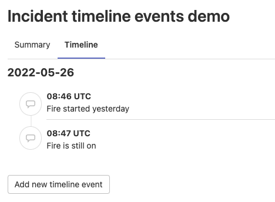



- Tier: 基础版，专业版，旗舰版
- Offering: JihuLab.com，私有化部署



事件时间线是事件记录留存的重要组成部分。时间线可以向管理层和外部查看者展示事件期间发生了什么，以及为解决问题采取了哪些步骤。

## 查看时间线

事件时间线事件按日期和时间升序排列。它们按日期分组，并按发生时间的升序排列：

要查看事件的事件时间线：

1. 在顶部栏中，选择**搜索或跳转到**并找到您的项目。
1. 在左侧边栏中，选择**监控** > **事件**。
1. 选择一个事件。
1. 选择**时间线**标签页。

## 创建事件

您可以通过多种方式在极狐GitLab 中创建时间线事件。

### 使用表单

使用表单手动创建时间线事件。

先决条件：

- 您必须具有该项目的开发者、维护者或所有者角色。

要创建时间线事件：

1. 在顶部栏中，选择**搜索或跳转到**并找到您的项目。
1. 在左侧边栏中，选择**监控** > **事件**。
1. 选择一个事件。
1. 选择**时间线**标签页。
1. 选择**添加新的时间线事件**。
1. 填写必填字段。
1. 选择**保存**或**保存并添加另一个事件**。

### 使用快速操作

您可以使用 [`/timeline` 快速操作](../../user/project/quick_actions.md#timeline)创建时间线事件。

### 从事件上的评论创建

先决条件：

- 您必须具有该项目的开发者、维护者或所有者角色。

> [!warning]
> 添加到公开和内部事件时间线的内部评论
> 对任何有权访问该事件的人都可见。

要从事件上的评论创建时间线事件：

1. 在顶部栏中，选择**搜索或跳转到**并找到您的项目。
1. 在左侧边栏中，选择**监控** > **事件**。
1. 选择一个事件。
1. 创建评论或选择一条现有评论。
1. 在要添加的评论上，选择**将评论添加到事件时间线** ()。

该评论会作为时间线事件显示在事件时间线上。

### 当事件严重性发生变化时

当有人[更改事件的严重性](manage_incidents.md#change-severity)时，会创建一个新的时间线事件。

### 当标记发生变化时



- Status: 实验



> [!flag]
> 此功能的可用性由功能标志控制。
> 此功能可用于测试，但尚未准备好用于生产环境。

当有人添加或移除事件上的[标记](../../user/project/labels.md)时，会创建一个新的时间线事件。

## 删除事件

您也可以删除时间线事件。

先决条件：

- 您必须具有该项目的开发者、维护者或所有者角色。

要删除时间线事件：

1. 在顶部栏中，选择**搜索或跳转到**并找到您的项目。
1. 在左侧边栏中，选择**监控** > **事件**。
1. 选择一个事件。
1. 选择**时间线**标签页。
1. 在时间线事件的右侧，选择**更多操作** ()，然后选择**删除**。
1. 要确认，请选择**删除事件**。

或者：

1. 在时间线事件的右侧，选择**更多操作** ()，然后选择**编辑**。
1. 选择**删除**。
1. 要确认，请选择**删除事件**。

## 事件标签

[使用表单创建事件](#using-the-form)或编辑事件时，您可以指定事件标签以记录相关的事件时间戳。时间线标签是可选的。每个事件可以选择多个标签。当您创建时间线事件并选择标签时，事件评论会填充一条默认消息。这样可以快速创建事件。如果已设置评论，则不会更改。添加的标签会显示在时间戳旁边。

## 格式规则

事件时间线事件支持以下[极狐GitLab 风格 Markdown](../../user/markdown.md) 功能。

- [代码](../../user/markdown.md#code-spans-and-blocks)。
- [表情符号](../../user/markdown.md#emoji)。
- [强调](../../user/markdown.md#emphasis)。
- [极狐GitLab 特定引用](../../user/markdown.md#gitlab-specific-references)。
- [图片](../../user/markdown.md#images)，渲染为指向所上传图片的链接。
- [链接](../../user/markdown.md#links)。
