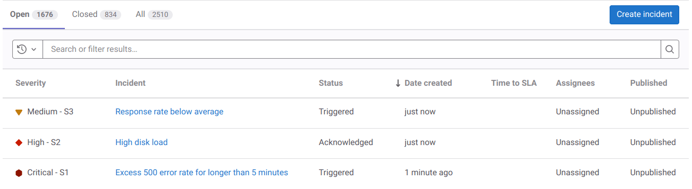
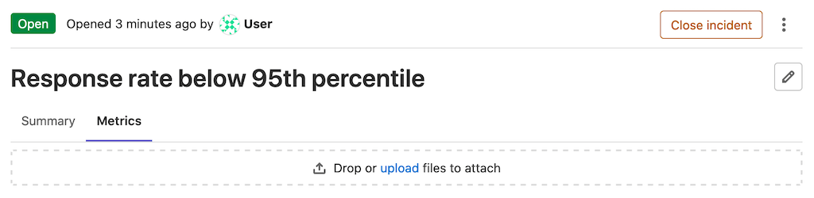
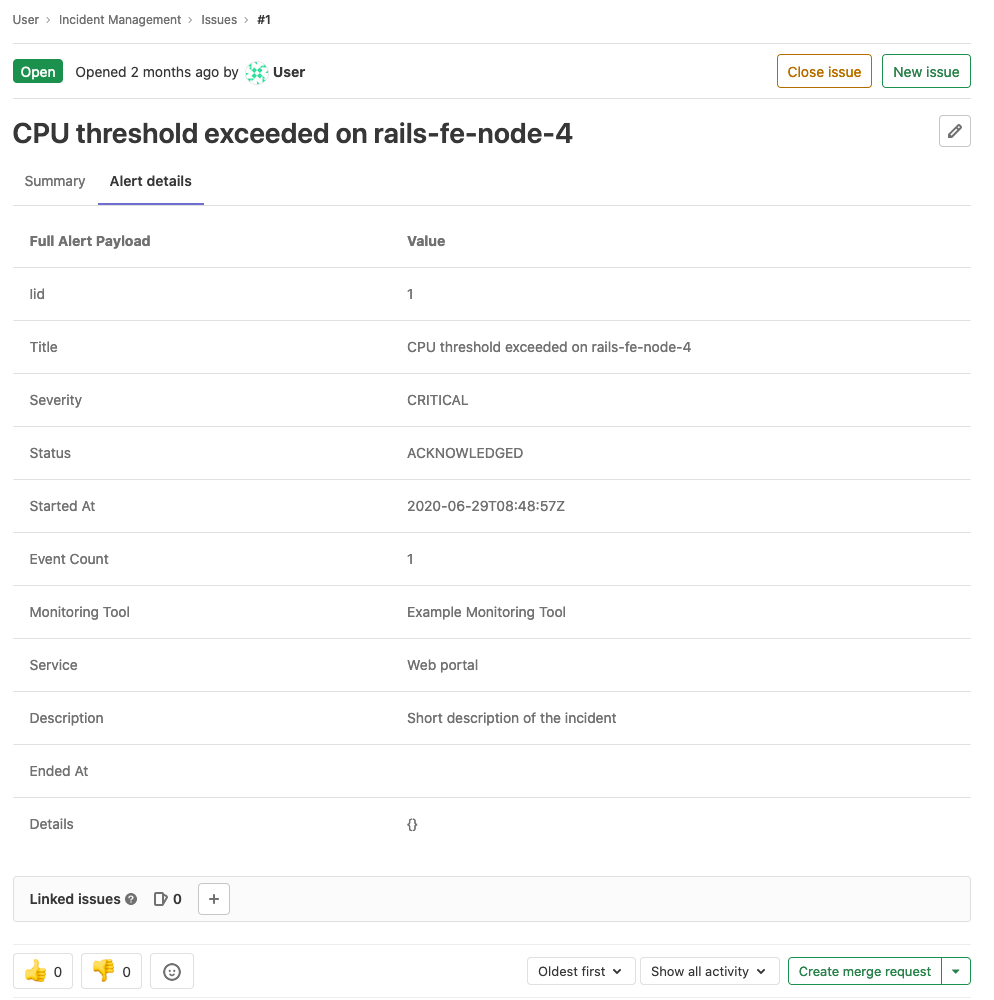



- Tier: 基础版，专业版，旗舰版
- Offering: JihuLab.com，私有化部署



事件是指需要紧急恢复的服务中断或故障。事件在事件管理工作流中至关重要。使用极狐GitLab 排查、响应和修复事件。

## 事件列表

当您[查看事件列表](manage_incidents.md#view-a-list-of-incidents)时，其中包含以下内容：

- **状态**：要按状态筛选事件，请在事件列表上方选择**开启**、**已关闭**
  或**全部**。
- **搜索**：搜索事件标题和描述，或[筛选列表](#filter-the-incidents-list)。
- **严重性**：特定事件的严重性，可以是以下值之一：
  -  严重 - S1
  -  高 - S2
  -  中 - S3
  -  低 - S4
  -  未知
- **事件**：事件的标题，用于尽可能传达最有意义的信息。
- **状态**：事件的状态，可以是以下值之一：
  - 已触发
  - 已确认
  - 已解决

  在专业版或旗舰版中，此字段还会链接到该事件的[值班升级](paging.md#escalating-an-incident)。

- **创建日期**：事件创建至今的时间。此字段使用极狐GitLab 的标准格式 `X time ago`。将鼠标悬停在该值上可查看按您的区域设置格式化的确切日期和时间。
- **指派人**：分配给该事件的用户。
- **已发布**：事件是否发布到[状态页](status_page.md)。

有关事件列表实际使用的示例，请参阅此[演示项目](https://gitlab.com/gitlab-org/monitor/monitor-sandbox/-/incidents)。

### 对事件列表排序

事件列表按事件创建日期排序显示事件，最新的排在最前面。

要按其他列排序，或更改排序顺序，请选择该列。

您可以按其排序的列：

- 严重性
- 状态
- 距 SLA 的时间
- 已发布

### 筛选事件列表

要按作者或指派人筛选事件列表，请在搜索框中输入这些值。

## 事件详情

### 摘要

事件的摘要部分提供有关事件的关键详情以及议题模板的内容（如果[已选择](alerts.md#trigger-actions-from-alerts)）。事件顶部的突出显示栏从左到右显示：

- 指向原始告警的链接。
- 告警开始时间。
- 事件计数。

在突出显示栏下方，摘要包含以下字段：

- 开始时间
- 严重性
- `full_query`
- 监控工具

可以使用[极狐GitLab 风格 Markdown](../../user/markdown.md) 进一步自定义事件摘要。

如果事件是[从告警创建的](alerts.md#trigger-actions-from-alerts)，且该告警为事件提供了 Markdown，则该 Markdown 会追加到摘要中。如果为项目配置了事件模板，则模板内容会追加到末尾。

评论以讨论串形式显示，但也可以通过[开启最近更新视图](#recent-updates-view)按时间顺序显示。

当您对事件进行更改时，极狐GitLab 会创建[系统评论](../../user/project/system_notes.md)并将其显示在摘要下方。

### 指标



- Tier: 专业版，旗舰版
- Offering: JihuLab.com，私有化部署



先决条件：

- 您必须至少具有该项目的报告者角色。

在许多情况下，事件与指标相关联。您可以在**指标**选项卡中上传指标图表的截图：

当您上传图片时，可以将该图片与文本或指向原始图表的链接相关联。

如果您添加了链接，可以通过选择上传图片上方的超链接来访问原始图表。

### 告警详情

事件会在单独的选项卡中显示关联告警的详情。要填充此选项卡，事件必须是通过关联告警创建的。从告警自动创建的事件会填充此字段。

### 时间线事件

事件时间线提供了事件期间所发生情况的高层次概览，以及为解决问题所采取的步骤。

详细了解[时间线事件](incident_timeline_events.md)以及如何启用此功能。

### 最近更新视图



- Tier: 专业版，旗舰版
- Offering: JihuLab.com，私有化部署



要查看事件的最近更新，请在评论栏上选择**开启最近更新视图**（）。评论会以非讨论串形式按时间顺序显示，从最新到最旧。

### 服务级别协议倒计时



- Tier: 专业版，旗舰版
- Offering: JihuLab.com，私有化部署



您可以在事件上启用服务级别协议倒计时，以跟踪您与客户约定的服务级别协议（SLA）。该计时器会在事件创建时自动启动，并显示 SLA 期限到期前的剩余时间。该计时器还会每 15 分钟动态更新一次，因此您无需刷新页面即可查看剩余时间。

先决条件：

- 您必须具有该项目的维护者或所有者角色。

要配置该计时器：

1. 在顶部栏中，选择**搜索或跳转到**并找到您的项目。
1. 在左侧边栏中，选择**设置** > **监控**。
1. 展开**事件**部分，然后选择**事件设置**选项卡。
1. 选择**激活“距 SLA 的时间”倒计时**。
1. 以 15 分钟为增量设置时间限制。
1. 选择**保存更改**。

启用 SLA 倒计时后，**距 SLA 的时间**列会在事件列表中可用，并作为新事件上的一个字段。如果事件在 SLA 期限结束前未关闭，极狐GitLab 会向该事件添加一个 `missed::SLA` 标记。
