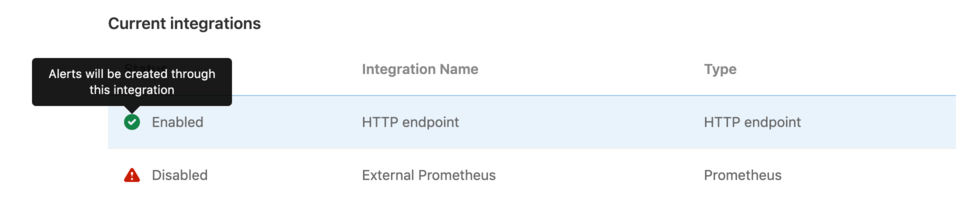
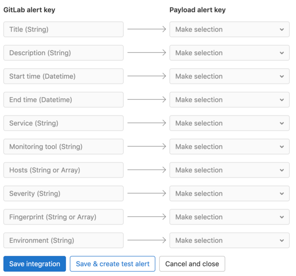



- Tier: 基础版，专业版，旗舰版
- Offering: JihuLab.com，私有化部署



极狐GitLab 可以通过 Webhook 接收器接受来自任何来源的告警。[告警通知](alerts.md)可以为值班轮换[触发寻呼](paging.md#paging)，或用于[创建事件](manage_incidents.md#from-an-alert)。

<a id="integrations-list"></a>

## 集成列表

拥有维护者或所有者角色时，您可以在项目的侧边栏菜单中导航到**设置** > **监控**，并展开**告警**部分，查看已配置的告警集成列表。该列表会显示集成名称、类型和状态（已启用或已禁用）：



<a id="configuration"></a>

## 配置

极狐GitLab 可以通过您配置的 HTTP 端点接收告警。

<a id="single-alerting-endpoint"></a>

### 单一告警端点

在极狐GitLab 项目中启用告警端点后，该项目即可接收 JSON 格式的告警负载。您可以随时[自定义负载](#customize-the-alert-payload-outside-of-gitlab)。

1. 以拥有项目维护者角色的用户身份登录极狐GitLab。
1. 在项目中转到**设置** > **监控**。
1. 展开**告警**部分，在**选择集成类型**下拉列表中，
   如果告警来自 Prometheus，选择 **Prometheus**；如果来自其他监控工具，选择 **HTTP 端点**。
1. 开启**活跃**告警设置。保存集成后，Webhook 配置的 URL 和授权密钥
   可在**查看凭据**标签页中获取。您还必须在外部服务中输入
   该 URL 和授权密钥。

<a id="alerting-endpoints"></a>

### 告警端点



- Tier: 专业版，旗舰版
- Offering: JihuLab.com，私有化部署



在[极狐GitLab 专业版](https://gitlab.cn/pricing)中，您可以创建多个唯一的告警端点，以 JSON 格式接收来自任何外部来源的告警，并且可以[自定义负载](#customize-the-alert-payload-outside-of-gitlab)。

1. 以拥有项目维护者角色的用户身份登录极狐GitLab。
1. 在项目中转到**设置** > **监控**。
1. 展开**告警**部分。
1. 对于您要创建的每个端点：

   1. 选择**添加新集成**。
   1. 在**选择集成类型**下拉列表中，如果告警来自 Prometheus，选择 **Prometheus**；如果来自其他监控工具，选择 **HTTP 端点**。
   1. 为集成命名。
   1. 开启**活跃**告警设置。保存集成后，Webhook
      配置的 **URL** 和**授权密钥**可在**查看凭据**标签页中获取。
      您还必须在外部服务中输入该 URL 和授权密钥。
   1. 可选。要将监控工具告警中的字段映射到极狐GitLab 字段，请输入示例
      负载并选择**解析负载以进行自定义映射**。必须提供有效的 JSON。如果您更新了
      示例负载，还必须重新映射字段。对于 Prometheus 集成，请输入负载 `alerts` 键中的单个告警，而不是整个负载。

   1. 可选。如果您提供了有效的示例负载，请选择**负载告警键**中的每个值，
      以[映射到**极狐GitLab 告警键**](#map-fields-in-custom-alerts)。
   1. 要保存集成，请选择**保存集成**。如有需要，您可以在集成创建后，
      从集成的**发送测试告警**标签页发送测试告警。

新的 HTTP 端点会显示在[集成列表](#integrations-list)中。您可以通过选择集成列表右侧的  设置图标来编辑集成。

<a id="map-fields-in-custom-alerts"></a>

#### 在自定义告警中映射字段

您可以将监控工具的告警格式与极狐GitLab 告警集成。要在[告警列表](alerts.md#alert-list)和[告警详情页面](alerts.md#alert-details-page)中显示正确的信息，请在[创建 HTTP 端点](#alerting-endpoints)时将告警字段映射到极狐GitLab 字段：



<a id="add-integration-credentials-to-alertmanager-prometheus-integrations-only"></a>

### 将集成凭据添加到 Alertmanager（仅限 Prometheus 集成）

要将 Prometheus 告警通知发送到极狐GitLab，请将
[Prometheus 集成](#single-alerting-endpoint)中的 URL 和授权密钥复制到
Prometheus Alertmanager 配置的
[`webhook_configs`](https://prometheus.io/docs/alerting/latest/configuration/#webhook_config)
部分：

```yaml
receivers:
  - name: gitlab
    webhook_configs:
      - http_config:
          authorization:
            type: Bearer
            credentials: 1234567890abdcdefg
        send_resolved: true
        url: http://IP_ADDRESS:PORT/root/manual_prometheus/prometheus/alerts/notify.json
        # Rest of configuration omitted
        # ...
```

<a id="customize-the-alert-payload-outside-of-gitlab"></a>

## 在极狐GitLab 之外自定义告警负载

<a id="expected-http-request-attributes"></a>

### 预期的 HTTP 请求属性

对于没有[自定义映射](#map-fields-in-custom-alerts)的 HTTP 端点，您可以通过发送以下参数来自定义负载。所有字段均为可选。如果传入的告警不包含 `Title` 字段的值，则应用默认值 `New: Alert`。

| 属性                  | 类型            | 描述 |
| ------------------------- | --------------- | ----------- |
| `title`                   | String          | 告警的标题。|
| `description`             | String          | 问题的高层级摘要。 |
| `start_time`              | DateTime        | 告警的时间。如果未提供，则使用当前时间。 |
| `end_time`                | DateTime        | 告警的解决时间。如果提供，则告警会被解决。 |
| `service`                 | String          | 受影响的服务。 |
| `monitoring_tool`         | String          | 关联监控工具的名称。 |
| `hosts`                   | String or Array | 发生此事件的一个或多个主机。 |
| `severity`                | String          | 告警的严重性。不区分大小写。可以是以下之一：`critical`、`high`、`medium`、`low`、`info`、`unknown`。如果缺失或值不在此列表中，则默认为 `critical`。 |
| `fingerprint`             | String or Array | 告警的唯一标识符。可用于对同一告警的多次出现进行分组。当启用 `generic_alert_fingerprinting` 功能时，指纹会根据负载自动生成（不包括 `start_time`、`end_time` 和 `hosts` 参数）。 |
| `gitlab_environment_name` | String          | 关联的极狐GitLab [环境](../../ci/environments/_index.md)的名称。要在[仪表板上显示告警](../../user/operations_dashboard/_index.md#adding-a-project-to-the-dashboard)，此项为必填。 |

您还可以向告警负载添加自定义字段。额外参数的值不限于基本类型（如字符串或数字），也可以是嵌套的 JSON 对象。例如：

```json
{ "foo": { "bar": { "baz": 42 } } }
```

> [!note]
> 确保您的请求小于
> [负载应用程序限制](../../administration/instance_limits.md#generic-alert-json-payloads)。

<a id="example-request-body"></a>

#### 示例请求正文

示例负载：

```json
{
  "title": "Incident title",
  "description": "Short description of the incident",
  "start_time": "2019-09-12T06:00:55Z",
  "service": "service affected",
  "monitoring_tool": "value",
  "hosts": "value",
  "severity": "high",
  "fingerprint": "d19381d4e8ebca87b55cda6e8eee7385",
  "foo": {
    "bar": {
      "baz": 42
    }
  }
}
```

<a id="expected-prometheus-request-attributes"></a>

### 预期的 Prometheus 请求属性

告警应按 Prometheus [Webhook 接收器](https://prometheus.io/docs/alerting/latest/configuration/#webhook_config)的格式进行格式化。

顶层必需属性：

- `alerts`
- `commonAnnotations`
- `commonLabels`
- `externalURL`
- `groupKey`
- `groupLabels`
- `receiver`
- `status`
- `version`

根据 Prometheus 负载中的 `alerts`，会为数组中的每一项创建一个极狐GitLab 告警。您可以修改下面列出的嵌套参数来配置极狐GitLab 告警。

| 属性                                                                  | 类型     | 必需 | 描述                          |
| -------------------------------------------------------------------------- | -------- | -------- | ------------------------------------ |
| `annotations/title`、`annotations/summary` 或 `labels/alertname` 之一   | String   | 是      | 告警的标题。              |
| `startsAt`                                                                 | DateTime | 是      | 告警的开始时间。         |
| `annotations/description`                                                  | String   | 否       | 问题的高层级摘要。 |
| `annotations/gitlab_incident_markdown`                                     | String   | 否       | 要追加到根据该告警创建的任何事件中的[极狐GitLab 风格 Markdown](../../user/markdown.md)。 |
| `annotations/runbook`                                                      | String   | 否       | 指向如何管理此告警的文档或说明的链接。 |
| `endsAt`                                                                   | DateTime | 否       | 告警的解决时间。    |
| `generatorUrl`中的 `g0.expr` 查询参数                                | String   | 否       | 关联指标的查询。          |
| `labels/gitlab_environment_name`                                           | String   | 否       | 关联的极狐GitLab [环境](../../ci/environments/_index.md)的名称。要在[仪表板上显示告警](../../user/operations_dashboard/_index.md#adding-a-project-to-the-dashboard)，此项为必填。 |
| `labels/severity`                                                          | String   | 否       | 告警的严重性。应为 [Prometheus 严重性选项](#prometheus-severity-options)之一。如果缺失或值不在此列表中，则默认为 `critical`。 |
| `status`                                                                   | String   | 否       | 告警在 Prometheus 中的状态。如果值为 'resolved'，则告警会被解决。 |
| `annotations/gitlab_y_label`、`annotations/title`、`annotations/summary` 或 `labels/alertname` 之一 | String | 否 | 在[极狐GitLab 风格 Markdown](../../user/markdown.md)中嵌入此告警的指标时要使用的 Y 轴标签。 |

`annotations` 下包含的其他属性可在[告警详情页面](alerts.md#alert-details-page)中查看。任何其他属性都会被忽略。

属性不限于基本类型（如字符串或数字），也可以是嵌套的 JSON 对象。例如：

```json
{
    "target": {
        "user": {
            "id": 42
        }
    }
}
```

> [!note]
> 确保您的请求小于
> [负载应用程序限制](../../administration/instance_limits.md#generic-alert-json-payloads)。

<a id="prometheus-severity-options"></a>

#### Prometheus 严重性选项

来自 Prometheus 的告警可以为[告警严重性](alerts.md#alert-severity)提供以下任一不区分大小写的值：

- **严重**：`critical`、`s1`、`p1`、`emergency`、`fatal`
- **高**：`high`、`s2`、`p2`、`major`、`page`
- **中**：`medium`、`s3`、`p3`、`error`、`alert`
- **低**：`low`、`s4`、`p4`、`warn`、`warning`
- **信息**：`info`、`s5`、`p5`、`debug`、`information`、`notice`

如果值缺失或不在上述列表中，严重性默认为 `critical`。

<a id="example-prometheus-alert"></a>

#### 示例 Prometheus 告警

示例告警规则：

```yaml
groups:
- name: example
  rules:
  - alert: ServiceDown
    expr: up == 0
    for: 5m
    labels:
      severity: high
    annotations:
      title: "Example title"
      runbook: "http://example.com/my-alert-runbook"
      description: "Service has been down for more than 5 minutes."
      gitlab_y_label: "y-axis label"
      foo:
        bar:
          baz: 42
```

示例请求负载：

```json
{
  "version" : "4",
  "groupKey": null,
  "status": "firing",
  "receiver": "",
  "groupLabels": {},
  "commonLabels": {},
  "commonAnnotations": {},
  "externalURL": "",
  "alerts": [{
    "startsAt": "2022-010-30T11:22:40Z",
    "generatorURL": "http://host?g0.expr=up",
    "endsAt": null,
    "status": "firing",
    "labels": {
      "gitlab_environment_name": "production",
      "severity": "high"
    },
    "annotations": {
      "title": "Example title",
      "runbook": "http://example.com/my-alert-runbook",
      "description": "Service has been down for more than 5 minutes.",
      "gitlab_y_label": "y-axis label",
      "foo": {
        "bar": {
          "baz": 42
        }
      }
    }
  }]
}
```

> [!note]
> [触发测试告警](#triggering-test-alerts)时，请输入示例中所示的整个负载。
> [配置自定义映射](#map-fields-in-custom-alerts)时，仅输入 `alerts` 数组中的第一项作为示例负载。

<a id="authorization"></a>

## 授权

接受以下授权方法：

- Bearer 授权请求头
- 基本身份验证

配置告警集成时，可以找到 `<authorization_key>` 和 `<url>` 的值。

<a id="bearer-authorization-header"></a>

### Bearer 授权请求头

授权密钥可用作 Bearer 令牌：

```shell
curl --request POST \
  --data '{"title": "Incident title"}' \
  --header "Authorization: Bearer <authorization_key>" \
  --header "Content-Type: application/json" \
  <url>
```

<a id="basic-authentication"></a>

### 基本身份验证

授权密钥可用作 `password`。`username` 留空：

- username: `<blank>`
- password: `<authorization_key>`

```shell
curl --request POST \
  --data '{"title": "Incident title"}' \
  --header "Authorization: Basic <base_64_encoded_credentials>" \
  --header "Content-Type: application/json" \
  <url>
```

基本身份验证也可以直接在 URL 中使用凭据：

```shell
curl --request POST \
  --data '{"title": "Incident title"}' \
  --header "Content-Type: application/json" \
  <username:password@url>
```

> [!warning]
> 在 URL 中使用授权密钥不安全，因为它会在服务器日志中可见。如果您的工具支持，
> 建议使用前面介绍的其中一种请求头方式。

<a id="response-body"></a>

## 响应正文

JSON 响应正文包含请求中创建的任何告警的列表：

```json
[
  {
    "iid": 1,
    "title": "Incident title"
  },
  {
    "iid": 2,
    "title": "Second Incident title"
  }
]
```

成功的响应会返回 `200` 响应码。

<a id="triggering-test-alerts"></a>

## 触发测试告警

在[项目维护者或所有者](../../user/permissions.md)配置集成后，您可以触发测试告警，以确认集成工作正常。

1. 以拥有开发者、维护者或所有者角色的用户身份登录。
1. 在项目中转到**设置** > **监控**。
1. 选择**告警**以展开该部分。
1. 在[列表](#integrations-list)中选择集成右侧的  设置图标。
1. 选择**发送测试告警**标签页以将其打开。
1. 在负载字段中输入测试负载（必须提供有效的 JSON）。
1. 选择**发送**。

极狐GitLab 会根据测试结果显示错误或成功消息。

<a id="automatic-grouping-of-identical-alerts"></a>

## 自动对相同告警进行分组



- Tier: 专业版，旗舰版
- Offering: JihuLab.com，私有化部署



极狐GitLab 会根据负载对告警进行分组。当传入的告警包含与另一告警相同的负载时（不包括 `start_time` 和 `hosts` 属性），极狐GitLab 会将这些告警分组在一起，并在[告警管理列表](incidents.md)和详情页面上显示计数器。

如果现有告警已经是 `resolved`，极狐GitLab 会改为创建一个新告警。


<a id="recovery-alerts"></a>

## 恢复告警

当 HTTP 端点收到设置了告警结束时间的负载时，极狐GitLab 中的告警会自动解决。对于没有[自定义映射](#map-fields-in-custom-alerts)的 HTTP 端点，预期的字段是 `end_time`。使用自定义映射时，您可以选择预期的字段。

极狐GitLab 会根据可作为负载一部分提供的 `fingerprint` 值来确定要解决哪个告警。有关告警属性和映射的更多信息，请参阅[在极狐GitLab 之外自定义告警负载](#customize-the-alert-payload-outside-of-gitlab)。

您还可以配置在告警解决时[自动关闭关联的事件](manage_incidents.md#automatically-close-incidents-via-recovery-alerts)。

<a id="link-to-your-opsgenie-alerts"></a>

## 链接到您的 Opsgenie 告警



- Tier: 专业版，旗舰版
- Offering: JihuLab.com，私有化部署



> [!warning]
> 我们正在通过
> [HTTP 端点集成](#single-alerting-endpoint)构建与 Opsgenie 及其他告警工具的更深入集成，
> 以便您可以在极狐GitLab 界面中查看告警。

您可以使用极狐GitLab 与 [Opsgenie](https://www.atlassian.com/software/opsgenie/migration)的集成来监控告警。

如果启用 Opsgenie 集成，则不能同时激活其他极狐GitLab 告警服务。

要启用 Opsgenie 集成：

1. 以拥有维护者或所有者角色的用户身份登录。
1. 转到**监控** > **告警**。
1. 在**集成**选择框中，选择 **Opsgenie**。
1. 选择**活跃**开关。
1. 在 **API URL** 字段中，输入 Opsgenie 集成的基础 URL，
   例如 `https://app.opsgenie.com/alert/list`。
1. 选择**保存更改**。

启用集成后，转到**监控** > **告警**下的**告警**页面，然后选择**在 Opsgenie 中查看告警**。
