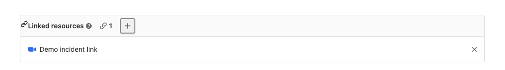



- Tier: 专业版，旗舰版
- Offering: JihuLab.com，私有化部署



为了帮助您的团队成员无需翻阅大量评论就能找到重要链接，您可以为事件议题添加关联资源。

您可能想要链接的资源：

- 事件 Slack 频道
- Zoom 会议
- 用于解决事件的资源

<a id="view-linked-resources-of-an-incident"></a>

## 查看事件的关联资源

事件的关联资源列在**摘要**标签页下。



要查看事件的关联资源：

1. 在顶部栏中，选择**搜索或跳转到**并找到您的项目。
1. 在左侧边栏中，选择**监控** > **事件**。
1. 选择一个事件。

<a id="add-a-linked-resource"></a>

## 添加关联资源

从事件中手动添加关联资源。

先决条件：

- 您必须拥有该项目的报告者、开发者、维护者或所有者角色。

要添加关联资源：

1. 在顶部栏中，选择**搜索或跳转到**并找到您的项目。
1. 在左侧边栏中，选择**监控** > **事件**。
1. 选择一个事件。
1. 在**关联资源**部分，选择加号图标（）。
1. 填写必填字段。
1. 选择**添加**。

<a id="using-a-quick-action"></a>

### 使用快速操作

要为事件添加多个链接，请使用 [`/link` 快速操作](../../user/project/quick_actions.md#link)：

```plaintext
/link https://example.link.us/j/123456789
```

您还可以随链接提交一段简短描述。该描述会显示在事件的**关联资源**部分中，替代 URL：

```plaintext
/link https://example.link.us/j/123456789 multiple alerts firing
```

<a id="link-zoom-meetings-from-an-incident"></a>

### 从事件链接 Zoom 会议

使用 [`/zoom` 快速操作](../../user/project/quick_actions.md#zoom)为事件添加多个 Zoom 链接：

```plaintext
/zoom https://example.zoom.us/j/123456789
```

您还可以随链接提交一段简短的可选描述。该描述会显示在事件议题的**关联资源**部分中，替代 URL：

```plaintext
/zoom https://example.zoom.us/j/123456789 Low on memory incident
```

<a id="remove-a-linked-resource"></a>

## 移除关联资源

您也可以移除关联资源。

先决条件：

- 您必须拥有该项目的报告者、开发者、维护者或所有者角色。

要移除关联资源：

1. 在顶部栏中，选择**搜索或跳转到**并找到您的项目。
1. 在左侧边栏中，选择**监控** > **事件**。
1. 选择一个事件。
1. 在**关联资源**部分，选择**移除**（）。
