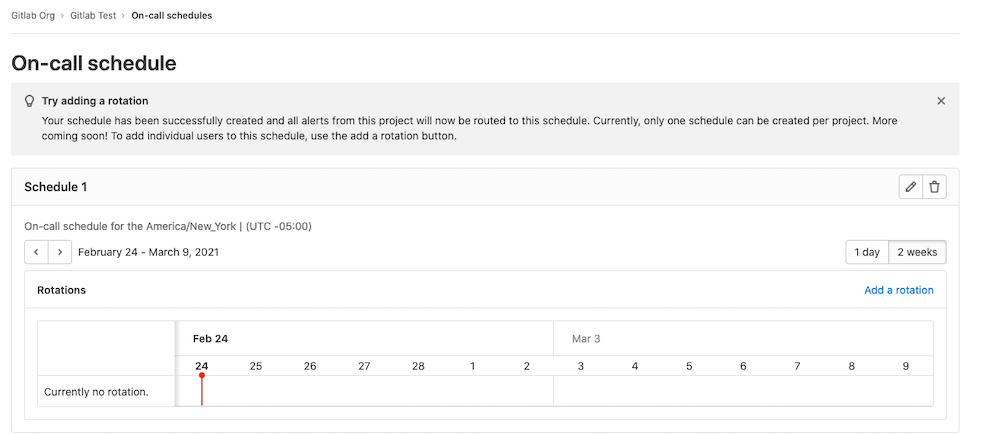
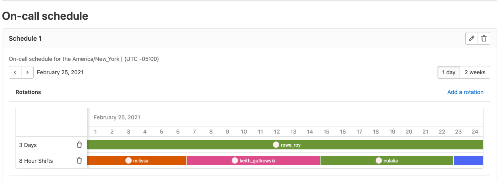



- Tier: 专业版，旗舰版
- Offering: JihuLab.com，私有化部署



使用值班计划管理为响应人员创建计划，以便轮换值班职责。让团队值班，以维持软件服务的可用性。借助[升级策略](escalation_policies.md)和值班计划，当出现问题时，您的团队会立即收到通知，从而能够快速响应服务中断和故障。

要使用值班计划：

1. [创建计划](#schedules)。
1. [为计划添加轮换](#rotations)。

## 计划

为您的团队设置值班计划，以便向其中添加轮换。

先决条件：

- 您必须具有维护者或所有者角色。

要创建值班计划：

1. 在顶部栏中，选择**搜索或跳转到**，然后找到您的项目。
1. 在左侧边栏中，选择**监控** > **待命计划**。
1. 选择**添加计划**。
1. 输入计划的名称和描述，并选择时区。
1. 选择**添加计划**。

现在您有一个不含轮换的空计划。这会呈现为空状态，提示您为计划创建[轮换](#rotations)。

### 编辑计划

要更新计划：

1. 在顶部栏中，选择**搜索或跳转到**，然后找到您的项目。
1. 在左侧边栏中，选择**监控** > **待命计划**。
1. 选择**编辑计划** ()。
1. 编辑信息。
1. 选择**保存更改**。

如果您更改计划的时区，极狐GitLab 会自动将轮换的受限时间区间（如果已设置）更新为新时区中的对应时间。

### 删除计划

要删除计划：

1. 在顶部栏中，选择**搜索或跳转到**，然后找到您的项目。
1. 在左侧边栏中，选择**监控** > **待命计划**。
1. 选择**删除计划** ()。
1. 在确认对话框中，选择**删除计划**。

## 轮换

向现有计划添加轮换，让您的团队成员值班。

要创建轮换：

1. 在顶部栏中，选择**搜索或跳转到**，然后找到您的项目。
1. 在左侧边栏中，选择**监控** > **待命计划**。
1. 选择**添加轮换**链接。
1. 输入以下信息：

   - **名称**：轮换的名称。
   - **参与者**：您希望加入轮换的人员。
   - **轮换时长**：轮换的持续时间。
   - **开始于**：轮换开始的日期和时间。
   - **启用结束日期**：开启该开关后，您可以选择轮换
     结束的日期和时间。
   - **限制为时间区间**：开启该开关后，您可以将轮换限制在
     您选择的时间段内。

### 编辑轮换

要编辑轮换：

1. 在顶部栏中，选择**搜索或跳转到**，然后找到您的项目。
1. 在左侧边栏中，选择**监控** > **待命计划**。
1. 在**轮换**部分中，选择**编辑轮换** ()。
1. 编辑信息。
1. 选择**保存更改**。

### 删除轮换

要删除轮换：

1. 在顶部栏中，选择**搜索或跳转到**，然后找到您的项目。
1. 在左侧边栏中，选择**监控** > **待命计划**。
1. 在**轮换**部分中，选择**删除轮换** ()。
1. 在确认对话框中，选择**删除轮换**。

## 查看计划轮换

您可以查看单日或两周的值班计划。要在这些时间段之间切换，请选择计划上的 **1 天**或 **2 周**按钮。两周是默认视图。

将鼠标悬停在计划中的任何轮换班次参与者上，可查看其各自的班次详情。

## 呼叫值班响应人员

有关更多详细信息，请参阅[呼叫](paging.md#paging)。

## 移除或删除值班用户

如果值班用户从项目或群组中移除，或其账号被删除，确认对话框会显示该用户的值班计划列表。如果确认移除或删除该用户，极狐GitLab 会重新计算值班轮换，并向项目所有者和轮换参与者发送电子邮件。
