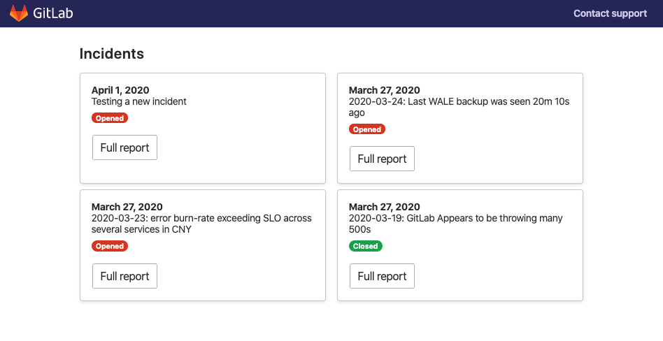
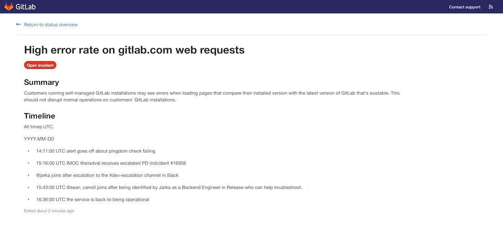
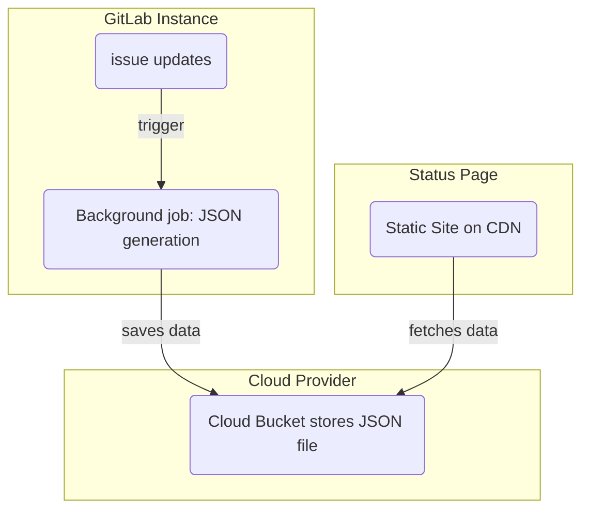
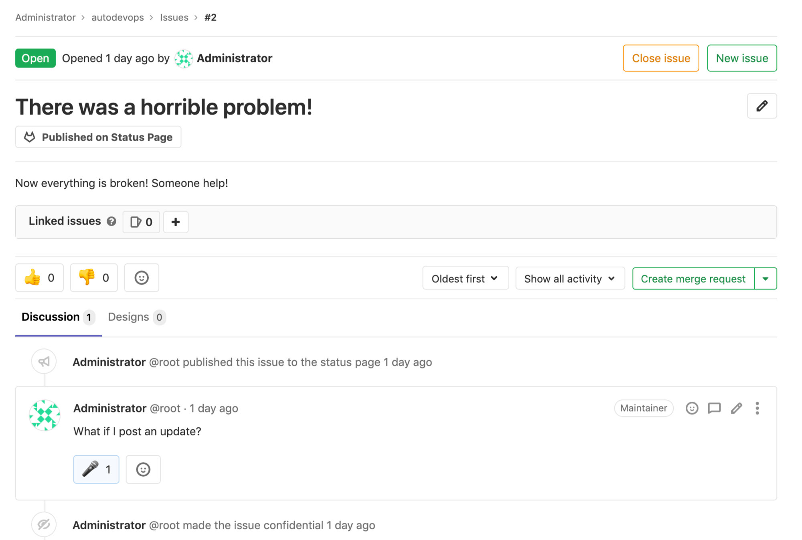



- Tier: 旗舰版
- Offering: JihuLab.com，私有化部署



借助极狐GitLab 状态页，您可以创建并部署一个静态网站，以便在事件发生期间高效地与用户沟通。状态页的着陆页会显示近期事件的概览：

选择某个事件后，会显示一个详情页，其中包含该事件的更多信息：

- 事件的状态，包括事件最近一次更新的时间。
- 事件标题，包括其中的任何表情符号。
- 事件描述，包括其中的表情符号。
- 事件描述中提供的任何文件附件，或带有有效图片扩展名的评论。
- 按时间顺序排列的事件更新列表。

## 设置状态页

要配置极狐GitLab 状态页，您必须：

1. 使用您的云提供商信息[配置极狐GitLab](#configure-gitlab-with-cloud-provider-information)。
1. [配置您的 AWS 账户](#configure-your-aws-account)。
1. 在极狐GitLab 上[创建状态页项目](#create-a-status-page-project)。
1. [将事件同步到状态页](#sync-incidents-to-the-status-page)。

### 使用云提供商信息配置极狐GitLab

仅支持将 AWS S3 作为部署目标。

先决条件：

- 您必须具有维护者或所有者角色。

要向极狐GitLab 提供将内容推送到状态页所需的 AWS 账户信息：

1. 在顶部栏中，选择**搜索或跳转到**，然后找到您的项目。
1. 在左侧边栏中，选择**设置** > **监控**。
1. 展开**状态页**。
1. 选中**活跃**复选框。
1. 在**状态页 URL** 框中，提供您外部状态页的 URL。
1. 在 **S3 存储桶名称**框中，输入您的 S3 存储桶名称。有关更多信息，请参阅
   [存储桶配置文档](https://docs.aws.amazon.com/AmazonS3/latest/userguide/HostingWebsiteOnS3Setup.html)。
1. 在 **AWS 区域**框中，输入您的存储桶所在的区域。有关更多信息，请参阅
   [AWS 文档](https://github.com/aws/aws-sdk-ruby#configuration)。
1. 输入您的 **AWS 访问密钥 ID** 和 **AWS 秘密访问密钥**。
1. 选择**保存更改**。

### 配置您的 AWS 账户

1. 在您的 AWS 账户中，使用以下文件作为示例创建两个新的 IAM 策略：
   - [创建存储桶](https://gitlab.com/gitlab-org/status-page/-/blob/master/deploy/etc/s3_create_policy.json)。
   - [更新存储桶内容](https://gitlab.com/gitlab-org/status-page/-/blob/master/deploy/etc/s3_update_bucket_policy.json)（请记得将 `S3_BUCKET_NAME` 替换为您的存储桶名称）。
1. 使用第一步中创建的权限策略创建一个新的 AWS 访问密钥。

### 创建状态页项目

配置好 AWS 账户后，您必须添加状态页项目，并配置必要的 CI/CD 变量，以将状态页部署到 AWS S3：

1. 复刻[状态页](https://gitlab.com/gitlab-org/status-page)项目。
   您可以通过[代码仓库镜像](https://gitlab.com/gitlab-org/status-page#repository-mirroring)来完成此操作，
   这可确保您获得最新的状态页功能。
1. 在左侧边栏中，选择**设置** > **CI/CD**。
1. 展开**变量**。
1. 从您的 Amazon 控制台添加以下变量：
   - `S3_BUCKET_NAME` - Amazon S3 存储桶的名称。
     如果不存在具有所提供名称的存储桶，则首次流水线运行时会创建一个存储桶，并将其配置为
     [静态网站托管](https://docs.aws.amazon.com/AmazonS3/latest/userguide/HostingWebsiteOnS3Setup.html)。

   - `AWS_DEFAULT_REGION` - AWS 区域。
   - `AWS_ACCESS_KEY_ID` - AWS 访问密钥 ID。
   - `AWS_SECRET_ACCESS_KEY` - AWS 密钥。
1. 在左侧边栏中，选择**构建** > **流水线**。
1. 要将状态页部署到 S3，请选择**新建流水线**。

> [!warning]
> 请考虑限制可以访问此项目中议题的人员，因为任何能够查看该事件的用户都可能[向您的极狐GitLab 状态页发布评论](#publish-comments-on-incidents)。

### 将事件同步到状态页

创建 CI/CD 变量后，配置您要用于事件的项目：

1. 在顶部栏中，选择**搜索或跳转到**，然后找到您的项目。
1. 在左侧边栏中，选择**设置** > **监控**。
1. 展开**状态页**。
1. 填写您的云提供商凭据，并确保选中**活跃**复选框。
1. 选择**保存更改**。

## 如何使用极狐GitLab 状态页

配置好极狐GitLab 实例后，相关更新会触发一个后台作业，将有关该事件的 JSON 格式数据推送到您的外部云提供商。您的状态页网站会定期获取此 JSON 格式数据，并将其格式化后显示给用户，无需您的团队额外付出即可提供有关正在进行的事件的信息：

### 发布事件

要发布事件：

1. 在您启用了极狐GitLab 状态页设置的项目中创建一个事件。
1. [项目或群组所有者](../../user/permissions.md)必须使用
   [`/publish` 快速操作](../../user/project/quick_actions.md#publish)将该事件发布到
   极狐GitLab 状态页。[机密事件](../../user/project/issues/confidential_issues.md)无法发布。

后台工作进程会使用您在设置期间提供的凭据将该事件发布到状态页。作为发布的一部分，极狐GitLab 会：

- 将用户和群组提及匿名化为 `Incident Responder`。
- 移除非公开 [极狐GitLab 引用](../../user/markdown.md#gitlab-specific-references)的标题。
- 发布事件描述中附加的任何文件，每个事件最多 5000 个。

发布后，您可以通过选择事件标题下方显示的**已发布到状态页**按钮来访问该事件的详情页。

### 更新事件

要发布事件的更新，请更新该事件的描述。

> [!warning]
> 当被引用的事件发生更改（例如标题或机密性）时，引用它们的事件不会更新。

### 发布事件评论

要将评论发布到状态页事件：

- 在该事件上创建一条评论。
- 当您准备好发布该评论时，通过向该评论添加麦克风[表情符号回应](../../user/emoji_reactions.md)
  （`:microphone:` 🎤）来将该评论标记为待发布。
- 该评论中附加的任何文件（每个事件最多 5000 个）也会一并发布。

> [!warning]
> 任何有权查看该事件的人都可以向评论添加表情符号回应，因此请考虑仅限团队成员访问议题。

### 更新事件状态

要将事件状态从 `open` 更改为 `closed`，请在极狐GitLab 中关闭该事件。关闭事件会触发后台工作进程更新极狐GitLab 状态页网站。

如果您[将已发布的事件设为机密](../../user/project/issues/confidential_issues.md#make-an-issue-confidential)，极狐GitLab 会将其从您的极狐GitLab 状态页网站中取消发布。
