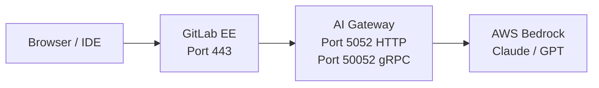



- Tier: 专业版，旗舰版
- Offering: 私有化部署



本指南将引导您使用 AWS Bedrock 部署带有自部署 AI 模型的极狐GitLab，从一台空白 EC2 实例开始，直到 Duo Agent Platform（DAP）任务流正常运行。每条命令都可直接复制粘贴。每个常见错误都有记录。

本指南使用一台 EC2 实例，同时运行极狐GitLab（Docker）和
AI 网关（Docker Compose），并以 AWS Bedrock 作为 LLM
提供商。此架构适用于概念验证和评估部署。

有关生产部署，请参阅
[参考架构](../../administration/reference_architectures/_index.md)。

<a id="prerequisites"></a>

## 先决条件

开始之前，您需要：

| 要求 | 详细信息 |
|-------------|---------|
| **AWS 账号** | 在目标区域中具有 Bedrock 访问权限（推荐 `us-east-1`）。 |
| **EC2 实例** | 最低 `t3.xlarge`（4 vCPU，16 GB 内存）。生产环境推荐 `t3.2xlarge`（8 vCPU，32 GB）。 |
| **域名** | 两条指向您 EC2 实例的 DNS 记录：`gitlab.example.com` 和 `aigw.example.com`。 |
| **极狐GitLab 许可证** | 专业版或旗舰版。经典 Duo 功能（Chat、代码建议）需要[分配 Duo 席位](../../subscriptions/subscription-add-ons.md)。使用在线许可证的 DAP（极狐GitLab 18.9 及更高版本）采用[通过极狐GitLab Credits 的用量计费](../../subscriptions/gitlab_credits.md)，无需 Duo Enterprise 席位。对于使用离线许可证的 DAP，请联系您的极狐GitLab 客户团队了解 ELA 方案。 |
| **SSH 访问** | 访问您的 EC2 实例。 |
| **安全组** | 入站开放端口 80、443 和 8443。 |

<a id="architecture-overview"></a>

## 架构概览



AI 网关作为边车容器与极狐GitLab 一起运行。
内置的 GitLab NGINX 将 HTTPS 和 gRPC 流量代理到 AI 网关。
然后 AI 网关将 LLM 请求转发到 AWS Bedrock。

DAP 任务流需要端口 8443。DAP 使用 gRPC 与
AI 网关 Duo Workflow Service（DWS）通信。GitLab NGINX
必须将端口 8443 上的 gRPC TLS 代理到 AI 网关的 gRPC 端口（50052）。

<a id="step-1-provision-aws-infrastructure"></a>

## 第 1 步：预配 AWS 基础设施

<a id="launch-an-ec2-instance"></a>

### 启动 EC2 实例

启动一台 Ubuntu 22.04 或更高版本的实例，配置如下：

- **实例类型：**`t3.xlarge`（最低）或 `t3.2xlarge`（推荐）
- **存储：**100 GB gp3
- **AMI：**Ubuntu Server 22.04 LTS 或 24.04

<a id="configure-the-security-group"></a>

### 配置安全组

开放以下入站端口：

| 端口 | 协议 | 来源 | 用途 |
|------|----------|--------|---------|
| 22 | TCP | 您的 IP | SSH |
| 80 | TCP | `0.0.0.0/0` | HTTP（Let's Encrypt 验证） |
| 443 | TCP | `0.0.0.0/0` | HTTPS（极狐GitLab 和 AI 网关代理） |
| 8443 | TCP | `0.0.0.0/0` | gRPC TLS（DAP 任务流） |

IDE 客户端（VS Code、JetBrains）会直接连接到端口 8443 以使用 DAP
任务流。如果您的用户位于 VPN 后面，可以限制来源 IP 范围。

<a id="install-docker"></a>

### 安装 Docker

通过 SSH 登录您的实例并安装 Docker：

```shell
sudo apt-get update && sudo apt-get upgrade -y

# Install Docker (official method)
curl --fail --silent --show-error --location "https://get.docker.com" | sudo bash

# Install Docker Compose plugin
sudo apt-get install -y docker-compose-plugin

# Verify
sudo docker --version
sudo docker compose version
```

<a id="set-up-dns"></a>

### 设置 DNS

创建两条指向您 EC2 公网 IP 的 A 记录：

| 记录 | 类型 | 值 |
|--------|------|-------|
| `gitlab.example.com` | A | 您的 EC2 公网 IP |
| `aigw.example.com` | A | 您的 EC2 公网 IP |

两个域名都指向同一个 IP。GitLab NGINX 根据主机名路由流量。

验证 DNS 传播：

```shell
dig gitlab.example.com +short
dig aigw.example.com +short
```

两条命令都应返回您的 EC2 公网 IP。

<a id="step-2-install-gitlab"></a>

## 第 2 步：安装极狐GitLab

<a id="create-data-directories"></a>

### 创建数据目录

```shell
sudo mkdir -p /srv/gitlab/config /srv/gitlab/logs /srv/gitlab/data
```

<a id="run-gitlab"></a>

### 运行极狐GitLab

此命令会安装并启动带有 Let's Encrypt 的极狐GitLab 企业版：

```shell
sudo docker run --detach \
  --hostname gitlab.example.com \
  --env GITLAB_OMNIBUS_CONFIG="
    external_url 'https://gitlab.example.com';
    letsencrypt['enable'] = true;
    letsencrypt['auto_renew'] = true;
    letsencrypt['contact_emails'] = ['you@example.com'];
    gitlab_rails['gitlab_shell_ssh_port'] = 2222;
  " \
  --publish 443:443 \
  --publish 80:80 \
  --publish 2222:22 \
  --publish 8443:8443 \
  --name gitlab \
  --restart always \
  --volume /srv/gitlab/config:/etc/gitlab \
  --volume /srv/gitlab/logs:/var/log/gitlab \
  --volume /srv/gitlab/data:/var/opt/gitlab \
  --shm-size 256m \
  registry.gitlab.cn/omnibus/gitlab-jh:latest
```

> [!note]
> DAP（gRPC TLS）需要 `--publish 8443:8443` 标志。如果
> 省略它，DAP 任务流会静默失败。您无法向正在运行的
> 容器添加端口。您需要重新创建它。

<a id="wait-for-gitlab-to-start"></a>

### 等待极狐GitLab 启动

极狐GitLab 首次运行时需要 3-5 分钟进行初始化：

```shell
until curl --silent --fail "https://gitlab.example.com/-/health" > /dev/null 2>&1; do
  echo "Waiting for GitLab to start..."
  sleep 10
done
echo "GitLab is up!"
```

<a id="set-the-root-password"></a>

### 设置 root 密码

```shell
sudo docker exec gitlab cat /etc/gitlab/initial_root_password
```

使用用户名 `root` 和命令输出中的密码，在 `https://gitlab.example.com` 登录。请立即更改密码。

<a id="apply-your-license"></a>

### 应用您的许可证

1. 转到**管理员 > 订阅**。
1. 上传您的极狐GitLab 许可证文件。

<a id="step-3-deploy-the-ai-gateway"></a>

## 第 3 步：部署 AI 网关

<a id="find-the-correct-image-tag"></a>

### 找到正确的镜像标签

AI 网关镜像位于 `registry.gitlab.cn/model-gateway/model-gateway-self-hosted`。
您必须使用与极狐GitLab 版本匹配的版本标签。

> [!note]
> 没有 `latest` 标签。使用 `registry.gitlab.cn/model-gateway/model-gateway-self-hosted:latest` 会
> 因找不到镜像而失败。

标签格式：`self-hosted-v{MAJOR}.{MINOR}.{PATCH}-jh`

查看可用标签：

```shell
curl --silent "https://hub.docker.com/v2/repositories/gitlab/model-gateway/tags?page_size=10&ordering=last_updated" | \
  python3 -c "import sys,json; [print(t['name'], '  ', t['last_updated'][:10]) for t in json.load(sys.stdin)['results']]"
```

<a id="generate-a-jwt-signing-key"></a>

### 生成 JWT 签名密钥

AI 网关需要一个 JWT 密钥来验证 DWS 请求：

```shell
sudo mkdir -p /srv/enterprise-sidecar
openssl genrsa -out /srv/enterprise-sidecar/duo_workflow_jwt.key 2048
```

<a id="create-the-environment-file"></a>

### 创建环境文件

创建 `/srv/enterprise-sidecar/.env`：

```shell
cat << 'EOF' | sudo tee /srv/enterprise-sidecar/.env
# AWS Bedrock credentials
AWS_ACCESS_KEY_ID=<your-aws-access-key>
AWS_SECRET_ACCESS_KEY=<your-aws-secret-key>
AWS_REGION=us-east-1

# AI Gateway: JWT signing key (for DWS authentication)
AIGW_JWT_SIGNING_KEY=<paste contents of duo_workflow_jwt.key>
EOF
```

为环境文件设置严格的权限：

```shell
sudo chmod 600 /srv/enterprise-sidecar/.env
```

要将 JWT 密钥嵌入环境文件，请将换行符替换为字面量
`\n`，使密钥位于单行：

```shell
JWT_KEY=$(sudo awk '{printf "%s\\n", $0}' /srv/enterprise-sidecar/duo_workflow_jwt.key)
sudo sed -i "s|AIGW_JWT_SIGNING_KEY=.*|AIGW_JWT_SIGNING_KEY=${JWT_KEY}|" /srv/enterprise-sidecar/.env
```

<a id="create-the-docker-compose-file"></a>

### 创建 Docker Compose 文件

创建 `/srv/enterprise-sidecar/docker-compose.yml`：

```yaml
services:
  ai-gateway:
    image: registry.gitlab.cn/model-gateway/model-gateway-self-hosted:self-hosted-v<VERSION>-jh  # Replace <VERSION> with your GitLab version (for example, 18.11.0)
    container_name: ai-gateway
    restart: unless-stopped
    environment:
      AIGW_GITLAB_URL: https://gitlab.example.com
      AIGW_GITLAB_API_URL: https://gitlab.example.com/api/v4/
      DUO_WORKFLOW_SELF_SIGNED_JWT__SIGNING_KEY: ${AIGW_JWT_SIGNING_KEY}
      AWS_ACCESS_KEY_ID: ${AWS_ACCESS_KEY_ID}
      AWS_SECRET_ACCESS_KEY: ${AWS_SECRET_ACCESS_KEY}
      AWS_REGION: ${AWS_REGION:-us-east-1}
      AIGW_LOGGING__LEVEL: INFO
      DUO_WORKFLOW_LOGGING__LEVEL: INFO
    ports:
      - "5052:5052"
      - "50052:50052"
    deploy:
      resources:
        limits:
          memory: 2048M
        reservations:
          memory: 512M
    healthcheck:
      test: ["CMD", "curl", "--silent", "--fail", "http://localhost:5052/monitoring/healthz"]
      interval: 30s
      timeout: 10s
      retries: 3
      start_period: 30s
```

<a id="start-the-ai-gateway"></a>

### 启动 AI 网关

```shell
cd /srv/enterprise-sidecar
sudo docker compose up -d
```

<a id="verify-ai-gateway-health"></a>

### 验证 AI 网关健康状况

```shell
# Check container is running
sudo docker ps | grep ai-gateway

# Check HTTP health endpoint (empty JSON means healthy)
curl --silent "http://localhost:5052/monitoring/healthz"

# Check logs for errors
sudo docker logs ai-gateway --tail 20
```

<a id="step-4-configure-tls-for-the-ai-gateway"></a>

## 第 4 步：为 AI 网关配置 TLS

AI 网关需要 HTTPS（用于 Chat 和代码建议）和 gRPC TLS
（用于 DAP 任务流）。使用内置的 GitLab NGINX 作为反向代理，
共享其 Let's Encrypt 证书。

<a id="add-the-ai-gateway-subdomain-to-lets-encrypt"></a>

### 将 AI 网关子域名添加到 Let's Encrypt

编辑极狐GitLab 配置：

```shell
sudo docker exec -it gitlab editor /etc/gitlab/gitlab.rb
```

找到 `letsencrypt` 部分并添加 `alt_names`：

```ruby
letsencrypt['alt_names'] = ['aigw.example.com']
```

如果您已有其他 `alt_names`（例如镜像仓库子域名），请将
`aigw.example.com` 添加到现有数组：

```ruby
letsencrypt['alt_names'] = ['registry.example.com', 'aigw.example.com']
```

续订证书以包含新的 SAN：

```shell
sudo docker exec gitlab gitlab-ctl renew-le-certs
```

验证证书包含 AI 网关子域名：

```shell
echo | openssl s_client -connect gitlab.example.com:443 2>/dev/null | \
  openssl x509 -noout -ext subjectAltName
```

您应该会在输出中看到 `DNS:aigw.example.com`。

<a id="create-the-nginx-proxy-configuration"></a>

### 创建 NGINX 代理配置

在主机上创建代理配置文件：

```shell
cat << 'NGINX' | sudo tee /srv/gitlab/config/nginx/aigw-proxy.conf
# AI Gateway reverse proxy: HTTPS for HTTP API, gRPC TLS for DAP

# HTTP API: Duo Chat, Code Suggestions
server {
    listen 443 ssl;
    server_name aigw.example.com;

    ssl_certificate /etc/gitlab/ssl/gitlab.example.com.crt;
    ssl_certificate_key /etc/gitlab/ssl/gitlab.example.com.key;
    ssl_protocols TLSv1.2 TLSv1.3;
    ssl_ciphers HIGH:!aNULL:!MD5;

    location / {
        proxy_pass http://172.17.0.1:5052;
        proxy_set_header Host $host;
        proxy_set_header X-Real-IP $remote_addr;
        proxy_set_header X-Forwarded-For $proxy_add_x_forwarded_for;
        proxy_set_header X-Forwarded-Proto https;
        proxy_read_timeout 600s;
        proxy_send_timeout 600s;
    }

    location /monitoring/healthz {
        proxy_pass http://172.17.0.1:5052/monitoring/healthz;
        access_log off;
    }
}

# gRPC TLS: DAP / Duo Agent Platform flows
server {
    listen 8443 ssl http2;
    server_name aigw.example.com;

    ssl_certificate /etc/gitlab/ssl/gitlab.example.com.crt;
    ssl_certificate_key /etc/gitlab/ssl/gitlab.example.com.key;
    ssl_protocols TLSv1.2 TLSv1.3;
    ssl_ciphers HIGH:!aNULL:!MD5;

    location / {
        grpc_pass grpc://172.17.0.1:50052;
        grpc_read_timeout 600s;
        grpc_send_timeout 600s;
    }
}
NGINX
```

地址 `172.17.0.1` 是 Docker 的默认桥接网关 IP。从极狐GitLab 容器内部，此 IP 可访问主机以及 AI 网关容器发布的端口。

<a id="include-the-configuration-in-the-gitlab-nginx"></a>

### 在 GitLab NGINX 中包含该配置

将配置文件复制到容器内的 NGINX 运行时目录：

```shell
sudo docker exec gitlab mkdir -p /var/opt/gitlab/nginx/conf
sudo docker cp /srv/gitlab/config/nginx/aigw-proxy.conf \
  gitlab:/var/opt/gitlab/nginx/conf/aigw-proxy.conf
```

> [!note]
> 不要将文件放在 `/etc/gitlab/nginx/` 中。只有 `gitlab.rb`中
> `custom_nginx_config` 引用的文件才会被加载。运行时目录
> 是 `/var/opt/gitlab/nginx/conf/`。

将 include 指令添加到 `gitlab.rb`：

```shell
sudo docker exec -it gitlab editor /etc/gitlab/gitlab.rb
```

找到或添加 `nginx['custom_nginx_config']` 行：

```ruby
nginx['custom_nginx_config'] = "include /var/opt/gitlab/nginx/conf/aigw-proxy.conf;"
```

如果您已有自定义 NGINX 配置（例如 KeyCloak
代理），请用分号将它们串联起来：

```ruby
nginx['custom_nginx_config'] = "include /var/opt/gitlab/nginx/conf/keycloak-proxy.conf; include /var/opt/gitlab/nginx/conf/aigw-proxy.conf;"
```

<a id="reconfigure-gitlab"></a>

### 重新配置极狐GitLab

```shell
sudo docker exec gitlab gitlab-ctl reconfigure
```

<a id="verify-tls"></a>

### 验证 TLS

```shell
# HTTPS for AI Gateway HTTP API
curl --silent "https://aigw.example.com/monitoring/healthz"
# Expected: {}

# gRPC TLS for DAP
openssl s_client -connect aigw.example.com:8443 < /dev/null 2>/dev/null | \
  grep "Verify return code"
# Expected: Verify return code: 0 (ok)
```

<a id="step-5-connect-aws-bedrock"></a>

## 第 5 步：连接 AWS Bedrock

<a id="create-an-iam-user-for-bedrock"></a>

### 为 Bedrock 创建 IAM 用户

在 AWS 控制台中，转到 **IAM > 用户 > 创建用户**：

- **名称：**`gitlab-bedrock`（或类似名称）
- **权限：**附加 `AmazonBedrockFullAccess` 托管策略

创建访问密钥（使用场景：“Application running outside AWS”）。
保存 **访问密钥 ID** 和 **秘密访问密钥**。

或者，如果您的 EC2 实例具有带 Bedrock 权限的 IAM 角色，则可以跳过访问密钥。AI 网关会自动使用实例配置文件。

<a id="activate-anthropic-models-on-bedrock"></a>

### 在 Bedrock 上激活 Anthropic models

此步骤是必需的，且最容易被忽视：

1. 转到 **AWS 控制台 > Amazon Bedrock > 提供商 > Anthropic**。
1. 填写 **提交用例详情** 表单。
1. 等待约 15 分钟以完成激活。

> [!note]
> 如果没有此表单，所有对 Anthropic models 的 Bedrock API 调用都会返回：
> `"Model use case details have not been submitted for this account."`
> 旧的“Model access”页面已停用。模型会在
> 首次调用时自动启用，但 Anthropic 除外，它需要用例表单。

<a id="find-your-models-inference-profile-id"></a>

### 查找模型的推理配置文件 ID

较新的 Claude 模型（Claude 4.5 Sonnet 及更高版本）需要**推理
配置文件 ID**，而不是直接的模型 ID。

```shell
aws bedrock list-inference-profiles --region us-east-1 --output json | \
  python3 -c "
import sys, json
profiles = json.load(sys.stdin)['inferenceProfileSummaries']
for p in profiles:
    if 'claude' in p['inferenceProfileId'].lower():
        print(p['inferenceProfileId'])
"
```

> [!note]
> 使用 `us.` 前缀（例如 `us.anthropic.claude-sonnet-4-6`），
> 而不是基础模型 ID（`anthropic.claude-sonnet-4-6`）。
>
> | 模型标识符 | 结果 |
> |---|---|
> | `bedrock/anthropic.claude-sonnet-4-6` | **400 Bad Request**：“on-demand throughput isn't supported” |
> | `bedrock/us.anthropic.claude-sonnet-4-6` | 可用 |
>
> `us.` 前缀路由到仅限美国的区域。`global.` 前缀
> 在所有已启用的区域中路由。

<a id="use-an-application-inference-profile-arn"></a>

### 使用应用程序推理配置文件 ARN

要按团队或项目跟踪成本分配或支出，请使用
[应用程序推理配置文件](https://docs.aws.amazon.com/bedrock/latest/userguide/inference-profiles-create.html)
ARN 作为模型标识符，而不是推理配置文件 ID。使用以下格式：

```plaintext
bedrock/converse/arn:aws:bedrock:<region>:<account-id>:application-inference-profile/<id>
```

`converse/` 前缀会通过 Amazon Bedrock Converse API 路由请求，
这是基于 ARN 的标识符所必需的。

<a id="restart-the-ai-gateway-with-credentials"></a>

### 使用凭证重启 AI 网关

如果尚未添加，请将您的 AWS 凭证添加到
`/srv/enterprise-sidecar/.env`，然后重启：

```shell
cd /srv/enterprise-sidecar
sudo docker compose down ai-gateway
sudo docker compose up -d ai-gateway
```

<a id="step-6-configure-gitlab-admin-settings"></a>

## 第 6 步：配置极狐GitLab 管理员设置

<a id="set-ai-gateway-urls"></a>

### 设置 AI 网关 URL

转到**管理员 > 极狐GitLab Duo**，然后选择**更改配置**。

| 设置 | 值 |
|---------|-------|
| 连接方法 | 通过极狐GitLab 私有化部署的间接连接 |
| 本地 AI 网关 URL | `https://aigw.example.com` |
| 本地 DAP 服务 URL | `aigw.example.com:8443` |
| AI 网关请求超时 | `300`（秒） |

> [!note]
> 默认的 60 秒超时对 Bedrock 来说太短。单个
> DAP 任务流可能需要 5-10 分钟。请将此值设置为至少 300。

选择**保存更改**。

<a id="run-the-health-check"></a>

### 运行健康检查

在同一页面上，选择**运行健康检查**。您应该会看到四项绿色检查：

| 检查 | 预期 |
|-------|----------|
| AI 网关 | 已连接 |
| 网络 | 可访问 |
| 代码建议 | 可用 |
| DAP | 可用 |

<a id="add-a-self-hosted-model"></a>

### 添加自部署模型

转到**管理员 > 极狐GitLab Duo > 为极狐GitLab Duo 配置模型**。

选择**添加自部署模型**并填写：

| 字段 | 值 |
|-------|-------|
| 部署名称 | `Bedrock Claude Sonnet 4.6`（或任何描述性名称） |
| 平台 | `Amazon Bedrock` |
| 模型系列 | `Claude` |
| 模型标识符 | `bedrock/us.anthropic.claude-sonnet-4-6` |

> [!note]
> 模型标识符必须以 `bedrock/` 开头。

选择**测试连接**。您应该会看到：
*“已成功连接到自部署模型。”*

如果您看到“400 Bad Request”，说明您使用了错误的模型标识符。请使用推理配置文件 ID（`us.anthropic.claude-sonnet-4-6`），而不是直接的模型 ID。

选择**添加模型**。

<a id="assign-the-model-to-features"></a>

### 将模型分配给功能

在同一页面上，选择 **AI 原生功能**标签页。

对于您想要通过 Bedrock 路由的每项功能，请从下拉列表中选择您的自部署模型：

| 功能 | 推荐分配 |
|---------|----------------------|
| **极狐GitLab Duo Agent Platform > Agents & flows** | Bedrock Claude Sonnet 4.6 |
| **极狐GitLab Duo Agent Platform > Agentic Chat** | Bedrock Claude Sonnet 4.6 |
| 代码建议 | 极狐GitLab 托管（默认）或 Bedrock |
| Chat | 极狐GitLab 托管（默认）或 Bedrock |
| 代码评审 | 极狐GitLab 托管（默认）或 Bedrock |

开始时仅将 DAP 功能分配给 Bedrock，让 Chat 和代码建议保留在极狐GitLab 托管的默认值上。这样您可以在不危及日常开发者体验的情况下验证 Bedrock 连接。确认一切正常后，再切换更多功能。

<a id="step-7-register-a-runner-for-dap-flows"></a>

## 第 7 步：为 DAP 任务流注册 runner

DAP 任务流会创建 CI/CD 流水线。如果没有注册的 runner，DAP 任务流会无限期停留在待处理状态。

<a id="install-and-register-a-runner"></a>

### 安装并注册 runner

在您的 EC2 实例（或其他机器）上，安装极狐GitLab Runner：

```shell
curl --location "https://packages.gitlab.com/install/repositories/runner/gitlab-runner/script.deb.sh" | sudo bash
sudo apt-get install -y gitlab-runner
```

将 runner 注册到您的极狐GitLab 实例。转到
**管理员 > CI/CD > Runner** 并选择**新建实例 runner** 以获取
注册令牌，然后运行：

```shell
sudo gitlab-runner register \
  --url "https://gitlab.example.com" \
  --token "<REGISTRATION_TOKEN>" \
  --executor docker \
  --docker-image "ruby:3.2" \
  --tag-list "docker" \
  --description "Docker runner for DAP"
```

有关更多详细信息，请参阅
[安装极狐GitLab Runner](https://gitlab.cn/docs/runner/install/) 和
[创建并注册 runner](../../tutorials/create_register_first_runner/_index.md)。

> [!note]
> DAP 任务流使用 Docker-in-Docker 工作流。runner 必须使用
> `docker` executor。

<a id="step-8-enable-duo-features-on-groups-and-projects"></a>

## 第 8 步：在群组和项目上启用 Duo 功能

管理员级配置（第 6 步）使 Duo 功能在实例范围内可用，但您还必须在群组和项目级别启用它们。

<a id="enable-duo-on-a-group"></a>

### 在群组上启用 Duo

1. 转到您群组的**设置 > 通用**。
1. 展开**权限和群组功能**。
1. 在**极狐GitLab Duo 功能**下，选择**启用极狐GitLab Duo 功能**。
1. 要使用 DAP，还需选择**启用实验和测试版功能**和
   **允许任务流执行**（勾选您想要启用的任务流类型）。
1. 选择**保存更改**。

有关更多详细信息，请参阅
[开启或关闭极狐GitLab Duo](../../user/gitlab_duo/turn_on_off.md)。

<a id="enable-duo-on-a-project"></a>

### 在项目上启用 Duo

1. 转到您项目的**设置 > 通用**。
1. 展开**可见性、项目功能、权限**。
1. 在**极狐GitLab Duo** 下，开启**使用极狐GitLab Duo 功能**。
1. 选择**保存更改**。

有关更多详细信息，请参阅
[开启或关闭极狐GitLab Duo](../../user/gitlab_duo/turn_on_off.md)。

<a id="step-9-verify-end-to-end"></a>

## 第 9 步：端到端验证

<a id="health-checks"></a>

### 健康检查

```shell
# AI Gateway HTTP health
curl --silent "https://aigw.example.com/monitoring/healthz"
# Expected: {}

# gRPC TLS connectivity
openssl s_client -connect aigw.example.com:8443 < /dev/null 2>/dev/null | \
  grep "Verify return code"
# Expected: Verify return code: 0 (ok)
```

在浏览器中，转到**管理员 > 极狐GitLab Duo**，选择**更改配置**，然后选择**运行健康检查**。四项检查都应显示为绿色。

<a id="run-the-rake-verification-task"></a>

### 运行 Rake 验证任务

```shell
sudo docker exec gitlab gitlab-rake "gitlab:duo:verify_self_hosted_setup[your_username]"
```

这会验证完整链路：许可证、功能标志、AI 网关连接和模型配置。

> [!note]
> Rake 任务的模型连接测试使用占位符 URL
>（`bedrockselfhostedmodel.com`），即使
> 您的部署运行正常，也可能报告失败。所有其他检查（许可证、
> AI 网关、功能分配）都是有效的。

<a id="test-duo-chat"></a>

### 测试 Duo Chat

> [!note]
> 在某些 AI 网关版本上，使用 Bedrock 的 Duo Chat 可能会返回 400 错误
>（`"This model does not support assistant message prefill"`）。
> 这仅影响 Duo Chat。DAP 任务流使用
> 不同的代码路径，可正常工作。如果您看到此错误，请将
> Chat 保留在极狐GitLab 托管的模型上，仅对 DAP 功能使用 Bedrock。

1. 在您的极狐GitLab 实例中打开任意项目。
1. 选择 **Duo Chat** 图标。
1. 提出一个简单问题，例如“什么是合并请求？”
1. 验证您收到了回复。

查看 AI 网关日志中的 Bedrock 活动：

```shell
sudo docker logs -f ai-gateway 2>&1 | grep -i "litellm\|bedrock\|chat"
```

<a id="test-a-dap-flow"></a>

### 测试 DAP 任务流

这才是真正的测试。在
Bedrock 上端到端运行 Duo Agent Platform 任务流：

1. 创建或打开一个包含一些代码的项目。
1. 创建一个议题（例如“为登录表单添加输入验证”）。
1. 在议题页面上，选择 **Duo > 启动工作流**。
1. 等待。使用 Bedrock 的 DAP 任务流通常需要 3-10 分钟。
1. 检查流水线：**构建 > 流水线**。查找 `source: duo_workflow`。

在任务流期间查看 AI 网关日志：

```shell
sudo docker logs -f ai-gateway 2>&1 | grep -i "workflow\|bedrock\|litellm"
```

DAP 任务流期间的预期日志输出：

```plaintext
LiteLLM completion() model= us.anthropic.claude-sonnet-4-6; provider = bedrock
```

> [!note]
> 如果任务流在约 10 秒内完成，说明出了问题。健康
> 的任务流需要数分钟，而不是数秒。请检查 AI 网关日志中的错误。

<a id="step-10-monitoring-optional"></a>

## 第 10 步：监控（可选）

<a id="ai-gateway-prometheus-metrics"></a>

### AI 网关 Prometheus 指标

AI 网关在两个端口上公开指标：

| 端口 | 端点 | 内容 |
|------|----------|---------|
| 8082 | `/metrics` | AI 网关（FastAPI）指标：请求计数、延迟 |
| 8083 | `/metrics` | DWS 指标：gRPC 调用计数 |

要将这些指标公开以供 Prometheus 抓取，请将它们添加到您的
`docker-compose.yml` 端口：

```yaml
ports:
  - "5052:5052"
  - "50052:50052"
  - "8082:8082"
  - "8083:8083"
```

并添加相应的环境变量：

```yaml
environment:
  AIGW_FASTAPI__METRICS_HOST: "0.0.0.0"
  AIGW_FASTAPI__METRICS_PORT: "8082"
  PROMETHEUS_METRICS__ADDR: "0.0.0.0"
  PROMETHEUS_METRICS__PORT: "8083"
```

<a id="troubleshooting"></a>

## 故障排除

<a id="ai-gateway-does-not-start"></a>

### AI 网关无法启动

如果容器立即退出或健康检查始终无法通过：

```shell
sudo docker logs ai-gateway --tail 50
```

| 错误 | 修复方法 |
|-------|-----|
| `Image not found` | 您使用了 `latest` 标签。请使用明确的版本，例如 `self-hosted-v18.11.0-jh`。 |
| `AIGW_GITLAB_URL must be set` | 将环境变量添加到 `docker-compose.yml`。 |
| 健康检查时连接被拒绝 | 等待 30 秒以完成启动。如果持续出现，请检查端口绑定。 |

<a id="health-check-fails-in-admin-ui"></a>

### 管理 UI 中健康检查失败

| 检查 | 常见原因 | 修复方法 |
|-------|-------------|-----|
| AI 网关：未连接 | 管理员设置中的 URL 错误 | 使用 `https://aigw.example.com`（不是 `http://`，也不是端口 5052）。 |
| 网络：不可访问 | DNS 在容器内无法解析 | 使用 `docker exec gitlab dig aigw.example.com` 验证。 |
| DAP：不可用 | 端口 8443 未发布 | 使用 `--publish 8443:8443` 重新创建极狐GitLab 容器。 |

<a id="400-bad-request-when-testing-model-connection"></a>

### 测试模型连接时出现 400 Bad Request

您使用的是直接的模型 ID，而不是推理配置文件 ID。

将 `bedrock/anthropic.claude-sonnet-4-6` 更改为
`bedrock/us.anthropic.claude-sonnet-4-6`（注意 `us.` 前缀）。

<a id="model-use-case-details-have-not-been-submitted"></a>

### “Model use case details have not been submitted”

1. 转到 **AWS 控制台 > Amazon Bedrock > 提供商 > Anthropic**。
1. 提交用例详情表单。
1. 等待约 15 分钟以完成激活。
1. 重试。

<a id="tls-errors"></a>

### TLS 错误

如果 `curl "https://aigw.example.com/monitoring/healthz"` 返回 SSL 错误：

1. 验证您已将 `aigw.example.com` 添加到 `gitlab.rb`中的 `letsencrypt['alt_names']`。
1. 验证您已运行 `gitlab-ctl renew-le-certs`。
1. 验证 NGINX 配置使用了正确的证书路径。
1. 验证 NGINX 配置文件位于 `/var/opt/gitlab/nginx/conf/`（不是 `/etc/gitlab/nginx/`）。
1. 验证 `gitlab.rb`中的 `custom_nginx_config` 引用了该文件。

<a id="dap-flows-do-not-start"></a>

### DAP 任务流不启动

如果您选择了**启动工作流**但没有出现流水线：

1. 验证 runner 已注册并在线（**管理员 > CI/CD > Runner**）。请参阅[第 7 步](#step-7-register-a-runner-for-dap-flows)。
1. 验证已为群组和项目启用 Duo。请参阅[第 8 步](#step-8-enable-duo-features-on-groups-and-projects)。
1. 验证用户拥有极狐GitLab Credits 或 Duo 席位（**管理员 > 极狐GitLab Duo > 席位分配**）。
1. 验证端口 8443 已在极狐GitLab 容器上发布。

<a id="nginx-configuration-not-taking-effect"></a>

### NGINX 配置未生效

在编辑 `gitlab.rb` 并运行重新配置后：

1. 验证文件存在于运行时目录中：

   ```shell
   sudo docker exec gitlab ls -la /var/opt/gitlab/nginx/conf/
   ```

1. 如果缺失，请再次复制：

   ```shell
   sudo docker cp /srv/gitlab/config/nginx/aigw-proxy.conf \
     gitlab:/var/opt/gitlab/nginx/conf/aigw-proxy.conf
   ```

1. 重新配置并重启 NGINX：

   ```shell
   sudo docker exec gitlab gitlab-ctl reconfigure
   sudo docker exec gitlab gitlab-ctl restart nginx
   ```
