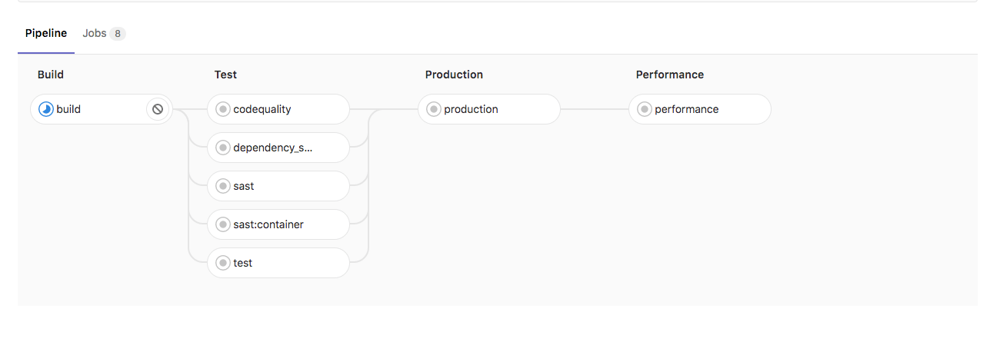
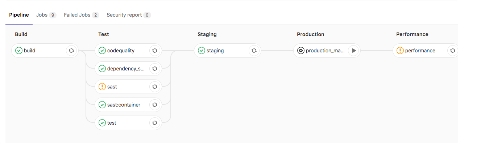
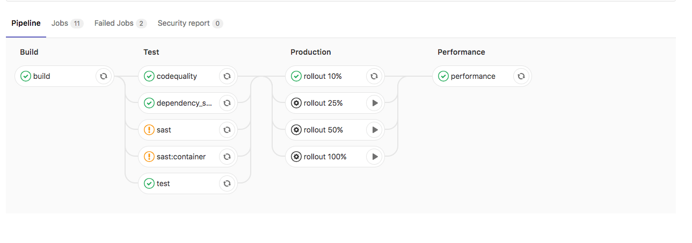
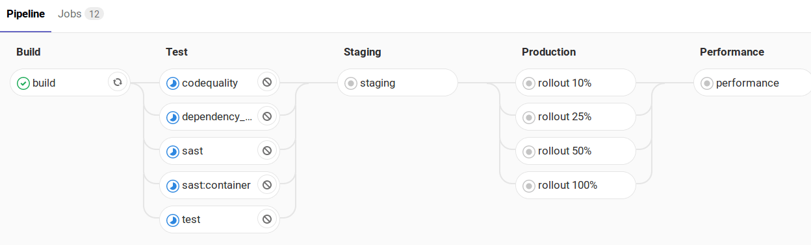

使用 CI/CD 变量来设置 Auto DevOps 域名、提供自定义 Helm chart，或扩缩您的应用程序。

<a id="build-and-deployment-variables"></a>

## 构建和部署变量

使用这些变量来自定义和部署您的构建。

| **CI/CD 变量**                      | **描述** |
|-----------------------------------------|-----------------|
| `ADDITIONAL_HOSTS`                      | 以逗号分隔列表形式指定的完全限定域名，这些域名会被添加到 Ingress 主机中。 |
| `<ENVIRONMENT>_ADDITIONAL_HOSTS`        | 针对特定环境，以逗号分隔列表形式指定的完全限定域名，这些域名会被添加到 Ingress 主机中。此变量优先于 `ADDITIONAL_HOSTS`。 |
| `AUTO_BUILD_IMAGE_VERSION`              | 自定义用于 `build` 作业的镜像版本。请参阅[版本列表](https://gitlab.com/gitlab-org/cluster-integration/auto-build-image/-/releases)。 |
| `AUTO_DEPLOY_IMAGE_VERSION`             | 自定义用于 Kubernetes 部署作业的镜像版本。请参阅[版本列表](https://gitlab.com/gitlab-org/cluster-integration/auto-deploy-image/-/releases)。 |
| `AUTO_DEVOPS_ATOMIC_RELEASE`            | 默认情况下，Auto DevOps 对 Helm 部署使用 [`--atomic`](https://v2.helm.sh/docs/helm/#options-43)。将此变量设置为 `false` 可禁用 `--atomic` |
| `AUTO_DEVOPS_BUILD_IMAGE_CNB_BUILDER`   | 使用 Cloud Native Buildpacks 构建时使用的构建器。默认构建器为 `heroku/buildpacks:22`。[更多详情](stages.md#auto-build-using-cloud-native-buildpacks)。 |
| `AUTO_DEVOPS_BUILD_IMAGE_EXTRA_ARGS`    | 传递给 `docker build` 命令的额外参数。使用引号不会阻止单词拆分。[更多详情](customize.md#pass-arguments-to-docker-build)。 |
| `AUTO_DEVOPS_BUILD_IMAGE_FORWARDED_CI_VARIABLES` | 要转发到构建环境（buildpack 构建器或 `docker build`）的 [CI/CD 变量名称的逗号分隔列表](customize.md#forward-cicd-variables-to-the-build-environment)。 |
| `AUTO_DEVOPS_BUILD_IMAGE_CNB_PORT`      | 生成的 Docker 镜像所公开的端口。设置为 `false` 可阻止公开任何端口。默认为 `5000`。 |
| `AUTO_DEVOPS_BUILD_IMAGE_CONTEXT`       | 用于设置 Dockerfile 和 Cloud Native Buildpacks 的构建上下文目录。默认为根目录。 |
| `AUTO_DEVOPS_CHART`                     | 用于部署您的应用程序的 Helm Chart。默认为[由 GitLab 提供的](https://gitlab.com/gitlab-org/cluster-integration/auto-deploy-image/-/tree/master/assets/auto-deploy-app) Helm Chart。 |
| `AUTO_DEVOPS_CHART_REPOSITORY`          | 用于搜索 chart 的 Helm Chart 仓库。默认为 `https://charts.gitlab.io`。 |
| `AUTO_DEVOPS_CHART_REPOSITORY_NAME`     | 用于设置 Helm 仓库的名称。默认为 `gitlab`。 |
| `AUTO_DEVOPS_CHART_REPOSITORY_USERNAME` | 用于设置连接到 Helm 仓库的用户名。默认为无凭据。还需设置 `AUTO_DEVOPS_CHART_REPOSITORY_PASSWORD`。 |
| `AUTO_DEVOPS_CHART_REPOSITORY_PASSWORD` | 用于设置连接到 Helm 仓库的密码。默认为无凭据。还需设置 `AUTO_DEVOPS_CHART_REPOSITORY_USERNAME`。 |
| `AUTO_DEVOPS_CHART_REPOSITORY_PASS_CREDENTIALS` | 设置为非空值可启用以下行为：当 chart 产物与仓库位于不同主机时，将 Helm 仓库凭据转发到 chart 服务器。 |
| `AUTO_DEVOPS_CHART_REPOSITORY_INSECURE` | 设置为非空值可向 Helm 命令添加 `--insecure-skip-tls-verify` 参数。默认情况下，Helm 使用 TLS 验证。 |
| `AUTO_DEVOPS_CHART_CUSTOM_ONLY`         | 设置为非空值可仅使用自定义 chart。默认情况下，会从 GitLab 下载最新的 chart。 |
| `AUTO_DEVOPS_CHART_VERSION`             | 设置部署 chart 的版本。默认为最新可用版本。 |
| `AUTO_DEVOPS_COMMON_NAME`               | 设置为有效域名可自定义用于 TLS 证书的通用名称。默认为 `le-$CI_PROJECT_ID.$KUBE_INGRESS_BASE_DOMAIN`。设置为 `false` 可不在 Ingress 上设置此备用主机。 |
| `AUTO_DEVOPS_DEPLOY_DEBUG`              | 如果存在此变量，Helm 会输出调试日志。 |
| `AUTO_DEVOPS_ALLOW_TO_FORCE_DEPLOY_V<N>` | 从 [auto-deploy-image](https://gitlab.com/gitlab-org/cluster-integration/auto-deploy-image) v1.0.0 起，如果存在此变量，则会强制部署新主版本的 chart。更多信息，请参阅[忽略警告并继续部署](upgrading_auto_deploy_dependencies.md#ignore-warnings-and-continue-deploying)。 |
| `BUILDPACK_URL`                         | 完整的 Buildpack URL。[必须指向 Pack 支持的 URL](customize.md#custom-buildpacks)。 |
| `CANARY_ENABLED`                        | 用于定义[金丝雀环境的部署策略](#deploy-policy-for-canary-environments)。 |
| `BUILDPACK_VOLUMES`                     | 指定一个或多个[要挂载的 Buildpack 卷](stages.md#mount-volumes-into-the-build-container)。使用竖线 `\|` 作为列表分隔符。 |
| `CANARY_PRODUCTION_REPLICAS`            | 为生产环境中的[金丝雀部署](../../user/project/canary_deployments.md)部署的金丝雀副本数量。优先于 `CANARY_REPLICAS`。默认为 1。 |
| `CANARY_REPLICAS`                       | 为[金丝雀部署](../../user/project/canary_deployments.md)部署的金丝雀副本数量。默认为 1。 |
| `CI_APPLICATION_REPOSITORY`             | 正在构建或部署的容器镜像的仓库，即 `$CI_APPLICATION_REPOSITORY:$CI_APPLICATION_TAG`。更多详情，请阅读[自定义容器镜像](customize.md#custom-container-image)。 |
| `CI_APPLICATION_TAG`                    | 正在构建或部署的容器镜像的标签，即 `$CI_APPLICATION_REPOSITORY:$CI_APPLICATION_TAG`。更多详情，请阅读[自定义容器镜像](customize.md#custom-container-image)。 |
| `DAST_AUTO_DEPLOY_IMAGE_VERSION`        | 自定义用于默认分支上 DAST 部署的镜像版本。通常应与 `AUTO_DEPLOY_IMAGE_VERSION` 相同。请参阅[版本列表](https://gitlab.com/gitlab-org/cluster-integration/auto-deploy-image/-/releases)。 |
| `DOCKERFILE_PATH`                       | 允许覆盖[构建阶段的默认 Dockerfile 路径](customize.md#custom-dockerfiles) |
| `HELM_RELEASE_NAME`                     | 允许覆盖 `helm` 发布名称。当将多个项目部署到单个命名空间时，可用于分配唯一的发布名称。 |
| `HELM_UPGRADE_VALUES_FILE`              | 允许覆盖 `helm upgrade` values 文件。默认为 `.gitlab/auto-deploy-values.yaml`。 |
| `HELM_UPGRADE_EXTRA_ARGS`               | 允许在部署应用程序时向 `helm upgrade` 命令添加额外选项。使用引号不会阻止单词拆分。 |
| `INCREMENTAL_ROLLOUT_MODE`              | 如果存在，可用于为生产环境启用应用程序的[增量发布](#incremental-rollout-to-production)。设置为 `manual` 表示手动部署作业，或设置为 `timed` 表示自动发布部署，每次延迟 5 分钟。 |
| `K8S_SECRET_*`                          | 任何以 [`K8S_SECRET_`](#configure-application-secret-variables) 为前缀的变量，都会由 Auto DevOps 作为环境变量提供给已部署的应用程序。 |
| `KUBE_CONTEXT`                          | 可用于从 `KUBECONFIG`中选择要使用的上下文。当 `KUBE_CONTEXT` 为空时，将使用 `KUBECONFIG`中的默认上下文（如果有）。[与极狐GitLab Kubernetes Agent 一起使用时](../../user/clusters/agent/ci_cd_workflow.md)，必须选择一个上下文。 |
| `KUBE_INGRESS_BASE_DOMAIN`              | 可用于为每个集群设置域名。更多信息，请参阅[集群域名](../../user/project/clusters/gitlab_managed_clusters.md#base-domain)。 |
| `KUBE_NAMESPACE`                        | 用于部署的命名空间。使用基于证书的集群时，[不应直接覆盖此值](../../user/project/clusters/deploy_to_cluster.md#custom-namespace)。 |
| `KUBECONFIG`                            | 用于部署的 kubeconfig。用户提供的值优先于极狐GitLab 提供的值。 |
| `PRODUCTION_REPLICAS`                   | 在生产环境中部署的副本数量。优先于 `REPLICAS`，默认为 1。要实现零停机升级，请设置为 2 或更大。 |
| `REPLICAS`                              | 要部署的副本数量。默认为 1。请更改此变量，而不是[修改](customize.md#customize-helm-chart-values) `replicaCount`。 |
| `ROLLOUT_RESOURCE_TYPE`                 | 允许在使用自定义 Helm chart 时指定要部署的资源类型。默认值为 `deployment`。 |
| `ROLLOUT_STATUS_DISABLED`               | 用于禁用发布状态检查，因为它不支持所有资源类型，例如 `cronjob`。 |
| `STAGING_ENABLED`                       | 用于定义[暂存和生产环境的部署策略](#deploy-policy-for-staging-and-production-environments)。 |
| `TRACE`                                 | 设置为任意值可使 Helm 命令产生详细输出。您可以使用此设置来帮助诊断 Auto DevOps 部署问题。 |

<a id="database-variables"></a>

## 数据库变量

> [!warning]
> `POSTGRES_ENABLED` 不再默认设置。

使用这些变量将 CI/CD 与 PostgreSQL 数据库集成。

| **CI/CD 变量**                            | **描述**                    |
|-----------------------------------------|------------------------------------|
| `DB_INITIALIZE`                         | 用于指定初始化应用程序 PostgreSQL 数据库时要运行的命令。在应用程序 pod 内运行。 |
| `DB_MIGRATE`                            | 用于指定迁移应用程序 PostgreSQL 数据库时要运行的命令。在应用程序 pod 内运行。 |
| `POSTGRES_ENABLED`                      | 是否启用 PostgreSQL。设置为 `true` 可启用 PostgreSQL 的自动部署。 |
| `POSTGRES_USER`                         | PostgreSQL 用户。默认为 `user`。设置它可使用自定义用户名。 |
| `POSTGRES_PASSWORD`                     | PostgreSQL 密码。默认为 `testing-password`。设置它可使用自定义密码。 |
| `POSTGRES_DB`                           | PostgreSQL 数据库名称。默认为 [`$CI_ENVIRONMENT_SLUG`](../../ci/variables/_index.md#predefined-cicd-variables)的值。设置它可使用自定义数据库名称。 |
| `POSTGRES_VERSION`                      | 要使用的 [`postgres` Docker 镜像](https://hub.docker.com/_/postgres)的标签。测试和部署默认为 `9.6.16`。如果 `AUTO_DEVOPS_POSTGRES_CHANNEL` 设置为 `1`，部署将使用默认版本 `9.6.2`。 |
| `POSTGRES_HELM_UPGRADE_VALUES_FILE`     | 使用 [auto-deploy-image v2](upgrading_auto_deploy_dependencies.md) 时，此变量允许覆盖 PostgreSQL 的 `helm upgrade` values 文件。默认为 `.gitlab/auto-deploy-postgres-values.yaml`。 |
| `POSTGRES_HELM_UPGRADE_EXTRA_ARGS`      | 使用 [auto-deploy-image v2](upgrading_auto_deploy_dependencies.md) 时，此变量允许在部署应用程序时向 `helm upgrade` 命令添加额外的 PostgreSQL 选项。使用引号不会阻止单词拆分。 |
| `POSTGRES_CHART_REPOSITORY`             | 用于搜索 PostgreSQL chart 的 Helm Chart 仓库。默认为 `https://raw.githubusercontent.com/bitnami/charts/eb5f9a9513d987b519f0ecd732e7031241c50328/bitnami`。 |
| `POSTGRES_CHART_VERSION`                | 用于 PostgreSQL chart 的 Helm Chart 版本。默认为 `8.2.1`。 |

<a id="job-skipping-variables"></a>

## 跳过作业的变量

 使用这些变量可跳过特定类型的 CI/CD 作业。跳过时，不会创建或运行这些 CI/CD 作业。

| **作业名称**                           | **CI/CD 变量**              | **极狐GitLab 版本**    | **描述** |
|----------------------------------------|---------------------------------|-----------------------|-----------------|
| `.fuzz_base`                           | `COVFUZZ_DISABLED`              |                       | [阅读更多](../../user/application_security/coverage_fuzzing/_index.md)内容，了解 `.fuzz_base` 如何为您自己的作业提供能力。如果值为 `"true"`，则不会创建该作业。 |
| `apifuzzer_fuzz`                       | `API_FUZZING_DISABLED`          |                       | 如果值为 `"true"`，则不会创建该作业。 |
| `build`                                | `BUILD_DISABLED`                |                       | 如果存在该变量，则不会创建该作业。 |
| `build_artifact`                       | `BUILD_DISABLED`                |                       | 如果存在该变量，则不会创建该作业。 |
| `brakeman-sast`                        | `SAST_DISABLED`                 |                       | 如果值为 `"true"`，则不会创建该作业。 |
| `canary`                               | `CANARY_ENABLED`                |                       | 如果存在该变量，则会创建此手动作业。 |
| `code_intelligence`                    | `CODE_INTELLIGENCE_DISABLED`    |                       | 如果存在该变量，则不会创建该作业。 |
| `code_quality`                         | `CODE_QUALITY_DISABLED`         |                       | 如果值为 `"true"`，则不会创建该作业。 |
| `container_scanning`                   | `CONTAINER_SCANNING_DISABLED`   |                       | 如果值为 `"true"`，则不会创建该作业。 |
| `dast`                                 | `DAST_DISABLED`                 |                       | 如果值为 `"true"`，则不会创建该作业。 |
| `dast_environment_deploy`              | `DAST_DISABLED_FOR_DEFAULT_BRANCH` 或 `DAST_DISABLED`  |                        | 如果值为 `"true"`，则不会创建该作业。 |
| `dependency_scanning`                  | `DEPENDENCY_SCANNING_DISABLED`  |                       | 如果值为 `"true"`，则不会创建该作业。 |
| `flawfinder-sast`                      | `SAST_DISABLED`                 |                       | 如果值为 `"true"`，则不会创建该作业。 |
| `gemnasium-dependency_scanning`        | `DEPENDENCY_SCANNING_DISABLED`  |                       | 如果值为 `"true"`，则不会创建该作业。 |
| `gemnasium-maven-dependency_scanning`  | `DEPENDENCY_SCANNING_DISABLED`  |                       | 如果值为 `"true"`，则不会创建该作业。 |
| `gemnasium-python-dependency_scanning` | `DEPENDENCY_SCANNING_DISABLED`  |                       | 如果值为 `"true"`，则不会创建该作业。 |
| `kubesec-sast`                         | `SAST_DISABLED`                 |                       | 如果值为 `"true"`，则不会创建该作业。 |
| `license_scanning`                     | `LICENSE_MANAGEMENT_DISABLED`   |                       | 如果值为 `"true"`，则不会创建该作业。该作业[从极狐GitLab 15.9 起已弃用](https://gitlab.com/gitlab-org/gitlab/-/merge_requests/111071) |
| `load_performance`                     | `LOAD_PERFORMANCE_DISABLED`     |                       | 如果存在该变量，则不会创建该作业。 |
| `nodejs-scan-sast`                     | `SAST_DISABLED`                 |                       | 如果值为 `"true"`，则不会创建该作业。 |
| `browser_performance`                  | `BROWSER_PERFORMANCE_DISABLED`  |                       | 浏览器性能。如果存在该变量，则不会创建该作业。 |
| `phpcs-security-audit-sast`            | `SAST_DISABLED`                 |                       | 如果值为 `"true"`，则不会创建该作业。 |
| `pmd-apex-sast`                        | `SAST_DISABLED`                 |                       | 如果值为 `"true"`，则不会创建该作业。 |
| `review`                               | `REVIEW_DISABLED`               |                       | 如果存在该变量，则不会创建该作业。 |
| `review:stop`                          | `REVIEW_DISABLED`               |                       | 手动作业。如果存在该变量，则不会创建该作业。 |
| `secret_detection`                     | `SECRET_DETECTION_DISABLED`     |                       | 如果值为 `"true"`，则不会创建该作业。 |
| `secret_detection_default_branch`      | `SECRET_DETECTION_DISABLED`     |                       | 如果值为 `"true"`，则不会创建该作业。 |
| `semgrep-sast`                         | `SAST_DISABLED`                 |                       | 如果值为 `"true"`，则不会创建该作业。 |
| `sobelow-sast`                         | `SAST_DISABLED`                 |                       | 如果值为 `"true"`，则不会创建该作业。 |
| `stop_dast_environment`                | `DAST_DISABLED_FOR_DEFAULT_BRANCH` 或 `DAST_DISABLED` |                       | 如果值为 `"true"`，则不会创建该作业。 |
| `spotbugs-sast`                        | `SAST_DISABLED`                 |                       | 如果值为 `"true"`，则不会创建该作业。 |
| `test`                                 | `TEST_DISABLED`                 |                       | 如果存在该变量，则不会创建该作业。 |
| `staging`                              | `STAGING_ENABLED`               |                       | 如果存在该变量，则会创建该作业。 |
| `stop_review`                          | `REVIEW_DISABLED`               |                       | 如果存在该变量，则不会创建该作业。 |

<a id="configure-application-secret-variables"></a>

## 配置应用程序密钥变量

某些已部署的应用程序需要访问密钥变量。
Auto DevOps 会检测以 `K8S_SECRET_` 开头的 CI/CD 变量，
并将它们作为环境变量提供给已部署的应用程序。

先决条件：

- 变量值必须是单行。

要配置密钥变量：

1. 在顶部栏中，选择**搜索或跳转到**，然后找到您的项目。
1. 在左侧边栏中，选择**设置** > **CI/CD**。
1. 展开**变量**。
1. 创建一个以 `K8S_SECRET_` 为前缀的 CI/CD 变量。例如，您
   可以创建一个名为 `K8S_SECRET_RAILS_MASTER_KEY`的变量。
1. 运行 Auto DevOps 流水线，可以通过手动创建新的
   流水线，或通过将代码更改推送到极狐GitLab。

<a id="kubernetes-secrets"></a>

### Kubernetes 密钥

Auto DevOps 流水线使用您的应用程序密钥变量来填充 Kubernetes 密钥。此密钥在每个环境中都是唯一的。部署应用程序时，该密钥会作为环境变量加载到运行该应用程序的容器中。例如，如果您创建一个名为 `K8S_SECRET_RAILS_MASTER_KEY`的密钥，您的
Kubernetes 密钥可能如下所示：

```shell
$ kubectl get secret production-secret -n minimal-ruby-app-54 -o yaml

apiVersion: v1
data:
  RAILS_MASTER_KEY: MTIzNC10ZXN0
kind: Secret
metadata:
  creationTimestamp: 2018-12-20T01:48:26Z
  name: production-secret
  namespace: minimal-ruby-app-54
  resourceVersion: "429422"
  selfLink: /api/v1/namespaces/minimal-ruby-app-54/secrets/production-secret
  uid: 57ac2bfd-03f9-11e9-b812-42010a9400e4
type: Opaque
```

<a id="update-application-secrets"></a>

## 更新应用程序密钥

环境变量在 Kubernetes pod 中通常是不可变的。如果您更新了应用程序密钥，然后手动创建新的流水线，正在运行的应用程序不会收到更新后的密钥。

要更新应用程序密钥，可以：

- 将代码更新推送到极狐GitLab，以强制 Kubernetes 部署重新创建 pod。
- 手动删除正在运行的 pod，使 Kubernetes 使用更新后的
  密钥创建新的 pod。

由于 Auto DevOps 脚本环境的限制，
不支持具有多行值的变量。

<a id="configure-replica-variables"></a>

## 配置副本变量

当您想要扩缩部署时，请添加副本变量：

1. 将副本变量添加为[项目 CI/CD 变量](../../ci/variables/_index.md#for-a-project)。
1. 要扩缩您的应用程序，请重新部署它。

   > [!warning]
   > 不要直接使用 Kubernetes 扩缩您的应用程序。Helm 可能无法检测到该更改，
   > 并且后续使用 Auto DevOps 的部署可能会撤销您的更改。

<a id="custom-replica-variables"></a>

### 自定义副本变量

您可以使用 `<TRACK>_<ENV>_REPLICAS` 格式创建自定义副本变量：

- `<TRACK>` 是 Helm Chart 应用定义中设置的 `track`
  [Kubernetes 标签](https://kubernetes.io/docs/concepts/overview/working-with-objects/labels/)
  的全大写值。如果未设置 `track`，请从自定义变量中省略 `<TRACK>`。
- `<ENV>` 是在
  `.gitlab-ci.yml`中设置的部署作业环境名称的全大写形式。

例如，如果环境为 `qa`，track 为 `foo`，则创建一个名为 `FOO_QA_REPLICAS`的环境变量：

```yaml
QA testing:
  stage: deploy
  environment:
    name: qa
  script:
    - deploy foo
```

track `foo` 必须在应用程序的 Helm chart 中定义。
例如：

```yaml
replicaCount: 1
image:
  repository: gitlab.example.com/group/project
  tag: stable
  pullPolicy: Always
  secrets:
    - name: gitlab-registry
application:
  track: foo
  tier: web
service:
  enabled: true
  name: web
  type: ClusterIP
  url: http://my.host.com/
  externalPort: 5000
  internalPort: 5000
```

<a id="deploy-policy-for-staging-and-production-environments"></a>

## 暂存和生产环境的部署策略

Auto DevOps 通常使用持续部署，并在默认分支上运行新的流水线时自动推送到 `production` 环境。要手动部署到生产环境，您可以使用 `STAGING_ENABLED` CI/CD 变量。

如果您设置 `STAGING_ENABLED`，极狐GitLab 会自动将应用程序部署到 `staging` 环境。当您准备好部署到生产环境时，极狐GitLab 会创建一个 `production_manual` 作业。

您还可以在[项目设置](requirements.md#auto-devops-deployment-strategy)中启用手动部署。

<a id="deploy-policy-for-canary-environments"></a>

## 金丝雀环境的部署策略



- Tier: 专业版，旗舰版
- Offering: JihuLab.com，私有化部署



在将任何更改部署到生产环境之前，您可以使用[金丝雀环境](../../user/project/canary_deployments.md)。

如果您设置 `CANARY_ENABLED`，极狐GitLab 会创建两个[手动作业](../../ci/pipelines/_index.md#add-manual-interaction-to-your-pipeline)：

- `canary` - 将应用程序部署到金丝雀环境。
- `production_manual` - 将应用程序部署到生产环境。

<a id="incremental-rollout-to-production"></a>

## 增量发布到生产环境



- Tier: 专业版，旗舰版
- Offering: JihuLab.com，私有化部署



使用增量发布来持续部署您的应用程序，从少量 pod 开始。您可以手动增加 pod 数量。

您可以在[项目设置](requirements.md#auto-devops-deployment-strategy)中启用手动部署，或通过将 `INCREMENTAL_ROLLOUT_MODE` 设置为 `manual`。

如果您将 `INCREMENTAL_ROLLOUT_MODE` 设置为 `manual`，极狐GitLab 会创建四个手动作业：

1. `rollout 10%`
1. `rollout 25%`
1. `rollout 50%`
1. `rollout 100%`

百分比基于 `REPLICAS` CI/CD 变量，并定义用于部署的 pod 数量。例如，如果该值为 `10`，并且您运行 `10%` 发布作业，则您的应用程序仅部署到一个 pod。

您可以按任意顺序运行发布作业。要缩减，请重新运行较低百分比的作业。

运行 `rollout 100%` 作业后，您无法缩减，必须[回滚您的部署](../../ci/environments/deployments.md#retry-or-roll-back-a-deployment)。

<a id="example-incremental-rollout-configurations"></a>

### 增量发布配置示例

未设置 `INCREMENTAL_ROLLOUT_MODE` 且未设置 `STAGING_ENABLED`：



未设置 `INCREMENTAL_ROLLOUT_MODE` 且设置了 `STAGING_ENABLED`：



将 `INCREMENTAL_ROLLOUT_MODE` 设置为 `manual` 且未设置 `STAGING_ENABLED`：



将 `INCREMENTAL_ROLLOUT_MODE` 设置为 `manual` 且设置了 `STAGING_ENABLED`：



<a id="timed-incremental-rollout-to-production"></a>

## 定时增量发布到生产环境



- Tier: 专业版，旗舰版
- Offering: JihuLab.com，私有化部署



使用定时增量发布来持续部署您的应用程序，从少量 pod 开始。

您可以在[项目设置](requirements.md#auto-devops-deployment-strategy)中启用定时增量部署，或通过将 `INCREMENTAL_ROLLOUT_MODE` CI/CD 变量设置为 `timed`。

如果您将 `INCREMENTAL_ROLLOUT_MODE` 设置为 `timed`，极狐GitLab 会创建四个作业：

1. `timed rollout 10%`
1. `timed rollout 25%`
1. `timed rollout 50%`
1. `timed rollout 100%`

作业之间有五分钟的延迟。
