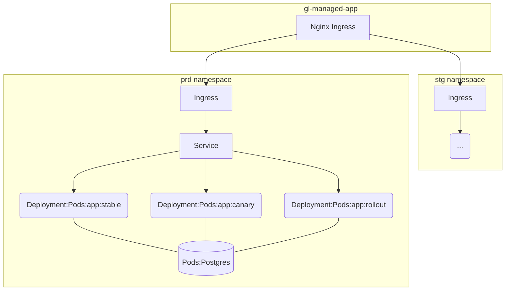
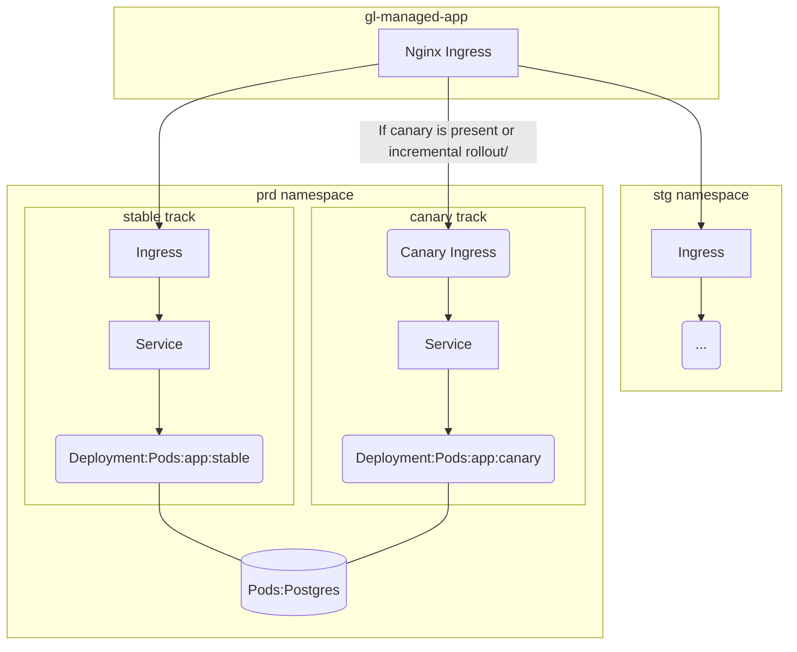



- Tier: 基础版，专业版，旗舰版
- Offering: JihuLab.com，私有化部署



[Auto Deploy](stages.md#auto-deploy) 是一项将您的应用部署到 Kubernetes 集群的功能。
它由多个依赖项组成：

- [Auto Deploy 模板](https://jihulab.com/gitlab-cn/gitlab/-/blob/main-jh/lib/gitlab/ci/templates/Jobs/Deploy.gitlab-ci.yml)是一组使用 `auto-deploy-image`的流水线作业和脚本。
- [`auto-deploy-image`](https://gitlab.com/gitlab-org/cluster-integration/auto-deploy-image) 是与 Kubernetes 集群通信的可执行镜像。
- [`auto-deploy-app chart`](https://gitlab.com/gitlab-org/cluster-integration/auto-deploy-image/-/tree/master/assets/auto-deploy-app) 是用于部署您的应用的 Helm chart。

`auto-deploy-image` 和 `auto-deploy-app` chart 使用[语义化版本](https://semver.org/)。默认情况下，您的 Auto DevOps 项目会持续使用稳定且不破坏兼容性的版本。但是，这些依赖项可能会在极狐GitLab 的大版本发布中升级，并带来破坏性变更，需要您升级自己的部署。

本指南介绍如何使用较新或不同的 Auto Deploy 依赖项大版本升级您的部署。

<a id="verify-dependency-versions"></a>

## 验证依赖项版本

检查当前版本的流程因您使用的模板而异。首先确认正在使用哪个模板：

- 对于极狐GitLab 私有化部署实例，使用的是[随极狐GitLab 软件包捆绑的稳定版 Auto Deploy 模板](https://jihulab.com/gitlab-cn/gitlab/-/blob/main-jh/lib/gitlab/ci/templates/Jobs/Deploy.gitlab-ci.yml)。
- 如果满足以下任一条件，则使用的是 [JihuLab.com 稳定版 Auto Deploy 模板](https://jihulab.com/gitlab-cn/gitlab/-/blob/main-jh/lib/gitlab/ci/templates/Jobs/Deploy.gitlab-ci.yml)：
  - 您的 Auto DevOps 项目没有 `.gitlab-ci.yml` 文件。
  - 您的 Auto DevOps 项目有 `.gitlab-ci.yml`，并且[包含](../../ci/yaml/_index.md#includetemplate)了 `Auto-DevOps.gitlab-ci.yml` 模板。
- 如果同时满足以下两个条件，则使用的是[最新的 Auto Deploy 模板](https://gitlab.com/gitlab-org/gitlab/-/blob/master/lib/gitlab/ci/templates/Jobs/Deploy.latest.gitlab-ci.yml)：
  - 您的 Auto DevOps 项目有 `.gitlab-ci.yml` 文件，并且[包含](../../ci/yaml/_index.md#includetemplate)了 `Auto-DevOps.gitlab-ci.yml` 模板。
  - 它还包含[最新的 Auto Deploy 模板](#early-adopters)。

如果您知道正在使用哪个模板：

- `auto-deploy-image` 版本位于该模板中（例如 `auto-deploy-image:v1.0.3`）。
- `auto-deploy-app` chart 版本[位于 auto-deploy-image 代码仓库中](https://gitlab.com/gitlab-org/cluster-integration/auto-deploy-image/-/blob/v1.0.3/assets/auto-deploy-app/Chart.yaml)（例如 `version: 1.0.3`）。

<a id="compatibility"></a>

## 兼容性

下表说明了极狐GitLab 与 Auto Deploy 依赖项之间的版本兼容性：

| 极狐GitLab 版本   | `auto-deploy-image` 版本 | 说明 |
|------------------|-----------------------------|-------|
| v10.0 至 v14.0   | v0.1.0 至 v2.0.0            | v0 和 v1 auto-deploy-image 向后兼容。 |
| v13.4 及更高版本  | v2.0.0 及更高版本            | v2 auto-deploy-image 包含破坏性变更，如[升级指南](#upgrade-deployments-to-the-v2-auto-deploy-image)所述。 |

您可以在 [Auto Deploy 稳定版模板](https://jihulab.com/gitlab-cn/gitlab/-/blob/main-jh/lib/gitlab/ci/templates/Jobs/Deploy.gitlab-ci.yml)中找到 auto-deploy-image 的当前稳定版本。

<a id="upgrade-guide"></a>

## 升级指南

使用 Auto DevOps 的项目必须使用由极狐GitLab 管理的未经修改的 chart。
[自定义 chart](customize.md#custom-helm-chart) 不受支持。

<a id="upgrade-deployments-to-the-v1-auto-deploy-image"></a>

### 将部署升级到 v1 `auto-deploy-image`

v1 chart 与 v0 chart 向后兼容，因此无需更改配置。

<a id="upgrade-deployments-to-the-v2-auto-deploy-image"></a>

### 将部署升级到 v2 `auto-deploy-image`

v2 auto-deploy-image 包含多项依赖项和架构变更。
如果您的 Auto DevOps 项目有一个使用 v1 `auto-deploy-image` 部署的活动环境，请按以下升级指南操作。否则，您可以跳过此过程。

<a id="kubernetes-116"></a>

#### Kubernetes 1.16+

v2 auto-deploy-image 不再支持 Kubernetes 1.15 及更早版本。如果您需要升级
Kubernetes 集群，请遵循您的云提供商的说明。这里有一个 [GKE 上的示例](https://docs.cloud.google.com/kubernetes-engine/docs/how-to/upgrading-a-cluster)。

<a id="helm-v3"></a>

#### Helm v3

`auto-deploy-image` 使用 Helm 二进制文件来操作发布版本。此前，`auto-deploy-image` 使用 Helm v2，它在集群中使用 Tiller。
在 v2 `auto-deploy-image`中，它使用不再需要 Tiller 的 Helm v3。

如果您的 Auto DevOps 项目有一个使用 v1 `auto-deploy-image` 部署的活动环境，请使用以下步骤升级到使用 Helm v3 的 v2：

1. 设置以下 CI/CD 变量：

   - `MIGRATE_HELM_2TO3` 设置为 `true`。如果未设置此变量，迁移作业不会运行。
   - `AUTO_DEVOPS_FORCE_DEPLOY_V2` 设置为 `1`。
   - **可选**：`BACKUP_HELM2_RELEASES` 设置为 `1`。如果设置此变量，迁移
     作业会将备份保存 1 周，保存在名为 `helm-2-release-backups`的作业产物中。
     如果您在准备好之前意外删除了 Helm v2 发布版本，您可以使用 `kubectl apply -f $backup`
     从 Kubernetes 清单文件恢复此备份。

     > [!warning]
     > 如果您的流水线是公开的，请勿使用此功能。
     > 此产物可能包含密钥，并且对任何
     > 能看到您作业的用户可见。

1. 运行流水线并触发 `<environment-name>:helm-2to3:migrate` 作业。
1. 像往常一样部署您的环境。此部署使用 Helm v3。
1. 如果部署成功，您可以安全地运行 `<environment-name>:helm-2to3:cleanup`。
   这会从命名空间中删除所有 Helm v2 发布版本数据。
1. 移除 `MIGRATE_HELM_2TO3` CI/CD 变量，或将其设置为 `false`。您可以使用[环境范围](../../ci/environments/_index.md#limit-the-environment-scope-of-a-cicd-variable)一次为一个环境执行此操作。

<a id="in-cluster-postgresql-channel-2"></a>

#### 集群内 PostgreSQL Channel 2

v2 auto-deploy-image 不再支持[旧版集群内 PostgreSQL](upgrading_postgresql.md)。
如果您的 Kubernetes 集群仍依赖它，请使用 [v1 auto-deploy-image](#use-a-specific-version-of-auto-deploy-dependencies)
[升级并迁移您的数据](upgrading_postgresql.md)。

<a id="traffic-routing-change-for-canary-deployments-and-incremental-rollouts"></a>

#### 金丝雀部署和增量发布的流量路由变更

Auto Deploy 支持高级部署策略，例如[金丝雀部署](cicd_variables.md#deploy-policy-for-canary-environments)和[增量发布](../../ci/environments/incremental_rollouts.md)。

此前，`auto-deploy-image` 通过更改副本比例创建一个服务来在不稳定和稳定轨道之间平衡流量。在 v2 `auto-deploy-image`中，
它使用 [Canary Ingress](https://kubernetes.github.io/ingress-nginx/user-guide/nginx-configuration/annotations/#canary) 控制流量。

有关更多详细信息，请参阅 [v2 `auto-deploy-app` chart 资源架构](#v2-chart-resource-architecture)。

如果您的 Auto DevOps 项目在 `production` 环境中使用 v1 `auto-deploy-image` 部署了活动的 `canary` 或 `rollout` 轨道发布版本，请使用以下步骤升级到 v2：

1. 验证您的项目[正在使用 v1 `auto-deploy-image`](#verify-dependency-versions)。
   如果没有，请[指定版本](#use-a-specific-version-of-auto-deploy-dependencies)。
1. 如果您正在部署 `canary` 或 `rollout` 部署，请先将
   它们提升到 `production`，以删除不稳定轨道。
1. 验证您的项目[正在使用 v2 `auto-deploy-image`](#verify-dependency-versions)。
   如果没有，请[指定版本](#use-a-specific-version-of-auto-deploy-dependencies)。
1. 在极狐GitLab CI/CD 设置中添加一个值为 `true`的 `AUTO_DEVOPS_FORCE_DEPLOY_V2` CI/CD 变量。
1. 创建一个新的流水线并运行 `production` 作业，以使用 v2 `auto-deploy-app chart`
   更新资源架构。
1. 移除 `AUTO_DEVOPS_FORCE_DEPLOY_V2` 变量。

<a id="use-a-specific-version-of-auto-deploy-dependencies"></a>

### 使用特定版本的 Auto Deploy 依赖项

要使用特定版本的 Auto Deploy 依赖项，请指定包含[所需版本的 `auto-deploy-image` 和 `auto-deploy-app`](#verify-dependency-versions)的
上一个 Auto Deploy 稳定版模板。

例如，如果该模板捆绑在极狐GitLab 19.2 中，请将您的 `.gitlab-ci.yml` 更改为：

```yaml
include:
  - template: Auto-DevOps.gitlab-ci.yml
  - remote: https://gitlab.com/gitlab-org/gitlab/-/raw/v19.2.0-ee/lib/gitlab/ci/templates/Jobs/Deploy.gitlab-ci.yml
```

<a id="ignore-warnings-and-continue-deploying"></a>

### 忽略警告并继续部署

如果您确定新 chart 版本可以安全部署，您可以添加
`AUTO_DEVOPS_FORCE_DEPLOY_V<major-version-number>` [CI/CD 变量](cicd_variables.md#build-and-deployment-variables)
以强制部署继续。

例如，如果您想在之前使用 `v0.17.0` chart 的部署上部署 `v2.0.0` chart，请添加 `AUTO_DEVOPS_FORCE_DEPLOY_V2`。

<a id="early-adopters"></a>

## 抢先体验

如果您想使用 `auto-deploy-image`的最新 [beta](../../policy/development_stages_support.md#beta) 或不稳定版本，请将最新的 Auto Deploy 模板包含到您的 `.gitlab-ci.yml`中：

```yaml
include:
  - template: Auto-DevOps.gitlab-ci.yml
  - template: Jobs/Deploy.latest.gitlab-ci.yml
```

> [!warning]
> 使用 [beta](../../policy/development_stages_support.md#beta) 或不稳定的 `auto-deploy-image` 可能会对
> 您的环境造成无法恢复的损害。请勿在重要项目或环境中测试它。

<a id="resource-architectures-of-the-auto-deploy-app-chart"></a>

## `auto-deploy-app` chart 的资源架构

<a id="v0-and-v1-chart-resource-architecture"></a>

### v0 和 v1 chart 资源架构



<a id="v2-chart-resource-architecture"></a>

### v2 chart 资源架构



<a id="troubleshooting"></a>

## 故障排除

<a id="major-version-mismatch-warning"></a>

### 大版本不匹配警告

如果部署的 chart 的大版本与上一个不同，新 chart 可能无法正确部署。这可能是由于架构变更所致。如果发生这种情况，部署作业会失败，并显示类似以下的消息：

```plaintext
*************************************************************************************
                                   [WARNING]
Detected a major version difference between the chart that is currently deploying (auto-deploy-app-v0.7.0), and the previously deployed chart (auto-deploy-app-v1.0.0).
A new major version might not be backward compatible with the current release (production). The deployment could fail or be stuck in an unrecoverable status.
...
```

要清除此错误消息并恢复部署，您必须执行以下操作之一：

- 手动[升级 chart 版本](#upgrade-guide)。
- [使用特定的 chart 版本](#use-a-specific-version-of-auto-deploy-dependencies)。

<a id="error-missing-key-appkubernetesiomanaged-by-must-be-set-to-helm"></a>

### 错误：`missing key "app.kubernetes.io/managed-by": must be set to "Helm"`

如果您的集群中有一个使用 v1 `auto-deploy-image` 部署的部署，您可能会遇到以下错误：

- `Error: rendered manifests contain a resource that already exists. Unable to continue with install: Secret "production-postgresql" in namespace "<project-name>-production" exists and cannot be imported into the current release: invalid ownership metadata; label validation error: missing key "app.kubernetes.io/managed-by": must be set to "Helm"; annotation validation error: missing key "meta.helm.sh/release-name": must be set to "production-postgresql"; annotation validation error: missing key "meta.helm.sh/release-namespace": must be set to "<project-name>-production"`

这是因为之前的部署是使用 Helm2 部署的，它与 Helm3 不兼容。要解决此问题，请遵循[升级指南](#upgrade-deployments-to-the-v2-auto-deploy-image)。
