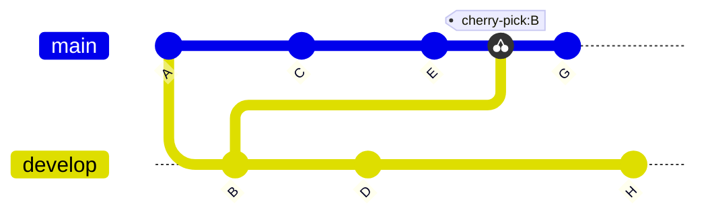



- Tier: 基础版，专业版，旗舰版
- Offering: JihuLab.com，私有化部署



当您在命令行中使用 `git cherry-pick` 时，您会将现有分支中的特定变更复制到当前分支。当您想要执行以下操作时，拣选会有所帮助：

- 将缺陷修复向后移植到较旧的发布分支，而不引入新功能。
- 复用来自永远无法合并的分支的工作。
- 将小型功能向后移植到之前的版本，而不包含实验性变更。
- 将紧急生产修复（热修复）应用到开发分支。
- 将变更从 fork 复制到上游代码仓库。

有关从极狐GitLab UI 进行拣选的更多信息，请参阅
[拣选变更](../../user/project/merge_requests/cherry_pick_changes.md)。

当您拣选一个提交时，Git 会：

- 在当前分支上创建一个包含相同变更的新提交。
- 保留原始提交信息和作者信息。
- 生成新的提交 SHA。（原始提交保持不变。）

<!-- Diagram reused in doc/user/projects/merge_requests/cherry_pick_changes.md -->



请谨慎使用 `git cherry-pick`，因为它可能会创建具有相同变更但安全哈希算法（SHA）不同的重复提交。这可能会使您的项目历史变得复杂。请先考虑以下替代方案：

- 如果您需要某个分支中的大部分变更，并且该分支历史是干净的，请将整个
  分支合并到当前分支。
- 如果原始提交包含您在新分支中不需要的复杂依赖项，
  请创建一个新提交，而不是拣选旧提交。

<a id="apply-one-commit-to-another-branch"></a>

## 将一个提交应用到另一个分支

要将单个提交拣选到当前工作分支：

1. 确定您想要拣选的提交的 SHA。
   要找到它，请检查提交历史或使用 `git log` 命令。例如：

   ```shell
   $ git log

   commit abc123f
   Merge: 88888999999 aaaaabbbbbb
   Author: user@example.com
   Date:   Tue Aug 31 21:19:41 2021 +0000

       Fixes a regression we found yesterday
   ```

1. 检出您想要拣选到的分支：

   ```shell
   git checkout release
   ```

1. 使用 `git cherry-pick` 命令将提交 `abc123f` 从
   功能分支复制到 `release` 分支。将 `abc123f` 替换为您所确定的
   提交的 SHA：

   ```shell
   git cherry-pick abc123f
   ```

Git 会将提交 `abc123f`中的变更复制到 `release` 分支，如果发生冲突，会显示通知。解决冲突，然后继续拣选过程。对每个需要提交 `abc123f` 内容的分支重复此操作。

<a id="apply-multiple-commits-to-another-branch"></a>

## 将多个提交应用到另一个分支

如果您需要的代码是在多个提交中添加的，请将这些提交分别拣选到您所需的目标分支：

1. 确定您想要拣选的提交的 SHA。要找到它，请检查提交历史
   或使用 `git log` 命令。例如，如果代码变更在一个提交中，而改进的测试
   覆盖率在下一个提交中：

   ```shell
   $ git log

   commit abc123f
   Merge: 88888999999 aaaaabbbbbb
   Author: user@example.com
   Date:   Tue Aug 31 21:19:41 2021 +0000

       Fixes a regression we found yesterday

   commit ghi456j
   Merge: 44444666666 cccccdddddd
   Author: user@example.com
   Date:   Tue Aug 31 21:19:41 2021 +0000

       Adds tests to ensure the problem does not happen again
   ```

1. 检出您想要拣选到的分支（`release`）：

   ```shell
   git checkout release
   ```

1. 将提交复制到您的 `release` 分支。

   - 要将每个提交分别复制到 `release` 分支，请对
     每个提交使用 `git cherry-pick` 命令。将 `abc123f` 和 `ghi456j` 替换为您所需提交的 SHA：

     ```shell
     git cherry-pick abc123f
     git cherry-pick ghi456j
     ...
     ```

   - 要将一系列提交拣选到您的 `release` 分支，使用 SHA 标记
     开始和结束，请使用 `..` 表示法。此命令会应用 `abc123f`
     和 `ghi456j` 之间的所有提交：

     ```shell
     git cherry-pick abc123f..ghi456j
     ```

<a id="copy-the-contents-of-an-entire-branch"></a>

## 复制整个分支的内容

当您拣选某个分支的合并提交时，您的拣选会将分支中的所有变更复制到当前工作分支。拣选合并提交需要 `-m` 标志。此标志告诉 Git 使用哪个父提交。合并提交可能有多个父提交，具体取决于它们的创建方式。

在简单情况下，`-m 1` 使用第一个父提交，即该分支的合并提交。要指定第二个父提交（通常是功能分支合并前的最后一个提交），请使用 `-m 2`。这些标志决定 Git 将哪些变更应用到您的当前分支。

要将分支 `feature-1`的合并提交拣选到当前工作分支：

1. 确定您想要拣选的提交的 SHA。
   要找到它，请检查提交历史或使用 `git log` 命令。例如：

   ```shell
   $ git log

   commit 987pqr6
   Merge: 88888999999 aaaaabbbbbb
   Author: user@example.com
   Date:   Tue Aug 31 21:19:41 2021 +0000

       Merges feature-1 into main
   ```

1. 检出您想要拣选到的分支：

   ```shell
   git checkout feature-2
   ```

1. 使用 `git cherry-pick` 命令，并带上 `-m` 选项以及您想要用作主线
   的父提交的索引。将 `<merge-commit-hash>` 替换为合并提交的 SHA，
   将 `<parent_index>` 替换为父提交的索引。索引从 `1` 开始。例如：

   ```shell
   # git cherry-pick -m <parent_index> <merge-commit-hash>
   git cherry-pick -m 1 987pqr6
   ```

当您运行此命令时，Git 会将 `987pqr6` 合并提交的内容复制到您的 `feature-2` 分支。如果您想要使用 `feature-1` 分支的最后一个提交，而不是合并提交 `987pqr6`，请改用 `-m 2`。

<a id="troubleshooting"></a>

## 故障排除

如果您在拣选过程中遇到冲突：

1. 在受影响的文件中手动解决冲突。
1. 暂存已解决的文件：

   ```shell
   git add <resolved_file>
   ```

1. 继续拣选过程：

   ```shell
   git cherry-pick --continue
   ```

要中止拣选过程并返回到之前的状态，请使用以下命令：

```shell
git cherry-pick --abort
```

这会撤销拣选过程中所做的任何变更。
