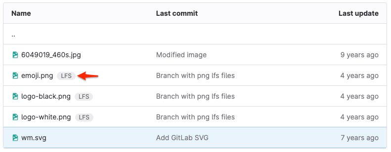

Git 大文件存储 (LFS)是一个开源 Git 扩展，可帮助 Git 代码仓库高效管理大型二进制文件。Git 无法像跟踪文本文件那样跟踪二进制文件（如音频、视频或图像文件）的变更。文本文件可以生成纯文本差异，而对二进制文件的任何变更都要求 Git 在代码仓库中完全替换该文件。对大型文件的反复变更会增加代码仓库的体积。随着时间推移，体积的增长会拖慢常规 Git 操作，例如 `clone`、`fetch` 或 `pull`。

使用 Git LFS 可将大型二进制文件存储在 Git 代码仓库之外，仅留下一个供 Git 管理的、基于文本的小型指针。当您使用 Git LFS 向代码仓库添加文件时，极狐GitLab 会：

1. 将该文件添加到项目配置的对象存储中，而不是 Git 代码仓库中。
1. 向 Git 代码仓库添加一个指针，而不是大型文件。该指针包含有关您文件的信息，如下所示：

   ```plaintext
   version https://git-lfs.github.com/spec/v1
   oid sha256:lpca0iva5kpz9wva5rgsqsicxrxrkbjr0bh4sy6rz08g2c4tyc441rto5j5bctit
   size 804
   ```

   - Version - 正在使用的 Git LFS 规范版本
   - OID - 使用的哈希方法，以及唯一对象 ID，格式为 `{hash-method}:{hash}`。
   - Size - 文件大小，以字节为单位。

1. 排队一个作业以重新计算项目的统计信息，包括存储大小和 LFS 对象存储。您的 LFS 对象存储是与代码仓库关联的所有 LFS 对象大小之和。

使用 Git LFS 管理的文件会在文件名旁显示 **LFS** 标记：



Git LFS 客户端使用 HTTP 基本认证，并通过 HTTPS 与您的服务器通信。在对请求进行认证后，Git LFS 客户端会收到有关从何处获取（或推送）大型文件的指令。

您的 Git 代码仓库保持较小体积，这有助于您遵守代码仓库大小限制。有关更多信息，请参阅
[针对极狐GitLab 私有化部署的代码仓库大小限制](../../../administration/settings/account_and_limit_settings.md#repository-size-limit)和
[针对 JihuLab.com 的代码仓库大小限制](../../../user/jihulab_com/_index.md#account-and-limit-settings)。

<a id="understand-how-git-lfs-works-with-forks"></a>

## 了解 Git LFS 如何与复刻配合使用

当您复刻一个代码仓库时，您的复刻会包含上游代码仓库在您复刻时已存在的 LFS 对象。如果您向复刻中添加新的 LFS 对象，它们仅属于您的复刻，而不属于上游代码仓库。对象存储总量只会为您的复刻增加。

当您从复刻向上游项目创建合并请求，且您的合并请求包含新的 Git LFS 对象时，极狐GitLab 会在合并后将该新 LFS 对象与上游项目关联。

<a id="configure-git-lfs-for-a-project"></a>

## 为项目配置 Git LFS



- Tier: 基础版，专业版，旗舰版
- Offering: 私有化部署



极狐GitLab 默认为极狐GitLab 私有化部署和 JihuLab.com 启用 Git LFS。它同时提供服务器设置和项目特定设置。

- 要在您的实例上配置 Git LFS，例如设置远程对象存储，请参阅
  [Git 大文件存储 (LFS)管理](../../../administration/lfs/_index.md)。
- 要为特定项目配置 Git LFS：

  1. 在代码仓库本地副本的根目录中，运行 `git lfs install`。此命令会添加：
     - 一个 pre-push Git 钩子到您的代码仓库。
     - 一个 [`.gitattributes` 文件](../../../user/project/repository/files/git_attributes.md)，用于跟踪
       单个文件和文件类型的处理方式。
  1. 添加您想用 Git LFS 跟踪的文件和文件类型。

<a id="enable-or-disable-git-lfs-for-a-project"></a>

## 为项目启用或禁用 Git LFS

极狐GitLab 默认为极狐GitLab 私有化部署和 JihuLab.com 启用 Git LFS。

先决条件：

- 您必须拥有该项目的开发者、维护者或所有者角色。

要为您的项目启用或禁用 Git LFS：

1. 在顶部栏中，选择**搜索或跳转到**并找到您的项目。
1. 在左侧边栏中，选择**设置** > **通用**。
1. 展开**可见性、项目功能、权限**部分。
1. 选择 **Git 大文件存储 (LFS)** 开关。
1. 选择**保存更改**。

<a id="add-and-track-files"></a>

## 添加和跟踪文件

您可以将大型文件添加到 Git LFS。这有助于您在 Git 代码仓库中管理文件。当您使用 Git LFS 跟踪文件时，它们会在 Git 中被替换为文本指针，并存储在远程服务器上。有关更多信息，请参阅 [Git LFS](../file_management.md#git-lfs)。

当您[为项目配置 Git LFS](#configure-git-lfs-for-a-project) 时，请确保项目根目录中有一个
`.gitattributes` 文件。如果没有根级 `.gitattributes` 文件，
即使您在项目子目录中正确配置了 LFS，UI 也会显示警告。
有关更多信息，请参阅 [LFS 配置警告消息](troubleshooting.md#warning-possible-lfs-configuration-issue)。

<a id="clone-a-repository-that-uses-git-lfs"></a>

## 克隆使用 Git LFS 的代码仓库

当您克隆使用 Git LFS 的代码仓库时，Git 会检测到 LFS 跟踪的文件并通过 HTTPS 克隆它们。如果您使用 SSH URL 运行 `git clone`，例如
`user@hostname.com:group/project.git`，则必须再次输入您的极狐GitLab 凭据以进行 HTTPS
认证。

默认情况下，即使 Git 通过 SSH 与您的代码仓库通信，Git LFS 操作也通过 HTTPS 进行。
在极狐GitLab 17.2 中，引入了 [LFS 的纯 SSH 支持](https://gitlab.com/groups/gitlab-org/-/work_items/11872)。
有关如何启用此功能的信息，请参阅[纯 SSH 传输协议](../../../administration/lfs/_index.md#pure-ssh-transfer-protocol)。

要为您已克隆的代码仓库获取新的 LFS 对象，请运行以下命令：

```shell
git lfs fetch origin main
```

<a id="migrate-an-existing-repository-to-git-lfs"></a>

## 将现有代码仓库迁移到 Git LFS

请阅读 [`git-lfs-migrate` 文档](https://github.com/git-lfs/git-lfs/blob/main/docs/man/git-lfs-migrate.adoc)，
了解如何使用 Git LFS 迁移现有 Git 代码仓库。

<a id="delete-a-git-lfs-file-from-repository-history"></a>

## 从代码仓库历史中删除 Git LFS 文件

了解在 Git LFS 中取消跟踪文件与删除文件之间的区别很重要：

- 取消跟踪：文件仍保留在磁盘和代码仓库历史中。
  如果用户检出历史分支或标签，他们仍然需要该文件的 LFS 版本。
- 删除：文件被移除，但仍保留在代码仓库历史中。

要使用 Git LFS 删除已跟踪的文件，请参阅[删除文件](../undo.md#remove-a-file-from-a-repository)。

要彻底清除文件的全部历史（过去和现在），
请参阅[处理敏感信息](../undo.md#handle-sensitive-information)。

> [!warning]
> 清除文件历史需要重写 Git 历史。此操作具有破坏性且不可逆。

<a id="reduce-repository-size-after-removing-large-files"></a>

## 删除大型文件后减小代码仓库体积

如果您需要从代码仓库历史中删除大型文件以减小代码仓库的总大小，请参阅
[减小代码仓库体积](../../../user/project/repository/repository_size.md#methods-to-reduce-repository-size)。
