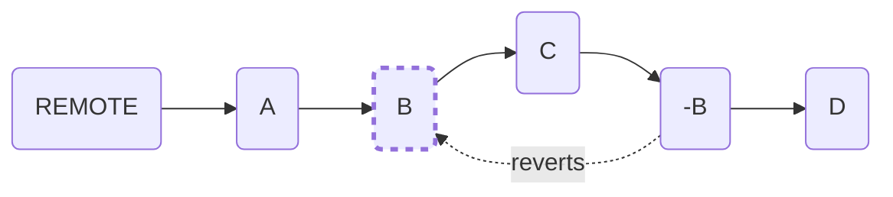
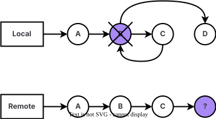

使用 Git 时，需要不断尝试和迭代。开发过程中难免出错，有时您需要撤销更改。Git 让您可以掌控代码历史，借助相关功能，您可以在 [Git 工作流](get_started.md#understand-the-git-workflow)的任意阶段撤销更改。

从意外提交中恢复、移除敏感数据、修复错误的合并，并保持代码仓库历史整洁。与他人协作时，可以通过新的还原提交来保持透明，也可以在共享之前先在本地重置您的工作。具体使用哪种方法，取决于更改是：

- 仅存在于您的本地计算机上。
- 存储在远程 Git 服务器（例如 JihuLab.com）上。

<a id="undo-local-changes"></a>

## 撤销本地更改

在您将更改推送到远程代码仓库之前，您在 Git 中所做的更改仅存在于本地开发环境中。

当您在 Git 中*暂存*某个文件时，就是指示 Git 跟踪该文件的更改，为提交做准备。若要忽略某个文件的更改，不将其包含在下一次提交中，请*取消暂存*该文件。

<a id="revert-unstaged-local-changes"></a>

### 还原未暂存的本地更改

要撤销尚未暂存的本地更改：

1. 运行 `git status`，确认该文件未暂存（即您没有使用 `git add <file>`）：

   ```shell
   git status
   ```

   输出示例：

   ```shell
   On branch main
   Your branch is up-to-date with 'origin/main'.
   Changes not staged for commit:
     (use "git add <file>..." to update what will be committed)
     (use "git checkout -- <file>..." to discard changes in working directory)

       modified:   <file>
   no changes added to commit (use "git add" and/or "git commit -a")
   ```

1. 选择一种方式撤销您的更改：

   - 覆盖本地更改：

     ```shell
     git checkout -- <file>
     ```

   - 永久丢弃所有文件的本地更改：

     ```shell
     git reset --hard
     ```

<a id="revert-staged-local-changes"></a>

### 还原已暂存的本地更改

您可以撤销已经暂存的本地更改。在以下示例中，某个文件已添加到暂存区，但尚未提交：

1. 使用 `git status` 确认该文件已暂存：

   ```shell
   git status
   ```

   输出示例：

   ```shell
   On branch main
   Your branch is up-to-date with 'origin/main'.
   Changes to be committed:
     (use "git restore --staged <file>..." to unstage)

     new file:   <file>
   ```

1. 选择一种方式撤销您的更改：

   - 取消暂存该文件，但保留您的更改：

     ```shell
     git restore --staged <file>
     ```

   - 取消暂存所有内容，但保留您的更改：

     ```shell
     git reset
     ```

   - 将该文件取消暂存到当前提交（HEAD）：

     ```shell
     git reset HEAD <file>
     ```

   - 永久丢弃所有内容：

     ```shell
     git reset --hard
     ```

<a id="undo-local-commits"></a>

## 撤销本地提交

当您使用 `git commit` 提交到本地代码仓库时，Git 会记录您的更改。由于您尚未推送到远程代码仓库，您的更改尚未公开，也未与他人共享。此时，您可以撤销您的更改。

<a id="revert-commits-without-altering-history"></a>

### 在不改动历史的情况下还原提交

您可以在保留提交历史的同时还原某个提交。

本示例使用五个提交 `A`、`B`、`C`、`D`、`E`，它们按顺序提交：`A-B-C-D-E`。您要撤销的提交是 `B`。

1. 找到您要还原到的提交的 SHA。要查看提交日志，请使用命令 `git log`。
1. 选择一种方式撤销您的更改：

   - 还原提交 `B` 引入的更改：

     ```shell
     git revert <commit-B-SHA>
     ```

   - 撤销提交 `B`中单个文件或目录的更改，但将其保留在暂存状态：

     ```shell
     git checkout <commit-B-SHA> <file>
     ```

   - 撤销提交 `B`中单个文件或目录的更改，但将其保留在未暂存状态：

     ```shell
     git reset <commit-B-SHA> <file>
     ```

<a id="revert-commits-and-modify-history"></a>

### 还原提交并修改历史

以下各节介绍会重写 Git 历史的任务。更多信息，请参见[变基并解决冲突](git_rebase.md)。

<a id="delete-a-specific-commit"></a>

#### 删除特定提交

您可以删除特定提交。例如，如果您有提交 `A-B-C-D`，并且想删除提交 `B`。

1. 对从当前提交 `D` 到 `B`的范围执行变基：

   ```shell
   git rebase -i A
   ```

   编辑器中将显示提交列表。
1. 在提交 `B` 前面，将 `pick` 替换为 `drop`。
1. 其他所有提交保留默认值 `pick`。
1. 保存并退出编辑器。

<a id="edit-a-specific-commit"></a>

#### 编辑特定提交

您可以修改特定提交。例如，如果您有提交 `A-B-C-D`，并且想修改提交 `B`中引入的内容。

1. 对从当前提交 `D` 到 `B`的范围执行变基：

   ```shell
   git rebase -i A
   ```

   编辑器中将显示提交列表。
1. 在提交 `B` 前面，将 `pick` 替换为 `edit`。
1. 其他所有提交保留默认值 `pick`。
1. 保存并退出编辑器。
1. 在编辑器中打开该文件，进行修改，然后提交更改：

   ```shell
   git commit -a
   ```

<a id="undo-multiple-commits"></a>

### 撤销多个提交

如果您在分支上创建了多个提交（`A-B-C-D`），然后发现提交 `C` 和 `D` 有误，请撤销这两个错误的提交：

1. 检出最后一个正确的提交。在本示例中为 `B`。

   ```shell
   git checkout <commit-B-SHA>
   ```

1. 创建一个新分支。

   ```shell
   git checkout -b new-path-of-feature
   ```

1. 添加、推送并提交您的更改。

   ```shell
   git add .
   git commit -m "Undo commits C and D"
   git push --set-upstream origin new-path-of-feature
   ```

现在的提交为 `A-B-C-D-E`。

或者，将该提交[拣选](../../user/project/merge_requests/cherry_pick_changes.md#cherry-pick-a-single-commit)到一个新的合并请求中。

> [!note]
> 另一种解决方案是重置到 `B` 并提交 `E`。不过，这种方案会得到 `A-B-E`，
> 与其他人本地的内容产生冲突。如果您的分支是共享分支，请不要使用这种方案。

<a id="recover-undone-commits"></a>

### 恢复已撤销的提交

您可以找回之前的本地提交。不过，并非所有之前的提交都可用，因为 Git 会定期[清理分支或标签无法访问的提交](https://git-scm.com/book/en/v2/Git-Internals-Maintenance-and-Data-Recovery)。

要查看代码仓库历史并跟踪先前的提交，请运行 `git reflog show`。例如：

```shell
$ git reflog show

# Example output:
b673187 HEAD@{4}: merge 6e43d5987921bde189640cc1e37661f7f75c9c0b: Merge made by the 'recursive' strategy.
eb37e74 HEAD@{5}: rebase -i (finish): returning to refs/heads/master
eb37e74 HEAD@{6}: rebase -i (pick): Commit C
97436c6 HEAD@{7}: rebase -i (start): checkout 97436c6eec6396c63856c19b6a96372705b08b1b
...
88f1867 HEAD@{12}: commit: Commit D
97436c6 HEAD@{13}: checkout: moving from 97436c6eec6396c63856c19b6a96372705b08b1b to test
97436c6 HEAD@{14}: checkout: moving from master to 97436c6
05cc326 HEAD@{15}: commit: Commit C
6e43d59 HEAD@{16}: commit: Commit B
```

此输出显示代码仓库历史，包括：

- 提交 SHA。
- 该提交是在多少次更改 `HEAD`的操作之前创建的（`HEAD@{12}` 表示 12 次更改 `HEAD`的操作之前）。
- 所执行的操作，例如：提交、变基、合并。
- 对更改 `HEAD`的操作的说明。

<a id="undo-remote-changes"></a>

## 撤销远程更改

您可以撤销分支上的远程更改。不过，您无法撤销已合并到您分支中的分支上的更改。在这种情况下，您必须还原远程分支上的更改。

<a id="revert-remote-changes-without-altering-history"></a>

### 在不改动历史的情况下还原远程更改

要撤销远程代码仓库中的更改，您可以创建一个包含要撤销的更改的新提交。此过程会保留历史，并提供清晰的时间线和开发结构：



要还原特定提交 `B`中引入的更改：

```shell
git revert B
```

<a id="revert-remote-changes-and-modify-history"></a>

### 还原远程更改并修改历史

您可以撤销远程更改并修改历史。

即使历史已更新，旧提交仍可通过提交 SHA 访问，至少在完成所有分离提交的自动清理之前，或手动运行清理之前是如此。如果仍有引用指向旧提交，即使执行清理也可能不会移除它们。



在公共分支或可能被他人使用的分支上工作时，不应更改历史。

> [!note]
> 切勿修改[默认分支](../../user/project/repository/branches/default.md)或共享分支的提交历史。

<a id="modify-history-with-git-rebase"></a>

### 使用 `git rebase` 修改历史

合并请求的分支是公共分支，可能会被其他开发者使用。不过，项目规则可能要求您在评审完成后使用 `git rebase` 来减少目标分支上显示的提交数量。

您可以使用 `git rebase -i` 修改历史。使用此命令可以修改、压缩和删除提交。

```shell
#
# Commands:
# p, pick = use commit
# r, reword = use commit, but edit the commit message
# e, edit = use commit, but stop for amending
# s, squash = use commit, but meld into previous commit
# f, fixup = like "squash", but discard this commit's log message
# x, exec = run command (the rest of the line) using shell
# d, drop = remove commit
#
# These lines can be re-ordered; they are executed from top to bottom.
#
# If you remove a line THAT COMMIT WILL BE LOST.
#
# However, if you remove everything, the rebase will be aborted.
#
# Empty commits are commented out
```

> [!note]
> 如果您决定停止变基，请不要关闭编辑器。
> 而应删除所有未注释的行并保存。

在共享分支和远程分支上请谨慎使用 `git rebase`。在推送到远程代码仓库之前，先在本地进行试验。

```shell
# Modify history from commit-id to HEAD (current commit)
git rebase -i commit-id
```

<a id="modify-history-with-git-merge---squash"></a>

### 使用 `git merge --squash` 修改历史

为大型开源代码仓库做贡献时，可以考虑将您的提交压缩为单个提交。这样做：

- 有助于保持项目历史整洁且呈线性。
- 简化还原更改的过程，因为所有更改都浓缩为一个提交。

要在合并时将您分支上的提交压缩为目标分支上的单个提交，请使用 `git merge --squash`。例如：

1. 检出基础分支。在本示例中，基础分支是 `main`：

   ```shell
   git checkout main
   ```

1. 使用 `--squash` 合并您的目标分支：

   ```shell
   git merge --squash <target-branch>
   ```

1. 提交更改：

   ```shell
   git commit -m "Squash commit from feature-branch"
   ```

有关如何从极狐GitLab UI 压缩提交的信息，请参见[压缩并合并](../../user/project/merge_requests/squash_and_merge.md)。

<a id="revert-a-merge-commit-to-a-different-parent"></a>

### 将合并提交还原到其他父项

还原合并提交时，您合并到的分支始终是第一个父项。例如，[默认分支](../../user/project/repository/branches/default.md)或 `main`。要将合并提交还原到其他父项，必须从命令行还原该提交：

1. 确定您要还原到的父提交的 SHA。
1. 确定您要还原到的提交的父项编号。（默认为 `1`，即第一个父项。）
1. 运行以下命令，将 `2` 替换为父项编号，将 `7a39eb0` 替换为提交 SHA：

   ```shell
   git revert -m 2 7a39eb0
   ```

有关从极狐GitLab UI 还原更改的信息，请参见[还原更改](../../user/project/merge_requests/revert_changes.md)。

<a id="handle-sensitive-information"></a>

## 处理敏感信息

敏感信息（例如密码和 API 密钥）可能会被意外提交到 Git 代码仓库中。本节介绍处理这种情况的方法。

<a id="redact-information"></a>

### 遮盖信息

永久删除意外提交的敏感或机密信息，并确保它不再能在您的代码仓库历史中访问。此过程会将一系列字符串替换为 `***REMOVED***`。

或者，要从代码仓库中完全删除特定文件，请参见[移除 blob](../../user/project/repository/repository_size.md#remove-blobs)。

要从代码仓库中遮盖文本，请参见[从代码仓库中遮盖文本](../../user/project/repository/repository_size.md#redact-text-from-repository)。

<a id="remove-information-from-commits"></a>

### 从提交中移除信息

您可以使用 Git 从过去的提交中删除敏感信息。不过，此过程会修改历史。

要使用[特定过滤器](https://git-scm.com/docs/git-filter-branch#_options)重写历史，请运行 `git filter-branch`。

要从历史中彻底移除某个文件，请使用：

```shell
git filter-branch --tree-filter 'rm filename' HEAD
```

在大型代码仓库中，`git filter-branch` 命令可能会很慢。有一些工具可以更快地执行 Git 命令。这些工具之所以更快，是因为它们不提供 `git filter-branch` 那样完整的功能集，而是专注于特定用例。

有关从代码仓库历史和极狐GitLab 存储中清除文件的更多信息，请参见[减小代码仓库大小](../../user/project/repository/repository_size.md#methods-to-reduce-repository-size)。

<a id="undo-and-remove-commits"></a>

## 撤销和移除提交

- 撤销上一次提交，并将所有内容放回暂存区：

  ```shell
  git reset --soft HEAD^
  ```

- 添加文件并更改提交消息：

  ```shell
  git commit --amend -m "New Message"
  ```

- 撤销上一次更改并移除所有其他更改（如果您尚未推送）：

  ```shell
  git reset --hard HEAD^
  ```

- 撤销上一次更改并移除最后两次提交（如果您尚未推送）：

  ```shell
  git reset --hard HEAD^^
  ```

<a id="example-git-reset-workflow"></a>

### `git reset` 工作流示例

以下是常见的 Git 重置工作流：

1. 编辑一个文件。
1. 检查分支状态：

   ```shell
   git status
   ```

1. 使用错误的提交消息将更改提交到分支：

   ```shell
   git commit -am "kjkfjkg"
   ```

1. 检查 Git 日志：

   ```shell
   git log
   ```

1. 使用正确的提交消息修正该提交：

   ```shell
   git commit --amend -m "New comment added"
   ```

1. 再次检查 Git 日志：

   ```shell
   git log
   ```

1. 对分支执行软重置：

   ```shell
   git reset --soft HEAD^
   ```

1. 再次检查 Git 日志：

   ```shell
   git log
   ```

1. 从远程拉取该分支的更新：

   ```shell
   git pull origin <branch>
   ```

1. 将该分支的更改推送到远程：

   ```shell
   git push origin <branch>
   ```

<a id="undo-commits-with-a-new-commit"></a>

## 使用新提交撤销提交

如果某个文件在某个提交中被更改，而您想将其改回上一次提交中的状态，同时保留提交历史，可以使用 `git revert`。该命令会创建一个新提交，用于反向执行原提交中执行的所有操作。

例如，要移除提交 `B`中对该文件的更改，并从提交 `A` 恢复其内容，请运行：

```shell
git revert <commit-sha>
```

<a id="remove-a-file-from-a-repository"></a>

## 从代码仓库中移除文件

- 要从磁盘和代码仓库中移除文件，请使用 `git rm`。要移除目录，请使用 `-r` 标志：

  ```shell
  git rm '*.txt'
  git rm -r <dirname>
  ```

- 要在磁盘上保留文件但从代码仓库中移除它（例如您想添加到 `.gitignore`的文件），请使用 `rm` 命令并加上 `--cache` 标志：

  ```shell
  git rm <filename> --cache
  ```

这些命令会从当前分支中移除该文件，但不会将其从代码仓库历史中彻底清除。要从代码仓库中完全移除该文件过去和现在的所有痕迹，请参见[移除 blob](../../user/project/repository/repository_size.md#remove-blobs)。

<a id="compare-git-revert-and-git-reset"></a>

## 比较 `git revert` 和 `git reset`

- `git reset` 命令会完全移除该提交。
- `git revert` 命令会移除更改，但保留提交不变。
  它更安全，因为您可以还原一次还原。

```shell
# Changed file
git commit -am "bug introduced"
git revert HEAD
# New commit created reverting changes
# Next, reapply the reverted commit
git log # take hash from the revert commit
git revert <rev commit hash>
# reverted commit is back (new commit created again)
```
