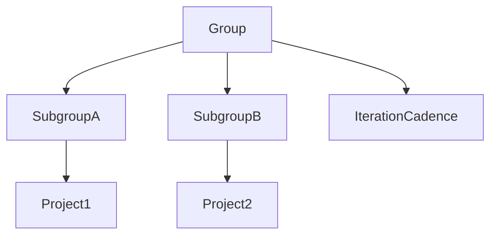

<!-- vale gitlab_base.FutureTense = NO -->

要在极狐GitLab 中运行敏捷开发迭代，您需要组合使用多个极狐GitLab 功能。

要从极狐GitLab 运行敏捷迭代：

1. 创建群组。
1. 创建项目。
1. 设置迭代节奏。
1. 创建作用域标记。
1. 创建您的史诗和议题。
1. 创建议题看板。

创建这些核心组件后，您就可以开始运行迭代了。

## 创建群组

迭代节奏是为群组创建的，因此如果您还没有群组，请先[创建一个](../../user/group/_index.md#create-a-group)。

您可以使用群组同时管理一个或多个相关项目。您可以将用户添加为群组成员，并为他们分配角色。角色决定每个用户在群组中各项目上拥有的[权限级别](../../user/permissions.md)。成员身份会自动向下级联到所有子群组和项目。

## 创建项目

现在，在您的群组中[创建一个或多个项目](../../user/project/_index.md)。创建项目有多种不同方式。项目包含您的代码和流水线，还包含用于规划即将进行的代码更改的议题。

## 设置迭代节奏

在开始创建史诗或议题之前，请先创建一个[迭代节奏](../../user/group/iterations/_index.md#iteration-cadences)。迭代节奏包含用于规划和报告议题的各个按顺序排列的迭代时间框。

创建迭代节奏时，您可以决定是自动管理迭代，还是关闭自动调度以[手动管理迭代](../../user/group/iterations/_index.md#create-an-iteration-manually)。

与成员身份类似，迭代会沿群组、子群组和项目层级向下级联。如果您的团队有多个群组和项目，请在最高层级的共享群组中创建迭代节奏：

## 创建作用域标记

您还应在创建迭代节奏的同一群组中[创建作用域标记](../../user/project/labels.md)。标记可帮助您组织史诗、议题和合并请求，并在看板中直观呈现议题的流转。例如，您可以使用作用域标记，如 `workflow::planning`、`workflow::ready for development`、`workflow::in development` 和 `workflow::complete` 来表示议题的状态。您还可以利用作用域标记来表示议题或史诗的类型，如 `type::feature`、`type::defect` 和 `type::maintenance`。

## 创建您的史诗和议题

现在您可以开始规划迭代了。首先在创建迭代节奏的群组中创建[史诗](../../user/group/epics/_index.md)，然后在一个或多个项目中创建子[议题](../../user/project/issues/_index.md)。根据需要为每个议题添加标记。

## 创建议题看板

[议题看板](../../user/project/issue_board.md)可帮助您规划即将进行的迭代，或直观呈现进行中迭代的工作流。列表列可以基于标记、指派人、迭代或里程碑创建。您还可以按多个属性筛选看板，并按议题的史诗对议题进行分组。

在创建迭代节奏和标记的群组中，[创建议题看板](../../user/project/issue_board.md#create-an-issue-board)并将其命名为“迭代规划”。然后，为每个迭代创建列表。之后，您可以将议题从“开放中”列表拖到迭代列表中，以便将它们安排到即将进行的迭代中。

要直观呈现当前迭代中议题的工作流，请创建另一个名为
“当前迭代”的议题看板。创建看板时：

1. 选择 **配置看板**（）。
1. 在 **迭代** 旁边，选择 **编辑**。
1. 从下拉列表中，选择 **当前迭代**。
1. 选择 **保存更改**。

现在，您的看板将只显示当前迭代中的议题。您可以开始为您之前创建的每个 `workflow::...` 标记添加列表。

现在，您已准备好开始开发了。
