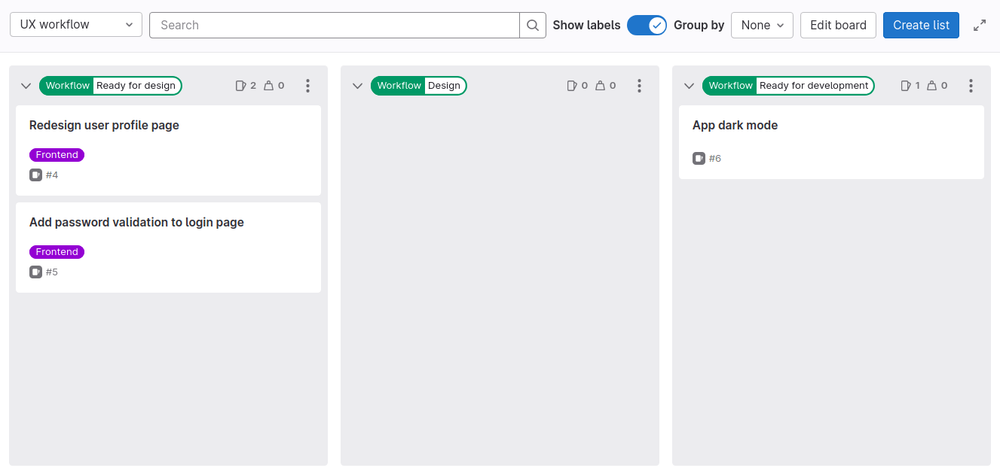
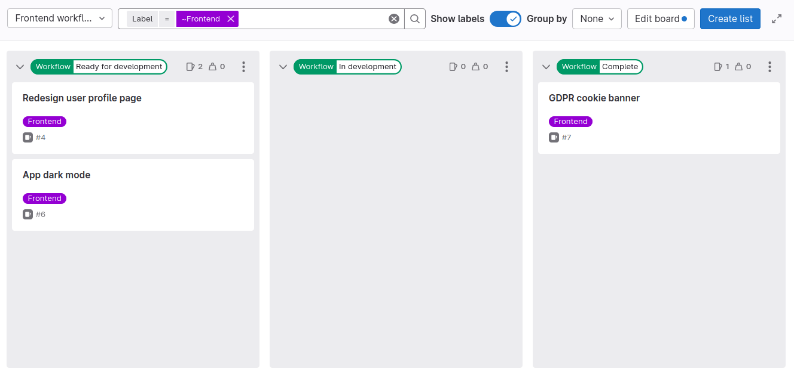
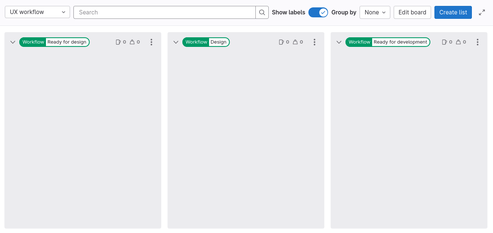
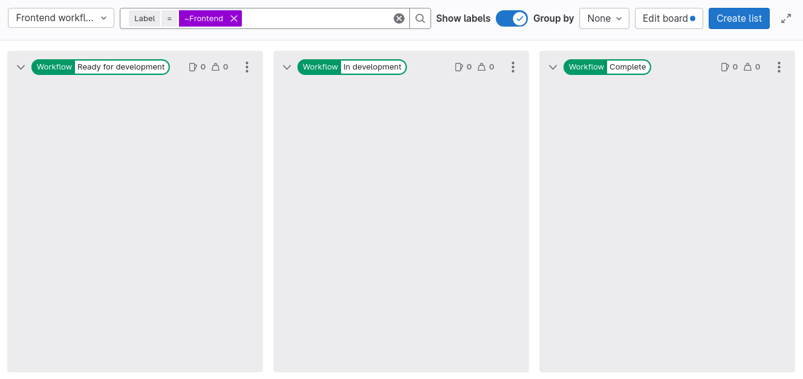

<!-- vale gitlab_base.FutureTense = NO -->

本教程介绍如何为按顺序处理议题的两个团队设置[议题看板](../../user/project/issue_board.md)和[作用域标记](../../user/project/labels.md#scoped-labels)。

在本示例中，您将为 UX 团队和前端团队创建两个议题看板。按照以下步骤，您可以为更多子团队（例如后端或质量保证团队）创建议题看板和工作流。

要为多个团队设置议题看板：

1. [创建群组](#create-a-group)
1. [创建项目](#create-a-project)
1. [创建标记](#create-labels)
1. [创建团队议题看板](#create-team-issue-boards)
1. [为功能创建议题](#create-issues-for-features)

## 开始之前

- 如果您使用现有群组来完成本教程，请确保您在该群组中具有计划者、报告者、开发者、维护者或所有者角色。
- 如果您使用现有项目来完成本教程，请确保您在该项目中具有计划者、报告者、开发者、维护者或所有者角色。

## 目标工作流

完成所有设置后，两个团队就可以将议题从一个看板移交到另一个看板，例如：

1. 项目负责人为一个名为 **Redesign user profile page**的功能议题添加 `Workflow::Ready for design` 和 `Frontend` 标记。
1. UX 团队的产品设计师：
   1. 查看 **UX workflow** 看板上的 `Workflow::Ready for design` 列表，并决定着手进行个人资料页面重新设计。

      

   1. 将自己指派给 **Redesign user profile page** 议题。
   1. 将议题卡片拖到 `Workflow::Design` 列表。之前的工作流标记会自动移除。
   1. 创建 ✨新设计✨。
   1. [将设计添加到议题](../../user/project/issues/design_management.md)。
   1. 将议题卡片拖到 `Workflow::Ready for development` 列表，这会添加该标记并移除其他任何 `Workflow::` 标记。
   1. 取消将自己指派给该议题。
1. 前端团队的开发者：
   1. 查看 **Frontend workflow** 看板上的 `Workflow::Ready for development` 列表，并选择一个要处理的议题。

      

   1. 将自己指派给 **Redesign user profile page** 议题。
   1. 将议题卡片拖到 `Workflow::In development` 列表。之前的工作流标记会自动移除。
   1. 在[合并请求](../../user/project/merge_requests/_index.md)中添加前端代码。
   1. 添加 `Workflow::Complete` 标记。

## 创建群组

为了应对项目后续的扩展，请先创建一个群组。您可以使用群组同时管理一个或多个相关项目。您可以将用户添加为群组成员，并为他们分配角色。

要创建群组：

1. 在右上角，选择**创建新的** () 和**新建群组**。
1. 选择**创建群组**。
1. 填写字段。将群组命名为 `Paperclip Software Factory`。
1. 选择**创建群组**。

您已创建一个空群组。接下来，您将创建一个用于存储议题和代码的项目。

## 创建项目

主要的代码开发工作发生在项目及其代码仓库中。项目包含您的代码和流水线，还包含用于规划即将进行的代码变更的议题。

要创建空白项目：

1. 在您的群组中，在右上角选择**创建新的** ()，然后选择
   **在此群组中** > **新建项目/仓库**。
1. 选择**创建空白项目**。
1. 输入项目详细信息：
   - 在**项目名称**文本框中，将项目命名为 `Paperclip Assistant`。
1. 选择**新建项目**。

## 创建标记

您需要一个团队标记和一组工作流标记，以显示议题处于开发生命周期的哪个阶段。

您可以在 `Paperclip Assistant` 项目中创建这些标记，但最好在 `Paperclip Software Factory` 群组中创建它们。这样，这些标记在您之后创建的所有其他项目中也可用。

要创建每个标记：

1. 在顶部栏中，选择**搜索或跳转到**并找到您的 **Paperclip Software Factory** 群组。
1. 选择**管理** > **标记**。
1. 选择**新建标记**。
1. 在**标题**文本框中，输入标记的名称。从 `Frontend` 开始。
1. 可选。从可用颜色中选择一种颜色，或在**背景颜色**文本框中输入十六进制颜色值
   以指定特定颜色。
1. 选择**创建标记**。

重复这些步骤以创建您需要的所有标记：

- `Frontend`
- `Workflow::Ready for design`
- `Workflow::Design`
- `Workflow::Ready for development`
- `Workflow::In development`
- `Workflow::Complete`

## 创建团队议题看板

与标记类似，您可以在 **Paperclip Assistant** 项目中创建议题看板，
但将它们放在 **Paperclip Software Factory** 群组中可能更好。这样，您就可以
管理该群组中之后可能创建的所有项目中的议题。

要创建新的群组议题看板：

1. 在顶部栏中，选择**搜索或跳转到**并找到您的 **Paperclip Software Factory** 群组。
1. 选择**计划** > **议题看板**。
1. 创建 UX workflow 和 Frontend workflow 看板。

要创建 **UX workflow** 议题看板：

1. 在议题看板页面的左上角，选择显示当前看板名称的下拉列表。
1. 选择**创建新看板**。
1. 在**标题字段**中，输入 `UX workflow`。
1. 清除**显示已打开列表**和**显示已关闭列表**复选框。
1. 选择**创建看板**。您应该会看到一个空看板。
1. 为 `Workflow::Ready for design` 标记创建一个列表：
   1. 在议题看板页面的右上角，选择**创建列表**。
   1. 在出现的列中，从**值**下拉列表中选择 `Workflow::Ready for design` 标记。
   1. 选择**添加到面板**。
1. 对标记 `Workflow::Design` 和 `Workflow::Ready for development` 重复上一步骤。

要创建 **Frontend workflow** 看板：

1. 在议题看板页面的左上角，选择显示当前看板名称的下拉列表。
1. 选择**创建新看板**。
1. 在**标题字段**中，输入 `Frontend workflow`。
1. 清除**显示已打开列表**和**显示已关闭列表**复选框。
1. 展开**范围**。
1. 在**标记**旁边，选择**编辑**并选择 `Frontend` 标记。
1. 选择**创建看板**。
1. 为 `Workflow::Ready for development` 标记创建一个列表：
   1. 在议题看板页面的右上角，选择**创建列表**。
   1. 在出现的列中，从**值**下拉列表中选择 `Workflow::Ready for development` 标记。
   1. 选择**添加到面板**。
1. 对标记 `Workflow::In development` 和 `Workflow::Complete` 重复上一步骤。

目前，两个看板中的列表都应为空。接下来，您将向其中添加一些议题。

## 为功能创建议题

要跟踪即将推出的功能、增强和缺陷，您必须创建一些议题。议题属于项目，但您也可以直接从议题看板创建它们。

要从看板创建议题：

1. 在议题看板页面的左上角，选择显示当前看板名称的下拉列表。
1. 选择 **UX workflow**。
1. 在 `Workflow::Ready for development` 列表上，选择**创建新议题** ()。
1. 填写字段：
   1. 在**标题**下，输入 `Redesign user profile page`。
   1. 在**项目**下，选择 **Paperclip Software Factory / Paperclip Assistant**。
1. 选择**创建议题**。由于您是在标记列表中创建新议题，因此它会带着
   该标记创建。
1. 添加 `Frontend` 标记，因为只有带有该标记的议题才会出现在前端团队的看板上：
   1. 选择议题卡片（而不是其标题），右侧会出现一个边栏。
   1. 在边栏的**标记**部分，选择**编辑**。
   1. 从**指派标记**下拉列表中，选择 `Workflow::Ready for design` 和
      `Frontend` 标记。所选标记旁会显示对勾。
   1. 要应用标记更改，请选择**指派标记**旁边的 **X**，或选择标记部分
      之外的任意区域。

重复这些步骤，使用相同的标记再创建几个议题。

现在，您应该至少能看到一个议题，可供您的产品设计师开始处理！

恭喜！现在您的团队可以开始协作开发出色的软件了。下一步，您可以自己使用这些看板尝试[目标工作流](#the-goal-workflow)，模拟两个团队的交互。

## 详细了解极狐GitLab 中的项目管理

在[教程页面](../plan_and_track.md)上查找有关项目管理的其他教程。
