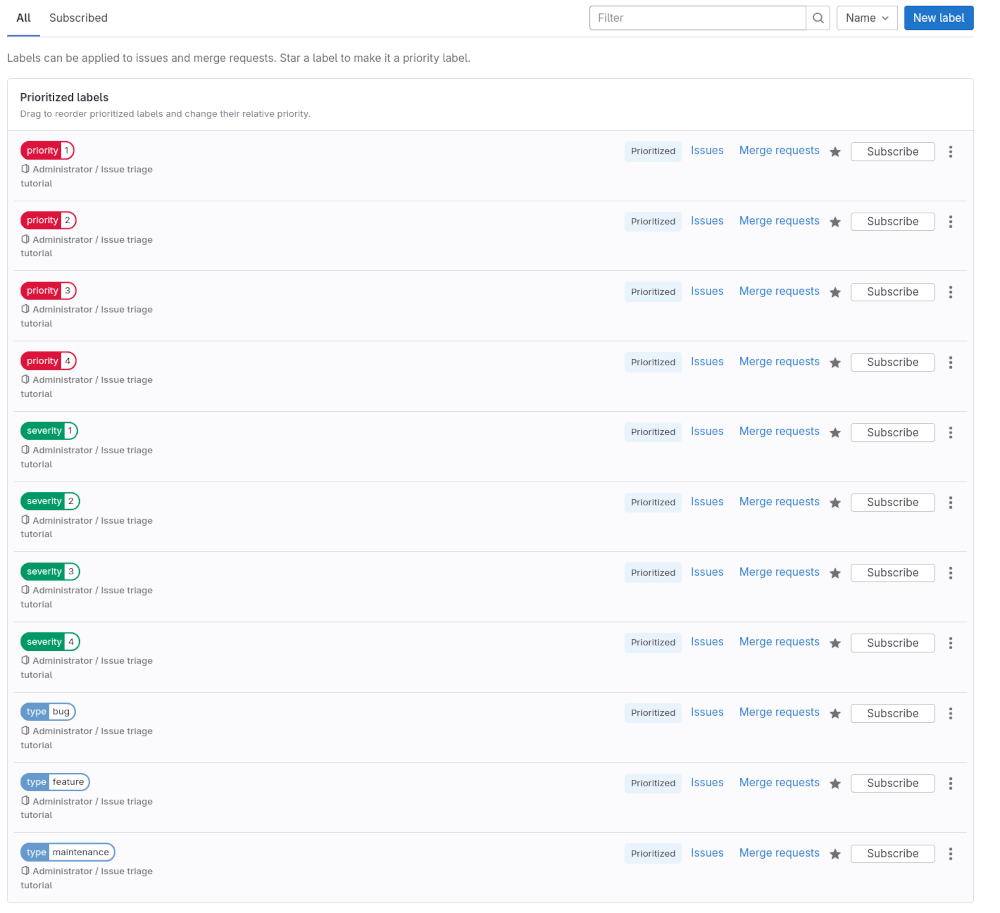
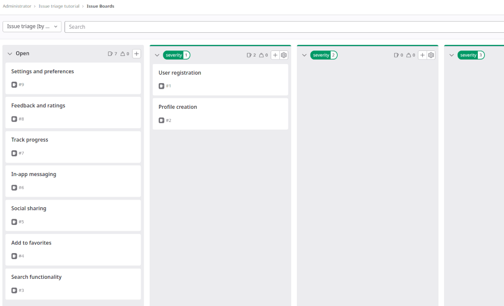
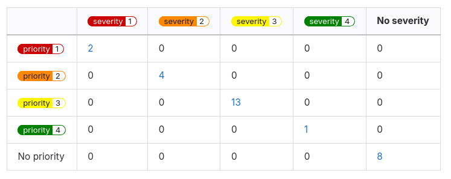

<!-- vale gitlab_base.FutureTense = NO -->

议题排查是指按类型和严重程度进行分类的过程。随着项目不断增长、人们创建越来越多的议题，为如何排查新进议题建立一套工作流程是很有必要的。

在本教程中，您将学习如何为此场景设置一个包含多个项目的极狐GitLab 群组。

要在项目中为议题排查设置极狐GitLab：

1. [创建群组](#create-a-group)
1. [在群组内创建项目](#create-projects-inside-a-group)
1. [确定类型、严重程度和优先级的判定标准](#decide-on-the-criteria-for-types-severity-and-priority)
1. [记录您的判定标准](#document-your-criteria)
1. [创建范围标记](#create-scoped-labels)
1. [为新标记设置优先级](#prioritize-the-new-labels)
1. [创建群组议题排查看板](#create-a-group-issue-triage-board)
1. [为功能创建议题](#create-issues-for-features)

## 开始之前

- 如果您使用现有项目来完成本教程，请确保您对该项目拥有报告者、开发者、维护者或所有者角色。
  - 如果您的现有项目没有父群组，请创建一个群组，并[将项目标记提升为群组标记](../../user/project/labels.md#promote-a-project-label-to-a-group-label)。

## 创建群组

[群组](../../user/group/_index.md)本质上是一个用于容纳多个项目的容器。借助群组，您可以管理多个项目，并一次性与群组成员沟通。

要创建新群组：

1. 在右上角，选择**创建新内容** ()，然后选择**新建群组**。
1. 选择**创建群组**。
1. 输入群组详细信息。
   - 在**群组名称**中，输入 `triage-tutorial`。
1. 在页面底部选择**创建群组**。

## 在群组内创建项目

要跨多个项目管理议题跟踪，您需要在群组内至少创建两个项目。

要创建新项目：

1. 在右上角，选择**创建新内容** () 和**新建项目/代码仓库**。
1. 选择**创建空白项目**。
1. 输入项目详细信息：
   - 在**项目名称**中，输入 `test-project-1`。有关更多信息，请参阅项目[命名规则](../../user/reserved_names.md#rules-for-usernames-project-and-group-names-and-slugs)。
1. 在页面底部选择**创建项目**。
1. 重复此过程，创建第二个名为 `test-project-2`的项目。

## 确定类型、严重程度和优先级的判定标准

接下来，您需要确定：

- 您想要识别的议题**类型**。如果您需要更细粒度的方式，还可以为每种类型创建子类型。类型有助于对工作进行分类，从而了解团队被要求处理的工作种类。
- **优先级**和**严重程度**的级别，用于定义新进工作对最终用户的影响，并帮助确定优先级。

在本教程中，假设您已确定以下内容：

- 类型：`Bug`、`Feature` 和 `Maintenance`
- 优先级：`1`、`2`、`3` 和 `4`
- 严重程度：`1`、`2`、`3` 和 `4`

如需参考，请查看极狐GitLab 如何定义这些内容：

- [类型和子类型](https://handbook.gitlab.com/handbook/engineering/metrics/#work-type-classification)
- [优先级](https://handbook.gitlab.com/handbook/product-development/how-we-work/issue-triage/#priority)
- [严重程度](https://handbook.gitlab.com/handbook/product-development/how-we-work/issue-triage/#severity)

## 记录您的判定标准

在就所有判定标准达成一致后，请将其记录下来，放在团队成员随时可以访问的地方。

例如，将其添加到项目的 [Wiki](../../user/project/wiki/_index.md)中，或添加到使用 [GitLab Pages](../../user/project/pages/_index.md) 发布的公司手册中。

<!-- Idea for expanding this tutorial:
     Add steps for [creating a wiki page](../../user/project/wiki/_index.md#create-a-new-wiki-page). -->

## 创建范围标记



- Tier: 专业版，旗舰版
- Offering: JihuLab.com，私有化部署



接下来，您将创建标记，以便添加到议题上对其进行分类。

最适合此目的的工具是[范围标记](../../user/project/labels.md#scoped-labels)，您可以用它来设置互斥的属性。

对照您[之前](#decide-on-the-criteria-for-types-severity-and-priority)整理的类型、严重程度和优先级列表，您需要创建与之匹配的范围标记。

范围标记名称中的双冒号（`::`）可防止同一范围的两个标记同时使用。例如，如果您向一个已有 `type::bug`的议题添加 `type::feature` 标记，则前一个标记会被移除。

> [!note]
> 范围标记在专业版和旗舰版中可用。
> 如果您使用的是基础版，可以改用普通标记。
> 但是，它们不是互斥的。

要创建每个标记：

1. 在顶部栏中，选择**搜索或跳转到**，然后找到您的群组。
1. 在左侧边栏中，选择**管理** > **标记**。
1. 选择**新建标记**。
1. 在**标题**文本框中，输入标记的名称。从 `type::bug` 开始。
1. 可选。从可用颜色中选择一种颜色，或在**背景颜色**文本框中输入特定颜色的十六进制颜色值。
1. 选择**创建标记**。

重复步骤 3-6 以创建您需要的所有标记。以下是一些示例：

- `type::bug`
- `type::feature`
- `type::maintenance`
- `priority::1`
- `priority::2`
- `priority::3`
- `priority::4`
- `severity::1`
- `severity::2`
- `severity::3`
- `severity::4`

## 为新标记设置优先级

现在，将新标记设置为优先级标记。这样做可以确保在按优先级或标记优先级排序时，最重要的议题显示在议题列表的顶部。

要了解按优先级或标记优先级排序时会发生什么，请参阅[议题列表的排序和排列](../../user/project/issues/sorting_issue_lists.md)。

要为标记设置优先级：

1. 在标记页面上，在您想要设置优先级的标记旁边，选择**设置优先级** ()。
   该标记现在会出现在标记列表的顶部，位于**已设置优先级的标记**下。
1. 要更改这些标记的相对优先级，请在列表中上下拖动它们。
   列表中位置越靠上的标记优先级越高。
1. 为您之前创建的所有标记设置优先级。
   确保优先级和严重程度较高的标记在列表中的位置高于数值较低的标记。

## 创建群组议题排查看板

为了应对即将到来的议题积压，请创建一个按标记组织议题的[议题看板](../../user/project/issue_board.md)。您将用它来快速创建议题，并通过将卡片拖到各个列表来为它们添加标记。

要设置您的议题看板：

1. 确定看板的作用域。
   例如，[创建一个群组议题看板](../../user/project/issue_board.md#group-issue-boards)，您将用它来为议题分配严重程度。
1. 在顶部栏中，选择**搜索或跳转到**，然后找到您的 **triage-tutorial** 群组。
1. 选择**计划** > **议题看板**。
1. 在议题看板页面的左上角，选择带有当前看板名称的下拉列表。
1. 选择**创建新看板**。
1. 在**标题**文本框中，输入 `Issue triage (by severity)`。
1. 保持选中**显示打开列表**复选框，并清除**显示已关闭列表**复选框。
1. 选择**创建看板**。您应该会看到一个空看板。
1. 为 `severity::1` 标记创建一个列表：
   1. 在议题看板页面的右上角，选择**创建列表**。
   1. 在出现的列中，从**值**下拉列表中选择 `severity::1` 标记。
   1. 在列表底部，选择**添加到看板**。
1. 对标记 `severity::2`、`severity::3` 和 `severity::4` 重复上一步骤。

目前，您看板中的列表应该是空的。接下来，您将用一些议题来填充它们。

## 为功能创建议题

要跟踪即将推出的功能和缺陷，您必须创建一些议题。议题属于项目，但您也可以直接从群组议题看板创建它们。

首先为计划中的功能创建一些议题。您可以在发现缺陷时为其创建议题（希望不要太多！）。

要从您的 **Issue triage (by severity)** 看板创建议题：

1. 转到**打开**列表。
   此列表显示不符合任何其他看板列表的议题。
   如果您已经知道您的议题应具有哪个严重程度标记，可以直接从该标记的列表创建它。
   请记住，从标记列表创建的每个议题都会被赋予该标记。

   现在，请继续使用**打开**列表。
1. 在**打开**列表上，选择**创建新议题**图标 ()。
1. 填写字段：
   - 在**标题**下，输入 `User registration`。
   - 选择此议题适用的项目。本示例使用 `test-project-1`。
1. 选择**创建议题**。
1. 重复这些步骤以创建更多议题。

   例如，如果您正在构建一个应用，假设 `test-project-1` 和 `test-project-2` 分别指该应用的后端和前端。
   创建以下议题，并根据您认为合适的方式分配给项目：

   - `User registration`
   - `Profile creation`
   - `Search functionality`
   - `Add to favorites`
   - `Push notifications`
   - `Social sharing`
   - `In-app messaging`
   - `Track progress`
   - `Feedback and ratings`
   - `Settings and preferences`

您的第一个排查议题看板已准备就绪！试着将一些议题从**打开**列表拖到某个标记列表，以添加其中一个严重程度标记。

## 后续步骤

接下来，您可以：

- 调整您使用议题看板的方式。一些选项包括：
  - 编辑您当前的议题看板，使其也包含优先级和类型标记的列表。
    这样会使看板更宽，可能需要一些水平滚动。
  - 创建名为 `Issue triage (by priority)` 和 `Issue triage (by type)`的单独议题看板。
    这样可以将各种类型的排查工作分开，但需要在看板之间切换。
  - [为团队交接设置议题看板](../boards_for_teams/_index.md)。
- 在议题列表中按优先级或严重程度浏览议题，[按每个标记进行筛选](../../user/project/issues/managing_issues.md#filter-the-list-of-issues)。
  如果可用，请使用[“is one of”筛选运算符](../../user/project/issues/managing_issues.md#filter-the-list-of-issues)。
- 将议题分解为[任务](../../user/tasks.md)。
- 使用 [`gitlab-triage` gem](https://gitlab.com/gitlab-org/ruby/gems/gitlab-triage) 创建有助于在项目中自动进行议题排查的策略。
  生成带有如下热力图的摘要报告：

  

要了解有关极狐GitLab 议题排查的更多信息，请参阅[议题排查](https://handbook.gitlab.com/handbook/product-development/how-we-work/issue-triage/)和[排查操作](https://handbook.gitlab.com/handbook/engineering/infrastructure-platforms/developer-experience/triage-operations/)。
