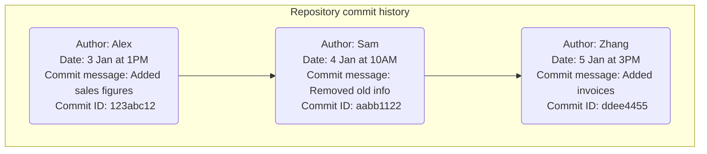
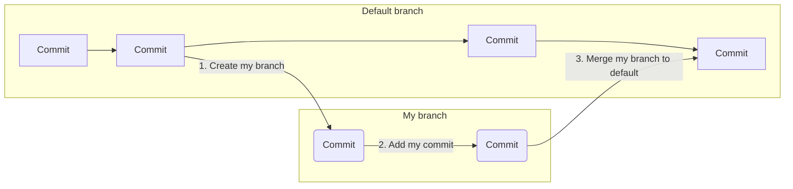
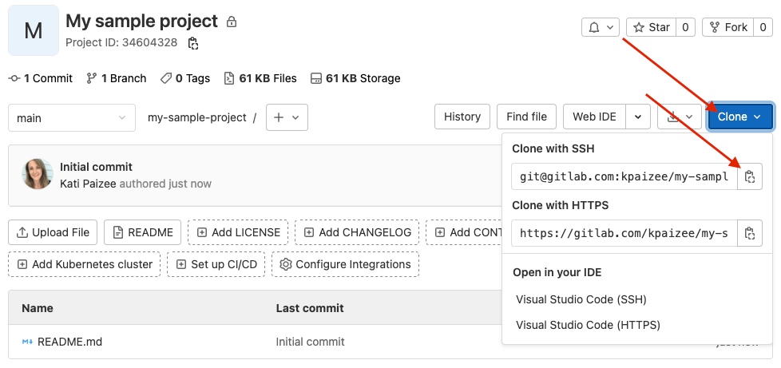
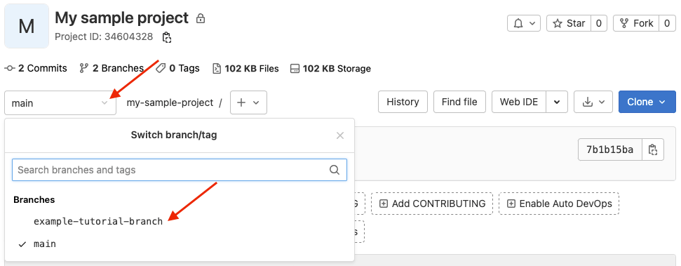
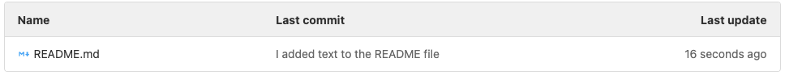

<!-- vale gitlab_base.FutureTense = NO -->

本教程将向您简要介绍 Git 的工作原理。它会带您逐步完成创建自己的项目、编辑文件，以及从命令行向 Git 代码仓库提交更改的全过程。

完成后，您将拥有一个可以练习使用 Git 的项目。

<a id="before-you-begin"></a>

## 先决条件

- [在本地计算机上安装 Git](../../topics/git/how_to_install_git/_index.md)。
- 确保您可以登录极狐GitLab 实例。如果您的组织没有极狐GitLab，请在 JihuLab.com 上创建一个账号。
- [创建 SSH 密钥并将其添加到极狐GitLab](../../user/ssh.md)。SSH 密钥是您在计算机与极狐GitLab 之间安全通信的方式。

<a id="what-is-git"></a>

## 什么是 Git？

在开始操作之前，让我们先了解一些 Git 的基本概念。

Git 是一个版本控制系统，用于跟踪文件的更改。

您将代码或文档等文件存储在 Git *代码仓库*中。当您想要编辑文件时，将代码仓库*克隆*到您的计算机，进行更改，然后*推送*更改回代码仓库。在极狐GitLab 中，Git 代码仓库位于一个*项目*中。

每次推送更改时，Git 都会将其记录为一个唯一的*提交*。这些提交构成了文件何时、如何更改以及由谁更改的历史记录。



在 Git 代码仓库中工作时，您是在*分支*上工作。默认情况下，代码仓库的内容位于默认分支中。要进行更改，您需要：

1. 创建自己的分支，它是您创建时默认分支的快照。
1. 进行更改并将其推送到您的分支。每次推送都会创建一个提交。
1. 准备就绪后，将您的分支*合并*到默认分支。



如果这一切让您感到有些不知所措，请坚持住。您即将看到这些概念的实际应用。

<a id="steps"></a>

## 步骤

以下是我们将要执行的操作概览：

1. [创建示例项目](#create-a-sample-project)。
1. [克隆代码仓库](#clone-the-repository)。
1. [创建分支并进行更改](#create-a-branch-and-make-changes)。
1. [提交并推送您的更改](#commit-and-push-your-changes)。
1. [合并您的更改](#merge-your-changes)。
1. [在极狐GitLab 中查看您的更改](#view-your-changes-in-gitlab)。

<a id="create-a-sample-project"></a>

### 创建示例项目

首先，在极狐GitLab 中创建一个示例项目。

1. 在极狐GitLab 中，选择右上角的**创建新的** () 和**新建项目/仓库**。
1. 在**项目名称**中，输入 `My sample project`。项目 slug 会自动为您生成。
   该 slug 是项目创建后您可用于访问项目的 URL。
1. 确保选中**使用自述文件初始化仓库**。
   其他字段如何填写由您决定。
1. 选择**新建项目**。

<a id="clone-the-repository"></a>

### 克隆代码仓库

现在您可以在项目中克隆代码仓库。*克隆*代码仓库意味着在您的计算机上，或您想要存储和处理文件的任何位置创建一份副本。

1. 在项目概览页面的右上角，选择**代码**，然后复制**使用 SSH 克隆**的 URL。

   
1. 在您的计算机上打开终端，并转到您想要克隆文件的目录。
1. 输入 `git clone` 并粘贴 URL：

   ```shell
   git clone git@gitlab.com:gitlab-example/my-sample-project.git
   ```

1. 转到该目录：

   ```shell
   cd my-sample-project
   ```

1. 默认情况下，您已克隆代码仓库的默认分支。通常该分支是 `main`。为确保无误，请获取默认分支的名称：

   ```shell
   git branch
   ```

   您当前所在的分支用星号标记。
   按键盘上的 `Q` 返回主终端窗口。

<a id="create-a-branch-and-make-changes"></a>

### 创建分支并进行更改

现在您已拥有代码仓库的副本，请创建自己的分支，以便独立处理您的更改。

1. 创建一个名为 `example-tutorial-branch`的新分支。

   ```shell
   git checkout -b example-tutorial-branch
   ```

1. 在 Visual Studio Code、Sublime、`vi` 或任何其他文本编辑器中，打开 README.md 文件并添加以下文本：

   ```plaintext
   Hello world! I'm using Git!
   ```

1. 保存文件。
1. Git 会跟踪已更改的文件。要确认哪些文件已更改，请获取状态。

   ```shell
   git status
   ```

   您应该会得到类似以下的输出：

   ```shell
   On branch example-tutorial-branch
   Changes not staged for commit:
   (use "git add <file>..." to update what will be committed)
   (use "git restore <file>..." to discard changes in working directory)
   modified:   README.md

   no changes added to commit (use "git add" and/or "git commit -a")
   ```

<a id="commit-and-push-your-changes"></a>

### 提交并推送您的更改

您已对代码仓库中的文件进行了更改。现在是时候通过进行首次提交来记录这些更改了。

1. 将 `README.md` 文件添加到*暂存*区。暂存区是您在提交文件之前放置文件的地方。

   ```shell
   git add README.md
   ```

1. 确认文件已暂存：

   ```shell
   git status
   ```

   您应该会得到类似以下的输出，并且文件名应显示为绿色文本。

   ```shell
   On branch example-tutorial-branch
   Changes to be committed:
   (use "git restore --staged <file>..." to unstage)
   modified:   README.md
   ```

1. 现在提交已暂存的文件，并包含一条描述您所做更改的消息。请确保用双引号 (") 将消息括起来。

   ```shell
   git commit -m "I added text to the README file"
   ```

1. 更改已提交到您的分支，但您的分支及其提交仍然只在您的计算机上可用。其他任何人都还无法访问它们。
   将您的分支推送到极狐GitLab：

   ```shell
   git push origin example-tutorial-branch
   ```

您的分支现在已在极狐GitLab 上可用，并且对您项目中的其他用户可见。



<a id="merge-your-changes"></a>

### 合并您的更改

现在您已准备好将 `example-tutorial-branch` 分支中的更改合并到默认分支（`main`）。

1. 检出代码仓库的默认分支。

   ```shell
   git checkout main
   ```

1. 将您的分支合并到默认分支。

   ```shell
   git merge example-tutorial-branch
   ```

1. 推送更改。

   ```shell
   git push
   ```

> [!note]
> 在本教程中，您将分支直接合并到代码仓库的默认分支。在极狐GitLab 中，您通常使用[合并请求](../../user/project/merge_requests/_index.md)来合并您的分支。

<a id="view-your-changes-in-gitlab"></a>

### 在极狐GitLab 中查看您的更改

您做到了！您更新了分支中的 `README.md` 文件，并将这些更改合并到了 `main` 分支。

让我们在 UI 中查看并确认您的更改。转到您的项目。

- 向下滚动并查看 `README.md` 文件的内容。
  您应该能看到所做的更改。
- 在 `README.md` 文件上方，查看**最后提交**列中的文本。
  您的提交消息会显示在此列中：

  

现在您可以返回命令行并切换回您的个人分支（`git checkout example-tutorial-branch`）。您可以继续更新文件或创建新文件。输入 `git status` 查看更改状态，然后尽情提交。

如果您把事情搞砸了，也不用担心。Git 中的一切都可以还原，如果您发现无法恢复，随时可以创建一个新分支重新开始。

干得漂亮。

<a id="find-more-git-learning-resources"></a>

## 查找更多 Git 学习资源

- 在[教程页面](../_index.md)上查找有关 Git 和极狐GitLab 的其他教程。
- PDF 下载：[Git 速查表](https://gitlab.com/gitlab-com/www-gitlab-com/-/blob/master/source/images/press/git-cheat-sheet.pdf)。
- 博客文章：[Git 技巧与提示](https://about.gitlab.com/blog/git-tips-and-tricks/)。
- 博客文章：[帮助您更好地使用 Git 的八条提示](https://about.gitlab.com/blog/8-tips-to-help-you-work-better-with-git/)。
- 官方 [Git 文档](https://git-scm.com)，包括
  [服务器上的 Git - GitLab](https://git-scm.com/book/en/v2/Git-on-the-Server-GitLab)。
