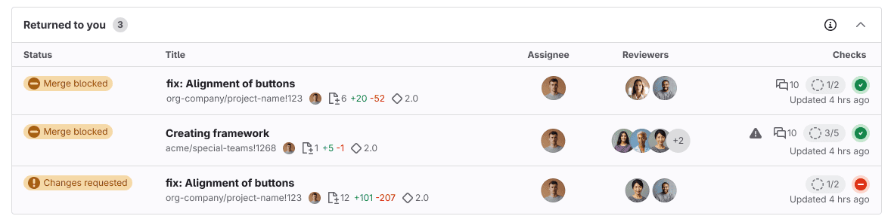
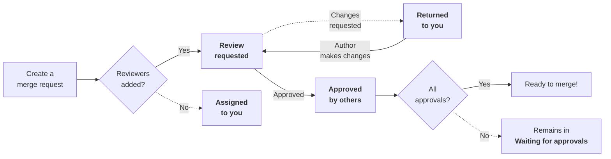



- Tier: 基础版，专业版，旗舰版
- Offering: JihuLab.com，私有化部署



> [!flag]
> 此功能的可用性由功能标志控制。

本教程向您介绍用于管理合并请求的新用户界面。

无论您是等待评审的作者，还是提供反馈的审核人，此页面都能帮助您跟踪工作。它将您的工作划分为清晰的类别，帮助您：

- 减少跟踪需要您关注的合并请求所花费的时间。
- 优先处理最紧急的工作。
- 查看您贡献的状态。
- 防止进行中的工作被遗忘。
- 提高您的代码评审速度。

## 实际效果

要查看您在 JihuLab.com 上的合并请求主页，您可以：

- 使用 <kbd>Shift</kbd>+<kbd>m</kbd> [键盘快捷键](../../user/shortcuts.md)。
- 在左侧边栏中，选择**合并请求**。

它分为三个选项卡，帮助您专注于当前需要关注的内容，同时仍可访问其他近期工作：

- **活跃**：这些合并请求需要您或您团队成员的关注。
- **已合并**：这些合并请求在过去 14 天内合并，且您是指派人或审核人。
- **搜索**：搜索所有合并请求，并根据需要进行筛选。

极狐GitLab 会在所有页面的右上角显示**活跃**合并请求的总数。例如，此用户有：

- 8 个未关闭的议题（）
- 3 个活跃合并请求（）
- 6 个待办事项（）

每个表格行将合并请求的相关信息分组到各列中：

- **状态** - 合并请求的当前状态。
- **标题** - 关于该议题的重要元数据，包括：
  - 合并请求标题。
  - 指派人的头像。
  - 添加和删除的文件及行数（`+` / `-`）。
  - 里程碑。
- **作者** - 作者的头像。
- **审核人** - 审核人的头像。带有绿色对勾的审核人已批准该合并请求。
- **检查** - 对可合并性的简要评估。
  - 未解决的讨论串数量，例如 `0 of 3`。
  - 当前所需的[审批状态](../../user/project/merge_requests/approvals/_index.md#in-the-list-of-merge-requests)。
  - 最近一次流水线的状态。
  - 最后更新日期。

## 设置显示偏好

在右上角，选择**显示偏好**（）以按以下方式对合并请求排序：

- **工作流**。此视图按状态对合并请求分组。需要您关注的合并请求会优先显示，无论
  您是作者还是审核人。
- **角色**。此视图按您是审核人还是作者对合并请求分组。





在**工作流**视图中，**活跃**选项卡按以下顺序对合并请求排序：

- **返还给您**
- **请求评审**
- **您的合并请求**

处于以下状态的合并请求不计入**活跃**计数：

- **等待指派人**
- **等待审批**
- **您已批准**
- **他人已批准**





在**角色**视图中，**活跃**选项卡按以下顺序对合并请求排序：

- **审核人（活跃）**
- **审核人（非活跃）**
- **您的合并请求（活跃）**
- **您的合并请求（非活跃）**





## 了解角色视图

**角色**视图将您是指派人或审核人的合并请求分组：

- **审核人（活跃）**：等待您评审。
- **审核人（非活跃）**：您已评审。
- **您的合并请求（活跃）**
- **您的合并请求（非活跃）**

**活跃**列表中的合并请求会计入左侧边栏显示的总数。

## 了解工作流视图

**工作流**视图按合并请求在[评审流程](../../user/project/merge_requests/reviews/_index.md)中所处的阶段进行分组。此视图帮助您了解下一步应采取什么操作：

此评审流程假设：

1. **指派人**是合并请求的作者。
1. **审核人**是在合并请求中评审工作的用户。
1. 审核人使用[**开始评审**](../../user/project/merge_requests/reviews/_index.md#start-a-review)和
   [**提交评审**](../../user/project/merge_requests/reviews/_index.md#submit-a-review)功能。

处于某个**活跃**状态的合并请求会计入左侧边栏显示的总数：

- 活跃状态：**返还给您**、**请求评审**、**您的合并请求**
- 非活跃状态：**等待指派人**、**等待审批**、**您已批准**、**他人已批准**

## 工作流视图：活跃状态

这些合并请求需要您或您团队成员的关注。

### 返还给您

审核人已提供反馈或请求更改。

- 下一步：处理审核人的评论，并实施建议的更改。
- 状态：
  - **请求更改**：审核人已请求更改。
  - **审核人已评论**：审核人已留下评论但未请求更改。

### 请求评审

您是该合并请求的审核人。

- 下一步：评审该合并请求。提供批准和反馈。需要时请求更改。
- 状态：
  - **已请求**：您尚未开始评审。
  - **评审已开始**：您已开始评审，但尚未完成。

### 您的合并请求

您是该合并请求的作者或指派人。您尚未添加审核人。

- 下一步：添加审核人以开始评审流程。
- 状态：
  - **草稿**：该合并请求被标记为草稿。
  - **需要审核人**：该合并请求不是草稿，但没有审核人。

## 工作流视图：非活跃状态

**活跃**选项卡显示您所有进行中的合并请求，按状态排序。这些合并请求不计入活跃计数，因为当前不需要您采取任何操作：

### 等待指派人

您指派的、正在等待审批的合并请求，以及您已请求更改的评审。

- 下一步：等待评审和审批。
- 状态：
  - **您已请求更改**：您已完成评审并请求更改。
  - **您已评论**：您已评论，但尚未完成评审。

### 等待审批

您指派的、正在等待审批的合并请求，以及您已请求更改的评审。

- 下一步：等待所有审批要求得到满足。
- 状态：
  - **需要审批** - 剩余所需审批数量。
  - **已批准** - 您已批准，或所有所需审批均已满足。
  - **等待审批**。

### 您已批准

您已评审并批准的合并请求。

- 下一步：等待其他审批和其他合并要求得到满足。
- 状态：
  - **已批准** - 您已批准，且所需审批均已满足。
  - **需要审批** - 您已批准，但并非所有所需审批均已满足。

### 他人已批准

已收到其他团队成员批准的合并请求。

- 下一步：如果所有要求均已满足，可能已准备好合并。
- 状态：
  - **已批准** - 您的合并请求已收到必要的批准。
