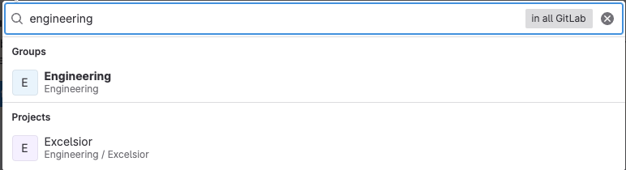
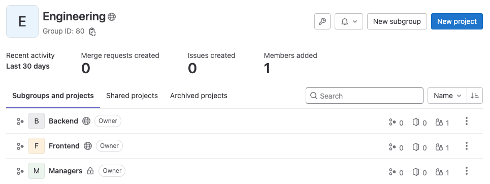
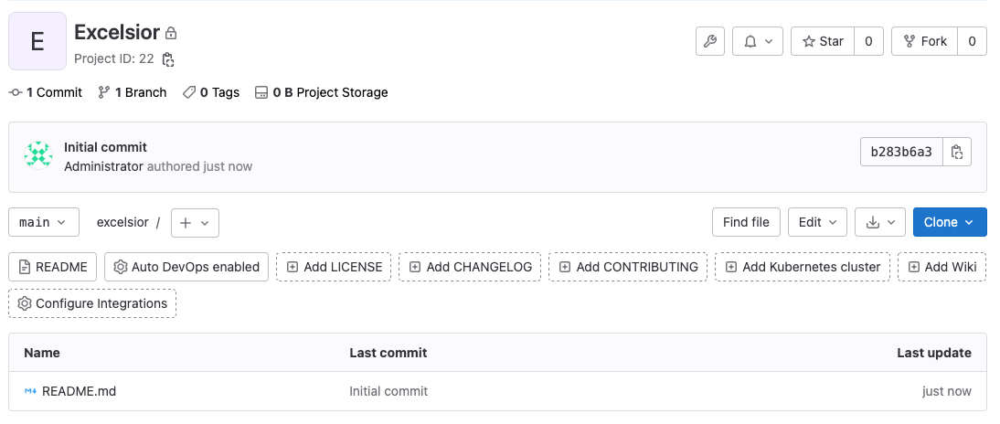
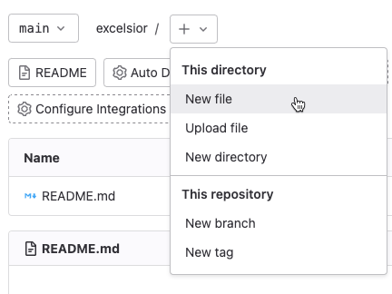
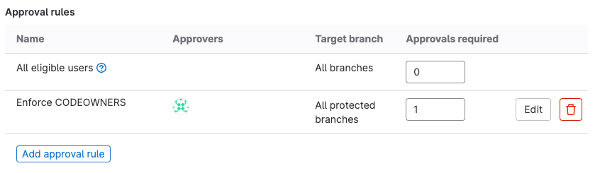
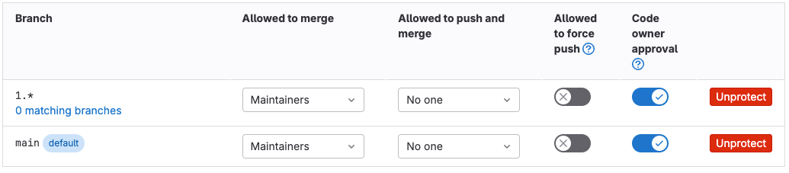
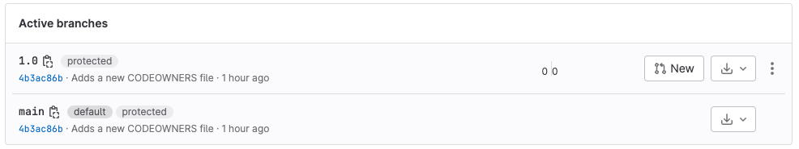
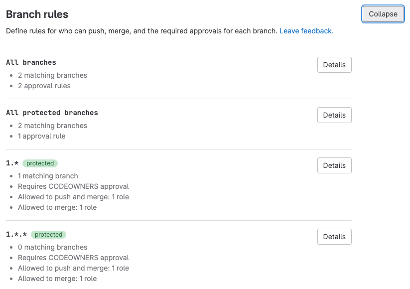

<!-- vale gitlab_base.FutureTense = NO -->



- Tier: 基础版，专业版，旗舰版
- Offering: JihuLab.com，私有化部署



当您的团队启动一个新项目时，他们需要一种既能保证效率又能进行适当评审的工作流。在极狐GitLab 中，您可以创建用户群组，将这些群组与分支保护相结合，然后通过审批规则强制执行这些保护。

本教程为一个名为“Excelsior”的示例项目的 `1.x` 和 `1.x.x` 发布分支设置保护，并为该项目创建一个最小化的审批工作流：

1. [创建 `engineering` 群组](#create-the-engineering-group)
1. [在 `engineering`中创建子群组](#create-subgroups-in-engineering)
1. [将用户添加到子群组](#add-users-to-the-subgroups)
1. [创建 Excelsior 项目](#create-the-excelsior-project)
1. [添加基本的 CODEOWNERS 文件](#add-a-basic-codeowners-file)
1. [配置审批规则](#configure-approval-rules)
1. [在分支上强制执行 CODEOWNER 审批](#enforce-codeowner-approval-on-branches)
1. [创建发布分支](#create-the-release-branches)

<a id="before-you-begin"></a>

## 开始之前

- 您必须具有维护者或所有者角色。
- 您需要一份经理名单及其电子邮件地址。
- 您需要一份后端和前端工程师名单及其电子邮件地址。
- 您了解用于分支命名的[语义化版本](https://semver.org/)。

<a id="create-the-engineering-group"></a>

## 创建 `engineering` 群组

在设置 Excelsior 项目之前，您应该创建一个群组来拥有该项目。在这里，您将设置 Engineering 群组：

1. 在右上角，选择**创建新的** () 和**新建群组**。
1. 选择**创建群组**。
1. 在**群组名称**中，输入 `Engineering`。
1. 在**群组 URL**中，输入 `engineering`。
1. 将**可见性级别**设置为**私有**。
1. 个性化您的体验，让极狐GitLab 向您显示最有帮助的信息：
   - 在**角色**中，选择**系统管理员**。
   - 在**谁将使用此群组？**中，选择**我的公司或团队**。
   - 在**您将使用此群组做什么？**中，选择**我想要存储我的代码**。
1. 跳过邀请成员加入群组。您将在本教程后面的部分添加用户。
1. 选择**创建群组**。

接下来，您将向此 `engineering` 群组添加子群组，以实现更精细的控制。

<a id="create-subgroups-in-engineering"></a>

## 在 `engineering`中创建子群组

`engineering` 群组是一个好的开始，但 Excelsior 项目的后端工程师、前端工程师和经理有着不同的任务和不同的专业领域。

在这里，您将在 Engineering 群组中创建三个更精细的子群组，按用户所做工作的类型进行划分：`managers`、`frontend` 和 `backend`。然后，您将把这些新群组添加为 `engineering` 群组的成员。

首先，创建新的子群组：

1. 在顶部栏中，选择**搜索或跳转到**并搜索 `engineering`。
1. 选择名为 `Engineering`的群组：

   
1. 在 `engineering` 群组的概览页面上，在右上角选择**创建子群组**。
1. 在**子群组名称**中，输入 `Managers`。
1. 将**可见性级别**设置为**私有**。
1. 选择**创建子群组**。

接下来，将该子群组添加为 `engineering` 群组的成员：

1. 在顶部栏中，选择**搜索或跳转到**并搜索 `engineering`。
1. 选择名为 `Engineering`的群组。
1. 选择**管理** > **成员**。
1. 在右上角，选择**邀请群组**。
1. 在**选择要邀请的群组**中，选择 `Engineering / Managers`。
1. 添加子群组时，选择**维护者**角色。这会配置子群组成员在访问 `engineering` 群组及其项目时可以继承的最高角色。
1. 可选。选择一个到期日期。
1. 选择**邀请**。

重复此过程，为 `backend` 和 `frontend` 创建子群组。完成后，再次搜索 `engineering` 群组。其概览页面应显示三个子群组，如下所示：



<a id="add-users-to-the-subgroups"></a>

## 将用户添加到子群组

在上一步中，当您将子群组添加到父群组（`engineering`）时，您将子群组的成员限制为维护者角色。此角色是他们在 `engineering` 拥有的项目中可以继承的最高角色。因此：

- 用户 1 以访客角色添加到 `manager` 子群组，并在 `engineering` 项目上获得访客角色。
- 用户 2 以所有者角色添加到 `manager` 群组。此角色高于您设置的最高角色（维护者），因此用户 2 获得维护者角色，而不是所有者。

要将用户添加到 `frontend` 子群组：

1. 在顶部栏中，选择**搜索或跳转到**并搜索 `frontend`。
1. 选择 `Frontend` 群组。
1. 选择**管理** > **成员**。
1. 选择**邀请成员**。
1. 填写字段。默认选择**开发者**角色，如果此用户评审他人的工作，则将其提升为**维护者**。
1. 选择**邀请**。
1. 重复这些步骤，直到您将所有前端工程师添加到 `frontend` 子群组。

现在对 `backend` 和 `managers` 群组执行相同操作。同一用户可以是一个或多个子群组的成员。

<a id="create-the-excelsior-project"></a>

## 创建 Excelsior 项目

现在您的群组结构已就位，创建 `excelsior` 项目供团队在其中工作。由于前端和后端工程师都参与其中，`excelsior` 应属于 `engineering`，而不是您刚刚创建的任何较小的子群组。

要创建新的 `excelsior` 项目：

1. 在顶部栏中，选择**搜索或跳转到**并搜索 `engineering`。
1. 选择名为 `Engineering`的群组。
1. 在 `engineering` 群组的概览页面上，在右上角选择**创建新的** () 和**在此群组中** > **新建项目/仓库**。
1. 选择**创建空白项目**。
1. 输入项目详细信息：
   - 在**项目名称**字段中，输入 `Excelsior`。**项目路径**应自动填充为 `excelsior`。
   - 在**可见性级别**中，选择**公开**。
   - 选择**使用 README 初始化代码仓库**，向代码仓库添加一个初始文件。
1. 选择**创建项目**。

极狐GitLab 为您创建 `excelsior` 项目，并将您重定向到其主页。它应如下所示：



您将在下一步中使用此页面上的功能。

<a id="add-a-basic-codeowners-file"></a>

## 添加基本的 CODEOWNERS 文件

将 CODEOWNERS 文件添加到项目的根目录，以将评审路由到正确的子群组。此示例设置了四条规则：

- 所有更改都应由 `engineering` 群组中的某人评审。
- 经理应评审对 CODEOWNERS 文件本身的任何更改。
- 前端工程师应评审对前端文件的更改。
- 后端工程师应评审对后端文件的更改。

> [!note]
> 极狐GitLab 基础版仅支持可选评审。要使评审成为必需，您需要
> 极狐GitLab 专业版或旗舰版。

要将 CODEOWNERS 文件添加到您的 `excelsior` 项目：

1. 在顶部栏中，选择**搜索或跳转到**并搜索 `Excelsior`。
1. 选择名为 `Excelsior`的项目。
1. 在分支名称旁边，选择加号图标 ()，然后选择**新建文件**：
   
1. 在**文件名**中，输入 `CODEOWNERS`。这将在项目的根目录中创建一个名为 `CODEOWNERS`的文件。
1. 将此示例粘贴到编辑区域，如果 `@engineering/` 与您的群组结构不匹配，请更改它：

   ```plaintext
   # All changes should be reviewed by someone in the engineering group
   * @engineering

   # A manager should review any changes to this file
   CODEOWNERS @engineering/managers

   # Frontend files should be reviewed by FE engineers
   [Frontend] @engineering/frontend
   *.scss
   *.js

   # Backend files should be reviewed by BE engineers
   [Backend] @engineering/backend
   *.rb
   ```

1. 在**提交信息**中，粘贴：

   ```plaintext
   Adds a new CODEOWNERS file

   Creates a small CODEOWNERS file to:
   - Route backend and frontend changes to the right teams
   - Route CODEOWNERS file changes to managers
   - Request all changes be reviewed
   ```

1. 选择**提交更改**。

CODEOWNERS 文件现已位于项目的 `main` 分支中，并可用于此项目中创建的所有未来分支。

<a id="configure-approval-rules"></a>

## 配置审批规则

CODEOWNERS 文件描述了目录和文件类型的适当审核人。审批规则将合并请求引导至这些审核人。在这里，您将设置一个审批规则，使用新 CODEOWNERS 文件中的信息，并为发布分支添加保护：

1. 在顶部栏中，选择**搜索或跳转到**并搜索 `Excelsior`。
1. 选择名为 `Excelsior`的项目。
1. 选择**设置** > **合并请求**。
1. 在**合并请求审批**部分中，滚动到**审批规则**。
1. 选择**添加审批规则**。
1. 创建一个名为 `Enforce CODEOWNERS`的规则。
1. 选择**所有受保护分支**。
1. 要使该规则在极狐GitLab 专业版和极狐GitLab 旗舰版中成为必需，请将**所需审批数**设置为 `1`。
1. 将 `managers` 群组添加为审批人。
1. 选择**添加审批规则**。
1. 滚动到**审批设置**，并确保选中**阻止在合并请求中编辑审批规则**。
1. 选择**保存更改**。

添加后，`Enforce CODEOWNERS` 规则如下所示：



<a id="enforce-codeowner-approval-on-branches"></a>

## 在分支上强制执行 CODEOWNER 审批

您已为项目配置了多项保护，现在可以将这些保护组合在一起，以保护项目的重要分支：

- 您的用户被分类到逻辑群组和子群组中。
- 您的 CODEOWNERS 文件描述了文件类型和目录的领域专家。
- 您的审批规则鼓励（在极狐GitLab 基础版中）或要求（在极狐GitLab 专业版和极狐GitLab 旗舰版中）领域专家评审更改。

您的 `excelsior` 项目对发布分支名称使用[语义化版本](https://semver.org/)，因此您知道发布分支遵循 `1.x` 和 `1.x.x` 模式。您希望添加到这些分支的所有代码都由领域专家评审，并由经理对合并到发布分支的工作做出最终决定。

与其一次为一个分支创建保护，不如配置通配符分支规则来保护多个分支：

1. 在顶部栏中，选择**搜索或跳转到**并搜索 `Excelsior`。
1. 选择名为 `Excelsior`的项目。
1. 选择**设置** > **代码仓库**。
1. 展开**分支规则**。
1. 选择**添加分支规则** > **分支名称或模式**。
1. 从下拉列表中，输入 `1.*`，然后选择**创建通配符 `1.*`**。
1. 要要求所有人提交合并请求，而不是直接推送提交：
   1. 在**允许合并**部分中，选择**编辑**，设置为**维护者**，然后选择**保存更改**。
   1. 在**允许推送和合并**部分中，选择**编辑**，设置为**没有人**，然后选择**保存更改**。
   1. 保持**允许强制推送**为禁用状态。
1. 在极狐GitLab 专业版和极狐GitLab 旗舰版中，要要求代码所有者评审他们处理的文件的更改，请切换**需要代码所有者审批**。
1. 在分支表中，找到标记为 `Default`的规则。（根据您的极狐GitLab 版本，此分支可能名为 `main` 或 `master`。）将此分支的值设置为与您用于 `1.*` 规则的设置相匹配。

您的规则现已就位，即使尚不存在 `1.*` 分支：



<a id="create-the-release-branches"></a>

## 创建发布分支

现在所有分支保护都已就位，您可以创建 1.0.0 发布分支：

1. 在顶部栏中，选择**搜索或跳转到**并搜索 `Excelsior`。
1. 选择名为 `Excelsior`的项目。
1. 在左侧边栏中，选择**代码** > **分支**。
1. 在右上角，选择**新建分支**。将其命名为 `1.0.0`。
1. 选择**创建分支**。

分支保护现在在 UI 中可见：

- 在左侧边栏中，选择**代码** > **分支**。在分支列表中，分支 `1.0.0` 应显示其受保护：

  
- 在左侧边栏中，选择**设置** > **代码仓库**，然后展开**分支规则**以查看所有受保护分支的详细信息：

  

恭喜！您的工程师可以在各自的分支中独立工作，所有提交以供 1.0.0 发布分支考虑的代码都将由领域专家评审。
