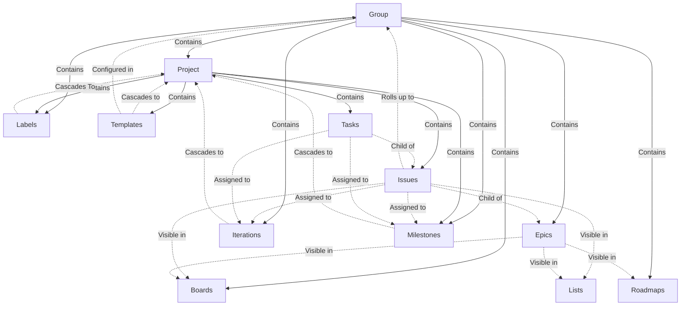
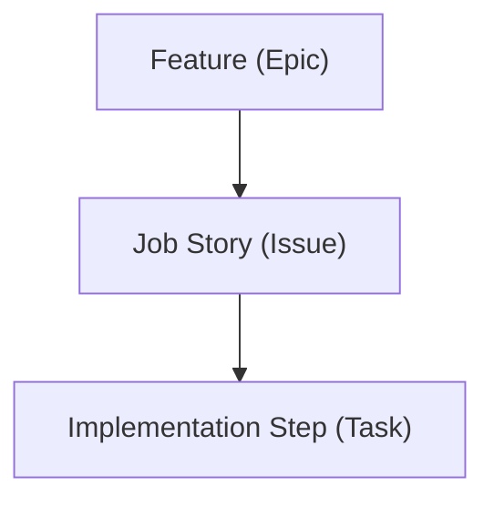
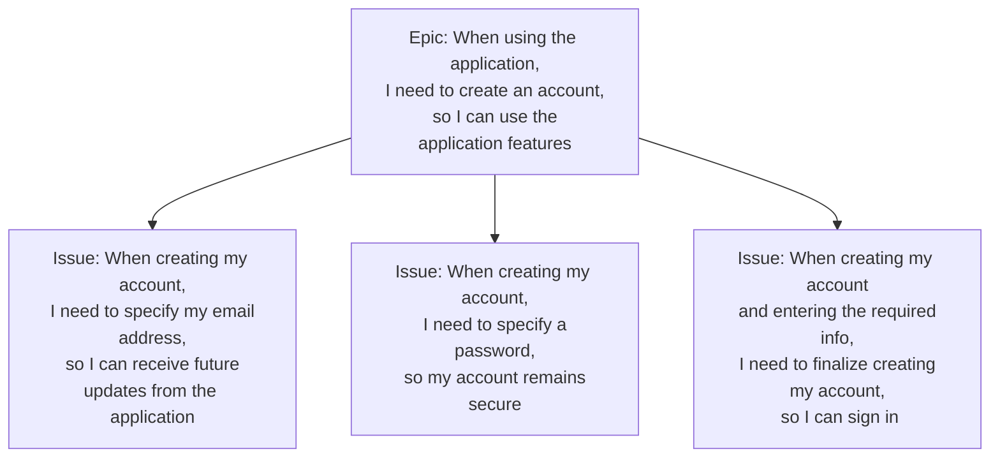
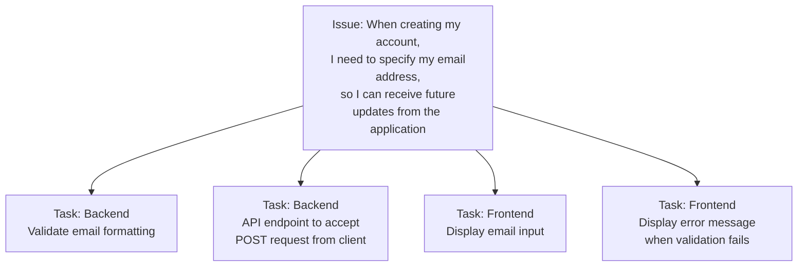

<!-- vale gitlab_base.FutureTense = NO -->

本教程提供分步指导，介绍如何使用极狐GitLab 中的敏捷规划和跟踪功能来促进核心 Scrum 仪式和工作流。通过精心设置群组、项目、看板和其他功能，团队可以实现更高的透明度、协作和交付节奏。

根据 Martin Fowler 的[敏捷流畅度模型](https://martinfowler.com/articles/agileFluency.html)，实践 [Scrum](https://scrumguides.org/scrum-guide.html)的团队：

> ……从赞助者、客户和用户将从其软件中获得的收益出发进行思考和规划。

他们通过每月展示进展、定期反思并改进流程和工作习惯来实现这一点，从而提供更多业务和客户价值。

本教程涵盖以下主题：

- [设置群组和项目](#setting-up-your-groups-and-projects)
- [管理功能待办事项](#managing-your-feature-backlog)
- [管理故事待办事项](#managing-your-story-backlog)
- [跟踪冲刺进度](#tracking-sprint-progress)

<a id="setting-up-your-groups-and-projects"></a>

## 设置群组和项目

要在极狐GitLab 中促进 Scrum 实践，您首先需要设置群组和项目的基础结构。您将使用群组创建看板和标记，这些看板和标记可由嵌套在该群组下的项目继承。项目将包含构成每个冲刺实际工作项的议题和任务。

<a id="understanding-the-inheritance-model-in-gitlab"></a>

### 了解极狐GitLab 中的继承模型

极狐GitLab 具有层级结构，其中群组包含项目。应用于群组的设置和配置会向下级联到子项目，因此您可以跨多个项目标准化标记、看板和迭代：



- 群组包含一个或多个项目、史诗、看板、标记和迭代。
  用户在群组中的成员身份会向下级联到该群组的项目。
- 您可以在群组或项目中创建看板和标记。
  在本教程中，您应在群组中创建它们，以便在单个群组中的多个项目之间促进标准化的规划工作流和报告。
- 任何向下级联到项目的对象都可以与该项目的议题关联，
  例如：您可以将群组中的标记应用到议题。

<a id="create-your-group"></a>

### 创建群组

为您的 Scrum 活动创建一个专用群组。这将是项目和配置（如您希望跨项目标准化的看板和标记）的父容器。

该群组将是典型 Scrum 节奏中不同活动的主要场所。它将包含您的看板、功能（史诗）、故事（议题）汇总和标记。

要创建群组：

1. 在右上角，选择**创建新的** () 和**新建群组**。
1. 选择**创建群组**。
1. 在**群组名称**文本框中，输入群组的名称。有关不能用作群组名称的词语列表，请参阅
   [保留名称](../../user/reserved_names.md)。
1. 在**群组 URL** 文本框中，输入用于[命名空间](../../user/namespace/_index.md)的群组路径。
1. 选择群组的[**可见性级别**](../../user/public_access.md)。
1. 可选。要个性化您的极狐GitLab 体验：
   - 从**角色**下拉列表中，选择您的角色。
   - 对于**谁将使用此群组？**，选择一个选项。
   - 从**您将使用此群组做什么？**下拉列表中，选择一个选项。
1. 可选。要邀请成员加入群组，请在**电子邮件 1** 文本框中，输入您想邀请的用户的电子邮件地址。要邀请更多用户，请选择**邀请其他成员**并输入用户的电子邮件地址。
1. 选择**创建群组**。

<a id="create-your-projects"></a>

### 创建项目

在您创建的群组中，创建一个或多个项目。您的项目将包含汇总到父群组的故事。

要创建空白项目：

1. 在右上角，选择**创建新的** () 和**新建项目/仓库**。
1. 选择**创建空白项目**。
1. 输入项目详细信息：
   - 在**项目名称**文本框中，输入项目的名称。请参阅
     [项目名称的限制](../../user/reserved_names.md)。
   - 在**项目 slug** 文本框中，输入项目的路径。极狐GitLab 实例使用
     slug 作为项目的 URL 路径。要更改 slug，请先输入项目名称，
     然后更改 slug。
   - 要修改项目对用户的[查看和访问权限](../../user/public_access.md)，
     请更改**可见性级别**。
   - 要创建 README 文件以便初始化 Git 代码仓库、拥有默认分支并
     可被克隆，请选择**使用 README 初始化代码仓库**。
1. 选择**创建项目**。

<a id="create-scoped-labels-to-support-different-phases-of-the-scrum-lifecycle"></a>

### 创建范围标记以支持 Scrum 生命周期的不同阶段

接下来，在您创建的群组中，您将创建标记以添加到议题中对其进行分类。

最适合此操作的工具是[范围标记](../../user/project/labels.md#scoped-labels)，您可以使用它设置互斥的属性。

范围标记名称中的双冒号 (`::`) 可防止同一范围的两个标记一起使用。例如，如果您将 `status::in progress` 标记添加到已有 `status::ready`的议题，则前一个标记会被移除。

要创建每个标记：

1. 在顶部栏中，选择**搜索或跳转到**并找到您的群组。
1. 在左侧边栏中，选择**管理** > **标记**。
1. 选择**新建标记**。
1. 在**标题**文本框中，输入标记的名称。从 `priority::now` 开始。
1. 可选。通过从可用颜色中选择来选择颜色，或在**背景颜色**文本框中输入
   特定颜色的十六进制颜色值。
1. 选择**创建标记**。

重复这些步骤以创建您需要的所有标记：

- **优先级**：您将在史诗看板上使用这些标记，以促进功能级别的发布优先级排序。
  - `priority::now`
  - `priority::next`
  - `priority::later`
- **状态**：您将在议题看板上使用这些标记，以了解故事在
  整体开发生命周期中的当前步骤。
  - `status::triage`
  - `status::refine`
  - `status::ready`
  - `status::in progress`
  - `status::in review`
  - `status::acceptance`
  - `status::done`
- **类型**：您将使用这些标记来表示通常纳入单个迭代的不同类型的工作：
  - `type::story`
  - `type::bug`
  - `type::maintenance`

<a id="create-an-iteration-cadence"></a>

### 创建迭代节奏

在极狐GitLab 中，冲刺称为迭代。迭代节奏包含用于规划和报告议题的各个连续的迭代时间盒。与标记类似，迭代会向下级联到您的群组、子群组和项目层级。这就是为什么您要在已创建的群组中创建迭代节奏。

先决条件：

- 您必须具有群组的报告者、开发者、维护者或所有者角色。

要创建迭代节奏：

1. 在顶部栏中，选择**搜索或跳转到**并找到您的群组。
1. 在左侧边栏中，选择**计划** > **迭代**。
1. 选择**新建迭代节奏**。
1. 输入迭代节奏的标题和描述。
1. 确保选中**启用自动计划**复选框。
1. 完成必填字段以使用自动计划。
   - 选择迭代节奏的自动化开始日期。迭代计划在
     与开始日期所在星期几相同的星期几开始。
   - 从**持续时间**下拉列表中，选择 **2**。
   - 从**即将到来的迭代**下拉列表中，选择 **4**。
   - 选中**启用滚动**复选框。
1. 选择**创建节奏**。将打开节奏列表页面。

以这种方式配置迭代节奏后：

- 每个冲刺时长为两周。
- 极狐GitLab 会自动创建未来四个冲刺。
- 当前冲刺关闭时，一个冲刺中未完成的议题会自动重新分配到下一个冲刺。

您也可以关闭**自动计划**，并在您的节奏中[手动创建和管理迭代](../../user/group/iterations/_index.md#create-an-iteration-manually)。

<a id="managing-your-feature-backlog"></a>

## 管理功能待办事项

功能待办事项以史诗的形式记录想法和期望的功能。当您细化此待办事项时，史诗将被排定优先级以流入即将到来的冲刺。本节介绍如何创建史诗看板以促进待办事项管理，以及如何编写您的第一个功能史诗。

<a id="decide-on-a-way-to-structure-your-work"></a>

### 决定组织工作的方式

极狐GitLab 具有可扩展性，可支持不同风格的待办事项管理。本教程按以下方式组织交付物：



- 一个史诗代表团队可以在单个迭代中交付的一个功能。
- 每个史诗将包含许多
  [工作故事](https://medium.com/@umang.soni/moving-from-user-role-based-approach-to-problem-statement-based-approach-for-product-development-18b2d2395e5)。
  - 一个故事应提供切实的客户价值，包含明确的验收标准，并且足够小，
    以便个人可以在一两天内完成。
  - 作为一个团队，您每个冲刺应完成四到十个故事。
- 虽然拆分功能有许多策略，但一个很好的策略是将故事
  [垂直切片](https://www.agilerant.info/vertical-slicing-to-boost-software-value/)
  为用户为实现其目标而必须采取的离散、独立的故事。

  虽然您可能不会向客户交付单个故事，但您的团队可以通过在生产环境或预发布环境中使用功能标志
  来测试和交互每个故事。
  这不仅有助于让利益相关者了解故事的进展，也是一种
  将更复杂的功能分解为可实现的开发目标的机制。
- 根据故事的复杂性，您可以使用任务将故事分解为开发人员完成故事所需采取的离散
  实施步骤。

在时间范围方面，请遵循以下准则来确定工作项的规模和范围：

- 一个**功能**可以在单个迭代中完成。
- 一个**故事**可以在几天内完成。
- 一个**任务**可以在几小时到一天内完成。

<a id="example-vertically-slicing-a-feature"></a>

#### 示例：垂直切片一个功能

以下示例展示了如何根据最终用户的旅程将一个功能分解为垂直切片的工作故事：



您将应用程序未修改的账户创建功能分解为三个离散的故事：

1. 输入电子邮件地址。
1. 输入密码。
1. 选择按钮以执行账户创建。

在您将功能分解为故事后，您可以进一步将故事分解为离散的实施步骤：



<a id="set-up-a-release-planning-board"></a>

### 设置发布规划看板

您已定义交付物结构。下一步是创建一个史诗看板，您将用它来开发和维护功能待办事项。

要创建新的史诗看板：

1. 在顶部栏中，选择**搜索或跳转到**并找到您的群组。
1. 在左侧边栏中，选择**计划** > **史诗看板**。
1. 在左上角，选择带有当前看板名称的下拉列表。
1. 选择**创建新看板**。
1. 输入新看板的标题：`Release Planning`。
1. 选择**创建看板**。

接下来，为 `priority::later`、`priority::next` 和 `priority::now` 标记[创建列表](../../user/group/epics/epic_boards.md#create-a-new-list)。

要创建新列表：

1. 在看板的右上角，选择**创建列表**。
1. 在**新列表**列中，展开**选择标记**下拉列表，并选择要用作
   列表范围的标记。
1. 选择**添加到看板**。

您将使用这些列表来促进功能在看板上从左到右移动。

使用发布规划看板中的每个列表来表示以下时间范围：

- **打开**：尚未准备好排定优先级的功能。
- **稍后**：将排定优先级到较晚发布的功能。
- **下一步**：暂定计划用于下一次发布的功能。
- **现在**：为当前发布排定优先级的功能。
- **已关闭**：已完成或已取消的功能。

<a id="create-your-first-epic"></a>

### 创建您的第一个史诗

接下来，在 `priority::now` 列表中创建一个新史诗：

1. 在 **`priority::now`** 列表的顶部，选择**新建史诗** () 图标。
1. 输入新史诗的标题：

   ```plaintext
   When using the application, I need to create an account, so that I can use the application features.
   ```

1. 选择**创建史诗**。

完成此步骤后，您的看板应如下所示：


您现在可以使用 **Release Planning** 看板快速构建您的待办事项。

勾勒出许多功能，并将它们排定优先级到**现在**、**下一步**、**稍后**列表中。接下来，花一些时间进一步将每个故事分解为故事和任务。

要在列表内或跨列表重新排序功能史诗，请拖动史诗卡片。您也可以[将卡片移动到列表的顶部或底部](../../user/group/epics/epic_boards.md#move-an-epic-to-the-start-of-the-list)。

<a id="managing-your-story-backlog"></a>

## 管理故事待办事项

当您将功能定义为史诗后，下一步是将这些功能分解为细粒度的、垂直切片的议题。然后，您将在专用待办事项看板上跨迭代细化和排序这些议题。

<a id="break-down-features-into-stories"></a>

### 将功能分解为故事

提前将功能分解为垂直切片的故事，以便召开高效的冲刺规划会议。在上一步中，您创建了第一个功能。让我们将其分解为故事。

要创建您的第一个故事：

1. 在顶部栏中，选择**搜索或跳转到**并找到您的群组。
1. 在左侧边栏中，选择**计划** > **史诗看板**。
1. 在左上角，确保带有当前看板名称的下拉列表显示 **Release Planning**。
   如果没有，请从下拉列表中选择该看板。
1. 通过点击史诗卡片的标题打开一个史诗。
1. 在**子议题和史诗**部分，选择**添加** > **添加新议题**。
1. 为议题输入以下标题：

   ```plaintext
   When creating my account, I need to specify my email address so that I can receive future updates from the application
   ```

1. 从**项目**下拉列表中，选择您要在其中创建议题的项目。
1. 选择**创建议题**。
1. 对其他两个垂直切片重复此过程：

   ```plaintext
   When creating my account, I need to specify a password so that my account remains secure
   ```

   ```plaintext
   When creating my account and entering the required information, I need to finalize creating my account so that I can sign in
   ```

<a id="refine-your-story-backlog"></a>

### 细化您的故事待办事项

在上一步中，您将一个功能分解为完成该功能所需的用户故事。接下来，设置一个议题看板，作为管理和细化故事待办事项的规范位置。

在您的群组中，创建一个标题为 **Backlog**的新议题看板。您将使用此看板将故事排序并排期到即将到来的冲刺（迭代）中：

1. 在顶部栏中，选择**搜索或跳转到**并找到您的群组。
1. 在左侧边栏中，选择**计划** > **议题看板**。
1. 在左上角，选择带有当前看板名称的下拉列表。
1. 选择**创建新看板**。
1. 输入新看板的标题：`Backlog`。
1. 选择**创建看板**。

创建看板后，为每个即将到来的迭代创建一个新列表：

1. 在议题看板页面的右上角，选择**创建列表**。
1. 在出现的列中，在**范围**下，选择**迭代**。
1. 从**值**下拉列表中，选择一个迭代。
1. 选择**添加到看板**。
1. 对其他即将到来的迭代重复上一步。

然后，当一个迭代结束时，您应[移除已完成的迭代列表](../../user/project/issue_board.md#remove-a-list)并为根据您的节奏设置自动创建的新未来迭代添加一个新列表。

此时，故事尚未被估算或细化为任务。将它们标记为待细化：

1. 在看板中[选择每个议题的卡片](../../user/project/issue_board.md#edit-an-issue)并应用 `status::refine` 标记：
   1. 在边栏的**标记**部分，选择**编辑**。
   1. 从**选择标记**列表中，选择 `status::refine` 标记。
   1. 选择标记部分之外的任意区域。
1. 将三个故事拖到所需的即将到来的冲刺中，以将故事分配到相应的冲刺时间盒。

到本教程的这一阶段，您的 **Backlog** 看板应如下所示：


在实践中，您将使用此看板将许多故事排序到即将到来的迭代中。当您的待办事项增长，并且您有跨越多个功能的数十个故事时，开启[**按史诗分组**](../../user/project/issue_board.md#group-issues-in-swimlanes)会很有帮助，这样您就可以查看与相应功能史诗相关的故事。当故事被分组后，将它们排序到即将到来的冲刺中会更容易。

<a id="sprint-planning-ceremony"></a>

### 冲刺规划仪式

待办事项准备就绪后，就该规划即将到来的冲刺了。您可以使用同步和异步方式在极狐GitLab 中促进冲刺规划会议。

<a id="synchronous-planning"></a>

#### 同步规划

到了冲刺规划仪式时，与团队一起打开 **Backlog** 看板，逐一处理每个故事。您应在当前冲刺的最后一天开始规划下一个冲刺。在讨论每个议题时：

- 审阅并协作确定验收标准。
  您可以使用检查清单或列表项在议题的描述中记录这些内容。
- 进一步[将故事分解为任务](../../user/tasks.md#create-a-task)，对应每个实施步骤。
- 估算议题的故事点工作量或复杂性，并在议题的**权重**文本框中设置此值。
- 在团队对议题的范围感到满意并就故事点值达成一致后，
  将 `status::ready` 标记应用到议题：

  1. 在边栏的**标记**部分，选择**编辑**。
  1. 从**选择标记**列表中，选择 `status::ready` 标记。
  1. 选择标记部分之外的任意区域。

在您循环处理完即将到来的迭代中的所有议题后，冲刺规划就完成了！

请记住将团队的速度纳入您的冲刺承诺。您可以在每个迭代列表的顶部找到分配给每个冲刺的故事点（权重）总数。也值得考虑可能从上一个冲刺滚动过来的故事点。

<a id="asynchronous-planning"></a>

#### 异步规划

与其召开同步会议，不如使用一个议题来运行您的冲刺规划。

鉴于异步冲刺规划的性质，您应在当前冲刺结束前几天开始。为所有团队成员提供适当的时间来贡献和协作。

1. 打开 **Backlog** 议题看板：
   1. 在顶部栏中，选择**搜索或跳转到**并找到您的群组。
   1. 选择**计划** > **议题看板**。
   1. 在左上角，选择带有当前看板名称的下拉列表。
   1. 选择 **Backlog**。
1. 在即将到来的冲刺的列表中，选择**创建新议题** ()。
1. 输入议题的标题：`Release Planning`。
1. 选择**创建议题**。
1. 打开议题，并为分配给即将到来的冲刺的每个故事创建一个讨论串。

   在议题 URL 后附加 `+` 以自动展开标题。
   在议题 URL 后附加 `+s` 以自动展开标题、里程碑和指派人。
   您可以使用以下模板为这些讨论串创建复选框：

   ```markdown
   ## https://gitlab.example.com/my-group/application-b/-/issues/5+

   - [ ] Acceptance criteria defined
   - [ ] Weight set
   - [ ] Implementation steps (tasks) created
   ```

   例如：

   
1. 在每个故事都有一个讨论串后，编辑议题描述并[提及每个团队成员](../../user/discussions/_index.md#mentions)。
   提及团队成员会自动在他们的各自[待办事项列表](../../user/todos.md)中为他们创建一个待办事项。
1. 然后，以异步方式，在即将到来的冲刺开始之前，团队成员应：

   - 讨论每个议题、提出问题并协作，以就每个计划议题的验收标准达成一致。
   - 使用诸如 `:one:`、`:two:` 和 `:three:` 之类的表情回应来投票决定故事点（权重）应是多少。
     如果团队成员设置了不同的故事点值，这是一个进一步讨论直至达成共识的绝佳机会。
     您也可以对所有不同的回应取平均值，以就故事点达成一致。
   - 将垂直切片（议题）分解为实施步骤（任务）。

1. 当每个故事讨论结束时，用验收标准的任何更改更新议题，
   并在**权重**文本框中设置故事点值。
1. 在故事更新后，为每个议题添加 `status::ready` 标记。
1. 然后，为表示该垂直切片的规划已完成，
   在规划议题中[解决每个讨论串](../../user/discussions/_index.md#resolve-a-thread)。

<a id="tracking-sprint-progress"></a>

## 跟踪冲刺进度

为了在冲刺期间可视化和管理工作，团队可以创建一个代表当前冲刺范围的专用议题看板。此看板提供团队进展和任何潜在阻碍的透明度。团队还可以使用迭代分析，通过燃尽图获得额外的可见性。

<a id="create-a-board-for-your-current-sprint"></a>

### 为当前冲刺创建看板

在您的群组中，创建一个标题为 **Current Sprint**的新议题看板：

1. 在顶部栏中，选择**搜索或跳转到**并找到您的群组。
1. 在左侧边栏中，选择**计划** > **议题看板**。
1. 在左上角，选择带有当前看板名称的下拉列表。
1. 选择**创建新看板**。
1. 输入新看板的标题：`Current Sprint`。
1. 在**范围**旁边，选择**展开**。
1. 在**迭代**旁边，选择**编辑**。
1. 在您的迭代节奏下方，选择**当前**。
1. 选择**创建看板**。

该看板现在仅筛选显示分配给当前迭代的议题。使用它来可视化团队在活动冲刺中的进展。

接下来，为所有状态创建标记列表：

1. 在议题看板页面的右上角，选择**创建列表**。
1. 在出现的列中，在**范围**下，选择**标记**。
1. 从**值**下拉列表中，选择一个标记：

   - `status::refine`：议题在开发前需要进一步细化。
   - `status::ready`：议题已准备好开发。
   - `status::in progress`：议题正在开发中。
   - `status::review`：议题对应的合并请求正在接受代码评审。
   - `status::acceptance`：议题已准备好供利益相关者验收和 QA 测试。
   - `status::done`：议题的验收标准已满足。

1. 选择**添加到看板**。
1. 对其他标记重复上述步骤。

然后，随着冲刺的推进，将议题拖到不同的列表以更改其 `status::` 标记。

<a id="view-burndown-and-burnup-charts-for-your-sprint"></a>

### 查看冲刺的燃尽图和燃起图

在冲刺期间查看迭代报告会很有帮助。迭代报告提供进度指标以及燃尽图和燃起图。

要查看您的迭代报告：

1. 在顶部栏中，选择**搜索或跳转到**并找到您的群组。
1. 在左侧边栏中，选择**计划** > **迭代**并选择一个迭代节奏。
1. 选择一个迭代。
