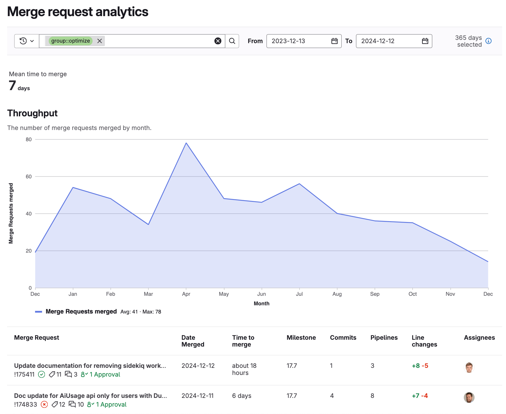



- Tier: 专业版，旗舰版
- Offering: JihuLab.com，私有化部署



合并请求分析为 DevOps 管理人员提供有关团队代码评审和合并工作流的宝贵洞察。基于与合并请求相关的详细指标和趋势，组织可以监控并优化其开发流程。

使用合并请求分析可查看：

- 您的组织每月合并的合并请求数量。
- 合并请求从创建到合并的平均时间。
- 每个已合并合并请求的信息（例如里程碑、提交、行变更和指派人）。

您可以使用合并请求分析来识别：

- 生产力较低或较高的月份。
- 您的合并请求和代码评审流程的效率与生产力。

这些洞察可帮助您做出数据驱动的决策，例如：

- 资源分配：通过重新分配资源或调整时间线来解决生产力低下的时期。
- 绩效基准：突出表现优异的团队并分享最佳实践。
- 里程碑规划：根据历史合并趋势调整时间线。
- 流程优化：识别并解决代码评审和合并工作流中的瓶颈。

## 查看合并请求分析

先决条件：

- 您必须具有报告者、开发者、维护者或所有者角色。

要查看合并请求分析：

1. 在顶部栏中，选择**搜索或跳转到**，然后找到您的项目。
1. 在左侧边栏中，选择**分析** > **分析仪表板**。
1. 选择**合并请求分析**。

## 查看某个日期范围内的合并请求数量

要查看在特定日期范围内合并的合并请求数量：

1. 在顶部栏中，选择**搜索或跳转到**，然后找到您的项目。
1. 在左侧边栏中，选择**分析** > **分析仪表板**。
1. 选择**合并请求分析**。
1. 可选。筛选结果：
   1. 选择筛选栏。
   1. 选择一个参数。
   1. 选择一个值或输入文本以细化结果。
   1. 要调整日期范围，请从下拉列表中选择一个选项。默认值为**最近 365 天**。

**吞吐量**图表显示一段时间内关闭的议题或已合并（未关闭）的合并请求。

该表格每页最多显示 20 个合并请求，并包含每个合并请求的以下信息：

- 合并请求名称
- 合并日期
- 合并用时
- 里程碑
- 提交
- 流水线
- 行变更
- 指派人

## 查看合并请求创建到合并之间的平均时间

**平均合并时间**中的数字显示合并请求从创建到合并之间的平均时间。已关闭和尚未合并的合并请求不计入其中。

要查看**平均合并时间**：

1. 在顶部栏中，选择**搜索或跳转到**，然后找到您的项目。
1. 在左侧边栏中，选择**分析** > **分析仪表板**。
1. 选择**合并请求分析**。仪表板上会显示**平均合并时间**数字。
