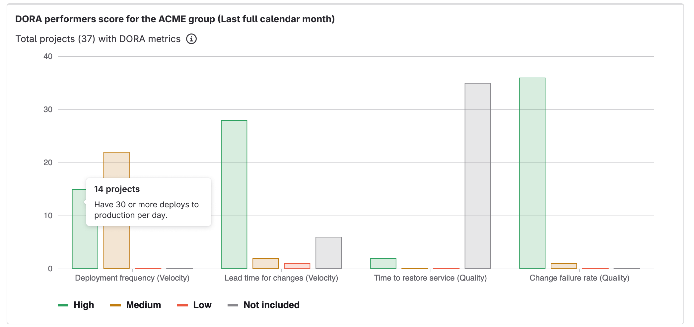
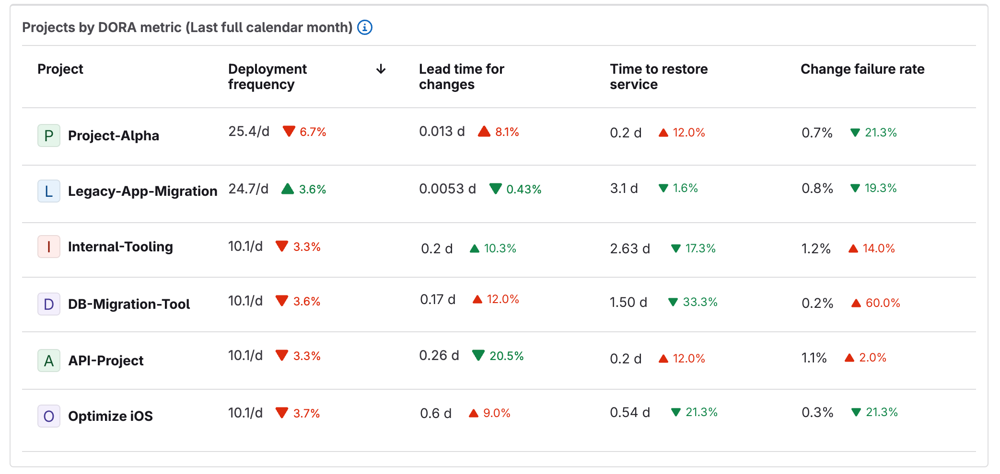



- Tier: 专业版，旗舰版
- Offering: JihuLab.com，私有化部署



价值流仪表板是一个可自定义的仪表板，您可以用它来识别数字化转型改进的趋势、模式和机会。价值流仪表板中集中化的 UI 充当单一可信来源（SSOT），所有利益相关者都可以访问并查看与组织相关的同一组指标。价值流仪表板包含的面板可可视化以下指标：

- [DORA 指标](dora_metrics.md)
- [价值流分析（VSA）- 流指标](../group/value_stream_analytics/_index.md)
- [漏洞](../application_security/vulnerability_report/_index.md)
- 极狐GitLab Duo 代码建议

借助价值流仪表板，您可以：

- 跟踪并比较前文列出的指标在一段时间内的变化。
- 及早发现下降趋势。
- 了解安全暴露情况。
- 深入查看单个项目或指标，以采取改进措施。
- 了解将 AI 引入软件开发生命周期（SDLC）的影响，并展示对极狐GitLab Duo 投资的回报率（ROI）。

如需查看可点击的演示，请参阅[价值流管理产品导览](https://gitlab.navattic.com/vsm)。

要将价值流仪表板作为群组的分析仪表板查看：

1. 在顶部栏中，选择**搜索或跳转到**，然后找到您的群组。
1. 在左侧边栏中，选择**分析** > **分析仪表板**。
1. 从可用仪表板列表中，选择**价值流仪表板**。

> [!note]
> 价值流仪表板上显示的数据会在后端持续收集。
> 如果您升级到旗舰版，即可访问历史数据，并查看有关过去极狐GitLab 使用情况和性能的指标。

<a id="panels"></a>

## 面板

价值流仪表板的面板具有默认配置，但您也可以自定义仪表板面板。

<a id="overview"></a>

### 概览

概览通过可视化关键 DevOps 指标，提供顶级命名空间活动的整体视图：

- 一个命名空间元数据面板，显示命名空间名称、类型和可见性。
- 一行单统计面板，显示使用量计数。

下表显示了群组和项目命名空间中资源的可用使用量计数：

| 使用量计数    | 可视化          | 群组       | 项目     |
|----------------|------------------------|-------------|-------------|
| 子群组      | `groups_count`         |  |   |
| 项目       | `projects_count`       |  |   |
| 用户          | `users_count`          |  |   |
| 议题         | `issues_count`         |  |  |
| 合并请求 | `merge_requests_count` |  |  |
| 流水线      | `pipelines_count`      |  |  |

概览中显示的数据通过批处理收集。极狐GitLab 会在数据库中存储每个子群组的记录计数，然后汇总这些记录计数，为顶级群组提供指标。数据按月汇总，通常在月末进行；极狐GitLab 会根据系统负载尽力完成汇总。

有关更多信息，请参阅[史诗 10417](https://gitlab.com/groups/gitlab-org/-/epics/10417#iterations-path)。

<a id="devsecops-metrics-comparison"></a>

### DevSecOps 指标比较

DevSecOps 指标比较面板显示群组或项目过去六个月的指标。这些可视化有助于您了解关键 DevSecOps 指标是否逐月改善。价值流仪表板显示三个 DevSecOps 指标比较面板：

- 生命周期指标
- DORA 指标（仅旗舰版）
- 安全指标（仅旗舰版，至少需要**开发者**角色）

在每个比较面板中，您可以：

- 一目了然地比较群组、项目和团队之间的表现。
- 识别价值贡献最大、表现优异或表现不佳的团队和项目。
- 深入查看指标以进行进一步分析。

当您将鼠标悬停在某个指标上时，工具提示会显示该指标的说明以及指向相关文档页面的链接。

**变化百分比**列还显示指标值相比六个月前，较上个月的百分比增加或减少。

**趋势**列显示迷你图，帮助您识别指标随时间变化的趋势模式（例如季节性变化）。迷你图的颜色从蓝色到绿色，其中绿色表示正向趋势，蓝色表示负向趋势。

<a id="dora-performers-score"></a>

### DORA 表现者评分



- Tier: 旗舰版



DORA 表现者评分面板是一个群组级条形图，可视化组织在不同项目上最后一个完整日历月的 DevOps 表现水平状态。



该图表是您项目 DORA 评分的细分，[分类](https://cloud.google.com/blog/products/devops-sre/dora-2022-accelerate-state-of-devops-report-now-out)为高、中或低。该图表汇总群组中的所有子项目。

图表条形显示每个评分类别的项目总数，按月计算。要从图表中排除数据（例如**未包含**），请在图例中选择要排除的系列。将鼠标悬停在每个条形上会显示一个对话框，说明该评分的定义。

例如，如果某个项目在部署频率（速度）方面获得高分，意味着该项目每天有一次或多次部署到生产环境。

| 指标                  | 高 | 中  | 低  | 描述 |
|-------------------------|------|---------|------|-------------|
| 部署频率    | ≥30  | 1-29    | \<1  | 每天部署到生产环境的次数 |
| 变更前置时间   | ≤7   | 8-29    | ≥30  | 从代码提交到代码成功在生产环境中运行所需的天数 |
| 服务恢复时间 | ≤1   | 2-6     | ≥7   | 发生影响用户的服务事件或缺陷时恢复服务所需的天数 |
| 变更失败率     | ≤15% | 16%-44% | ≥45% | 导致服务降级的生产环境变更百分比 |

要了解更多信息，请参阅博客文章 [Inside DORA Performers score in GitLab Value Streams Dashboard](https://about.gitlab.com/blog/inside-dora-performers-score-in-gitlab-value-streams-dashboard/)。

<a id="filter-the-panel-by-project-topic"></a>

#### 按项目主题筛选面板

当您使用 YAML 配置自定义仪表板时，您可以根据分配的[主题](../project/project_topics.md)筛选显示的项目。

```yaml
panels:
  - title: 'My dora performers scores'
    visualization: dora_performers_score
    queryOverrides:
      namespace: group/my-custom-group
      filters:
        projectTopics:
          - JavaScript
          - Vue.js
```

如果提供了多个主题，则项目必须匹配所有主题才会包含在结果中。

<a id="projects-by-dora-metric"></a>

### 按 DORA 指标划分的项目



- Tier: 旗舰版



**按 DORA 指标划分的项目**面板是一个群组级表格，列出组织在各项目上的 DevOps 表现水平状态。

该表格列出所有项目及其 DORA 指标，汇总群组和子群组中子项目的数据。指标按最后一个完整日历月汇总。

您可以按指标值对项目排序，帮助您识别高、中、低表现的项目。如需进一步调查，您可以选择项目名称，深入查看该项目的页面。



<a id="enable-or-disable-overview-background-aggregation"></a>

## 启用或禁用概览后台聚合



- Tier: 旗舰版
- Offering: 私有化部署



要启用或禁用价值流仪表板的概览计数聚合：

1. 在顶部栏中，选择**搜索或跳转到**，然后找到您的群组。
   该群组必须位于顶级。
1. 在左侧边栏中，选择**设置** > **分析**。
1. 在**价值流仪表板**中，选中或清除**为价值流仪表板启用概览后台聚合**复选框。

要检索群组中的聚合使用量计数，请使用 [GraphQL API](../../api/graphql/reference/_index.md#groupvaluestreamdashboardusageoverview)。

<a id="view-the-value-streams-dashboard"></a>

## 查看价值流仪表板

先决条件：

- 您必须拥有群组或项目的报告者、开发者、维护者或所有者角色。
- 必须启用概览后台聚合。
- 要查看比较面板中的贡献者计数指标，您必须[设置 ClickHouse](../../integration/clickhouse.md)。
- 要跟踪部署到生产环境，群组或项目必须在[生产部署层级](../../ci/environments/_index.md#deployment-tier-of-environments)中拥有一个环境。
- 要衡量周期时间，[议题必须从提交消息中交叉链接](../project/issues/crosslinking_issues.md#from-commit-messages)。

<a id="for-groups"></a>

### 对于群组

要查看群组的价值流仪表板：

- 从分析仪表板：
  1. 在顶部栏中，选择**搜索或跳转到**，然后找到您的群组。
  1. 选择**分析** > **分析仪表板**。
- 从价值流分析：
  1. 在顶部栏中，选择**搜索或跳转到**，然后找到您的项目或群组。
  1. 选择**分析** > **价值流分析**。
  1. 在**筛选结果**文本框下方，在**生命周期指标**行中，选择**价值流仪表板 / DORA**。
  1. 可选。要打开新页面，请将此路径 `/analytics/dashboards/value_streams_dashboard` 附加到群组 URL（例如 `https://gitlab.com/groups/gitlab-org/-/analytics/dashboards/value_streams_dashboard`）。

<a id="for-projects"></a>

### 对于项目

要将价值流仪表板作为项目的分析仪表板查看：

1. 在顶部栏中，选择**搜索或跳转到**，然后找到您的项目。
1. 在左侧边栏中，选择**分析** > **分析仪表板**。
1. 从可用仪表板列表中，选择**价值流仪表板**。

<a id="schedule-reports"></a>

## 定期报告

您可以使用 CI/CD 组件[价值流仪表板定期报告工具](https://gitlab.com/components/vsd-reports-generator)来安排定期报告。此工具省去了手动寻找包含相关数据的仪表板的工作，节省时间和精力，让您可以专注于分析洞察。通过定期生成报告，您可以确保组织中的决策者收到主动、及时且相关的信息。

定期报告工具通过公共极狐GitLab GraphQL API 从项目或群组收集指标，
然后使用极狐GitLab 风格 Markdown 构建报告，
并在指定项目中打开一个议题。该议题包含 Markdown 格式的比较指标表格。

请参阅[定期报告示例](https://gitlab.com/components/vsd-reports-generator#example-for-monthly-executive-value-streams-report)。
要了解更多信息，请参阅博客文章 [New Scheduled Reports Generation tool simplifies value stream management](https://about.gitlab.com/blog/new-scheduled-reports-generation-tool-simplifies-value-stream-management/)。

<a id="customize-dashboard-panels"></a>

## 自定义仪表板面板

您可以自定义价值流仪表板，并配置页面中要包含哪些子群组和项目。

要自定义页面的默认内容，您需要在您选择的项目中创建一个 YAML 配置文件。在此文件中，您可以定义各种设置和参数，例如标题、描述和面板数量。该文件由 schema 驱动，并使用 Git 等版本控制系统管理。这样可以跟踪和维护配置更改历史，必要时回退到以前的版本，并与团队成员有效协作。查询参数仍可用于覆盖 YAML 配置。

在自定义仪表板面板之前，您必须选择一个项目来存储您的 YAML 配置文件。

先决条件：

- 您必须拥有群组的维护者或所有者角色。

1. 在顶部栏中，选择**搜索或跳转到**，然后找到您的群组。
1. 在左侧边栏中，选择**设置** > **分析**。
1. 选择您希望存储 YAML 配置文件的项目。
1. 选择**保存更改**。

设置好项目后，设置配置文件：

1. 在顶部栏中，选择**搜索或跳转到**，然后找到您在上一步中选择的项目。
1. 在默认分支中，创建配置文件：`.gitlab/analytics/dashboards/value_streams/value_streams.yaml`。
1. 在 `value_streams.yaml` 配置文件中，填写配置选项：

| 字段                                      | 描述 |
|--------------------------------------------|-------------|
| `title`                                    | 面板的自定义名称 |
| `queryOverrides`（原为 `data`）         | 覆盖特定于每种可视化的数据查询参数。 |
| `namespace`（`queryOverrides`的子字段） | 用于面板的群组或项目路径 |
| `filters`（`queryOverrides`的子字段）   | 为每种支持的可视化类型筛选查询。 |
| `visualization`                            | 要渲染的可视化类型。支持的选项有 `ai_impact_table`、`dora_performers_score`、`namespace_metadata` 以及使用量计数。 |
| `gridAttributes`                           | 面板的大小和位置 |
| `xPos`（`gridAttributes`的子字段）      | 面板的水平位置 |
| `yPos`（`gridAttributes`的子字段）      | 面板的垂直位置 |
| `width`（`gridAttributes`的子字段）     | 面板的宽度（最大 12） |
| `height`（`gridAttributes`的子字段）    | 面板的高度 |

```yaml
# version - The latest version of the analytics dashboard schema
version: '2'

# title - Change the title of the Value Streams Dashboard.
title: 'Custom Dashboard title'

# description - Change the description of the Value Streams Dashboard. [optional]
description: 'Custom description'

# panels - List of panels that contain panel settings.
#   title - Change the title of the panel.
#   visualization - The type of visualization to be rendered
#   gridAttributes - The size and positioning of the panel
#   queryOverrides.namespace - The Group or Project path to use for the chart panel
#   queryOverrides.filters.includeMetrics - Shows rows by metric ID in the table panel.
panels:
  - title: 'Group usage overview'
    visualization: namespace_metadata
    gridAttributes:
      yPos: 0
      xPos: 0
      height: 4
      width: 12
  - title: 'Groups'
    visualization: groups_count
    gridAttributes:
      yPos: 4
      xPos: 0
      height: 4
      width: 4
  - title: 'Issues'
    visualization: issues_count
    gridAttributes:
      yPos: 4
      xPos: 4
      height: 4
      width: 4
  - title: 'Merge requests'
    visualization: merge_requests_count
    gridAttributes:
      yPos: 4
      xPos: 8
      height: 4
      width: 4
  - title: 'Group dora and issue metrics'
    visualization: ai_impact_table
    queryOverrides:
      namespace: group
      filters:
        includeMetrics:
          - deployment_frequency
          - deploys
    gridAttributes:
      yPos: 8
      xPos: 0
      height: 12
      width: 12
  - title: 'My dora performers scores'
    visualization: dora_performers_score
    queryOverrides:
      namespace: group/my-project
      filters:
        projectTopics:
          - ruby
          - javascript
    gridAttributes:
      yPos: 20
      xPos: 0
      height: 12
      width: 12
```

<a id="supported-visualization-filters"></a>

### 支持的可视化筛选器

`queryOverrides` 字段上的 `filters` 子字段可用于自定义面板中显示的数据。

<a id="devsecops-metrics-comparison-panel-filters"></a>

#### DevSecOps 指标比较面板筛选器

`ai_impact_table` 可视化的筛选器。

| 筛选器           | 描述                                                                       | 支持的值                          |
|------------------|-----------------------------------------------------------------------------------|-------------------------------------------|
| `includeMetrics` | 按指标 ID 在表格面板中显示行。优先于 `excludeMetrics`。 | [可用指标](#dashboard-metrics-and-drill-down-reports)中的任意 `ID`。 |
| `excludeMetrics` | 按指标 ID 从表格面板中隐藏行。                                     | [可用指标](#dashboard-metrics-and-drill-down-reports)中的任意 `ID`。 |

<a id="dora-performers-score-panel-filters"></a>

#### DORA 表现者评分面板筛选器

`dora_performers_score` 可视化的筛选器。

| 筛选器          | 描述                                                                               | 支持的值 |
|-----------------|-------------------------------------------------------------------------------------------|------------------|
| `projectTopics` | 根据分配的主题筛选显示的项目 | 任意可用的群组主题 |

<a id="additional-panel-filters-deprecated"></a>

#### 其他面板筛选器（已弃用）

<a id="dora-chart-filters"></a>

##### DORA 图表筛选器

> [!warning]
> `dora_chart` 可视化已在极狐GitLab 18.5 中[弃用](https://gitlab.com/gitlab-org/gitlab/-/merge_requests/206417)。

`dora_chart` 可视化的筛选器。

| 筛选器   | 描述                                  | 支持的值 |
|----------|----------------------------------------------|------------------|
| `labels` | 按标记筛选数据                       | 任意可用的群组标记。以下指标支持标记筛选：`lead_time`、`cycle_time`、`issues`、`issues_completed`、`merge_request_throughput`、`median_time_to_merge`。 |

<a id="usage-overview-filters"></a>

##### 使用量概览筛选器

> [!warning]
> `usage_overview` 可视化已在极狐GitLab 19.2 中[弃用](https://gitlab.com/gitlab-org/gitlab/-/work_items/594892)。请改用 `namespace_metadata` 可视化以及使用量计数单统计。

`usage_overview` 可视化的筛选器。

对于群组和子群组命名空间：

| 筛选器    | 描述                                                    | 支持的值 |
|-----------|----------------------------------------------------------------|------------------|
| `include` | 限制返回的指标，默认显示所有可用指标 | `groups`、`projects`、`issues`、`merge_requests`、`pipelines`、`users` |

对于项目命名空间：

| 筛选器    | 描述                                                    | 支持的值 |
|-----------|----------------------------------------------------------------|------------------|
| `include` | 限制返回的指标，默认显示所有可用指标 | `issues`、`merge_requests`、`pipelines` |

<a id="dashboard-metrics-and-drill-down-reports"></a>

## 仪表板指标和深入分析报告

下表概述了价值流仪表板中可用的指标，以及它们的描述和显示它们的深入分析报告名称。

| 指标                            | 描述                                                                                                          | 深入分析报告 | ID |
|-----------------------------------|----------------------------------------------------------------------------------------------------------------------| ----------------- | -- |
| 部署频率              | 每天平均部署到生产环境的次数。此指标衡量向最终用户交付价值的频率。 | **部署频率**标签页 | `deployment_frequency` |
| 变更前置时间             | 成功将提交交付到生产环境所需的时间。此指标反映 CI/CD 流水线的效率。   | **前置时间**标签页 | `lead_time_for_changes` |
| 服务恢复时间           | 组织从生产环境故障中恢复所需的时间。                                           | **服务恢复时间**标签页 | `time_to_restore_service` |
| 变更失败率               | 导致生产环境事件的部署百分比。                                                      | **变更失败率**标签页 | `change_failure_rate` |
| 前置时间                         | 从议题创建到议题关闭的中位时间。                                                                      | 价值流分析 | `lead_time` |
| 周期时间                        | 从链接议题的合并请求最早提交到该议题关闭的中位时间。                 | 价值流分析中的**生命周期指标**部分 | `cycle_time` |
| 创建的议题                    | 创建的新议题数量。                                                                                        | 议题分析 | `issues` |
| 关闭的议题                     | 每月关闭的议题数量。                                                                                    | 议题分析 | `issues_completed` |
| 部署次数                 | 部署到生产环境的总次数。                                                                               | 合并请求分析 | `deploys` |
| 合并请求吞吐量          | 每月合并的合并请求数量。                                                                        | 生产力分析 | `merge_request_throughput` |
| 合并中位时间              | 合并请求创建与合并请求合并之间的中位时间。                                                  | 生产力分析 | `median_time_to_merge` |
| 贡献者计数                 | 群组中每月有贡献的唯一用户数。                                                      | 贡献分析 | `contributor_count` |
| 随时间变化的严重漏洞 | 项目或群组中随时间变化的严重漏洞                                                               | 漏洞报告 | `vulnerability_critical` |
| 随时间变化的高危漏洞    | 项目或群组中随时间变化的高危漏洞                                                                   | 漏洞报告 | `vulnerability_high` |
| 流水线运行总数               | 在所选时间段内运行的流水线总数。                                             | CI/CD 分析 | `pipeline_count` |
| 流水线中位持续时间          | 流水线完成所需的中位时间。                                                                  | CI/CD 分析 | `pipeline_duration_median` |
| 流水线成功率             | 成功完成的流水线百分比。                                                             | CI/CD 分析 | `pipeline_success_rate` |
| 流水线失败率             | 失败的流水线百分比。                                                                             | CI/CD 分析 | `pipeline_failed_rate` |
| 功能使用量                     | 使用过任意极狐GitLab Duo 功能的贡献者数量。                                                              |  | `duo_used_count` |
| 代码建议使用量            | 使用过代码建议的用户数量。                                                                           |  | `code_suggestions_users_count` |
| 代码建议接受率  | 已接受的代码建议占生成的代码建议总数的比例。                                                   |  | `code_suggestions_acceptance_rate` |
| Non-Agentic Chat 使用量          | 使用过 Non-Agentic Chat 的用户数量。                                                                     |  | `duo_chat_users_count` |
| 根因分析使用量         | 使用过根因分析的用户数量。                                                                        |  | `duo_rca_users_count` |

<a id="metrics-with-jira"></a>

## 与 Jira 配合使用的指标

以下指标不依赖于使用 Jira：

- DORA 部署频率
- DORA 变更前置时间
- 部署次数
- 合并请求吞吐量
- 合并中位时间
- 漏洞
