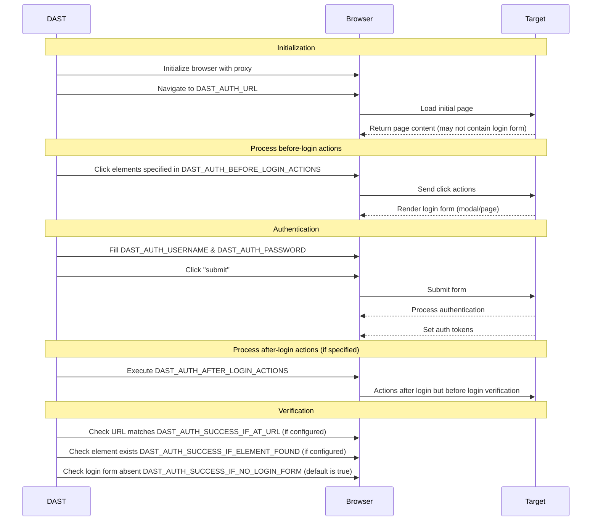

为实现完整覆盖，DAST 分析器必须通过被测应用进行认证。这需要在 DAST CI/CD 作业中配置认证凭据和认证方法。

DAST 需要认证才能：

- 模拟真实攻击，并识别攻击者可能利用的漏洞。
- 测试仅在认证后才可见的用户专属功能和自定义行为。

DAST 作业会向应用进行认证，最常见的方式是在浏览器中填写并提交登录表单。表单提交后，DAST 作业会确认认证是否成功。如果认证成功，DAST 作业会继续运行，并保存凭据以便在爬取目标应用时复用。如果认证失败，DAST 作业会停止。

DAST 支持的认证方法包括：

- 单步登录表单
- 多步登录表单
- 认证到已配置目标 URL 之外的 URL

选择认证凭据时：

- 不要使用对生产系统、生产服务器有效或用于访问生产数据的凭据。
- 不要对生产服务器运行已认证的扫描。已认证的扫描可以执行已认证用户能执行的任何操作，包括修改或删除数据、提交表单以及访问链接。请仅对非生产系统或服务器运行已认证的扫描。
- 提供允许 DAST 测试整个应用的凭据。
- 记录凭据的到期日期（如有），以备将来参考。例如，使用 1Password 等密码管理器。

下图说明了认证变量在认证不同阶段的使用方式：



<a id="getting-started"></a>

## 开始使用

> [!note]
> 您应定期确认分析器的认证仍然有效，因为随着应用发生变化，认证往往会随时间失效。

要运行 DAST 已认证扫描：

- 阅读认证的[先决条件](#prerequisites)。
- [更新您的目标网站](#update-the-target-website)为已认证用户的登录后落地页。
- 如果您的登录表单将用户名、密码和提交按钮放在同一页面上，请使用 [CI/CD 变量](#available-cicd-variables)配置[单步](#configuration-for-a-single-step-login-form)登录表单认证。
- 如果您的登录表单将用户名字段和密码字段放在不同页面上，请使用 [CI/CD 变量](#available-cicd-variables)配置[多步](#configuration-for-a-multi-step-login-form)登录表单认证。
- 确保用户在扫描期间不会[被登出](#excluding-logout-urls)。

<a id="prerequisites"></a>

### 先决条件

- 您拥有希望在扫描期间以其身份进行认证的用户的用户名和密码。
- 您已查看[已知问题](#known-issues)，以确保 DAST 能够认证到您的应用。
- 如果您使用[表单认证](#form-authentication)，您已满足先决条件。
- 如果您的表单认证流程包含[基于时间的一次性密码](#totp-authentication)，您已满足额外的先决条件。
- 您已考虑如何[验证](#verifying-authentication-is-successful)认证是否成功。

<a id="form-authentication"></a>

#### 表单认证

- 您知道应用登录表单的 URL。或者，您知道如何从认证 URL 前往登录表单（请参阅[点击前往登录表单](#clicking-to-go-to-the-login-form)）。
- 您知道 DAST 用于输入相应用户名和密码值的用户名和密码 HTML 字段的[选择器](#finding-an-elements-selector)。
- 您知道选中后提交登录表单的元素的[选择器](#finding-an-elements-selector)。

<a id="totp-authentication"></a>

#### TOTP 认证

- 您拥有测试用户 TOTP 注册的密钥，采用 Base32 编码。
- 您已确认认证提供商支持以下 TOTP 配置（与 Google Authenticator 相同）：
  - HMAC 算法：SHA-1
  - 时间步长：30 秒
  - 令牌长度：6
- 您知道 DAST 用于输入所生成 TOTP 令牌的 TOTP 字段的[选择器](#finding-an-elements-selector)。
- 您知道提交 TOTP 令牌的元素的[选择器](#finding-an-elements-selector)（如果该令牌与密码分开提交）。

<a id="available-cicd-variables"></a>

### 可用的 CI/CD 变量

有关 DAST 认证 CI/CD 变量的列表，请参阅[认证变量](variables.md#authentication)。

DAST CI/CD 变量表由 Rake 任务 `bundle exec rake gitlab:dast_variables:compile_docs` 生成。它使用 [`lib/gitlab/security/dast_variables.rb`](https://gitlab.com/gitlab-org/gitlab/-/blob/master/lib/gitlab/security/dast_variables.rb)中定义的变量元数据。

<a id="update-the-target-website"></a>

### 更新目标网站

目标网站由 CI/CD 变量 `DAST_TARGET_URL` 定义，是 DAST 开始爬取您的应用时使用的 URL。

为在已认证扫描中获得最佳爬取结果，目标网站应是一个仅在用户认证后才能访问的 URL。通常，这是用户登录后所落地页面的 URL。

例如：

```yaml
include:
  - template: DAST.gitlab-ci.yml

dast:
  variables:
    DAST_TARGET_URL: "https://example.com/dashboard/welcome"
    DAST_AUTH_URL: "https://example.com/login"
```

<a id="configuration-for-http-authentication"></a>

### HTTP 认证配置

要使用 [HTTP 认证方案](https://www.chromium.org/developers/design-documents/http-authentication/)（例如基本认证），您可以将 `DAST_AUTH_TYPE`的值设置为 `basic-digest`。其他方案（例如 Negotiate 或 NTLM）可能可用，但由于目前缺少自动化测试覆盖，官方并不支持。

配置需要为 DAST 作业定义 CI/CD 变量 `DAST_AUTH_TYPE`、`DAST_AUTH_URL`、`DAST_AUTH_USERNAME`、`DAST_AUTH_PASSWORD`。如果您没有唯一的登录 URL，请将 `DAST_AUTH_URL` 设置为与 `DAST_TARGET_URL` 相同的 URL。

```yaml
include:
  - template: DAST.gitlab-ci.yml

dast:
  variables:
    DAST_TARGET_URL: "https://example.com"
    DAST_AUTH_TYPE: "basic-digest"
    DAST_AUTH_URL: "https://example.com"
```

不要在 YAML 作业定义文件中定义 `DAST_AUTH_USERNAME` 和 `DAST_AUTH_PASSWORD`，因为这可能带来安全风险。请改为使用极狐GitLab UI 将它们创建为掩码 CI/CD 变量。有关更多信息，请参阅[自定义 CI/CD 变量](../../../../../ci/variables/_index.md#for-a-project)。

<a id="configuration-for-a-single-step-login-form"></a>

### 单步登录表单配置

单步登录表单将所有登录表单元素放在同一页面上。配置需要为 DAST 作业定义 CI/CD 变量 `DAST_AUTH_URL`、`DAST_AUTH_USERNAME`、`DAST_AUTH_USERNAME_FIELD`、`DAST_AUTH_PASSWORD`、`DAST_AUTH_PASSWORD_FIELD` 和 `DAST_AUTH_SUBMIT_FIELD`。

您应在作业定义 YAML 中设置 URL 和字段选择器，例如：

```yaml
include:
  - template: DAST.gitlab-ci.yml

dast:
  variables:
    DAST_TARGET_URL: "https://example.com"
    DAST_AUTH_URL: "https://example.com/login"
    DAST_AUTH_USERNAME_FIELD: "css:[name=username]"
    DAST_AUTH_PASSWORD_FIELD: "css:[name=password]"
    DAST_AUTH_SUBMIT_FIELD: "css:button[type=submit]"
```

不要在 YAML 作业定义文件中定义 `DAST_AUTH_USERNAME` 和 `DAST_AUTH_PASSWORD`，因为这可能带来安全风险。请改为使用极狐GitLab UI 将它们创建为掩码 CI/CD 变量。有关更多信息，请参阅[自定义 CI/CD 变量](../../../../../ci/variables/_index.md#for-a-project)。

<a id="configuration-for-a-multi-step-login-form"></a>

### 多步登录表单配置

多步登录表单有两个页面。第一个页面有一个包含用户名和下一步提交按钮的表单。如果用户名有效，后续页面上的第二个表单会包含密码和表单提交按钮。

配置需要为 DAST 作业定义以下 CI/CD 变量：

- `DAST_AUTH_URL`
- `DAST_AUTH_USERNAME`
- `DAST_AUTH_USERNAME_FIELD`
- `DAST_AUTH_FIRST_SUBMIT_FIELD`
- `DAST_AUTH_PASSWORD`
- `DAST_AUTH_PASSWORD_FIELD`
- `DAST_AUTH_SUBMIT_FIELD`。

您应在作业定义 YAML 中设置 URL 和字段选择器，例如：

```yaml
include:
  - template: DAST.gitlab-ci.yml

dast:
  variables:
    DAST_TARGET_URL: "https://example.com"
    DAST_AUTH_URL: "https://example.com/login"
    DAST_AUTH_USERNAME_FIELD: "css:[name=username]"
    DAST_AUTH_FIRST_SUBMIT_FIELD: "css:button[name=next]"
    DAST_AUTH_PASSWORD_FIELD: "css:[name=password]"
    DAST_AUTH_SUBMIT_FIELD: "css:button[type=submit]"
```

不要在 YAML 作业定义文件中定义 `DAST_AUTH_USERNAME` 和 `DAST_AUTH_PASSWORD`，因为这可能带来安全风险。请改为使用极狐GitLab UI 将它们创建为掩码 CI/CD 变量。有关更多信息，请参阅[自定义 CI/CD 变量](../../../../../ci/variables/_index.md#for-a-project)。

<a id="configuration-for-time-based-one-time-password-totp"></a>

### 基于时间的一次性密码（TOTP）配置

TOTP 配置需要为 DAST 作业定义以下 CI/CD 变量：

- `DAST_AUTH_OTP_FIELD`
- `DAST_AUTH_OTP_KEY`

如果 TOTP 令牌在密码提交后在其自己的表单中提交，您还必须定义以下变量：

- `DAST_AUTH_OTP_SUBMIT_FIELD`

`_FIELD` 选择器变量可以在作业定义 YAML 中定义，例如：

```yaml
include:
  - template: DAST.gitlab-ci.yml

dast:
  variables:
    DAST_TARGET_URL: "https://example.com"
    DAST_AUTH_URL: "https://example.com/login"
    DAST_AUTH_USERNAME_FIELD: "css:[name=username]"
    DAST_AUTH_PASSWORD_FIELD: "css:[name=password]"
    DAST_AUTH_SUBMIT_FIELD: "css:button[type=submit]"
    DAST_AUTH_OTP_FIELD: "name:otp"
    DAST_AUTH_OTP_SUBMIT_FIELD: "css:input[type=submit]"
```

不要在 YAML 作业定义文件中定义 `DAST_AUTH_OTP_KEY`，因为这可能带来安全风险。请改为使用极狐GitLab UI 将其创建为掩码 CI/CD 变量。有关更多信息，请参阅[自定义 CI/CD 变量](../../../../../ci/variables/_index.md#for-a-project)。

<a id="configuration-for-single-sign-on-sso"></a>

### 单点登录（SSO）配置

如果用户可以登录应用，那么在大多数情况下，即使应用使用单点登录（SSO），DAST 也能够登录。使用 SSO 解决方案的应用应使用[单步](#configuration-for-a-single-step-login-form)或[多步](#configuration-for-a-multi-step-login-form)登录表单配置指南来配置 DAST 认证。

DAST 支持用户被重定向到外部身份提供商站点进行登录的认证流程。请查看 DAST 认证的[已知问题](#known-issues)，以确定您的 SSO 认证流程是否受支持。

<a id="configuration-for-windows-integrated-authentication-kerberos"></a>

### Windows 集成认证（Kerberos）配置

Windows 集成认证（Kerberos）是托管在 Windows 域内的业务线（LOB）应用常用的认证机制。它使用用户的计算机登录信息提供无提示认证。

要配置这种认证方式，请执行以下步骤：

1. 在 IT/运维团队的协助下收集必要信息。
1. 在您的 `.gitlab-ci.yml` 文件中创建或更新 `dast` 作业定义。
1. 使用收集到的信息填充示例 `krb5.conf` 文件。
1. 设置必要的作业变量。
1. 使用项目**设置**页面设置必要的密钥变量。
1. 测试并验证认证正常工作。

在 IT/运维部门的协助下收集以下信息：

- Windows 域或 Kerberos 领域的名称（名称中必须包含句点，例如 `EXAMPLE.COM`）
- Windows/Kerberos 域控制器的主机名
- 对于 Kerberos，为认证服务器名称。对于 Windows 域，即域控制器。

创建 `krb5.conf` 文件：

```ini
[libdefaults]
  # Realm is another name for domain name
  default_realm = EXAMPLE.COM
  # These settings are not needed for Windows Domains
  # they support other Kerberos implementations
  kdc_timesync = 1
  ccache_type = 4
  forwardable = true
  proxiable = true
  rdns = false
  fcc-mit-ticketflags = true
[realms]
  EXAMPLE.COM = {
    # Domain controller or KDC
    kdc = kdc.example.com
    # Domain controller or admin server
    admin_server = kdc.example.com
  }
[domain_realm]
  # Mapping DNS domains to realms/Windows domain
  # DNS domains provided by DAST_AUTH_NEGOTIATE_DELEGATION
  # should also be represented here (but without the wildcard)
  .example.com = EXAMPLE.COM
  example.com = EXAMPLE.COM
```

此配置使用 `DAST_AUTH_NEGOTIATE_DELEGATION` 变量。该变量设置允许集成认证所需的以下 Chromium 策略：

- [AuthServerAllowlist](https://chromeenterprise.google/policies/#AuthServerAllowlist)
- [AuthNegotiateDelegateAllowlist](https://chromeenterprise.google/policies/#AuthNegotiateDelegateAllowlist)

该变量的设置为与您的 Windows 域或 Kerberos 领域关联的 DNS 域。您应提供：

- 同时使用小写和大写形式。
- 使用通配符模式以及仅域名本身。

在我们的示例中，Windows 域为 `EXAMPLE.COM`，DNS 域为 `example.com`。因此 `DAST_AUTH_NEGOTIATE_DELEGATION`的值为 `*.example.com,example.com,*.EXAMPLE.COM,EXAMPLE.COM`。

将它们整合到一个作业定义中：

```yaml
# This job will extend the dast job defined in
# the DAST template which must also be included.
dast:
  image:
    name: "$SECURE_ANALYZERS_PREFIX/dast:$DAST_VERSION$DAST_IMAGE_SUFFIX"
    docker:
      user: root
  variables:
    DAST_TARGET_URL: https://target.example.com
    DAST_AUTH_URL: https://target.example.com
    DAST_AUTH_TYPE: basic-digest
    DAST_AUTH_NEGOTIATE_DELEGATION: '*.example.com,example.com,*.EXAMPLE.COM,EXAMPLE.COM'
    # Not shown -- DAST_AUTH_USERNAME, DAST_AUTH_PASSWORD set via Settings -> CI -> Variables
  before_script:
    - KRB5_CONF='
[libdefaults]
  default_realm = EXAMPLE.COM
  kdc_timesync = 1
  ccache_type = 4
  forwardable = true
  proxiable = true
  rdns = false
  fcc-mit-ticketflags = true
[realms]
  EXAMPLE.COM = {
    kdc = ad1.example.com
    admin_server = ad1.example.com
  }
[domain_realm]
  .example.com = EXAMPLE.COM
  example.com = EXAMPLE.COM
'
    - cat "$KRB5_CONF" > /etc/krb5.conf
    - echo '$DAST_AUTH_PASSWORD' | kinit $DAST_AUTH_USERNAME
    - klist
```

预期输出：

作业控制台输出包含 `before` 脚本的输出。如果认证成功，输出将类似以下内容。如果认证失败，作业应失败且不运行扫描。

```plaintext
Password for mike@EXAMPLE.COM:
Ticket cache: FILE:/tmp/krb5cc_1000
Default principal: mike@EXAMPLE.COM

Valid starting       Expires              Service principal
11/11/2024 21:50:50  11/12/2024 07:50:50  krbtgt/EXAMPLE.COM@EXAMPLE.COM
        renew until 11/12/2024 21:50:50
```

DAST 扫描器还会输出以下内容，表示成功：

```plaintext
2024-11-08T17:03:09.226 INF AUTH  attempting to authenticate find_auth_fields="basic-digest"
2024-11-08T17:03:09.226 INF AUTH  loading login page LoginURL="https://target.example.com"
2024-11-08T17:03:10.619 INF AUTH  verifying if login attempt was successful true_when="HTTP status code < 400 and has authentication token and no login form found (auto-detected)"
2024-11-08T17:03:10.619 INF AUTH  requirement is satisfied, HTTP login request returned status code 200 want="HTTP status code < 400" url="https://target.example.com/"
2024-11-08T17:03:10.623 INF AUTH  requirement is satisfied, did not detect a login form want="no login form found (auto-detected)"
2024-11-08T17:03:10.623 INF AUTH  authentication token cookies names=""
2024-11-08T17:03:10.623 INF AUTH  authentication token storage events keys=""
2024-11-08T17:03:10.623 INF AUTH  requirement is satisfied, basic authentication detected want="has authentication token"
2024-11-08T17:03:11.230 INF AUTH  login attempt succeeded
```

<a id="clicking-to-go-to-the-login-form"></a>

### 点击前往登录表单

定义 `DAST_AUTH_BEFORE_LOGIN_ACTIONS`，以提供从 `DAST_AUTH_URL` 开始要点击的元素路径，使 DAST 能够访问登录表单。此方法适用于在弹出（模态）窗口中显示登录表单的应用，或登录表单没有唯一 URL 的情况。

例如：

```yaml
include:
  - template: DAST.gitlab-ci.yml

dast:
  variables:
    DAST_TARGET_URL: "https://example.com"
    DAST_AUTH_URL: "https://example.com/login"
    DAST_AUTH_BEFORE_LOGIN_ACTIONS: "css:.navigation-menu,css:.login-menu-item"
```

<a id="taking-additional-actions-after-submitting-the-login-form"></a>

### 提交登录表单后执行其他操作

定义 `DAST_AUTH_AFTER_LOGIN_ACTIONS`，以提供在提交登录表单之后、验证之前（记录认证详细信息时）要执行的一系列操作。这可用于通过“保持登录状态”对话框。

| 操作                           | 格式                      |
|----------------------------------|-----------------------------|
| 点击元素              | `click(on=<selector>)`      |
| 从下拉列表中选择选项 | `select(option=<selector>)` |

操作以逗号分隔。有关选择器的信息，请参阅[查找元素的选择器](#finding-an-elements-selector)。

例如：

```yaml
include:
  - template: DAST.gitlab-ci.yml

dast:
  variables:
    DAST_TARGET_URL: "https://example.com"
    DAST_AUTH_URL: "https://example.com/login"
    DAST_AUTH_AFTER_LOGIN_ACTIONS: "select(option=id:accept-yes),click(on=id:continue-button)"
```

<a id="excluding-logout-urls"></a>

### 排除登出 URL

如果 DAST 在运行已认证扫描时爬取到登出 URL，用户会被登出，导致扫描的剩余部分处于未认证状态。因此，建议使用 CI/CD 变量 `DAST_SCOPE_EXCLUDE_URLS` 排除登出 URL。DAST 不会访问任何被排除的 URL，从而确保用户保持登录状态。

提供的 URL 可以是绝对 URL，也可以是相对于 `DAST_TARGET_URL` 基础路径的 URL 路径正则表达式。例如：

```yaml
include:
  - template: DAST.gitlab-ci.yml

dast:
  variables:
    DAST_TARGET_URL: "https://example.com/welcome/home"
    DAST_SCOPE_EXCLUDE_URLS: "https://example.com/logout,/user/.*/logout"
```

<a id="finding-an-elements-selector"></a>

### 查找元素的选择器

选择器由 CI/CD 变量使用，用于指定浏览器中页面上所显示元素的位置。选择器的格式为 `type`:`search string`。DAST 根据类型使用搜索字符串来查找选择器。

| 选择器类型 | 示例                            | 描述                                                                                                                                                                                           |
|---------------|------------------------------------|-------------------------------------------------------------------------------------------------------------------------------------------------------------------------------------------------------|
| `css`         | `css:.password-field`              | 搜索具有所提供 CSS 选择器的 HTML 元素。出于性能原因，选择器应尽可能具体。                                                                    |
| `id`          | `id:element`                       | 搜索具有所提供元素 ID 的 HTML 元素。                                                                                                                                            |
| `name`        | `name:element`                     | 搜索具有所提供元素名称的 HTML 元素。                                                                                                                                          |
| `xpath`       | `xpath://input[@id="my-button"]/a` | 搜索具有所提供 XPath 的 HTML 元素。XPath 搜索的性能预计低于其他搜索。                                                                           |

<a id="find-selectors-with-google-chrome"></a>

#### 使用 Google Chrome 查找选择器

Chrome DevTools 元素选择器工具是查找选择器的有效方式。

1. 打开 Chrome 并前往您希望查找选择器的页面，例如您站点的登录页面。
1. 使用键盘快捷键在 Chrome DevTools 中打开 `Elements` 标签页
   <kbd>Command</kbd>+<kbd>Shift</kbd>+<kbd>C</kbd>（macOS）或
   <kbd>Control</kbd>+<kbd>Shift</kbd>+<kbd>C</kbd>（Windows 或 Linux）。
1. 选择 `Select an element in the page to select it` 工具。
   
1. 在页面上选择您希望了解其选择器的字段。
1. 工具激活后，高亮显示您希望查看其详情的字段。
   
1. 高亮显示后，您可以看到该元素的详细信息，包括适合作为选择器的属性。

在此示例中，`id="user_login"` 似乎是一个不错的候选。您可以将其用作 DAST 用户名字段的选择器，方法是设置
`DAST_AUTH_USERNAME_FIELD: "id:user_login"`。

<a id="choose-the-right-selector"></a>

#### 选择合适的选择器

明智地选择选择器可以使扫描更能适应应用的变化。

按优先顺序，您应选择以下选择器：

- `id` 字段。这些字段通常在页面上是唯一的，且很少变化。
- `name` 字段。这些字段通常在页面上是唯一的，且很少变化。
- 特定于字段的 `class` 值，例如用户名字段上 `username` 类的选择器 `"css:.username"`。
- 存在特定于字段的数据属性，例如当用户名字段上的 `data-username` 字段具有任意值时，使用选择器 `"css:[data-username]"`。
- 多个 `class` 层级值，例如当有多个元素具有类 `username` 但只有一个嵌套在具有类 `login-form`的元素内时，使用选择器 `"css:.login-form .username"`。

使用选择器定位特定字段时，应避免搜索：

- 任何动态生成的 `id`、`name`、`attribute`、`class` 或 `value`。
- 通用类名，例如 `column-10` 和 `dark-grey`。
- XPath 搜索，因为它们的性能低于其他选择器搜索。
- 未限定范围的搜索，例如以 `css:*` 和 `xpath://*` 开头的搜索。

<a id="verifying-authentication-is-successful"></a>

## 验证认证是否成功

DAST 提交登录表单后，会进行验证过程以确定认证是否成功。如果认证失败，扫描会因错误而停止。

提交登录表单后，在以下情况下会判定认证失败：

- 登录提交的 HTTP 响应具有 `400` 或 `500` 系列状态码。
- 任何[验证检查](#verification-checks)失败。
- 在认证过程中未设置具有足够随机值的[认证令牌](#authentication-tokens)。

<a id="verification-checks"></a>

### 验证检查

验证检查会在认证完成后对浏览器状态运行检查，以进一步确定认证是否成功。

如果未配置任何验证检查，DAST 会测试登录表单是否不存在。

<a id="verify-based-on-the-url"></a>

#### 基于 URL 验证

将 `DAST_AUTH_SUCCESS_IF_AT_URL` 定义为登录表单成功提交后浏览器标签页中显示的 URL。

DAST 会将验证 URL 与认证后浏览器中的 URL 进行比较。如果两者不相同，则认证失败。

例如：

```yaml
include:
  - template: DAST.gitlab-ci.yml

dast:
  variables:
    DAST_TARGET_URL: "https://example.com"
    DAST_AUTH_SUCCESS_IF_AT_URL: "https://example.com/user/welcome"
```

<a id="verify-based-on-presence-of-an-element"></a>

#### 基于元素是否存在验证

将 `DAST_AUTH_SUCCESS_IF_ELEMENT_FOUND` 定义为[选择器](#finding-an-elements-selector)，用于查找登录表单成功提交后所显示页面上的一个或多个元素。如果未找到任何元素，则认证失败。在登录失败时所显示页面上搜索该选择器应返回零个元素。

例如：

```yaml
include:
  - template: DAST.gitlab-ci.yml

dast:
  variables:
    DAST_TARGET_URL: "https://example.com"
    DAST_AUTH_SUCCESS_IF_ELEMENT_FOUND: "css:.welcome-user"
```

<a id="verify-based-on-absence-of-a-login-form"></a>

#### 基于登录表单是否不存在验证

将 `DAST_AUTH_SUCCESS_IF_NO_LOGIN_FORM` 定义为 `"true"`，以指示 DAST 应在登录表单成功提交后所显示的页面上搜索登录表单。如果登录后仍存在登录表单，则认证失败。

例如：

```yaml
include:
  - template: DAST.gitlab-ci.yml

dast:
  variables:
    DAST_TARGET_URL: "https://example.com"
    DAST_AUTH_SUCCESS_IF_NO_LOGIN_FORM: "true"
```

<a id="authentication-tokens"></a>

### 认证令牌

DAST 会记录认证过程中设置的认证令牌。当 DAST 打开新浏览器时，认证令牌会被加载到其中，以便用户在整个扫描过程中保持登录状态。

为记录令牌，DAST 会在认证过程之前对应用设置的 cookie、本地存储和会话存储值进行快照。DAST 在认证后执行相同操作，并使用差异来确定哪些是由认证过程创建的。

DAST 将具有足够“随机”值的 cookie、本地存储和会话存储值视为认证令牌。例如，`sessionID=HVxzpS8GzMlPAc2e39uyIVzwACIuGe0H` 会被视为认证令牌，而 `ab_testing_group=A1` 则不会。

CI/CD 变量 `DAST_AUTH_COOKIE_NAMES` 可用于指定认证 cookie 的名称，并绕过 DAST 使用的随机性检查。这不仅可以提高认证过程的稳健性，还可以提高检查认证令牌的漏洞检查的准确性。

例如：

```yaml
include:
  - template: DAST.gitlab-ci.yml

dast:
  variables:
    DAST_TARGET_URL: "https://example.com"
    DAST_AUTH_COOKIE_NAMES: "sessionID,refreshToken"
```

<a id="known-issues"></a>

## 已知问题

- 如果认证流程包含 CAPTCHA，DAST 无法绕过。
  请在被扫描应用的测试环境中为所配置的用户关闭这些功能。
- DAST 无法使用基于短信或生物识别的一次性密码（OTP）进行认证。
  请在被扫描应用的测试环境中为所配置的用户关闭这些功能；或将用户的 MFA 类型更改为 TOTP。
- DAST 无法认证到在登录期间未设置[认证令牌](#authentication-tokens)的应用。
- DAST 无法认证到需要比用户名、密码和可选 TOTP 更多文本输入的应用。

<a id="troubleshooting"></a>

## 故障排除

[日志](#read-the-logs)可让您深入了解 DAST 在认证过程中的行为和预期。有关更详细的信息，请配置[认证报告](#configure-the-authentication-report)。

有关特定错误消息或情况的更多信息，请参阅[已知问题](#known-problems)。

基于浏览器的分析器用于认证用户。有关高级故障排除，请参阅[基于浏览器的故障排除](../troubleshooting.md)。

<a id="read-the-logs"></a>

### 阅读日志

DAST CI/CD 作业的控制台输出使用 `AUTH` 日志模块显示有关认证过程的信息。例如，以下日志显示多步登录表单的认证失败。认证失败是因为登录后应显示主页。但登录表单仍然存在。

```plaintext
2022-11-16T13:43:02.000 INF AUTH  attempting to authenticate
2022-11-16T13:43:02.000 INF AUTH  loading login page LoginURL=https://example.com/login
2022-11-16T13:43:10.000 INF AUTH  multi-step authentication detected
2022-11-16T13:43:15.000 INF AUTH  verifying if user submit was successful true_when="HTTP status code < 400"
2022-11-16T13:43:15.000 INF AUTH  requirement is satisfied, no login HTTP message detected want="HTTP status code < 400"
2022-11-16T13:43:20.000 INF AUTH  verifying if login attempt was successful true_when="HTTP status code < 400 and has authentication token and no login form found (no element found when searching using selector css:[id=email] or css:[id=password] or css:[id=submit])"
2022-11-24T14:43:20.000 INF AUTH  requirement is satisfied, HTTP login request returned status code 200 url=https://example.com/user/login?error=invalid%20credentials want="HTTP status code < 400"
2022-11-16T13:43:21.000 INF AUTH  requirement is unsatisfied, login form was found want="no login form found (no element found when searching using selector css:[id=email] or css:[id=password] or css:[id=submit])"
2022-11-16T13:43:21.000 INF AUTH  login attempt failed error="authentication failed: failed to authenticate user"
```

<a id="configure-the-authentication-report"></a>

### 配置认证报告

> [!warning]
> 认证报告可能包含敏感信息，例如用于执行登录的凭据。

认证报告可以保存为 CI/CD 作业产物，以帮助了解认证失败的原因。

报告包含登录过程中执行的步骤、HTTP 请求和响应、文档对象模型（DOM）以及屏幕截图。


导出认证调试报告的示例配置可能如下所示：

```yaml
dast:
  variables:
    DAST_TARGET_URL: "https://example.com"
    DAST_AUTH_REPORT: "true"
```

<a id="known-problems"></a>

### 已知问题

<a id="login-form-not-found"></a>

#### 未找到登录表单

DAST 在加载登录页面时未能找到登录表单，通常是因为无法加载认证 URL。日志会报告致命错误，例如：

```plaintext
2022-12-07T12:44:02.838 INF AUTH  loading login page LoginURL=[authentication URL]
2022-12-07T12:44:11.119 FTL MAIN  authentication failed: login form not found
```

建议操作：

- 生成[认证报告](#configure-the-authentication-report)以检查 HTTP 响应。
- 检查目标应用认证是否已部署并正在运行。
- 检查 `DAST_AUTH_URL` 是否正确。
- 检查极狐GitLab Runner 能否访问 `DAST_AUTH_URL`。
- 如果使用了 `DAST_AUTH_BEFORE_LOGIN_ACTIONS`，请检查其是否有效。

<a id="scan-doesnt-crawl-authenticated-pages"></a>

#### 扫描未爬取已认证页面

如果 DAST 在认证过程中捕获了错误的[认证令牌](#authentication-tokens)，则扫描无法爬取已认证页面。cookie 和存储认证令牌的名称会写入日志。例如：

```plaintext
2022-11-24T14:42:31.492 INF AUTH  authentication token cookies names=["sessionID"]
2022-11-24T14:42:31.492 INF AUTH  authentication token storage events keys=["token"]
```

建议操作：

- 生成[认证报告](#configure-the-authentication-report)，并查看 `Login submit`的屏幕截图，以验证登录是否按预期工作。
- 验证记录的认证令牌是您的应用所使用的令牌。
- 如果使用 cookie 存储认证令牌，请使用 `DAST_AUTH_COOKIE_NAMES` 设置认证令牌 cookie 的名称。

<a id="unable-to-find-elements-with-selector"></a>

#### 无法找到具有选择器的元素

DAST 未能找到用户名、密码、第一个提交按钮或提交按钮元素。日志会报告致命错误，例如：

```plaintext
2022-12-07T13:14:11.545 FTL MAIN  authentication failed: unable to find elements with selector: css:#username
```

建议操作：

- 生成[认证报告](#configure-the-authentication-report)，使用 `Login page`的屏幕截图来验证页面是否正确加载。
- 在浏览器中加载登录页面，并验证在 `DAST_AUTH_USERNAME_FIELD`、`DAST_AUTH_PASSWORD_FIELD`、`DAST_AUTH_FIRST_SUBMIT_FIELD` 和 `DAST_AUTH_SUBMIT_FIELD`中配置的[选择器](#finding-an-elements-selector)是否正确。

<a id="failed-to-authenticate-user"></a>

#### 无法认证用户

DAST 因登录验证检查失败而无法认证。日志会报告致命错误，例如：

```plaintext
2022-12-07T06:39:49.483 INF AUTH  verifying if login attempt was successful true_when="HTTP status code < 400 and has authentication token and no login form found (no element found when searching using selector css:[name=username] or css:[name=password] or css:button[type=\"submit\"])"
2022-12-07T06:39:49.484 INF AUTH  requirement is satisfied, HTTP login request returned status code 303 url=http://auth-manual:8090/login want="HTTP status code < 400"
2022-12-07T06:39:49.513 INF AUTH  requirement is unsatisfied, login form was found want="no login form found (no element found when searching using selector css:[name=username] or css:[name=password] or css:button[type=\"submit\"])"
2022-12-07T06:39:49.589 INF AUTH  login attempt failed error="authentication failed: failed to authenticate user"
2022-12-07T06:39:53.626 FTL MAIN  authentication failed: failed to authenticate user
```

建议操作：

- 在日志中查找 `requirement is unsatisfied`。针对相应错误进行响应。

<a id="requirement-unsatisfied-login-form-was-found"></a>

#### 要求未满足，找到了登录表单

应用通常在用户登录时显示仪表板，而在用户名或密码不正确时显示带有错误消息的登录表单。

当 DAST 在认证用户后所显示的页面上检测到登录表单时，会发生此错误，表明登录尝试失败。

```plaintext
2022-12-07T06:39:49.513 INF AUTH  requirement is unsatisfied, login form was found want="no login form found (no element found when searching using selector css:[name=username] or css:[name=password] or css:button[type=\"submit\"])"
```

建议操作：

- 验证所使用的用户名和密码/认证凭据是否正确。
- 生成[认证报告](#configure-the-authentication-report)，并验证 `Login submit`的 `Request` 是否正确。
- 认证报告中的 `Login submit` 请求和响应可能为空。当不存在会导致整页重新加载的请求（例如提交 HTML 表单时发出的请求）时，会发生这种情况。使用 websocket 或 AJAX 提交登录表单时会出现这种情况。
- 如果用户认证后所显示的页面确实包含与登录表单选择器匹配的元素，请配置 `DAST_AUTH_SUCCESS_IF_AT_URL`
  或 `DAST_AUTH_SUCCESS_IF_ELEMENT_FOUND`，以使用验证登录尝试的替代方法。

<a id="requirement-unsatisfied-selector-returned-no-results"></a>

#### 要求未满足，选择器未返回结果

DAST 无法在用户登录后所显示的页面上找到与 `DAST_AUTH_SUCCESS_IF_ELEMENT_FOUND`中提供的选择器匹配的元素。

```plaintext
2022-12-07T06:39:33.239 INF AUTH  requirement is unsatisfied, searching DOM using selector returned no results want="has element css:[name=welcome]"
```

建议操作：

- 生成[认证报告](#configure-the-authentication-report)，并查看 `Login submit`的屏幕截图，以验证是否显示了预期的页面。
- 确保 `DAST_AUTH_SUCCESS_IF_ELEMENT_FOUND` [选择器](#finding-an-elements-selector)正确。

<a id="requirement-unsatisfied-browser-not-at-url"></a>

#### 要求未满足，浏览器不在该 URL

DAST 检测到用户登录后所显示的页面 URL 与根据 `DAST_AUTH_SUCCESS_IF_AT_URL` 预期的 URL 不同。

```plaintext
2022-12-07T11:28:00.241 INF AUTH  requirement is unsatisfied, browser is not at URL browser_url="https://example.com/home" want="is at url https://example.com/user/dashboard"
```

建议操作：

- 生成[认证报告](#configure-the-authentication-report)，并查看 `Login submit`的屏幕截图，以验证是否显示了预期的页面。
- 确保 `DAST_AUTH_SUCCESS_IF_AT_URL` 正确。

<a id="requirement-unsatisfied-http-login-request-status-code"></a>

#### 要求未满足，HTTP 登录请求状态码

加载登录表单或提交表单时的 HTTP 响应状态码为 400（客户端错误）或 500（服务器错误）。

```plaintext
2022-12-07T06:39:53.626 INF AUTH  requirement is unsatisfied, HTTP login request returned status code 502 url="https://example.com/user/login" want="HTTP status code < 400"
```

- 验证所使用的用户名和密码/认证凭据是否正确。
- 生成[认证报告](#configure-the-authentication-report)，并验证 `Login submit`的 `Request` 是否正确。
- 验证目标应用是否按预期工作。

<a id="requirement-unsatisfied-no-authentication-token"></a>

#### 要求未满足，没有认证令牌

DAST 无法检测到认证过程中创建的[认证令牌](#authentication-tokens)。

```plaintext
2022-12-07T11:25:29.010 INF AUTH  authentication token cookies names=[]
2022-12-07T11:25:29.010 INF AUTH  authentication token storage events keys=[]
2022-12-07T11:25:29.010 INF AUTH  requirement is unsatisfied, no basic authentication, cookie or storage event authentication token detected want="has authentication token"
```

建议操作：

- 生成[认证报告](#configure-the-authentication-report)，并查看 `Login submit`的屏幕截图，以验证登录是否按预期工作。
- 使用浏览器的开发者工具，调查登录时创建的 cookie 和本地/会话存储对象。确保存在一个具有足够随机值的认证令牌。
- 如果使用 cookie 存储认证令牌，请使用 `DAST_AUTH_COOKIE_NAMES` 设置认证令牌 cookie 的名称。
