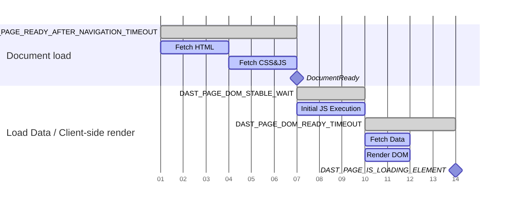

<a id="managing-scope"></a>

## 管理范围

范围控制 DAST 在爬取目标应用程序时跟随哪些 URL。妥善管理范围可以最大限度地缩短扫描运行时间，同时确保仅检查目标应用程序是否存在漏洞。

<a id="types-of-scope"></a>

### 范围的类型

范围有三种类型：

- 范围内
- 范围外
- 排除在范围外

<a id="in-scope"></a>

#### 范围内

DAST 会跟随范围内的 URL，并在 DOM 中搜索后续操作以继续爬取。记录的范围内 HTTP 消息会被被动检查是否存在漏洞，并在运行完整扫描时用于构建攻击。

<a id="out-of-scope"></a>

#### 范围外

对于非文档内容类型（如图像、样式表、字体、脚本或 AJAX 请求），DAST 会跟随范围外的 URL。除[身份验证](#scope-works-differently-during-authentication)外，DAST 不会为完整页面加载跟随范围外的 URL，例如点击指向外部网站的链接时。除用于搜索信息泄露的被动检查外，范围外 URL 记录的 HTTP 消息不会被检查是否存在漏洞。

<a id="excluded-from-scope"></a>

#### 排除在范围外

DAST 不会跟随排除在范围外的 URL。除用于搜索信息泄露的被动检查外，排除在范围外的 URL 记录的 HTTP 消息不会被检查是否存在漏洞。

<a id="scope-works-differently-during-authentication"></a>

### 身份验证期间范围的工作方式有所不同

许多目标应用程序的身份验证过程依赖于外部网站，例如使用身份访问管理提供商进行单点登录（SSO）时。为确保 DAST 能够通过这些提供商进行身份验证，DAST 在身份验证期间会为完整页面加载跟随范围外的 URL。DAST 不会跟随排除在范围外的 URL。

<a id="how-dast-blocks-http-requests"></a>

### DAST 如何阻止 HTTP 请求

当因范围规则而阻止请求时，DAST 会指示浏览器照常发出 HTTP 请求。该请求随后会被拦截，并以原因 `BlockedByClient` 拒绝。这种方法使 DAST 能够记录 HTTP 请求，同时确保该请求永远不会到达目标服务器。诸如 [200.1](../checks/200.1.md) 之类的被动检查会使用这些记录的请求来验证发送到外部主机的信息。

<a id="how-to-configure-scope"></a>

### 如何配置范围

默认情况下，与目标应用程序主机匹配的 URL 被视为范围内。所有其他主机被视为范围外。

范围通过以下变量进行配置：

- 使用 `DAST_SCOPE_ALLOW_HOSTS` 添加范围内主机。
- 使用 `DAST_SCOPE_IGNORE_HOSTS` 添加到范围外主机。
- 使用 `DAST_SCOPE_EXCLUDE_HOSTS` 添加到排除在范围外的主机。
- 使用 `DAST_SCOPE_EXCLUDE_URLS` 将特定 URL 设置为排除在范围外。

规则：

- 排除主机的优先级高于忽略主机，忽略主机的优先级高于允许主机。
- 为主机配置范围不会为该主机的子域配置范围。
- 为主机配置范围不会为该主机上的所有端口配置范围。

以下可能是一个典型配置：

```yaml
include:
  - template: DAST.gitlab-ci.yml

dast:
  variables:
    DAST_TARGET_URL: "https://my.site.com"                   # my.site.com URLs are considered in-scope by default
    DAST_SCOPE_ALLOW_HOSTS: "api.site.com:8443"       # include the API as part of the scan
    DAST_SCOPE_IGNORE_HOSTS: "analytics.site.com"      # explicitly disregard analytics from the scan
    DAST_SCOPE_EXCLUDE_HOSTS: "ads.site.com"           # don't visit any URLs on the ads subdomain
    DAST_SCOPE_EXCLUDE_URLS: "https://my.site.com/user/logout"  # don't visit this URL
```

<a id="vulnerability-detection"></a>

## 漏洞检测

DAST 通过我们全面的[基于浏览器的漏洞检查](../checks/_index.md)来检测漏洞。这些检查会在扫描期间识别 Web 应用程序中的安全问题。

爬取器在将 DAST 配置为代理服务器的浏览器中运行目标网站。这可确保浏览器发出的所有请求和响应都由 DAST 被动扫描。在运行完整扫描时，DAST 执行的主动漏洞检查不使用浏览器。漏洞检查方式的这种差异可能会导致一些问题，需要禁用目标网站的某些功能以确保扫描按预期工作。

例如，对于包含带有 Anti-CSRF 令牌的表单的目标网站，被动扫描可以按预期工作，因为浏览器会像用户查看页面一样显示页面和表单。但是，在完整扫描中运行的主动漏洞检查无法提交包含 Anti-CSRF 令牌的表单。在这种情况下，请在运行完整扫描时禁用 Anti-CSRF 令牌。

<a id="managing-scan-time"></a>

## 管理扫描时间

与标准极狐GitLab DAST 解决方案相比，运行基于浏览器的爬取器预计会为许多 Web 应用程序带来更好的覆盖率。这可能会以增加扫描时间为代价。

您可以通过以下措施来管理覆盖率与扫描时间之间的权衡：

- 如果目标应用程序具有基于模板的页面或重复内容，您可以使用 `DAST_CRAWL_GROUPED_URLS` 变量来[对 URL 进行分组](#grouped-urls)。
- 垂直扩展 runner，并使用[变量](variables.md) `DAST_CRAWL_WORKER_COUNT` 设置更多浏览器。默认值会根据可用的逻辑 CPU 数量动态设置。
- 使用[变量](variables.md) `DAST_CRAWL_MAX_ACTIONS` 限制浏览器执行的操作数量。默认值为 `10,000`。
- 使用[变量](variables.md) `DAST_CRAWL_MAX_DEPTH` 限制基于浏览器的爬取器检查覆盖率的页面深度。爬取器使用广度优先搜索策略，因此深度较小的页面会先被爬取。默认值为 `10`。
- 使用[变量](variables.md) `DAST_CRAWL_TIMEOUT` 限制爬取目标应用程序所花费的时间。默认值为 `24h`。当爬取器超时时，扫描会继续进行被动和主动检查。
- 使用[变量](variables.md) `DAST_CRAWL_GRAPH` 构建爬取图，以查看正在爬取哪些页面。
- 使用[变量](variables.md) `DAST_SCOPE_EXCLUDE_URLS` 阻止页面被爬取。
- 使用[变量](variables.md) `DAST_SCOPE_EXCLUDE_ELEMENTS` 阻止元素被选中。请谨慎使用，因为定义此变量会导致对每个爬取的页面进行额外查找。
- 如果目标应用程序渲染内容很少或渲染速度很快，请考虑将[变量](variables.md) `DAST_PAGE_DOM_STABLE_WAIT` 减小为更小的值。默认值为 `500ms`。

<a id="timeouts"></a>

## 超时

由于网络状况不佳或应用程序负载过高，默认超时可能不适用于您的应用程序。

基于浏览器的扫描能够调整各种超时，以确保在从一个页面过渡到下一个页面时继续顺利进行。这些值使用[时长字符串](https://pkg.go.dev/time#ParseDuration)进行配置，它允许您使用前缀配置时长：`m` 表示分钟，`s` 表示秒，`ms` 表示毫秒。

导航（即加载新页面的行为）通常需要最多的时间，因为它们会加载多个新资源，例如 JavaScript 或 CSS 文件。根据这些资源的大小或返回速度，默认的 `DAST_PAGE_READY_AFTER_NAVIGATION_TIMEOUT` 可能不够。

稳定性超时（例如可通过 `DAST_PAGE_DOM_READY_TIMEOUT` 或 `DAST_PAGE_READY_AFTER_ACTION_TIMEOUT` 配置的超时）也可以配置。稳定性超时决定基于浏览器的扫描何时认为页面已完全加载。基于浏览器的扫描在以下情况下认为页面已加载：

1. [DOMContentLoaded](https://developer.mozilla.org/en-US/docs/Web/API/Document/DOMContentLoaded_event) 事件已触发。
1. 没有被视为重要的未完成或未处理的请求，例如 JavaScript 和 CSS。媒体文件通常被视为不重要。
1. 根据浏览器是执行了导航、被强制转换，还是执行了操作：

   - 在 `DAST_PAGE_DOM_READY_TIMEOUT` 或 `DAST_PAGE_READY_AFTER_ACTION_TIMEOUT` 时长之后，没有新的文档对象模型（DOM）修改事件。

在这些事件发生后，基于浏览器的扫描会认为页面已加载并准备就绪，并尝试执行下一个操作。

如果您的应用程序出现延迟或返回大量导航失败，请考虑调整超时值，如下例所示：

```yaml
include:
  - template: DAST.gitlab-ci.yml

dast:
  variables:
    DAST_TARGET_URL: "https://my.site.com"
    DAST_PAGE_READY_AFTER_NAVIGATION_TIMEOUT: "45s"
    DAST_PAGE_READY_AFTER_ACTION_TIMEOUT: "15s"
    DAST_PAGE_DOM_READY_TIMEOUT: "15s"
```

> [!note]
> 调整这些值可能会影响扫描时间，因为它们会调整每个浏览器等待各种活动完成的时间。

<a id="page-readiness-timeouts"></a>

### 页面就绪超时

页面就绪是指页面已完全加载、其 DOM 已稳定且交互元素可用的状态。正确检测页面就绪对于以下方面至关重要：

- **扫描准确性**：在页面完全加载之前分析页面可能会遗漏内容或产生假阴性。
- **爬取效率**：等待时间过长会浪费扫描时间，而等待时间不足则会遗漏动态内容。
- **现代 Web 应用程序支持**：单页应用程序、大量使用 AJAX 的网站以及渐进式加载模式需要复杂的就绪检测。

通过一系列可选的可配置超时，DAST 扫描器可以检测页面不同部分何时完全加载。

<a id="timeout-variables"></a>

#### 超时变量

使用以下 CI/CD 变量来自定义 DAST 页面就绪超时。有关完整列表，请参阅[可用的 CI/CD 变量](variables.md)。

| 超时变量 | 默认值 | 描述 |
|:-----------------|:--------|:------------|
| `DAST_PAGE_READY_AFTER_NAVIGATION_TIMEOUT` | `15s` | 等待浏览器从一个页面导航到另一个页面的最长时间。用于完整页面加载的文档加载阶段。 |
| `DAST_PAGE_READY_AFTER_ACTION_TIMEOUT` | `7s` | 等待浏览器认为页面已加载并准备好进行分析的最长时间。用作 `DAST_PAGE_READY_AFTER_NAVIGATION_TIMEOUT`的替代项，适用于不会触发完整页面加载的页面内操作。 |
| `DAST_PAGE_DOM_STABLE_WAIT` | `500ms` | 定义在检查页面是否稳定之前等待 DOM 更新的时长。用于客户端渲染阶段的开始。 |
| `DAST_PAGE_DOM_READY_TIMEOUT` | `6s` | 等待浏览器在导航完成后认为页面已加载并准备好进行分析的最长时间。控制等待后台数据获取和 DOM 渲染。 |
| `DAST_PAGE_IS_LOADING_ELEMENT` | 无 | 当该选择器在页面上不再可见时，会向分析器表明页面已完成加载，扫描可以继续。标记客户端渲染过程的结束。 |

<a id="page-loading-workflow"></a>

#### 页面加载工作流

现代 Web 应用程序分多个阶段加载。DAST 扫描器为该过程中的每个步骤都设有特定的超时：

1. **文档加载**：浏览器获取并处理基本页面结构。

   1. 从服务器获取 HTML 内容。
   1. 加载引用的 CSS 和 JavaScript 文件。
   1. 解析内容并渲染初始页面。
   1. 触发标准的“文档就绪”事件。

   此阶段使用 `DAST_PAGE_READY_AFTER_NAVIGATION_TIMEOUT`（用于完整页面加载）或 `DAST_PAGE_READY_AFTER_ACTION_TIMEOUT`（用于页面内操作），它们设置文档加载的最长等待时间。

1. **客户端渲染**：在初始加载之后，许多单页应用程序会：

   - 执行初始 JavaScript（`DAST_PAGE_DOM_STABLE_WAIT`）。
   - 通过 AJAX 或其他 API 调用获取后台数据。
   - 渲染 DOM 并根据获取的数据执行更新（`DAST_PAGE_DOM_READY_TIMEOUT`）。
   - 显示页面加载指示器（`DAST_PAGE_IS_LOADING_ELEMENT`）。

   扫描器会监控这些活动，以确定页面何时准备好进行交互。

以下图表说明了爬取页面时使用的超时顺序：



<a id="grouped-urls"></a>

## 分组 URL

当您针对网站运行 DAST 扫描器时，一次典型扫描可能需要几个小时才能完成。当您的网站包含数千个使用相同模板但信息各异的相似页面时，就会出现这种延迟。DAST 将每个页面视为独立页面并单独分析它们，从而将大部分扫描时间花在爬取这些相似页面上。

例如：

- 拥有数千个产品页面的电子商务网站（`/products/item-123`、`/products/item-456`）
- 拥有用户个人资料的社交平台（`/users/john`、`/users/jane`）
- 拥有分类文章的内容管理系统（`/blog/category/tech`、`/blog/category/news`）
- 拥有分页结果的搜索界面（`/search?q=term&page=1`、`/search?q=term&page=2`）

分组 URL 不是将每个 URL 都视为唯一，而是允许您定义通配符模式，将相似的 URL 分组在一起。当 DAST 遇到与这些模式匹配的 URL 时，它会分析每个组中的一个代表性 URL，以缩短扫描时间，同时保持安全覆盖率。例如，如果所有产品详情页面都遵循相同的结构和安全模型，DAST 只需彻底测试其中一个即可。

<a id="how-grouped-urls-work"></a>

### 分组 URL 的工作方式

当您配置分组 URL 模式时，DAST 的爬取器会优化爬取：

1. 模式匹配：当爬取器发现新 URL 时，它会将每个 URL 与您定义的模式进行比对。
1. 智能分组：与某个模式匹配的 URL 会被分组在一起，只有第一个发现的 URL 会被完整分析。
1. 跳过导航：与同一模式匹配的后续 URL 会跳过完整爬取，但仍会被记录以供报告。
1. 安全覆盖率：对代表性 URL 执行的安全分析适用于整个组。

> [!warning]
> 因分组 URL 配置而被跳过的 URL 在爬取图中可能显示为 **visited** 或 **failed**。这是一个已知问题。有关更多信息，请参阅[议题 577252](https://gitlab.com/gitlab-org/gitlab/-/issues/577252)。

<a id="example-configuration-guide"></a>

### 示例配置指南

以下示例使用一个假设的电子商务网站。该网站的产品列表页面具有作为查询参数的可变筛选条件，产品详情页面则将产品标识符作为 URL 中的子路径。

**分析应用程序的 URL 模式**

在配置分组 URL 之前，请先了解应用程序的 URL 结构：

1. 查看您的站点地图或应用程序路由。
1. 检查之前扫描的 DAST 日志，以识别重复模式。
1. 按功能用途对 URL 进行分类（产品页面、用户个人资料、搜索结果）。
1. 识别共享相同页面结构的基于模板的页面。

在此示例中，对电子商务网站的一次扫描在 [CI 产物中的日志文件](../troubleshooting.md#log-destination)中产生了以下 URL：

```plaintext
INF REPT  visited 8 URLs
INF REPT  URL visited: (DOC www.your-site.com/products?category=vegetables&sort=price) GET www.your-site.com/products?category=vegetables&sort=price
INF REPT  URL visited: (DOC www.your-site.com/products?category=fruits&sort=price) GET www.your-site.com/products?category=fruits&sort=price
INF REPT  URL visited: (DOC www.your-site.com/products?category=frozen&sort=price) GET www.your-site.com/products?category=frozen&sort=price
INF REPT  URL visited: (DOC www.your-site.com/products?category=frozen&sort=price) GET www.your-site.com/products?category=frozen&sort=price
INF REPT  URL visited: (DOC www.your-site.com/products/029039-apple-93000/details) GET www.your-site.com/products/029039-apple-93000/details
INF REPT  URL visited: (DOC www.your-site.com/products/99345-orange-33322/details) GET www.your-site.com/products/99345-orange/details
INF REPT  URL visited: (DOC www.your-site.com/products/90845-orange-33992/details) GET www.your-site.com/products/90845-orange/details
INF REPT  URL visited: (DOC www.your-site.com/products/100232-bananas-2677/details) GET www.your-site.com/products/100232-bananas-2677/details
```

前四个 URL 表示具有不同 `category` 和 `sort` 筛选条件的产品列表页面。后四个 URL 表示具有唯一产品标识符的各个产品详情页面。其中两个产品详情页面的标识符中包含 `orange`。

这两组页面很可能共享相同的底层模板和安全特征。如果不使用分组 URL 进行优化，DAST 将逐个爬取并测试全部八个页面。

**设计通配符模式**

创建模式时，请遵循以下规则：

1. 至少包含一个 `*` 通配符以进行模式识别。`*` 匹配 URL 中零个或多个字符。URL 是按字符匹配的，而不是按 URL 的特定部分匹配。`*` 可以匹配 URL 的多个子路径。
1. 找出 URL 中在爬取过程中发生变化的字符。要具体明确，以避免将不相关的页面过度分组。
1. 考虑模式顺序。如果某个页面匹配多个模式，则使用最先指定的模式。

为电子商务网站配置模式：

1. 产品类别列表组模式：前四个 URL 可以使用模式 `www.your-site.com/products?category=*&sort=price` 进行逻辑分组。此模式匹配所有同时使用类别筛选条件并将 `price` 定义为 `sort` 筛选条件的页面。
1. 产品详情组模式：后四个 URL 可以使用模式 `www.your-site.com/products/*/details` 进行逻辑分组。此模式匹配所有产品详情页面，无论产品标识符是什么。

您还可以将产品详情组模式进一步拆分为两个组：

1. 橙子产品详情组模式：模式 `www.your-site.com/products/*orange*/details` 匹配这两个橙子产品的 URL。
1. 通用产品详情组模式：模式 `www.your-site.com/products/*/details` 匹配所有其他产品。

一个页面可以匹配多个 URL 模式。请按您希望它们被匹配的顺序指定模式。例如，`www.your-site.com/products/4782-orange-777/details` 同时匹配这两个模式，但这是一个橙子产品详情页面。为确保它匹配橙子产品详情组模式，请在配置中将橙子产品详情组模式指定在通用产品详情组模式之前。

**配置 `DAST_CRAWL_GROUPED_URLS` 变量**

将配置添加到您的 `.gitlab-ci.yml` 文件中：

```yaml
include:
  - template: DAST.gitlab-ci.yml

dast:
  variables:
    DAST_TARGET_URL: "https://your-site.com"
    DAST_CRAWL_GROUPED_URLS: "https://your-site.com/products?category=*&sort=price,https://your-site.com/products/*orange*/details,https://your-site.com/products/*/details"
```

**监控并验证**

实施分组 URL 后：

1. 检查爬取图（如果已启用）以验证分组行为。您应该会看到爬取图中的分支更少。
1. 查看扫描日志以确认预期的 URL 阻止。您应该会看到访问的 URL 更少。
1. 验证安全覆盖率未受影响。发现的问题数量可能会减少，因为每个组只扫描一个页面来查找漏洞。
1. 衡量扫描时长的性能改进。扫描完成所需的时间应该更短。

<a id="advanced-configuration-examples"></a>

#### 高级配置示例

以下示例演示了常见 Web 应用程序场景的高级模式：

**带通配符的多个查询参数**

对于具有多个可变参数的搜索或筛选页面：

```yaml
dast:
  variables:
    DAST_TARGET_URL: "https://your-site.com"
    # Match search results with any query and page number
    DAST_CRAWL_GROUPED_URLS: "https://your-site.com/search?q=*&page=*,https://your-site.com/search?q=*&page=*&sort=*"
```

这会将所有搜索结果页面分组在一起，无论搜索词、分页或排序选项如何。

**组合路径和查询参数模式**

对于同时具有动态路径和查询字符串的应用程序：

```yaml
dast:
  variables:
    DAST_TARGET_URL: "https://your-site.com"
    DAST_CRAWL_GROUPED_URLS: |
      https://your-site.com/api/v1/users/*/profile?tab=*,
      https://your-site.com/dashboard/*/reports?year=*&month=*,
      https://your-site.com/catalog/*/items?filter=*
```

此配置会将以下内容分组：

- 具有不同标签页的用户个人资料页面。
- 跨不同时间段的仪表板报告。
- 具有各种筛选条件的目录项。

**分层 URL 模式**

对于具有多个层级的嵌套资源结构：

```yaml
dast:
  variables:
    DAST_TARGET_URL: "https://your-site.com"
    DAST_CRAWL_GROUPED_URLS: |
      https://your-site.com/organizations/*/teams/*/members/*,
      https://your-site.com/projects/*/issues/*/comments,
      https://your-site.com/categories/*/subcategories/*/products/*
```

此配置可处理多个路径段发生变化的深层嵌套 URL。

**带资源 ID 的 API 端点**

对于具有可变资源标识符的 REST API 端点：

```yaml
dast:
  variables:
    DAST_TARGET_URL: "https://api.your-site.com"
    DAST_CRAWL_GROUPED_URLS: |
      https://api.your-site.com/v1/customers/*/orders,
      https://api.your-site.com/v1/customers/*/orders/*,
      https://api.your-site.com/v2/resources/*/relationships/*,
      https://api.your-site.com/*/items?id=*
```

此配置按资源类型而不是单个 ID 对 API 端点进行分组。

**区域设置和语言变体**

对于具有语言或区域代码的国际化网站：

```yaml
dast:
  variables:
    DAST_TARGET_URL: "https://your-site.com"
    DAST_CRAWL_GROUPED_URLS: |
      https://your-site.com/*/products/*,
      https://your-site.com/*/*/articles/*,
      https://*.your-site.com/content/*
```

此配置会将以下内容分组：

- 跨不同语言的产品页面（`/en/products/123`、`/fr/products/123`）。
- 具有语言和区域代码的文章（`/en/us/articles/guide`）。
- 基于子域的区域设置（`en.your-site.com/content/page`）。

**会话和令牌参数**

对于带有应被分组的会话 ID 或临时令牌的 URL：

```yaml
dast:
  variables:
    DAST_TARGET_URL: "https://your-site.com"
    DAST_CRAWL_GROUPED_URLS: |
      https://your-site.com/checkout?session=*,
      https://your-site.com/verify?token=*&email=*,
      https://your-site.com/share/*?ref=*
```

此配置可防止 DAST 将每个唯一的会话或令牌视为单独的页面。

<a id="complex-e-commerce-scenarios"></a>

##### 复杂的电子商务场景

用于全面的电子商务网站优化：

```yaml
dast:
  variables:
    DAST_TARGET_URL: "https://shop.your-site.com"
    DAST_CRAWL_GROUPED_URLS: |
      https://shop.your-site.com/products?category=*&brand=*&price=*,
      https://shop.your-site.com/products/*/reviews?page=*,
      https://shop.your-site.com/products/*/reviews?page=*&sort=*,
      https://shop.your-site.com/cart?item=*&quantity=*,
      https://shop.your-site.com/user/orders/*/tracking,
      https://shop.your-site.com/compare?products=*
```

此配置可处理：

- 具有多种筛选条件组合的产品列表。
- 具有不同排序的分页产品评论。
- 购物车变体。
- 订单跟踪页面。
- 产品比较页面。

**用于提高具体性的模式顺序**

当模式重叠时，请按从最具体到最通用的顺序排列它们：

```yaml
dast:
  variables:
    DAST_TARGET_URL: "https://your-site.com"
    # Order matters: specific patterns first, general patterns last
    DAST_CRAWL_GROUPED_URLS: |
      https://your-site.com/products/*-premium-*/details,
      https://your-site.com/products/*-sale-*/details,
      https://your-site.com/products/*/details,
      https://your-site.com/products/*
```

此配置可确保高级产品和促销产品在回退到通用产品模式之前被单独分组。

**从分组中排除特定模式**

与 `DAST_SCOPE_EXCLUDE_URLS` 结合使用，以将某些 URL 从分组和扫描中排除：

```yaml
dast:
  variables:
    DAST_TARGET_URL: "https://your-site.com"
    DAST_CRAWL_GROUPED_URLS: "https://your-site.com/articles/*/comments?page=*"
    # Exclude logout and admin URLs from scanning entirely
    DAST_SCOPE_EXCLUDE_URLS: "https://your-site.com/logout,https://your-site.com/admin/*"
```

此配置会对文章评论页面进行分组，同时将注销和管理员 URL 从扫描中排除。
