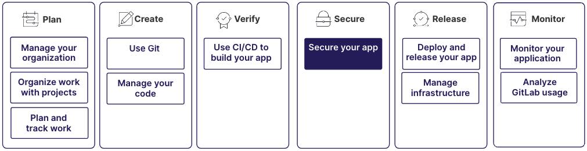

识别并修复应用程序源代码中的漏洞。将安全测试集成到软件开发生命周期中，通过自动扫描代码来发现潜在的安全问题。

您可以扫描各种编程语言和框架，并检测 SQL 注入、跨站脚本（XSS）和不安全的依赖项等漏洞。安全扫描的结果会显示在极狐GitLab UI 中，您可以在其中查看并处理这些结果。

这些功能还可以与合并请求和流水线等其他极狐GitLab 功能集成，以确保安全在整个开发过程中始终是优先事项。

保护您的应用程序是极狐GitLab DevOps 生命周期中 Secure 阶段的一部分：

## 第 1 步：了解扫描

密钥检测会扫描您的代码仓库，帮助防止您的密钥被泄露。它适用于所有编程语言。

依赖项扫描会分析应用程序的依赖项，以发现已知漏洞。它适用于特定语言和软件包管理器。

有关更多信息，请参阅：

- [密钥检测](secret_detection/_index.md)
- [依赖项扫描](dependency_scanning/_index.md)

## 第 2 步：选择要测试的项目

如果这是您首次设置极狐GitLab 安全扫描，应从单个项目开始。该项目应：

- 使用您组织的典型编程语言和技术，
  因为某些扫描功能在不同语言中的工作方式有所不同。
- 允许您尝试新设置（如必需审批），而不会中断团队的日常工作。
  您可以创建高流量项目的副本，或选择不太繁忙的项目。

## 第 3 步：启用扫描

要识别项目中泄露的密钥和有漏洞的软件包，请创建一个启用密钥检测和依赖项扫描的合并请求。

此合并请求会更新您的`.gitlab-ci.yml` 文件，使扫描作为项目 CI/CD 流水线的一部分运行。

作为此合并请求的一部分，您可以更改设置以适应项目的布局或配置。例如，您可以排除第三方代码目录。

将此合并请求合并到默认分支后，系统会创建基线扫描。此扫描会识别默认分支上已存在的漏洞。之后，合并请求将突出显示任何新引入的问题。

如果没有基线扫描，合并请求会显示分支中的每个漏洞，即使该漏洞已存在于默认分支上。

有关更多信息，请参阅：

- [启用密钥检测](secret_detection/pipeline/_index.md#getting-started)
- [密钥检测设置](secret_detection/pipeline/configure.md)
- [开启依赖项扫描](dependency_scanning/dependency_scanning_sbom/_index.md#turn-on-dependency-scanning)
- [依赖项扫描设置](dependency_scanning/dependency_scanning_sbom/_index.md#available-cicd-variables)

## 第 4 步：查看扫描结果

让您的团队熟悉如何在合并请求和漏洞报告中查看安全发现。

建立漏洞排查工作流。考虑创建标记和议题看板，以帮助管理由漏洞创建的议题。借助议题看板，所有利益相关者都能对所有议题有一致的了解，并跟踪修复进度。

监控安全仪表板的趋势，以衡量在修复现有漏洞和防止引入新漏洞方面的成效。

有关更多信息，请参阅：

- [查看漏洞报告](vulnerability_report/_index.md)
- [在合并请求中查看安全发现](detect/security_scanning_results.md)
- [查看安全仪表板](security_dashboard/_index.md)
- [标记](../project/labels.md)
- [议题看板](../project/issue_board.md)

## 第 5 步：安排未来的扫描作业

通过使用扫描执行策略来强制执行计划的安全扫描作业。这些计划作业独立于您可能已在合规框架流水线或项目的`.gitlab-ci.yml` 文件中定义的其他任何安全扫描运行。

计划扫描对于开发活动较少、且流水线扫描不频繁的项目或重要分支最为有用。

有关更多信息，请参阅：

- [扫描执行策略](policies/scan_execution_policies.md)
- [容器扫描](container_scanning/_index.md)
- [运维容器扫描](../clusters/agent/vulnerabilities.md)

## 第 6 步：限制新漏洞

要强制执行所需的扫描类型并确保安全与工程之间的职责分离，请使用扫描执行策略。

要限制新漏洞被合并到默认分支，请创建合并请求审批策略。

在熟悉扫描的工作方式后，您可以选择：

- 按照相同的步骤在更多项目中启用扫描。
- 一次在更多项目中强制执行扫描。

有关更多信息，请参阅：

- [扫描执行策略](policies/scan_execution_policies.md)
- [合并请求审批策略](policies/_index.md)

## 第 7 步：持续扫描新漏洞

随着时间的推移，您希望确保不会引入新漏洞。

- 要发现代码仓库中已存在但新发现的漏洞，
  请定期运行依赖项扫描和容器扫描。
- 要扫描生产集群中的容器镜像以发现安全漏洞，
  请启用运维容器扫描。
- 启用其他扫描类型，如 SAST、DAST 或模糊测试。
- 要允许在临时测试环境中进行 DAST 和 Web API 模糊测试，
  请考虑启用审查应用。

有关更多信息，请参阅：

- [SAST](sast/_index.md)
- [DAST](dast/_index.md)
- [模糊测试](coverage_fuzzing/_index.md)
- [Web API 模糊测试](api_fuzzing/_index.md)
- [审查应用](../../ci/review_apps/_index.md)
