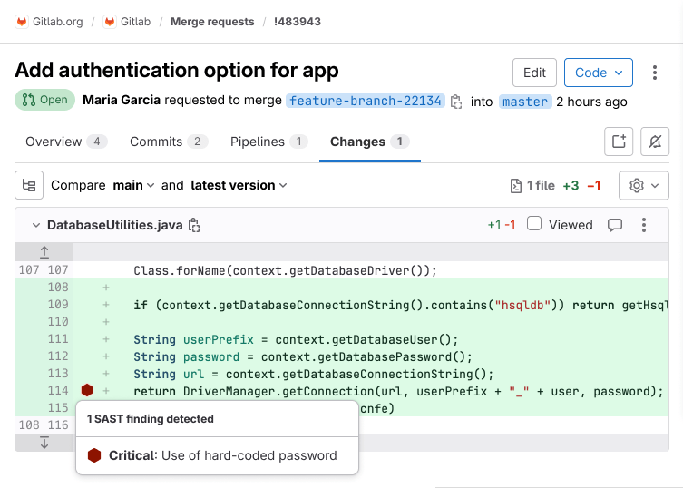

<style>
table.sast-table tr:nth-child(even) {
    background-color: transparent;
}

table.sast-table td {
    border-left: 1px solid #dbdbdb;
    border-right: 1px solid #dbdbdb;
    border-bottom: 1px solid #dbdbdb;
}

table.sast-table tr td:first-child {
    border-left: 0;
}

table.sast-table tr td:last-child {
    border-right: 0;
}

table.sast-table ul {
    font-size: 1em;
    list-style-type: none;
    padding-left: 0px;
    margin-bottom: 0px;
}

table.no-vertical-table-lines td {
    border-left: none;
    border-right: none;
    border-bottom: 1px solid #f0f0f0;
}

table.no-vertical-table-lines tr {
    border-top: none;
}
</style>



- Tier: 基础版，专业版，旗舰版
- Offering: JihuLab.com，私有化部署



静态应用程序安全测试（SAST）在源代码进入生产环境之前发现其中的漏洞。SAST 直接集成到您的 CI/CD 流水线中，在开发过程中识别安全问题，此时修复最容易且成本效益最高。

在开发后期才发现的安全漏洞会导致代价高昂的延迟和潜在的入侵风险。SAST 扫描会在每次提交时自动进行，为您提供即时反馈，而不会干扰您的工作流程。

<a id="reducing-false-positives-and-resolving-vulnerabilities-with-gitlab-duo"></a>

## 使用极狐GitLab Duo 减少误报并解决漏洞



- Tier: 旗舰版



SAST 扫描器可能会产生误报，在漏洞报告中制造噪音。极狐GitLab Duo 可协助进行漏洞管理。

<a id="false-positive-detection"></a>

### 误报检测

[极狐GitLab Duo 误报检测](../vulnerabilities/false_positive_detection.md)会自动分析严重级别和高危级别的 SAST 漏洞，以识别可能的误报。这有助于您的安全团队专注于真正的漏洞，并减少人工分类所花费的时间。

对于拥有极狐GitLab Duo 附加组件的旗舰版客户，误报检测会在每次安全扫描后自动运行，并为每次评估提供置信度评分和解释。

<a id="agentic-sast-vulnerability-resolution"></a>

### Agentic SAST 漏洞解决

[Agentic SAST 漏洞解决](../vulnerabilities/agentic_vulnerability_resolution.md)会自动生成合并请求，其中包含针对高危和严重级别 SAST 漏洞的上下文感知代码修复。这种 Agentic 方法使用多轮推理，以最少的人工干预解决漏洞。

对于旗舰版客户，当漏洞满足特定条件时，Agentic 漏洞解决会在每次安全扫描后自动运行。

<a id="features"></a>

## 功能

下表列出了每个功能可用的极狐GitLab 版本。

| 功能                                                                                                                          | 在基础版和专业版中 | 在旗舰版中 |
|:---------------------------------------------------------------------------------------------------------------------------------|:------------------|:------------|
| 使用[开源分析器](#supported-languages-and-frameworks)进行基本扫描                                                 |        |  |
| 可下载的 [SAST JSON 报告](#download-a-sast-report)                                                                         |        |  |
| 使用[极狐GitLab Advanced SAST](gitlab_advanced_sast.md) 进行跨文件、跨函数扫描                                         |         |  |
| [合并请求报告](#merge-request-reports)中的新发现                                                                  |         |  |
| [合并请求变更视图](#merge-request-changes-view)中的新发现                                                        |         |  |
| [漏洞管理](../vulnerabilities/_index.md)                                                                         |         |  |
| [极狐GitLab Duo 误报检测](../vulnerabilities/false_positive_detection.md)（需要极狐GitLab Duo 附加组件）               |         |  |
| [Agentic SAST 漏洞解决](../vulnerabilities/agentic_vulnerability_resolution.md) |         |  |
| [基于 UI 的扫描器配置](#enable-sast-by-using-the-ui)                                                                   |         |  |
| [规则集自定义](customize_rulesets.md)                                                                                   |         |  |
| [高级漏洞跟踪](#advanced-vulnerability-tracking)                                                              |         |  |

<a id="getting-started"></a>

## 快速入门

通过使用 UI 或编辑项目的极狐GitLab CI/CD 配置文件，在您的项目中启用 SAST。

> [!note]
> 默认情况下，SAST 仅在分支流水线中运行。要在合并请求流水线中运行 SAST，请参阅
> [将安全扫描工具与合并请求流水线结合使用](../detect/security_configuration.md#use-security-scanning-tools-with-merge-request-pipelines)。

<a id="enable-sast-by-using-the-ui"></a>

### 使用 UI 启用 SAST



- Tier: 旗舰版
- Offering: JihuLab.com，私有化部署



您可以使用 UI 启用和配置 SAST，既可以使用默认设置，也可以进行自定义。您可以使用的方法取决于您的极狐GitLab 许可证版本。

> [!note]
> UI 配置方法最适合没有或只有极简`.gitlab-ci.yml` 文件的情况。如果您的配置很复杂，该工具可能无法解析它。在这种情况下，
> 请改为[编辑 CI/CD 文件](#enable-sast-by-editing-the-cicd-file)。

<a id="enable-sast-with-customizations"></a>

#### 使用自定义配置启用 SAST

先决条件：

- 项目需具有维护者或所有者角色。
- 基于 Linux 的极狐GitLab Runner，使用 Docker 或 Kubernetes 执行器。如果您使用 JihuLab.com 的托管 Runner，则默认启用 Docker 或 Kubernetes 执行器。
  - 不支持在 Windows Runner 上使用极狐GitLab Runner。
  - 不支持 AMD64 以外的 CPU 架构。
- 极狐GitLab CI/CD 配置（`.gitlab-ci.yml`）必须包含 `test` 阶段，该阶段默认包含。如果您在`.gitlab-ci.yml` 文件中重新定义了阶段，则必须包含 `test` 阶段。

要使用自定义配置启用和配置 SAST：

1. 在顶部栏中，选择**搜索或跳转到**并找到您的项目。
1. 在左侧边栏中，选择**安全** > **安全配置**。
1. 如果项目默认分支的最新流水线已完成并生成了有效的 SAST 产物，请选择**配置 SAST**，否则在静态应用程序安全测试（SAST）行中选择**启用 SAST**。
1. 输入自定义 SAST 值。

   自定义值存储在`.gitlab-ci.yml` 文件中。对于不在 SAST 配置页面中的 CI/CD 变量，其值继承自极狐GitLab SAST 模板。
1. 选择**创建合并请求**。
1. 审查并合并合并请求。

流水线现在包含一个 SAST 作业。如果存在受支持的源代码，当流水线运行时，相应的分析器和默认规则会自动扫描漏洞。相应的作业会出现在项目流水线的 `test` 阶段下。

<a id="enable-sast-with-default-settings-only"></a>

#### 仅使用默认设置启用 SAST

先决条件：

- 项目需具有维护者或所有者角色。
- 基于 Linux 的极狐GitLab Runner，使用 Docker 或 Kubernetes 执行器。如果您使用 JihuLab.com 的托管 Runner，则默认启用 Docker 或 Kubernetes 执行器。
  - 不支持在 Windows Runner 上使用极狐GitLab Runner。
  - 不支持 AMD64 以外的 CPU 架构。
- 极狐GitLab CI/CD 配置（`.gitlab-ci.yml`）必须包含 `test` 阶段，该阶段默认包含。如果您在`.gitlab-ci.yml` 文件中重新定义了阶段，则必须包含 `test` 阶段。

要使用默认设置启用和配置 SAST：

1. 在顶部栏中，选择**搜索或跳转到**并找到您的项目。
1. 在左侧边栏中，选择**安全** > **安全配置**。
1. 在 SAST 部分中，选择**使用合并请求进行配置**。

   合并请求页面将打开。
1. 填写字段。
1. 选择**创建合并请求**。
1. 审查并合并合并请求以启用 SAST。

流水线现在包含一个 SAST 作业。如果存在受支持的源代码，当流水线运行时，相应的分析器和默认规则会自动扫描漏洞。相应的作业会出现在项目流水线的 `test` 阶段下。

<a id="enable-sast-by-editing-the-cicd-file"></a>

### 通过编辑 CI/CD 文件启用 SAST

先决条件：

- 项目需具有开发者、维护者或所有者角色。
- 基于 Linux 的极狐GitLab Runner，使用 Docker 或 Kubernetes 执行器。如果您使用 JihuLab.com 的托管 Runner，则默认启用 Docker 或 Kubernetes 执行器。
  - 不支持在 Windows Runner 上使用极狐GitLab Runner。
  - 不支持 AMD64 以外的 CPU 架构。
- 极狐GitLab CI/CD 配置（`.gitlab-ci.yml`）必须包含 `test` 阶段，该阶段默认包含。如果您在`.gitlab-ci.yml` 文件中重新定义了阶段，则必须包含 `test` 阶段。

要在您的项目中启用 SAST：

1. 在顶部栏中，选择**搜索或跳转到**并找到您的项目。
1. 转到**构建** > **流水线**编辑器。
1. 添加 SAST CI/CD 模板或组件。

   要使用模板，请添加以下行：

   ```yaml
   include:
     - template: Jobs/SAST.gitlab-ci.yml
   ```

   要使用 CI/CD 组件，请添加以下行：

   ```yaml
   include:
     - component: gitlab.com/components/sast/sast@main
   ```

1. 选择**验证**选项卡，然后选择**验证流水线**。

   消息**模拟成功完成**确认文件有效。
1. 选择**编辑**选项卡。
1. 填写字段：
   - 提交消息。
   - 分支。例如，`add-sast`。
1. 选中**使用这些更改启动新的合并请求**复选框，然后选择
   **提交更改**。

   合并请求页面将打开。
1. 根据您的标准工作流程填写字段，然后选择 **创建
   合并请求**。
1. 根据您的标准工作流程审查和编辑合并请求，然后选择**合并**。

流水线现在包含一个 SAST 作业。如果存在受支持的源代码，当流水线运行时，相应的分析器和默认规则会自动扫描漏洞。相应的作业会出现在项目流水线的 `test` 阶段下。

您可以在 [SAST 示例项目](https://gitlab.com/gitlab-org/security-products/demos/analyzer-configurations/semgrep/sast-getting-started)中查看一个可用的示例。

<a id="next-steps"></a>

### 后续步骤

启用 SAST 后，您可以：

- 详细了解如何[理解结果](#understanding-the-results)。
- 查看[优化提示](#optimization)。
- 规划[向更多项目推广](#roll-out)。

<a id="understanding-the-results"></a>

## 理解结果

先决条件：

- 项目需具有安全管理员、开发者、维护者或所有者角色。

您可以在流水线中查看漏洞：

1. 在顶部栏中，选择**搜索或跳转到**并找到您的项目。
1. 在左侧边栏中，选择**构建** > **流水线**。
1. 选择流水线。
1. 选择**安全**选项卡。
1. 可以下载结果，或选择一个漏洞查看其详细信息（仅限旗舰版），包括：
   - 描述：解释漏洞的原因、潜在影响以及建议的修复步骤。
   - 状态：指示漏洞是否已分类或已解决。
   - 严重级别：根据影响分为六个级别。
     [详细了解严重级别](../vulnerabilities/severities.md)。
   - 位置：显示发现问题的文件名和行号。
     选择文件路径会在代码视图中打开相应的行。
   - 扫描器：标识检测到漏洞的分析器。
   - 标识符：用于对漏洞进行分类的引用列表，例如 CWE 标识符和检测到漏洞的规则 ID。

SAST 漏洞根据所发现漏洞的主要通用弱点枚举（CWE）标识符命名。阅读每个漏洞发现的描述，以了解有关扫描器检测到的具体问题的更多信息。有关 SAST 覆盖范围的更多信息，请参阅 [SAST 规则](rules.md)。

在旗舰版中，您还可以下载安全扫描结果：

先决条件：

- 项目需具有安全管理员、开发者、维护者或所有者角色。

1. 在顶部栏中，选择**搜索或跳转到**并找到您的项目。
1. 在左侧边栏中，选择**构建** > **流水线**。
1. 选择流水线。
1. 选择**安全**选项卡。
1. 在流水线的**安全**选项卡中，选择**下载结果**。

有关更多详细信息，请参阅[流水线安全报告](../detect/security_scanning_results.md)。

> [!note]
> 发现在功能分支上生成。当它们合并到默认分支时，就会成为漏洞。在评估您的安全态势时，这一区别非常重要。

查看 SAST 结果的其他方式：

- 合并请求组件：显示新引入或已解决的发现。
- 合并请求变更视图：显示已更改行的内联注释。
- 漏洞报告：显示默认分支上已确认的漏洞。

一个流水线由多个作业组成，包括 SAST 和 DAST 扫描。如果任何作业因任何原因未能完成，安全仪表板不会显示 SAST 扫描器输出。例如，如果 SAST 作业完成但 DAST 作业失败，安全仪表板不会显示 SAST 结果。失败时，分析器会输出一个退出代码。

<a id="merge-request-reports"></a>

### 合并请求报告

有关合并请求中的 SAST 结果，请参阅[合并请求报告](../../project/merge_requests/reports.md)。

<a id="merge-request-changes-view"></a>

### 合并请求变更视图



- Tier: 旗舰版



SAST 结果显示在合并请求的**变更**视图中。包含 SAST 问题的行会在行号旁标有一个符号。选择该符号可查看问题列表，然后选择一个问题查看其详细信息。



<a id="optimization"></a>

## 优化

要根据您的要求优化 SAST，您可以：

- 禁用规则。
- 排除文件或路径，使其不被扫描。

<a id="disable-a-rule"></a>

### 禁用规则

先决条件：

- 项目需具有开发者、维护者或所有者角色。

要禁用规则，例如因为它产生太多误报：

1. 在顶部栏中，选择**搜索或跳转到**并找到您的项目。
1. 如果项目根目录中尚不存在`.gitlab/sast-ruleset.toml` 文件，请创建一个。
1. 在漏洞详细信息中，找到触发该发现的规则 ID。
1. 使用规则 ID 禁用该规则。例如，要禁用 `gosec.G107-1`，请在`.gitlab/sast-ruleset.toml`中添加以下内容：

   ```toml
   [semgrep]
     [[semgrep.ruleset]]
       disable = true
       [semgrep.ruleset.identifier]
         type = "semgrep_id"
         value = "gosec.G107-1"
   ```

有关自定义规则集的更多详细信息，请参阅[自定义规则集](customize_rulesets.md)。

<a id="exclude-files-or-paths-from-being-scanned"></a>

### 排除文件或路径，使其不被扫描

先决条件：

- 项目需具有开发者、维护者或所有者角色。

要排除文件或路径，使其不被扫描，例如测试或临时代码，请设置 `SAST_EXCLUDED_PATHS` 变量。例如，要跳过 `rule-template-injection.go`，请将以下内容添加到您的`.gitlab-ci.yml`中：

```yaml
variables:
  SAST_EXCLUDED_PATHS: "rule-template-injection.go"
```

有关配置选项的更多信息，请参阅[可用的 CI/CD 变量](#available-cicd-variables)。

<a id="roll-out"></a>

## 推广

在您对单个项目的 SAST 结果有信心后，可以将其实现扩展到其他项目：

- 使用[强制扫描执行](../detect/security_configuration.md#create-a-shared-configuration)在群组中应用 SAST 设置。
- 通过[指定远程配置文件](customize_rulesets.md#use-a-remote-ruleset-file)共享和重用中央规则集。
- 如果您有独特的要求，SAST 可以在离线环境或 SELinux 约束下运行。

<a id="supported-languages-and-frameworks"></a>

## 支持的语言和框架

极狐GitLab SAST 支持扫描以下语言和框架。

可用的扫描选项取决于极狐GitLab 版本：

- 在旗舰版中，极狐GitLab Advanced SAST 提供更准确的结果。对于它支持的语言，您应该使用它。
- 在所有版本中，您都可以使用极狐GitLab 提供的分析器（基于开源扫描器）来扫描您的代码。

有关 SAST 语言支持计划的更多信息，请参阅[类别方向页面](https://about.gitlab.com/direction/application_security_testing/static-analysis/sast/#language-support)。

<a id="languages-with-full-support"></a>

### 完全支持的语言

这些语言同时受极狐GitLab Advanced SAST（旗舰版）和标准分析器（所有版本）支持：

| 语言               | 极狐GitLab Advanced SAST[^advanced-sast-ultimate] | 标准分析器[^tiers-uses-semgrep] |
|------------------------|----------------------------------|-------------------------------|
| C                      |                       |                    |
| C++                    |                       |                    |
| C#                     |                       |                    |
| Go                     |                       |                    |
| Java[^including-java-server]       |                       |                    |
| Java Properties        |                       |                    |
| JavaScript[^including-node-react] |                       |                    |
| Objective-C (iOS)[^advanced-sast-support] |                |                    |
| PHP                    |                       |                    |
| Python                 |                       |                    |
| Ruby[^including-rails]       |                       |                    |
| Swift (iOS)[^advanced-sast-support] |                      |                    |
| TypeScript             |                       |                    |
| YAML[^support-restricted-following]       |                       |                    |

[^advanced-sast-ultimate]: [极狐GitLab Advanced SAST](gitlab_advanced_sast.md) - 仅限旗舰版。
[^tiers-uses-semgrep]: 所有版本。除非另有说明，使用 [Semgrep](https://gitlab.com/gitlab-org/security-products/analyzers/semgrep) 分析器和 [GitLab 管理的规则](rules.md#semgrep-based-analyzer)。
[^including-java-server]: 包括 Java Server Pages (JSP) 和 Android。
[^including-node-react]: 包括 Node.js 和 React。
[^including-rails]: 包括 Ruby on Rails。
[^support-restricted-following]: YAML 支持仅限于以下文件模式：

    - `application*.yml`
    - `application*.yaml`
    - `bootstrap*.yml`
    - `bootstrap*.yaml`

[^advanced-sast-support]: 极狐GitLab Advanced SAST 对 Swift 和 Objective-C 的支持处于
    [测试版](../../../policy/development_stages_support.md#beta)阶段。分析作为单独的
    `gitlab-advanced-sast-ext` 作业运行，该作业通过共享的
    `GITLAB_ADVANCED_SAST_ENABLED` 变量与极狐GitLab Advanced SAST 一起启用。有关更多信息，请参阅
    [Swift 和 Objective-C 配置](advanced_sast_swift_objc.md)。

<a id="languages-with-standard-analyzer-support-only"></a>

### 仅支持标准分析器的语言

这些语言受标准分析器（所有版本）支持，但不受极狐GitLab Advanced SAST 支持：

| 语言           | 标准分析器[^languages-standard-tiers-uses-semgrep]                                                                           | 提议的支持[^referenced-epic-proposes] |
|--------------------|---------------------------------------------------------------------------------------------------------|------------------------------|
| Apex (Salesforce)  |  [PMD-Apex](https://gitlab.com/gitlab-org/security-products/analyzers/pmd-apex)              | 无                         |
| Elixir (Phoenix)   |  [Sobelow](https://gitlab.com/gitlab-org/security-products/analyzers/sobelow)                | 无                         |
| Groovy             |  [SpotBugs](https://gitlab.com/gitlab-org/security-products/analyzers/spotbugs)[^find-sec-bugs]  | 无                         |
| Kotlin[^including-android] |                                                                                              | [史诗 15173](https://gitlab.com/groups/gitlab-org/-/epics/15173) |
| Scala              |                                                                                              | [史诗 15174](https://gitlab.com/groups/gitlab-org/-/epics/15174) |

[^languages-standard-tiers-uses-semgrep]: 所有版本。除非另有说明，使用 [Semgrep](https://gitlab.com/gitlab-org/security-products/analyzers/semgrep)
    分析器和 [GitLab 管理的规则](rules.md#semgrep-based-analyzer)。
[^referenced-epic-proposes]: 所引用的史诗提议为这些语言提供极狐GitLab Advanced SAST 支持。
[^find-sec-bugs]: 带有 find-sec-bugs 插件的 SpotBugs。支持 Gradle、Maven 和 SBT。它也可以与 Gradle wrapper、Grails 和 Maven wrapper 等变体一起使用。但是，SpotBugs 在用于基于 Ant 的项目时存在
    [限制](https://gitlab.com/gitlab-org/gitlab/-/issues/350801)。对于基于 Ant 的 Java 或
    Scala 项目，您应该使用极狐GitLab Advanced SAST 或基于 Semgrep 的分析器。
[^including-android]: 包括 Android。

<a id="languages-with-gitlab-advanced-sast-support-only"></a>

### 仅支持极狐GitLab Advanced SAST 的语言

这些语言在[测试版](../../../policy/development_stages_support.md#beta)中受极狐GitLab Advanced SAST（旗舰版）支持，但不受标准分析器支持：

| 语言 | 极狐GitLab Advanced SAST |
|----------|----------------------|
| Dart     |           |
| Rust     |           |

分析在单独的 `gitlab-advanced-sast-ext` CI/CD 作业中运行，该作业通过 `GITLAB_ADVANCED_SAST_ENABLED` CI/CD 变量与极狐GitLab Advanced SAST 一起启用。
有关更多信息，请参阅[极狐GitLab Advanced SAST](gitlab_advanced_sast.md#supported-languages)。

SAST CI/CD 模板还包含一个可以扫描 Kubernetes 清单和 Helm chart 的分析器作业；此作业默认关闭。请参阅[启用 Kubesec 分析器](#enabling-kubesec-analyzer)，或考虑改用支持其他平台的 [IaC 扫描](../iac_scanning/_index.md)。

要了解有关不再受支持的 SAST 分析器的更多信息，请参阅[已达到支持终止的分析器](analyzers.md#analyzers-that-have-reached-end-of-support)。

<a id="advanced-vulnerability-tracking"></a>

## 高级漏洞跟踪



- Tier: 旗舰版
- Offering: JihuLab.com，私有化部署



源代码是易变的；随着开发者进行更改，源代码可能会在同一文件内或文件之间移动。安全分析器可能已经报告了正在漏洞报告中跟踪的漏洞。这些漏洞与特定的问题代码片段相关联，以便可以找到并修复它们。如果代码片段在移动时没有被可靠地跟踪，漏洞管理就会更加困难，因为同一个漏洞可能会被再次报告。

极狐GitLab SAST 使用高级漏洞跟踪算法，以更准确地识别同一个漏洞何时因重构或不相关的更改而在同一文件中移动。

对高级漏洞跟踪的支持取决于所使用的语言和分析器。

同时受极狐GitLab Advanced SAST 分析器和基于 Semgrep 的分析器支持的语言：

- C
- C++
- C#
- Go
- Java
- JavaScript
- Python

仅受基于 Semgrep 的分析器支持的语言：

- PHP
- Ruby

对更多语言和分析器的支持在 [史诗 5144](https://gitlab.com/groups/gitlab-org/-/epics/5144)中进行跟踪。

有关更多信息，请参阅机密项目 `https://gitlab.com/gitlab-org/security-products/post-analyzers/tracking-calculator`。此项目的内容仅对 GitLab 团队成员可见。

<a id="automatic-vulnerability-resolution"></a>

## 自动漏洞解决

为了帮助您专注于仍然相关的漏洞，极狐GitLab SAST 会在以下情况下自动[解决](../vulnerabilities/_index.md#vulnerability-status-values)漏洞：

- 您[禁用了预定义规则](customize_rulesets.md#disable-default-rules)。
- 规则已从默认规则集中移除。

自动解决仅适用于[基于 Semgrep 的分析器](https://gitlab.com/gitlab-org/security-products/analyzers/semgrep)的发现。漏洞管理系统会在自动解决的漏洞上留下评论，以便您仍然拥有该漏洞的历史记录。

如果您稍后重新启用该规则，这些发现将重新开放以供分类。

<a id="supported-distributions"></a>

## 支持的分发版本

默认扫描器镜像基于 Alpine 基础镜像构建，以减小体积并提高可维护性。

<a id="fips-enabled-images"></a>

### 启用 FIPS 的镜像

极狐GitLab 提供基于 [Red Hat UBI](https://www.redhat.com/en/blog/introducing-red-hat-universal-base-image) 基础镜像的镜像版本，该版本使用经过 FIPS 140 验证的加密模块。要使用启用 FIPS 的镜像，您可以：

- 将 `SAST_IMAGE_SUFFIX` 设置为`-fips`。
- 将`-fips` 扩展名添加到默认镜像名称中。

例如：

```yaml
variables:
  SAST_IMAGE_SUFFIX: '-fips'

include:
  - template: Jobs/SAST.gitlab-ci.yml
```

符合 FIPS 的镜像仅适用于极狐GitLab Advanced SAST 和基于 Semgrep 的分析器。

> [!warning]
> 要以符合 FIPS 的方式使用 SAST，您必须[排除其他分析器运行](analyzers.md#customize-analyzers)。如果您使用启用 FIPS 的镜像在[具有非 root 用户的 Runner](https://gitlab.cn/docs/runner/install/kubernetes_helm_chart_configuration/#run-with-non-root-user)中运行 Advanced SAST 或 Semgrep，则必须更新 `runners.kubernetes.pod_security_context` 下的 `run_as_user` 属性，以使用[镜像创建的](https://gitlab.com/gitlab-org/security-products/analyzers/semgrep/-/blob/a5d822401014f400b24450c92df93467d5bbc6fd/Dockerfile.fips#L58) `gitlab` 用户的 ID，即 `1000`。

<a id="download-a-sast-report"></a>

## 下载 SAST 报告

先决条件：

- 项目需具有开发者、维护者或所有者角色。

每个 SAST 分析器都会输出一个 JSON 报告作为作业产物。该文件包含所有检测到的漏洞的详细信息。您可以下载该文件，以便在极狐GitLab 之外进行处理。

有关更多信息，请参阅：

- [SAST 报告文件架构](https://gitlab.com/gitlab-org/security-products/security-report-schemas/-/blob/master/dist/sast-report-format.json)
- [SAST 报告文件示例](https://gitlab.com/gitlab-org/security-products/analyzers/semgrep/-/blob/main/qa/expect/js/default/gl-sast-report.json)

<a id="configuration"></a>

## 配置

极狐GitLab SAST 设计为使用其默认配置。不过，您可以根据需要[更改配置变量](#available-cicd-variables)或[自定义检测规则](customize_rulesets.md)。

<a id="stable-vs-latest-sast-templates"></a>

### 稳定版与最新版 SAST 模板

SAST 提供
[`stable`](https://gitlab.com/gitlab-org/gitlab/-/blob/master/lib/gitlab/ci/templates/Jobs/SAST.gitlab-ci.yml)
模板，默认用于生产环境，以及
[`latest`](https://gitlab.com/gitlab-org/gitlab/-/blob/master/lib/gitlab/ci/templates/Jobs/SAST.latest.gitlab-ci.yml)
模板，用于测试前沿功能。有关差异以及何时使用每个模板的详细信息，请参阅[模板版本](../detect/security_configuration.md#template-editions)。

<a id="override-sast-jobs"></a>

### 覆盖 SAST 作业

当您想要自定义诸如 `variables`、`dependencies` 和 [`rules`](../../../ci/yaml/_index.md#rules) 等属性时，可以覆盖 SAST 作业。

先决条件：

- 对项目具有开发者、维护者或所有者角色。

要覆盖作业定义：

- 声明一个与要覆盖的 SAST 作业同名的作业。

  将此新作业放在模板包含之后，并在其下指定任何其他键。

在以下示例中，为 `spotbugs` 分析器启用了 CI/CD 变量 `FAIL_NEVER`：

```yaml
include:
  - template: Jobs/SAST.gitlab-ci.yml

spotbugs-sast:
  variables:
    FAIL_NEVER: 1
```

<a id="pin-analyzer-image-version"></a>

### 固定分析器镜像版本

当您想要在流水线中使用特定分析器镜像版本时，请固定镜像版本。GitLab 管理的 CI/CD 模板指定主版本，并自动拉取该主版本内最新的分析器版本。在某些情况下，您可能需要使用特定版本。例如，您可能需要避免后续版本中的回归。

您可以将标签设置为以下选项之一：

- 主版本，例如 `3`。您的流水线使用此主版本内发布的任何次要或补丁更新。
- 次要版本，例如 `3.7`。您的流水线使用此次要版本内发布的任何补丁更新。
- 补丁版本，例如 `3.7.0`。您的流水线不会收到任何更新。

仅在特定作业内设置此变量。如果您[在顶层](../../../ci/variables/_index.md#define-a-cicd-variable-in-the-gitlab-ciyml-file)设置它，您设置的版本将用于所有 SAST 分析器。

先决条件：

- 对项目具有开发者、维护者或所有者角色。

要将分析器镜像固定到特定版本：

- 在项目的 `.gitlab-ci.yml` 文件中设置 `SAST_ANALYZER_IMAGE_TAG` CI/CD 变量。此 CI/CD 变量必须在包含 `SAST.gitlab-ci.yml` 模板之后列出。

在以下示例中，设置了 `semgrep` 分析器的特定次要版本和 `brakeman` 分析器的特定补丁版本：

```yaml
include:
  - template: Jobs/SAST.gitlab-ci.yml

semgrep-sast:
  variables:
    SAST_ANALYZER_IMAGE_TAG: "3.7"

brakeman-sast:
  variables:
    SAST_ANALYZER_IMAGE_TAG: "3.1.1"
```

<a id="using-cicd-variables-to-pass-credentials-for-private-repositories"></a>

### 使用 CI/CD 变量为私有代码仓库传递凭据

一些分析器需要下载项目的依赖项才能执行分析。反过来，此类依赖项可能位于私有 Git 代码仓库中，因此需要用户名和密码等凭据才能下载。根据分析器的不同，可以通过使用[自定义 CI/CD 变量](#available-cicd-variables)向其提供此类凭据。

<a id="using-a-cicd-variable-to-pass-username-and-password-to-a-private-maven-repository"></a>

#### 使用 CI/CD 变量向私有 Maven 代码仓库传递用户名和密码

如果您的私有 Maven 代码仓库需要登录凭据，您可以使用 `MAVEN_CLI_OPTS` CI/CD 变量。

有关更多信息，请参阅[如何使用私有 Maven 代码仓库](../dependency_scanning/legacy_dependency_scanning/_index.md#authenticate-with-a-private-maven-repository)。

<a id="enabling-kubesec-analyzer"></a>

### 启用 Kubesec 分析器

先决条件：

- 对项目具有开发者、维护者或所有者角色。

您需要将 `SCAN_KUBERNETES_MANIFESTS` 设置为 `"true"` 以启用 Kubesec 分析器。在 `.gitlab-ci.yml`中，定义：

```yaml
include:
  - template: Jobs/SAST.gitlab-ci.yml

variables:
  SCAN_KUBERNETES_MANIFESTS: "true"
```

<a id="scan-other-languages-with-the-semgrep-based-analyzer"></a>

### 使用基于 Semgrep 的分析器扫描其他语言

您可以自定义基于 Semgrep 的 SAST 分析器，以扫描 GitLab 管理的规则集不支持的语言。但是，由于 GitLab 不提供这些其他语言的规则集，您必须[替换或添加默认规则](customize_rulesets.md#replace-or-add-to-the-default-rules)以覆盖它们。您还必须修改 `semgrep-sast` CI/CD 作业的 `rules`，以便在相关文件被修改时运行该作业。

<a id="scan-an-ocaml-application"></a>

#### 扫描 OCaml 应用程序

先决条件：

- 对项目具有开发者、维护者或所有者角色。

要扫描 OCaml 应用程序，请完成以下步骤：

1. 为 OCaml 提供自定义规则集。在代码仓库根目录的 `.gitlab/` 目录中创建一个名为 `sast-ruleset.toml`的文件。

   以下示例使用 Semgrep 注册表中针对 OCaml 的规则集：

   ```toml
   [semgrep]
     description = "OCaml ruleset for Semgrep"
     targetdir = "/sgrules"
     timeout = 60

     [[semgrep.passthrough]]
       type  = "url"
       value = "https://semgrep.dev/c/p/ocaml"
       target = "ocaml.yml"
   ```

   有关更多详细信息，请参阅
   [替换或添加预定义规则](customize_rulesets.md#replace-or-add-to-the-default-rules)。
1. 覆盖 `semgrep-sast` 作业以添加检测 OCaml（`.ml`）文件的规则。

   在 `.gitlab-ci.yml` 文件中定义以下内容：

   ```yaml
   include:
     - template: Jobs/SAST.gitlab-ci.yml

   semgrep-sast:
     rules:
       - if: $CI_COMMIT_BRANCH
         exists:
           - '**/*.ml'
           # include any other file extensions you need to scan from the semgrep-sast template: Jobs/SAST.gitlab-ci.yml
   ```

<a id="jdk21-support-for-spotbugs-analyzer"></a>

### SpotBugs 分析器的 JDK21 支持

SpotBugs 分析器的 `6` 版本添加了对 JDK21 的支持，并移除了 JDK11。如[议题 517169](https://gitlab.com/gitlab-org/gitlab/-/issues/517169)中所述，默认版本仍为 `5`。

要使用 `6` 版本，请固定分析器版本。有关详细信息，请参阅[固定分析器镜像版本](#pin-analyzer-image-version)。

```yaml
spotbugs-sast:
  variables:
    SAST_ANALYZER_IMAGE_TAG: "6"
```

<a id="using-pre-compilation-with-spotbugs-analyzer"></a>

### 在 SpotBugs 分析器中使用预编译

基于 SpotBugs 的分析器会扫描 Groovy 项目的已编译字节码。默认情况下，它会自动尝试获取依赖项并编译您的代码，以便进行扫描。

在以下任一情况下，自动编译可能会失败：

- 您的项目需要自定义构建配置。
- 您使用的语言版本未内置到分析器中。

要解决这些问题，请跳过分析器的编译步骤，改为直接提供流水线中较早阶段的产物。此策略称为预编译。

<a id="share-pre-compiled-artifacts"></a>

#### 共享预编译产物

先决条件：

- 对项目具有开发者、维护者或所有者角色。

要共享预编译产物，请对项目的 `.gitlab-ci.yml` 文件进行以下更改：

1. 使用编译作业（通常命名为 `build`）编译您的项目，并使用 CI/CD `artifacts: paths` 变量将编译输出存储为 `job artifact`。

   - 对于 Maven 项目，输出文件夹通常是 `target` 目录。
   - 对于 Gradle 项目，通常是 `build` 目录。
   - 如果您的项目使用自定义输出位置，请相应地设置产物路径。

1. 通过在 `spotbugs-sast` 作业中设置 `COMPILE: "false"` CI/CD 变量来禁用自动编译。
1. 通过设置 `dependencies` 关键字，确保 `spotbugs-sast` 作业依赖于编译作业。这允许 `spotbugs-sast` 作业下载并使用编译作业中创建的产物。

以下示例预编译一个 Gradle 项目，并将编译后的字节码提供给分析器：

```yaml
stages:
  - build
  - test

include:
  - template: Jobs/SAST.gitlab-ci.yml

build:
  image: gradle:7.6-jdk8
  stage: build
  script:
    - gradle build
  artifacts:
    paths:
      - build/

spotbugs-sast:
  dependencies:
    - build
  variables:
    COMPILE: "false"
    SECURE_LOG_LEVEL: debug
```

<a id="specify-dependencies-maven-only"></a>

### 指定依赖项（仅限 Maven）

先决条件：

- 对项目具有开发者、维护者或所有者角色。

如果您的项目需要分析器识别外部依赖项，并且您使用的是 Maven，则可以使用 `MAVEN_REPO_PATH` 变量指定本地代码仓库的位置。

指定依赖项仅支持基于 Maven 的项目。其他构建工具（例如 Gradle）没有用于指定依赖项的等效机制。在这种情况下，请确保您的编译产物包含所有必要的依赖项。

要指定 Maven 依赖项，请对项目的 `.gitlab-ci.yml` 文件进行以下更改：

1. 将 `MAVEN_REPO_PATH` 变量设置为指向您的本地 Maven 代码仓库。
1. 确保您的构建作业在该路径创建代码仓库（例如，通过运行 `mvn package
   -Dmaven.repo.local=./.m2/repository`）。
1. 配置 `spotbugs-sast` 作业以依赖于您的构建作业并禁用编译。

以下示例预编译一个 Maven 项目，并将编译后的字节码连同依赖项一起提供给分析器：

```yaml
stages:
  - build
  - test

include:
  - template: Jobs/SAST.gitlab-ci.yml

build:
  image: maven:3.6-jdk-8-slim
  stage: build
  script:
    - mvn package -Dmaven.repo.local=./.m2/repository
  artifacts:
    paths:
      - .m2/
      - target/

spotbugs-sast:
  dependencies:
    - build
  variables:
    MAVEN_REPO_PATH: $CI_PROJECT_DIR/.m2/repository
    COMPILE: "false"
    SECURE_LOG_LEVEL: debug
```

分析器现在可以在扫描期间识别您项目的依赖项。

<a id="available-cicd-variables"></a>

### 可用的 CI/CD 变量

可以使用 `.gitlab-ci.yml`中的 `variables` 参数配置 SAST。

使用极狐GitLab SAST 模板时，所有标准 SAST 配置 CI/CD 变量和[自定义变量](../../../ci/variables/_index.md#define-a-cicd-variable-in-the-ui)都会传播到底层 SAST 分析器镜像。

> [!warning]
> 对极狐GitLab 安全扫描工具的所有自定义都应在合并请求中进行测试，然后再将这些更改合并到默认分支。否则可能会产生意外结果，包括大量误报。

以下示例包含 SAST 模板，以在所有作业中将 `SEARCH_MAX_DEPTH` 变量覆盖为 `10`。模板在流水线配置之前进行评估，因此最后提及的变量优先。

```yaml
include:
  - template: Jobs/SAST.gitlab-ci.yml

variables:
  SEARCH_MAX_DEPTH: 10
```

<a id="custom-certificate-authority"></a>

#### 自定义证书颁发机构

以下分析器版本中引入了对自定义证书颁发机构（CA）的支持。

| 分析器   | 版本                                                                                        |
|------------|------------------------------------------------------------------------------------------------|
| `kubesec`  | [v2.1.0](https://gitlab.com/gitlab-org/security-products/analyzers/kubesec/-/releases/v2.1.0)  |
| `pmd-apex` | [v2.1.0](https://gitlab.com/gitlab-org/security-products/analyzers/pmd-apex/-/releases/v2.1.0) |
| `semgrep`  | [v0.0.1](https://gitlab.com/gitlab-org/security-products/analyzers/semgrep/-/releases/v0.0.1)  |
| `sobelow`  | [v2.2.0](https://gitlab.com/gitlab-org/security-products/analyzers/sobelow/-/releases/v2.2.0)  |
| `spotbugs` | [v2.7.1](https://gitlab.com/gitlab-org/security-products/analyzers/spotbugs/-/releases/v2.7.1) |

<a id="use-a-custom-certificate-authority"></a>

##### 使用自定义证书颁发机构

先决条件：

- 对项目具有维护者或开发者角色。
- [X.509 PEM 公钥证书的文本表示形式](https://www.rfc-editor.org/rfc/rfc7468#section-5.1)。

  您可以通过以下任一方法提供证书：

  - 直接在项目的 `.gitlab-ci.yml` 文件中添加证书。
  - 创建一个 `file` CI/CD 变量，提供证书的路径。
  - 在 UI 中设置一个[自定义变量](../../../ci/variables/_index.md#for-a-project)，其中包含证书的文本表示形式。

要信任自定义 CA 证书：

- 将 `ADDITIONAL_CA_CERT_BUNDLE` 变量设置为您希望在 SAST 环境中信任的 CA 证书包。

例如，要在项目的 `.gitlab-ci.yml` 文件中配置此值，请使用以下内容：

```yaml
variables:
  ADDITIONAL_CA_CERT_BUNDLE: |
      -----BEGIN CERTIFICATE-----
      MIIGqTCCBJGgAwIBAgIQI7AVxxVwg2kch4d56XNdDjANBgkqhkiG9w0BAQsFADCB
      ...
      jWgmPqF3vUbZE0EyScetPJquRFRKIesyJuBFMAs=
      -----END CERTIFICATE-----
```

<a id="docker-images"></a>

#### Docker 镜像

以下是与 Docker 镜像相关的 CI/CD 变量。

| CI/CD 变量            | 描述                                                                                                                                                   |
|---------------------------|--------------------------------------------------------------------------------------------------------------------------------------------------------------|
| `SECURE_ANALYZERS_PREFIX` | 覆盖提供默认镜像（代理）的 Docker 镜像仓库名称。有关更多详细信息，请参阅[自定义分析器](analyzers.md)。                   |
| `SAST_EXCLUDED_ANALYZERS` | 不应运行的默认镜像名称。有关更多详细信息，请参阅[自定义分析器](analyzers.md)。                                                     |
| `SAST_ANALYZER_IMAGE_TAG` | 覆盖分析器镜像的默认版本。有关更多详细信息，请参阅[固定分析器镜像版本](#pin-analyzer-image-version)。                          |
| `SAST_IMAGE_SUFFIX`       | 添加到镜像名称的后缀。如果设置为 `-fips`，则使用 `FIPS-enabled` 镜像进行扫描。有关更多详细信息，请参阅 [FIPS 启用镜像](#fips-enabled-images)。 |

<a id="vulnerability-filters"></a>

#### 漏洞过滤器

SAST 可以配置为根据文件路径和搜索深度排除代码。以下 CI/CD 变量控制扫描哪些文件以及分析器搜索代码库的彻底程度。

<table class="sast-table">
  <thead>
    <tr>
      <th>CI/CD 变量</th>
      <th>描述</th>
      <th>默认值</th>
      <th>分析器</th>
    </tr>
  </thead>
  <tbody>
    <tr>
      <td rowspan="3">
        <code>SAST_EXCLUDED_PATHS</code>
      </td>
      <td rowspan="3">
        用于排除漏洞的逗号分隔路径列表。此变量的确切处理方式取决于所使用的分析器。<sup><b><a href="#sast-excluded-paths-description">1</a></b></sup>
      </td>
      <td rowspan="3">
        <code>
          <a href="https://gitlab.com/gitlab-org/gitlab/blob/v17.3.0-ee/lib/gitlab/ci/templates/Jobs/SAST.gitlab-ci.yml#L13">spec, test, tests, tmp</a>
        </code>
      </td>
      <td>
        <a href="https://gitlab.com/gitlab-org/security-products/analyzers/semgrep">Semgrep</a><sup><b><a href="#sast-excluded-paths-semgrep">2</a></b>,</sup><sup><b><a href="#sast-excluded-paths-all-other-sast-analyzers">3</a></b></sup>
      </td>
    </tr>
    <tr>
      <td>
        <a href="https://gitlab.cn/docs/jh/user/application_security/sast/gitlab_advanced_sast/">极狐GitLab Advanced SAST</a><sup><b><a href="#sast-excluded-paths-semgrep">2</a></b>,</sup><sup><b><a href="#sast-excluded-paths-all-other-sast-analyzers">3</a></b></sup>
      </td>
    </tr>
    <tr>
      <td>
        所有其他 SAST 分析器<sup><b><a href="#sast-excluded-paths-all-other-sast-analyzers">3</a></b></sup>
      </td>
    </tr>
    <tr>
      <td>
        <code>SAST_SEMGREP_EXCLUDED_PATHS</code>
      </td>
      <td>
        当极狐GitLab Advanced SAST 分析器同时运行时，专门为 Semgrep 分析器排除的逗号分隔路径列表。这通过排除已由极狐GitLab Advanced SAST 扫描的文件来防止重复漏洞。此列表与 <code>SAST_EXCLUDED_PATHS</code> 合并。
      </td>
      <td>无</td>
      <td>
        <a href="https://gitlab.com/gitlab-org/security-products/analyzers/semgrep">Semgrep</a>
      </td>
    </tr>
    <tr>
      <td>
        <!-- markdownlint-disable MD044 -->
        <code>SAST_SPOTBUGS_EXCLUDED_BUILD_PATHS</code>
        <!-- markdownlint-enable MD044 -->
      </td>
      <td>
        用于排除目录不被构建和扫描的逗号分隔路径列表。
      </td>
      <td>无</td>
      <td>
        <a href="https://gitlab.com/gitlab-org/security-products/analyzers/spotbugs">SpotBugs</a><sup><b><a href="#sast-spotbugs-excluded-build-paths-description">4</a></b></sup>
      </td>
    </tr>
    <tr>
      <td rowspan="3">
        <code>SEARCH_MAX_DEPTH</code>
      </td>
      <td rowspan="3">
        分析器在搜索要扫描的匹配文件时向下进入的目录层级数。<sup><b><a href="#search-max-depth-description">5</a></b></sup>
      </td>
      <td rowspan="2">
        <code>
          <a href="https://gitlab.com/gitlab-org/gitlab/-/blob/v17.3.0-ee/lib/gitlab/ci/templates/Jobs/SAST.gitlab-ci.yml#L54">20</a>
        </code>
      </td>
      <td>
        <a href="https://gitlab.com/gitlab-org/security-products/analyzers/semgrep">Semgrep</a>
      </td>
    </tr>
    <tr>
      <td>
        <a href="https://gitlab.cn/docs/jh/user/application_security/sast/gitlab_advanced_sast/">极狐GitLab Advanced SAST</a>
      </td>
    </tr>
    <tr>
      <td>
        <code>
          <a href="https://gitlab.com/gitlab-org/gitlab/blob/v17.3.0-ee/lib/gitlab/ci/templates/Jobs/SAST.gitlab-ci.yml#L26">4</a>
        </code>
      </td>
      <td>
        所有其他 SAST 分析器
      </td>
    </tr>
  </tbody>
</table>

**脚注**：

1. <a id="sast-excluded-paths-description"></a>您可能需要排除构建工具使用的临时目录，因为这些目录可能会产生误报。要排除路径，请复制并粘贴默认排除路径，然后添加您自己的要排除的路径。如果您不指定默认排除路径，默认值将被覆盖，并且只有您指定的路径会被排除在 SAST 扫描之外。
1. <a id="sast-excluded-paths-semgrep"></a>对于这些分析器，`SAST_EXCLUDED_PATHS` 实现为**预过滤器**，在扫描执行之前应用。

   分析器会跳过路径与逗号分隔模式之一匹配的任何文件或目录。

   例如，如果 `SAST_EXCLUDED_PATHS` 设置为 `*.py,tests`：

   - `*.py` 忽略以下内容：
     - `foo.py`
     - `src/foo.py`
     - `foo.py/bar.sh`
   - `tests` 忽略：
     - `tests/foo.py`
     - `a/b/tests/c/foo.py`

   每个模式都是 glob 风格模式，使用与 [gitignore](https://git-scm.com/docs/gitignore#_pattern_format) 相同的语法。
1. <a id="sast-excluded-paths-all-other-sast-analyzers"></a>对于这些分析器，`SAST_EXCLUDED_PATHS` 实现为**后过滤器**，在扫描执行之后应用。

   模式可以是 glob（有关支持的模式，请参阅 [`doublestar.Match`](https://pkg.go.dev/github.com/bmatcuk/doublestar/v4@v4.0.2#Match)），也可以是文件或文件夹路径（例如 `doc,spec`）。父目录也会匹配模式。

   `SAST_EXCLUDED_PATHS`的后过滤器实现适用于所有 SAST 分析器。一些 SAST 分析器，例如带有[上标 `2`](#sast-excluded-paths-semgrep)的分析器，将 `SAST_EXCLUDED_PATHS` 同时实现为预过滤器和后过滤器。预过滤器更高效，因为它减少了要扫描的文件数量。

   对于同时支持 `SAST_EXCLUDED_PATHS` 作为预过滤器和后过滤器的分析器，先应用预过滤器，然后对剩余的任何漏洞应用后过滤器。
1. <a id="sast-spotbugs-excluded-build-paths-description"></a> 对于此变量，路径模式可以是 glob（有关支持的模式，请参阅 [`doublestar.Match`](https://pkg.go.dev/github.com/bmatcuk/doublestar/v4@v4.0.2#Match)）。如果路径模式与受支持的构建文件匹配，则目录会被排除在构建过程之外：

   - `build.sbt`
   - `grailsw`
   - `gradlew`
   - `build.gradle`
   - `mvnw`
   - `pom.xml`
   - `build.xml`

   例如，要排除构建和扫描一个包含路径为 `project/subdir/pom.xml`的构建文件的 `maven` 项目，请传递一个明确匹配该构建文件的 glob 模式，例如 `project/*/*.xml` 或 `**/*.xml`，或者精确匹配，例如 `project/subdir/pom.xml`。

   为模式传递父目录（例如 `project` 或 `project/subdir`）不会将该目录排除在构建之外，因为在这种情况下，构建文件没有被模式明确匹配。
1. <a id="search-max-depth-description"></a>[SAST CI/CD 模板](https://gitlab.com/gitlab-org/gitlab/blob/v17.4.1-ee/lib/gitlab/ci/templates/Jobs/SAST.gitlab-ci.yml)会搜索代码仓库以检测所使用的编程语言，并选择匹配的分析器。然后，每个分析器搜索代码库以找到应扫描的特定文件或目录。设置 `SEARCH_MAX_DEPTH`的值以指定分析器搜索阶段应跨越的目录层级数。

<a id="analyzer-settings"></a>

#### 分析器设置

一些分析器可以通过 CI/CD 变量进行自定义。

| CI/CD 变量                      | 分析器             | 默认值                                  | 描述 |
|-------------------------------------|----------------------|------------------------------------------|-------------|
| `GITLAB_ADVANCED_SAST_ENABLED`      | 极狐GitLab Advanced SAST | `false`                                  | 设置为 `true` 以启用极狐GitLab Advanced SAST 扫描（仅在极狐GitLab 旗舰版中可用）。 |
| `GITLAB_ADV_SAST_INCR_SCAN` | 极狐GitLab Advanced SAST | `false` | 启用增量扫描以在流水线运行之间缓存污点签名。 |
| `GITLAB_ADVANCED_SAST_EXT_INCREMENTAL_ENABLED` | 极狐GitLab Advanced SAST | `true` | 仅适用于 `gitlab-advanced-sast-ext` 分析器（Swift、Objective-C、Dart、Scala 和 Kotlin），该分析器默认开启[增量扫描](advanced_sast_swift_objc.md#incremental-scanning)。设置为 `false` 可将其关闭。对没有这些语言文件的代码仓库没有影响。对于其他语言，请改用 `GITLAB_ADV_SAST_INCR_SCAN`。 |
| `GITLAB_ADVANCED_SAST_CPP_ENABLED`  | 极狐GitLab Advanced SAST | `false`                                  | 要为 C 和 C++ 项目开启极狐GitLab Advanced SAST 扫描，请设置为 `true`。 |
| `ADVANCED_SAST_PARTIAL_SCAN`        | 极狐GitLab Advanced SAST | `false`                                  | 要开启差异扫描模式，请设置为 `differential`。 |
| `GITLAB_ADVANCED_SAST_RULE_TIMEOUT` | 极狐GitLab Advanced SAST | `30`                                     | 每个文件每条规则的超时时间（秒）。超过此超时时间时，将跳过该分析。 |
| `REPORT_UNVERIFIED_VULNS`           | 极狐GitLab Advanced SAST | `false`                                  | 在扫描结果中包含未经验证的发现。要开启，请设置为 `true`、`1` 或 `True`。 |
| `GITLAB_ADV_SAST_INCR_SCAN_SEARCH_PERIOD` | 极狐GitLab Advanced SAST | `3 days`                           | 向后搜索缓存的污点签名产物的时间范围。不得超过产物过期期限。 |
| `GITLAB_ADV_SAST_INCR_SCAN_CUSTOM_JOB_NAME` | 极狐GitLab Advanced SAST | `gitlab-advanced-sast`           | 用于缓存产物查找的自定义作业名称。如果您重命名了 `gitlab-advanced-sast` 作业，请设置此变量。 |
| `GITLAB_ADV_SAST_INCR_SCAN_STORAGE` | 极狐GitLab Advanced SAST | 未设置                                  | 缓存存储后端。要将缓存存储在 AWS S3 而不是 CI/CD 产物中，请设置为 `s3`。 |
| `GITLAB_ADV_SAST_INCR_SCAN_S3_BUCKET` | 极狐GitLab Advanced SAST | 未设置                                | 用于缓存存储的 S3 存储桶名称。当 `GITLAB_ADV_SAST_INCR_SCAN_STORAGE` 为 `s3` 时必填。 |
| `GITLAB_ADV_SAST_INCR_SCAN_S3_REGION` | 极狐GitLab Advanced SAST | 未设置                                | S3 存储桶的 AWS 区域。当 `GITLAB_ADV_SAST_INCR_SCAN_STORAGE` 为 `s3` 时必填。 |
| `GITLAB_ADV_SAST_INCR_SCAN_S3_ROLE_ARN` | 极狐GitLab Advanced SAST | 未设置                              | 通过 OIDC 代入的 IAM 角色的 ARN。当 `GITLAB_ADV_SAST_INCR_SCAN_STORAGE` 为 `s3` 时必填。 |
| `SCAN_KUBERNETES_MANIFESTS`         | Kubesec              | `"false"`                                | 设置为 `"true"` 以扫描 Kubernetes 清单。 |
| `KUBESEC_HELM_CHARTS_PATH`          | Kubesec              |                                          | `helm` 用于生成 `kubesec` 扫描的 Kubernetes 清单的 Helm chart 的可选路径。如果定义了依赖项，则应在 `before_script`中运行 `helm dependency build` 以获取必要的依赖项。 |
| `KUBESEC_HELM_OPTIONS`              | Kubesec              |                                          | `helm` 可执行文件的附加参数。 |
| `COMPILE`                           | SpotBugs             | `true`                                   | 设置为 `false` 以禁用项目编译和依赖项获取。 |
| `ANT_HOME`                          | SpotBugs             |                                          | `ANT_HOME` 变量。 |
| `ANT_PATH`                          | SpotBugs             | `ant`                                    | `ant` 可执行文件的路径。 |
| `GRADLE_PATH`                       | SpotBugs             | `gradle`                                 | `gradle` 可执行文件的路径。 |
| `JAVA_OPTS`                         | SpotBugs             | `-XX:MaxRAMPercentage=80`                | `java` 可执行文件的附加参数。 |
| `JAVA_PATH`                         | SpotBugs             | `java`                                   | `java` 可执行文件的路径。 |
| `SAST_JAVA_VERSION`                 | SpotBugs             | `17`                                     | 使用的 Java 版本。支持的版本为 `17` 和 `11`。 |
| `MAVEN_CLI_OPTS`                    | SpotBugs             | `--batch-mode -DskipTests=true`          | `mvn` 或 `mvnw` 可执行文件的附加参数。 |
| `MAVEN_PATH`                        | SpotBugs             | `mvn`                                    | `mvn` 可执行文件的路径。 |
| `MAVEN_REPO_PATH`                   | SpotBugs             | `$HOME/.m2/repository`                   | Maven 本地代码仓库的路径（`maven.repo.local` 属性的快捷方式）。 |
| `SBT_PATH`                          | SpotBugs             | `sbt`                                    | `sbt` 可执行文件的路径。 |
| `FAIL_NEVER`                        | SpotBugs             | `false`                                  | 设置为 `true` 或 `1` 以忽略编译失败。 |
| `SAST_SEMGREP_METRICS`              | Semgrep              | `true`                                   | 设置为 `false` 以禁用向 `r2c` 发送匿名扫描指标。 |
| `SAST_SCANNER_ALLOWED_CLI_OPTS`     | 极狐GitLab Advanced SAST、Semgrep、SpotBugs | Semgrep：`--max-target-bytes=1000000 --timeout=5`<br><br>极狐GitLab Advanced SAST 和 SpotBugs：`—` | 在运行扫描操作时传递给底层安全扫描器的 CLI 选项（带值的参数或标志）。仅接受一组有限的[选项](#security-scanner-configuration)。使用空格或等号（`=`）字符分隔 CLI 选项及其值。例如：`name1 value1` 或 `name1=value1`。<br><br>多个选项必须用空格分隔。例如：`name1 value1 name2 value2`。 |
| `SAST_RULESET_GIT_REFERENCE`        | 全部                  |                                          | 定义自定义规则集配置的路径。如果项目提交了 `.gitlab/sast-ruleset.toml` 文件，则该本地配置优先，并且不会使用 `SAST_RULESET_GIT_REFERENCE`中的文件。此变量仅适用于旗舰版。 |
| `SECURE_ENABLE_LOCAL_CONFIGURATION` | 全部                  | `false`                                  | 启用使用自定义规则集配置的选项。如果 `SECURE_ENABLE_LOCAL_CONFIGURATION` 设置为 `false`，则项目在 `.gitlab/sast-ruleset.toml`的自定义规则集配置文件将被忽略，而 `SAST_RULESET_GIT_REFERENCE`中的文件或默认配置优先。 |

<a id="security-scanner-configuration"></a>

#### 安全扫描器配置

SAST 分析器内部使用 OSS 安全扫描器执行分析。极狐GitLab 为安全扫描器设置了推荐配置，因此您无需担心调优它们。但是，在极少数情况下，我们的默认扫描器配置可能不适合您的要求。

为了允许对扫描器行为进行一些自定义，您可以向底层扫描器添加一组有限的标志。在 `SAST_SCANNER_ALLOWED_CLI_OPTS` CI/CD 变量中指定这些标志。这些标志会添加到扫描器的 CLI 选项中。

<table class="sast-table">
  <thead>
    <tr>
      <th>分析器</th>
      <th>CLI 选项</th>
      <th>描述</th>
    </tr>
  </thead>
  <tbody>
    <tr>
      <td rowspan="2">
        极狐GitLab Advanced SAST
      </td>
      <td>
        <code>--include-propagator-files</code>
      </td>
      <td>
        警告：此标志可能会导致显著的性能下降。 <br> 此选项启用对连接源文件和汇文件的中间文件的扫描，这些中间文件本身既不包含源也不包含汇。虽然对于较小代码仓库中的全面分析很有用，但为大型代码仓库启用此功能将严重影响性能。
      </td>
    </tr>
    <tr>
      <td>
        <code>--multi-core</code>
      </td>
      <td>
        多核扫描默认启用，自动检测可用的 CPU 核心数（在私有化部署 runner 上上限为 4）。
        使用 <code>--multi-core &lt;核心数&gt;</code> 覆盖（例如，<code>--multi-core 12</code>）。
        多核执行需要成比例地增加内存。您应该为每个核心分配 4 GB 内存。
        要禁用，请设置 <code>DISABLE_MULTI_CORE</code>。
        超出可用资源可能会导致性能问题。
      </td>
    </tr>
    <tr>
      <td rowspan="3">
        <a href="https://gitlab.com/gitlab-org/security-products/analyzers/semgrep">Semgrep</a>
      </td>
      <td>
        <code>--max-memory</code>
      </td>
      <td>
        设置在单个文件上运行规则时使用的最大系统内存（MB）。
      </td>
    </tr>
    <tr>
      <td>
        <code>--max-target-bytes</code>
      </td>
      <td>
        <p>
          要扫描的文件的最大大小。任何大于此值的输入程序都会被忽略。
          设置为 <code>0</code> 或负值以禁用此过滤器。字节可以指定或不指定计量单位，
          例如：<code>12.5kb</code>、<code>1.5MB</code> 或 <code>123</code>。默认为 <code>1000000</code> 字节。
        </p>
        <p>
          <b>注意：</b>
          您应该将此标志保持为默认值。此外，避免更改此标志以扫描压缩的 JavaScript（这不太可能正常工作）、<code>DLL</code>、<code>JAR</code> 或其他二进制文件，因为二进制文件不会被扫描。
        </p>
      </td>
    </tr>
    <tr>
      <td>
        <code>--timeout</code>
      </td>
      <td>
        在单个文件上运行规则所花费的最长时间（秒）。设置为 <code>0</code> 表示没有时间限制。
        超时值必须是整数，例如：<code>10</code> 或 <code>15</code>。默认为 <code>5</code>。
      </td>
    </tr>
    <tr>
      <td>
        <a href="https://gitlab.com/gitlab-org/security-products/analyzers/spotbugs">SpotBugs</a>
      </td>
      <td>
        <code>-effort</code>
      </td>
      <td>
        设置分析努力级别。有效值按精度和检测更多漏洞的能力递增顺序为
        <code>min</code>、<code>less</code>、<code>more</code> 和 <code>max</code>。默认值设置为
        <code>max</code>，这可能需要更多内存和时间来完成扫描，具体取决于项目的大小。如果您遇到内存或性能问题，可以将分析努力级别降低到较低的值。例如：
        <code>-effort less</code>。
      </td>
    </tr>
  </tbody>
</table>

<a id="exclude-code-from-analysis"></a>

### 从分析中排除代码

您可以将单行或代码块标记为排除在漏洞分析之外。在使用这种逐项发现的注释标注方法之前，您应该通过漏洞管理来管理所有漏洞，或者使用 `SAST_EXCLUDED_PATHS` 调整扫描的文件路径。

使用基于 Semgrep 的分析器时，还可以使用以下选项：

- 忽略一行代码 - 在该行末尾添加 `// nosemgrep:` 注释（前缀根据开发语言而定）。

  Java 示例：

  ```java
  vuln_func(); // nosemgrep
  ```

  Python 示例：

  ```python
  vuln_func(); # nosemgrep
  ```

- 忽略特定规则的一行代码 - 在该行末尾添加 `// nosemgrep: RULE_ID` 注释（前缀根据开发语言而定）。
- `//nosemgrep` 注释也可以添加到紧接检测之前的那一行。忽略注释和检测到的代码之间不应有其他行（包括其他注释）。
- 忽略文件或目录 - 在代码仓库的根目录或项目的工作目录中创建一个 `.semgrepignore` 文件，并在其中为文件和文件夹添加模式。极狐GitLab Semgrep 分析器会自动将您的自定义 `.semgrepignore` 文件与 [GitLab 内置忽略模式](https://gitlab.com/gitlab-org/security-products/analyzers/semgrep/-/blob/abcea7419961320f9718a2f24fe438cc1a7f8e08/semgrepignore)合并。

> [!note]
> Semgrep 分析器不遵循 `.gitignore` 文件。除非使用 `.semgrepignore` 或 `SAST_EXCLUDED_PATHS` 明确排除，否则 `.gitignore`中列出的文件也会被分析。

有关更多详细信息，请参阅 [Semgrep 文档](https://docs.semgrep.dev/ignoring-files-folders-code)。

<a id="running-sast-in-an-offline-environment"></a>

## 在离线环境中运行 SAST



- Tier: 基础版，专业版，旗舰版
- Offering: 私有化部署



对于在通过互联网访问外部资源受限、受限制或间歇性的环境中的实例，需要对 SAST 作业进行一些调整才能成功运行。有关更多信息，请参阅[离线环境](../offline_deployments/_index.md)。

<a id="requirements-for-offline-sast"></a>

### 离线 SAST 的要求

要在离线环境中使用 SAST，您需要：

- 带有 [`docker`](https://gitlab.cn/docs/runner/executors/docker/) 或 [`kubernetes`](https://gitlab.cn/docs/runner/install/kubernetes/) 执行器的极狐GitLab Runner。有关详细信息，请参阅[先决条件](#getting-started)。
- 一个 Docker 容器镜像仓库，其中包含本地可用的 SAST [分析器](https://gitlab.com/gitlab-org/security-products/analyzers)镜像副本。
- 配置软件包的证书检查（可选）。

极狐GitLab Runner 的[默认 `pull_policy` 为 `always`](https://gitlab.cn/docs/runner/executors/docker/#using-the-always-pull-policy)，这意味着即使本地有副本，runner 也会尝试从极狐GitLab 容器镜像仓库拉取 Docker 镜像。如果您希望仅使用本地可用的 Docker 镜像，可以在离线环境中将极狐GitLab Runner 的 [`pull_policy` 设置为 `if-not-present`](https://gitlab.cn/docs/runner/executors/docker/#using-the-if-not-present-pull-policy)。但是，如果不在离线环境中，请将拉取策略设置保持为 `always`。此设置可在您的 CI/CD 流水线中使用更新后的扫描器。

<a id="make-gitlab-sast-analyzer-images-available-inside-your-docker-registry"></a>

### 使极狐GitLab SAST 分析器镜像在您的 Docker 镜像仓库中可用

对于支持所有受支持语言和框架的 SAST，请将以下默认 SAST 分析器镜像从 `registry.gitlab.cn` 导入到您的[本地 Docker 容器镜像仓库](../../packages/container_registry/_index.md)：

```plaintext
registry.gitlab.cn/security-products/clangsa:1
registry.gitlab.cn/security-products/gitlab-advanced-sast:2
registry.gitlab.cn/security-products/gitlab-advanced-sast-ext:0
registry.gitlab.cn/security-products/kubesec:6
registry.gitlab.cn/security-products/pmd-apex:6
registry.gitlab.cn/security-products/semgrep:6
registry.gitlab.cn/security-products/sobelow:6
registry.gitlab.cn/security-products/spotbugs:5
```

将 Docker 镜像导入本地离线 Docker 镜像仓库的过程取决于您的网络安全策略。请咨询您的 IT 人员，以找到可接受且经批准的外部资源导入或临时访问流程。这些扫描器会[定期更新](../detect/vulnerability_scanner_maintenance.md)新定义，您或许可以偶尔自行更新。

有关将 Docker 镜像保存为文件并传输的详细信息，请参阅 Docker 文档中关于以下内容的说明：

- `docker save`
- `docker load`
- `docker export`
- `docker import`

<a id="use-local-sast-analyzers"></a>

### 使用本地 SAST 分析器

先决条件：

- 对项目具有开发者、维护者或所有者角色。

要使用本地 SAST 分析器：

- 在项目的 `.gitlab-ci.yml` 文件中，将 CI/CD 变量 `SECURE_ANALYZERS_PREFIX` 定义为指向您的本地 Docker 容器镜像仓库。

例如：

```yaml
variables:
  SECURE_ANALYZERS_PREFIX: "localhost:5000/analyzers"
```

SAST 作业现在应使用本地 SAST 分析器副本来扫描您的代码并生成安全报告，而无需互联网访问。

<a id="configure-certificate-checking-of-packages"></a>

### 配置软件包的证书检查

如果 SAST 作业调用软件包管理器，则必须配置其证书验证。在离线环境中，无法使用外部源进行证书验证。请使用自签名证书或禁用证书验证。有关说明，请参阅软件包管理器的文档。

<a id="running-sast-in-selinux"></a>

## 在 SELinux 中运行 SAST

默认情况下，SAST 分析器支持在 SELinux 上托管的极狐GitLab 实例中运行。在[覆盖的 SAST 作业](#override-sast-jobs)中添加 `before_script` 可能不起作用，因为 SELinux 上托管的 runner 权限受限。
