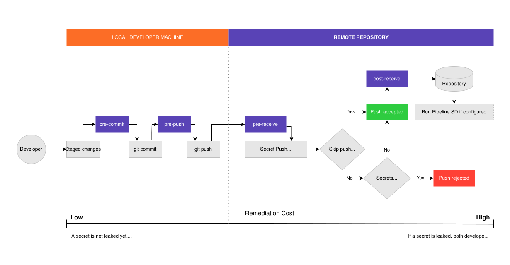



- Tier: 旗舰版
- Offering: JihuLab.com，私有化部署



密钥推送保护会阻止密钥和 API 令牌等密钥被推送到极狐GitLab。

将流水线密钥检测与密钥推送保护结合使用，可进一步强化您的安全性。

<a id="secret-push-protection-workflow"></a>

## 密钥推送保护工作流

密钥推送保护在预接收钩子中执行。当您将变更推送到极狐GitLab 时，推送保护会检查每个文件或提交中是否包含密钥。默认情况下，如果检测到密钥，推送会被阻止。

<!-- To edit the diagram, use either Draw.io or the VS Code extension "Draw.io Integration" -->


当推送被阻止时，极狐GitLab 会显示一条消息，其中包含：

- 包含密钥的提交 ID。
- 包含密钥的文件名和行号。
- 密钥类型。

例如，以下是使用 Git CLI 推送被阻止时返回消息的摘录。使用其他客户端（包括极狐GitLab Web IDE）时，消息格式不同，但内容相同。

```plain
remote: PUSH BLOCKED: Secrets detected in code changes
remote: Secret push protection found the following secrets in commit: 37e54de5e78c31d9e3c3821fd15f7069e3d375b6
remote:
remote: -- test.txt:2 GitLab Personal Access Token
remote:
remote: To push your changes you must remove the identified secrets.
```

如果密钥推送保护未在您的提交中检测到任何密钥，则不会显示任何消息。

<a id="detected-secrets"></a>

## 检测到的密钥

密钥推送保护会扫描文件或提交中的特定模式。每种模式匹配特定类型的密钥。要确认密钥推送保护会检测哪些密钥，请参阅[检测到的密钥](../detected_secrets.md)。密钥推送保护仅选用高置信度的模式，以尽量减少推送提交时的延迟，并尽量减少误报数量。例如，使用自定义前缀的个人访问令牌不会被密钥推送保护检测到。您可以通过密钥推送保护[排除](../exclusions.md)选定的密钥，使其不被检测。

<a id="getting-started"></a>

## 开始使用

在极狐GitLab 私有化部署实例上，您必须：

1. 在整个实例上允许密钥推送保护。
1. 启用密钥推送保护。您可以：
   - 在特定项目中启用密钥推送保护。
   - 使用 API 为群组中的所有项目启用密钥推送保护。

<a id="allow-the-use-of-secret-push-protection-in-your-gitlab-instance"></a>

### 在极狐GitLab 实例中允许使用密钥推送保护

在极狐GitLab 私有化部署实例上，您必须先允许密钥推送保护，然后才能在项目中启用它。

先决条件：

- 您必须是极狐GitLab 实例的管理员。

要在极狐GitLab 实例中允许使用密钥推送保护：

1. 以管理员身份登录您的极狐GitLab 实例。
1. 在右上角，选择**管理员**。
1. 在左侧边栏中，选择**设置** > **安全与合规**。
1. 在**密钥检测**下，选中或清除**允许密钥推送保护**。

该实例已允许使用密钥推送保护。要使用此功能，您必须按项目启用它。

<a id="enable-secret-push-protection-in-a-project"></a>

### 在项目中启用密钥推送保护

先决条件：

- 您必须具有该项目的安全管理员、维护者或所有者角色。
- 在极狐GitLab 私有化部署上，您必须在实例上允许密钥推送保护。

要在项目中启用密钥推送保护：

1. 在顶部栏中，选择**搜索或跳转到**并找到您的项目。
1. 在左侧边栏中，选择**安全** > **安全配置**。
1. 打开**密钥推送保护**开关。

您也可以[使用 API](../../../../api/group_security_settings.md#update-group-security-settings) 为群组中的所有项目启用密钥推送保护。

<a id="coverage"></a>

## 覆盖范围

在以下情况下，密钥推送保护不会阻止密钥：

- 您在推送提交时使用了跳过密钥推送保护选项。
- 该密钥被排除在密钥推送保护之外。
- 该密钥位于定义为[排除项](../exclusions.md)的路径中。

在以下情况下，密钥推送保护不会检查提交中的文件：

- 该文件是二进制文件。
- 该文件或差异补丁大于 1 MiB。
- 该文件被重命名、删除或移动，且内容未发生变化。
- 该文件的内容与源代码中另一个文件的内容完全相同。
- 该文件包含在创建代码仓库的初始推送中。
- 该推送总共包含超过 350,000 行变更。

<a id="diff-scanning"></a>

### 差异扫描

密钥推送保护仅扫描通过 HTTP(S) 和 SSH 推送的提交的差异。如果密钥已存在于文件中且不属于变更的一部分，则不会被检测到。

<a id="audit-events"></a>

## 审计事件

在以下情况下会记录[审计事件](../../../compliance/audit_event_types.md#secret-detection)：

- 密钥推送保护因在变更中检测到密钥而阻止推送。
- 密钥推送保护因推送包含[过多变更路径](#push-size-threshold)而被跳过。
- 密钥推送保护因推送[变更行数过多](#push-size-threshold)而被跳过。
- 密钥推送保护扫描超时，极狐GitLab 接受该推送。
- 密钥推送保护遇到规则集解析或编译错误。
- 密钥推送保护因扫描收到无效输入而被跳过。
- 密钥推送保护遇到意外的扫描错误。

<a id="push-size-threshold"></a>

## 推送大小阈值

当推送变更超过 3,150 个路径或 350,000 行时，密钥推送保护会被跳过。这些阈值仅适用于密钥推送保护所扫描的文件（在排除[排除项](../exclusions.md)中定义的路径之后）。这些阈值可防止您在推送大型变更集时发生推送超时。

<a id="understanding-the-results"></a>

## 了解结果

密钥推送保护可以识别多种类别的密钥：

- API 密钥和令牌：特定于服务的身份验证凭证
- 数据库连接字符串：包含内嵌凭证的 URL
- 私钥：用于身份验证或加密的加密密钥
- 通用高熵字符串：看起来像随机生成的密钥的模式

当推送被阻止时，密钥推送保护会提供详细信息，帮助您定位并处理检测到的密钥：

- 提交 ID：包含该密钥的具体提交。有助于跟踪 Git 历史中的变更。
- 文件路径和行号：检测到的模式的确切位置，便于快速导航。
- 密钥类型：检测到的模式的分类。例如，`GitLab Personal Access Token` 或 `AWS Access Key`。

<a id="common-detection-categories"></a>

### 常见检测类别

并非所有检测都需要立即处理。评估结果时请考虑以下情况：

- 真阳性：应轮换并移除的合法密钥。例如：
  - 有效的 API 密钥或令牌
  - 生产数据库凭证
  - 私有加密密钥
  - 任何可能授予未授权访问权限的凭证
- 假阳性：检测到的模式并非实际密钥。例如：
  - 类似密钥但无实际价值的测试数据
  - 配置模板中的占位符值
  - 文档中的示例凭证
  - 与密钥模式匹配的哈希值或校验和

在您的组织中记录常见的假阳性模式，以简化未来的评估。

<a id="optimization"></a>

## 优化

在广泛部署密钥推送保护之前，请优化配置，以减少假阳性并提高针对您特定环境的准确性。

<a id="reduce-false-positives"></a>

### 减少假阳性

假阳性会显著影响开发者生产力，并导致安全疲劳。

要减少假阳性：

- 有策略地[配置排除项](../exclusions.md)：
  - 为测试目录、文档和第三方依赖项创建基于路径的排除项。
  - 对特定于您代码库的已知假阳性模式使用基于模式的排除项。
  - 记录您的排除规则并定期审查。
- 为占位符值和测试凭证制定标准，
  这些标准应与您的排除规则匹配，但不匹配[默认规则集](../detected_secrets.md)。
- 监控假阳性率，并持续相应地调整排除项。

<a id="optimize-performance"></a>

### 优化性能

大型代码仓库或频繁推送可能会影响性能。

要优化密钥推送保护的性能：

- 监控推送时间，并在部署前建立基准指标。
- 对于包含大型二进制资产的代码仓库，考虑文件大小限制。
- 对不太可能包含密钥的目录[实施排除项](../exclusions.md#add-an-exclusion)。

<a id="integration-with-existing-workflows"></a>

### 与现有工作流集成

确保密钥推送保护与您现有的开发实践相辅相成：

- 配置流水线密钥检测和密钥推送保护，以确保您拥有纵深防御。
- 更新开发者文档，加入密钥推送保护流程。
- 与安全培训保持一致，教育开发者采用安全编码实践，以尽量减少密钥泄露。

<a id="roll-out"></a>

## 推广

大规模成功部署密钥推送保护需要仔细规划和分阶段实施：

1. 选择两到三个有活跃开发的非关键项目来测试该功能，并了解其对开发者工作流的影响。
1. 为您选定的测试项目打开密钥推送保护，并监控开发者反馈。
1. 记录处理被阻止推送的流程，并就新工作流培训您的开发团队。
1. 在试点阶段跟踪检测到的密钥数量、假阳性率和开发者体验反馈。

试点阶段应持续两到四周，以收集足够的数据，并在更广泛部署之前确定所需的任何工作流调整。

完成试点后，请考虑以下阶段进行规模化推广：

1. 早期采用者（第 3-6 周）
   - 在 10-20% 的活跃项目中启用，优先考虑安全敏感型代码仓库。
   - 重点关注具有较强安全意识和支持度的团队。
   - 监控性能影响和开发者体验。
   - 根据实际使用情况完善流程。
1. 广泛部署（第 7-12 周）
   - 分批逐步在其余项目中启用。
   - 为开发团队提供持续支持和培训。
   - 监控系统性能，并在需要时扩展基础设施。
   - 根据使用模式继续优化排除规则。
1. 全面覆盖（第 13-16 周）
   - 在所有其余项目中启用密钥推送保护。
   - 建立持续的维护和审查流程。
   - 定期审计排除规则和检测到的模式。

<a id="resolve-a-blocked-push"></a>

## 解决被阻止的推送

当密钥推送保护阻止推送时，您可以：

- [移除密钥](../remove_secrets_tutorial.md)。
- 跳过密钥推送保护。

<a id="skip-secret-push-protection"></a>

### 跳过密钥推送保护

在某些情况下，可能需要跳过密钥推送保护。例如，开发者可能需要提交占位符密钥用于测试，或者用户可能因 Git 操作超时而想跳过密钥推送保护。

跳过密钥推送保护时会记录审计事件。审计事件详情包括：

- 使用的跳过方法。
- 极狐GitLab 账号名称。
- 跳过密钥推送保护的日期和时间。
- 密钥被推送到的项目名称。
- 目标分支。（在极狐GitLab 17.4 中引入）
- 跳过密钥推送保护的提交。（在极狐GitLab 17.9 中引入）

如果启用了流水线密钥检测，则所有提交的内容在推送到代码仓库后都会被扫描。

要跳过推送中所有提交的密钥推送保护，您可以：

- 如果您使用 Git CLI 客户端，指示 Git 跳过密钥推送保护。
- 如果您使用任何其他客户端，将 `[skip secret push protection]` 添加到其中一条提交消息中。

<a id="for-the-git-cli-client"></a>

#### 对于 Git CLI 客户端

要从命令行跳过密钥推送保护：

- 使用 `secret_push_protection.skip_all` 推送选项。

  例如，您有几个提交因其中一个包含密钥而被阻止推送。
  要跳过密钥推送保护，您可以将该推送选项追加到 Git 命令中。

  ```shell
  git push -o secret_push_protection.skip_all
  ```

<a id="for-any-git-client"></a>

#### 对于任何 Git 客户端

要跳过密钥推送保护：

- 将 `[skip secret push protection]` 添加到其中一条提交消息中，可以放在现有行或新
  行上，然后推送提交。

  例如，您正在使用极狐GitLab Web IDE，并且有几个提交因其中一个包含密钥而被阻止
  推送。要跳过密钥推送保护，请编辑最新
  提交消息并添加 `[skip secret push protection]`，然后推送提交。

<a id="troubleshooting"></a>

## 故障排除

使用密钥推送保护时，您可能会遇到以下情况。

<a id="push-blocked-unexpectedly"></a>

### 推送意外被阻止

在极狐GitLab 17.11 之前，密钥推送保护会扫描所有已修改文件的内容。如果已修改文件包含密钥，即使该密钥不属于差异的一部分，也可能导致推送意外被阻止。

在极狐GitLab 17.10 及更早版本中，启用 `spp_scan_diffs` 功能标志以确保仅扫描新提交的变更。要将 Web IDE 变更推送到包含密钥的文件，您还需要额外启用 `secret_checks_for_web_requests` 功能标志。

<a id="file-was-not-scanned"></a>

### 文件未被扫描

某些文件会被排除在扫描之外。有关详情，请参阅[覆盖范围](#coverage)。
