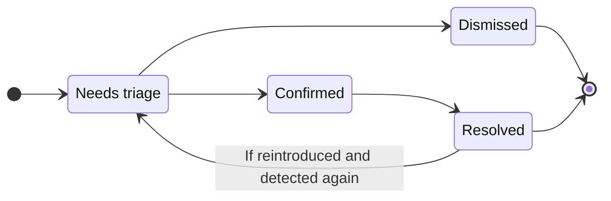



- Tier: 旗舰版
- Offering: JihuLab.com，私有化部署



项目中的每个漏洞都有一个漏洞页面。页面标题栏显示漏洞标题、检测到该漏洞的时间和所在流水线、相关的合并请求和议题数量（如有），以及您可以执行的操作。右侧边栏显示漏洞的状态和严重性。漏洞的其余数据分为以下几个部分：

- **风险**：帮助您对漏洞进行优先级排序的评分和标志。
- **修复**：扫描器报告的解决方案（如有）。
- **详情**：漏洞描述、报告该漏洞的扫描器，以及代码、容器镜像或依赖项中的位置。
- **补充信息**：CVE 和 CWE 等标识符、外部参考链接以及安全培训。
- **证据**：扫描器记录的请求和响应（针对会报告这些内容的扫描器）。
- **相关合并请求**和**相关议题**：链接到该漏洞的合并请求和议题。
- **活动**：状态变更、评论和检测事件的日志。

每个部分都可以折叠。要隐藏或显示某个部分的内容，请在该部分的标题栏中选择 **折叠**（）或 **展开**（）。

对于[常见漏洞和暴露（CVE）](https://www.cve.org/)目录中的漏洞，**风险**部分还包含：

- CVSS 评分
- [EPSS 评分](risk_assessment_data.md#epss)
- [KEV 状态](risk_assessment_data.md#kev)
- [可达性状态](../dependency_scanning/static_reachability.md)（限量提供）

有关这些附加数据的更多详情，请参阅[漏洞风险评估数据](risk_assessment_data.md)。

对于被识别为恶意软件的漏洞，不会显示 CVSS、EPSS 和 KEV 评分，并且会隐藏**修复**部分。极狐GitLab 无法像针对 CVE 那样为恶意软件推荐修复方案。受影响版本的软件包是恶意的，而不是存在漏洞，因此不存在修复版本。恶意软件发现项基于[极狐GitLab 恶意软件公告](../gitlab_advisory_database/_index.md#gitlab-malware-advisories)。

如果扫描器判定该漏洞为误报，则会在**风险**部分上方显示一条提醒。如果极狐GitLab Duo 将该漏洞识别为可能的误报，则**风险**部分会改为显示**误报置信度**评分。更多信息，请参阅[误报检测](false_positive_detection.md)。

对于 SAST 检测到的漏洞，极狐GitLab Duo 可以自动分析这些漏洞，并生成包含上下文感知代码修复的合并请求。更多信息，请参阅 [Agentic SAST 漏洞解决](agentic_vulnerability_resolution.md)。

<a id="secret-false-positive-detection"></a>

## 密钥误报检测



- Tier: 旗舰版
- Add-on: 极狐GitLab Duo Core、Pro 或 Enterprise
- Offering: JihuLab.com，私有化部署
- Status: 测试版



极狐GitLab Duo 会自动分析密钥检测发现项，以识别潜在的误报。忽略误报可以减少漏洞报告中的噪声，因为它会标记出可能并非实际安全风险的发现项。

对于每个已分析的漏洞，极狐GitLab Duo 会提供以下信息：

- 一个置信度评分，表示该评估正确的可能性。
- 关于该发现项可能正确或不正确的说明。
- 在漏洞报告中，将漏洞标识为潜在误报的可视化指示。

更多信息，请参阅[密钥误报检测](secret_false_positive_detection.md)。

<a id="vulnerability-resolution"></a>

## 漏洞解决



- Tier: 旗舰版
- Add-on: 极狐GitLab Duo Enterprise、极狐GitLab Duo with Amazon Q
- Offering: JihuLab.com，私有化部署





- [默认 LLM](../../gitlab_duo/model_selection.md#default-models)
- Amazon Q 的 LLM：Amazon Q Developer
- 可在[自部署模型的极狐GitLab Duo](../../../administration/gitlab_duo_self_hosted/_index.md) 上使用



使用极狐GitLab Duo 漏洞解决功能自动创建一个合并请求来解决该漏洞。默认情况下，它由 MiniMax-M3 模型提供支持。

极狐GitLab 无法保证大语言模型产生正确的结果。在合并建议的更改之前，您应始终对其进行审查。审查时，请检查：

- 您的应用程序的现有功能得以保留。
- 该漏洞已按照您组织的标准得到解决。

先决条件：

- 您必须拥有极狐GitLab 旗舰版订阅层级和极狐GitLab Duo Enterprise。
- 您必须是该项目的成员。
- 该漏洞必须是来自受支持分析器的 SAST 发现项：
  - 任何[极狐GitLab 支持的分析器](../sast/analyzers.md)。
  - 正确集成的第三方 SAST 扫描器，且会为每个漏洞报告漏洞位置和 CWE 标识符。
- 该漏洞必须属于[受支持的类型](#supported-vulnerabilities-for-vulnerability-resolution)。

详细了解[如何启用所有极狐GitLab Duo 功能](../../gitlab_duo/turn_on_off.md)。

要解决该漏洞：

1. 在顶部栏中，选择**搜索或跳转到**，然后找到您的项目。
1. 在左侧边栏中，选择**安全** > **漏洞报告**。
1. 可选。要移除默认筛选条件，请选择 **清除**（）。
1. 在漏洞列表上方，选择筛选栏。
1. 在出现的下拉列表中，选择**活动**，然后在 **极狐GitLab Duo (AI)** 类别中选择 **漏洞解决可用**。
1. 在筛选字段外选择。漏洞严重性总计和匹配的漏洞列表会更新。
1. 选择您想要解决的 SAST 漏洞。
   - 支持漏洞解决的漏洞旁边会显示一个蓝色图标。
1. 在右上角，选择 **使用 AI 解决**。如果未显示该按钮，请选择
   **AI 操作**，然后选择 **使用 AI 解决**。如果此项目是公开项目，请注意
   创建合并请求将公开暴露该漏洞和所提供的解决方案。要私下创建
   合并请求，请[创建私有 fork](../../project/merge_requests/confidential.md)，然后重复
   此过程。
1. 向合并请求添加一个额外的提交。这会强制运行新的流水线。
1. 在流水线完成后，在[流水线安全标签页](../detect/security_scanning_results.md)上，确认该漏洞不再出现。
1. 在漏洞报告上，[手动更新该漏洞](../vulnerability_report/_index.md#change-status-of-vulnerabilities)。

一个包含 AI 修复建议的合并请求会打开。审查建议的更改，然后按照您的标准工作流处理该合并请求。

请在[议题 476553](https://gitlab.com/gitlab-org/gitlab/-/issues/476553)中提供有关此功能的反馈。

<a id="supported-vulnerabilities-for-vulnerability-resolution"></a>

### 漏洞解决支持的漏洞

为确保建议的解决方案质量高，漏洞解决仅适用于特定的一组漏洞。系统会根据漏洞的通用弱点枚举（CWE）标识符来决定是否提供漏洞解决。

当前的漏洞集合是根据自动化系统和安全专家的测试选出的。极狐GitLab 正在积极努力将覆盖范围扩展到更多类型的漏洞。

<details><summary style="color:#5943b6; margin-top: 1em;"><a>查看漏洞解决支持的完整 CWE 列表</a></summary>

<ul>
  <li>CWE-23：相对路径遍历</li>
  <li>CWE-73：文件名或路径的外部控制</li>
  <li>CWE-78：OS 命令中使用的特殊元素的不当中和（“OS 命令注入”）</li>
  <li>CWE-80：网页中与脚本相关 HTML 标签的不当中和（基本 XSS）</li>
  <li>CWE-89：SQL 命令中使用的特殊元素的不当中和（“SQL 注入”）</li>
  <li>CWE-116：输出的不当编码或转义</li>
  <li>CWE-118：对可索引资源的不正确访问（“范围错误”）</li>
  <li>CWE-119：内存缓冲区边界内操作的不当限制</li>
  <li>CWE-120：未检查输入大小的缓冲区复制（“经典缓冲区溢出”）</li>
  <li>CWE-126：缓冲区过度读取</li>
  <li>CWE-190：整数溢出或回绕</li>
  <li>CWE-200：向未授权行为者暴露敏感信息</li>
  <li>CWE-208：可观察的时间差异</li>
  <li>CWE-209：生成包含敏感信息的错误消息</li>
  <li>CWE-272：最小权限违规</li>
  <li>CWE-287：不当身份验证</li>
  <li>CWE-295：不当证书验证</li>
  <li>CWE-297：主机不匹配时证书的不当验证</li>
  <li>CWE-305：通过主要弱点绕过身份验证</li>
  <li>CWE-310：加密问题</li>
  <li>CWE-311：敏感数据缺少加密</li>
  <li>CWE-323：在加密中重用随机数、密钥对</li>
  <li>CWE-327：使用已损坏或有风险的加密算法</li>
  <li>CWE-328：使用弱哈希</li>
  <li>CWE-330：使用随机性不足的值</li>
  <li>CWE-338：使用加密强度弱的伪随机数生成器（PRNG）</li>
  <li>CWE-345：数据真实性验证不足</li>
  <li>CWE-346：来源验证错误</li>
  <li>CWE-352：跨站请求伪造</li>
  <li>CWE-362：使用共享资源且同步不当的并发执行（“竞态条件”）</li>
  <li>CWE-369：除以零</li>
  <li>CWE-377：不安全的临时文件</li>
  <li>CWE-378：以不安全权限创建临时文件</li>
  <li>CWE-400：不受控制的资源消耗</li>
  <li>CWE-489：活动的调试代码</li>
  <li>CWE-521：弱密码要求</li>
  <li>CWE-539：使用包含敏感信息的持久性 Cookie</li>
  <li>CWE-599：缺少对 OpenSSL 证书的验证</li>
  <li>CWE-611：XML 外部实体引用的不当限制</li>
  <li>CWE-676：使用潜在危险的函数</li>
  <li>CWE-704：不正确的类型转换或强制转换</li>
  <li>CWE-754：对异常或特殊情况的不当检查</li>
  <li>CWE-770：无限制或节流的资源分配</li>
  <li>CWE-1004：不带“HttpOnly”标志的敏感 Cookie</li>
  <li>CWE-1275：SameSite 属性不当的敏感 Cookie</li>
</ul>
</details>

<a id="troubleshooting"></a>

### 故障排除

漏洞解决有时无法生成建议的修复。常见原因包括：

- 检测到误报：
  - 在提出修复之前，AI 模型会评估该漏洞是否有效。它可能会判定该漏洞并非真正的漏洞，或者不值得修复。
  - 如果该漏洞出现在测试代码中，就可能发生这种情况。您的组织可能仍会选择修复测试代码中出现的漏洞，但模型有时会将这些评估为误报。
  - 如果您同意该漏洞是误报或不值得修复，则应[忽略该漏洞](#vulnerability-status-values)并[选择匹配的原因](#vulnerability-dismissal-reasons)。
    - 要自定义 SAST 配置或报告极狐GitLab SAST 规则的问题，请参阅 [SAST 规则](../sast/rules.md)。
- 临时或意外错误：
  - 错误消息可能会指出 `an unexpected error has occurred`、`the upstream AI provider request timed out`、`something went wrong` 或类似原因。
  - 这些错误可能是由 AI 提供商或极狐GitLab Duo 的临时问题引起的。
  - 新请求可能会成功，因此您可以再次尝试解决该漏洞。
  - 如果您持续看到这些错误，请联系极狐GitLab 寻求帮助。

<a id="data-shared-with-third-party-ai-apis-for-vulnerability-resolution"></a>

### 漏洞解决与第三方 AI API 共享的数据

以下数据会与第三方 AI API 共享：

- 漏洞名称
- 漏洞描述
- 标识符（CWE、OWASP）
- 包含易受攻击代码行的整个文件
- 易受攻击的代码行（行号）

<a id="vulnerability-resolution-in-a-merge-request"></a>

## 在合并请求中解决漏洞



- Tier: 旗舰版
- Add-on: 极狐GitLab Duo Enterprise
- Offering: JihuLab.com，私有化部署



使用极狐GitLab Duo 漏洞解决功能自动创建一个合并请求建议评论，以解决该漏洞发现项。默认情况下，它由 MiniMax-M3 模型提供支持。

要解决该漏洞发现项：

1. 在顶部栏中，选择**搜索或跳转到**，然后找到您的项目。
1. 在左侧边栏中，选择**代码** > **合并请求**。
1. 选择一个合并请求。
   - 漏洞解决支持的漏洞发现项由 tanuki AI 图标（）指示。
1. 选择受支持的发现项以打开安全发现项对话框。
1. 在右下角，选择 **使用 AI 解决**。

一个包含 AI 修复建议的评论会在该合并请求中打开。审查建议的更改，然后按照您的标准工作流应用该合并请求建议。

请在[议题 476553](https://gitlab.com/gitlab-org/gitlab/-/issues/476553)中提供有关此功能的反馈。

<a id="troubleshooting-1"></a>

### 故障排除

在合并请求中解决漏洞有时无法生成建议的修复。常见原因包括：

- 检测到误报：
  - 在提出修复之前，AI 模型会评估该漏洞是否有效。它可能会判定该漏洞并非真正的漏洞，或者不值得修复。
  - 如果该漏洞出现在测试代码中，就可能发生这种情况。您的组织可能仍会选择修复测试代码中出现的漏洞，但模型有时会将这些评估为误报。
  - 如果您同意该漏洞是误报或不值得修复，则应[忽略该漏洞](#vulnerability-status-values)并[选择匹配的原因](#vulnerability-dismissal-reasons)。
    - 要自定义 SAST 配置或报告极狐GitLab SAST 规则的问题，请参阅 [SAST 规则](../sast/rules.md)。
- 临时或意外错误：
  - 错误消息可能会指出 `an unexpected error has occurred`、`the upstream AI provider request timed out`、`something went wrong` 或类似原因。
  - 这些错误可能是由 AI 提供商或极狐GitLab Duo 的临时问题引起的。
  - 新请求可能会成功，因此您可以再次尝试解决该漏洞。
  - 如果您持续看到这些错误，请联系极狐GitLab 寻求帮助。
- `Resolution target could not be found in the merge request, unable to create suggestion` 错误：
  - 当目标分支尚未运行完整的安全扫描流水线时，可能会发生此错误。请参阅[合并请求文档](../detect/security_scanning_results.md)。

<a id="vulnerability-code-flow"></a>

## 漏洞代码流



- Tier: 旗舰版
- Offering: JihuLab.com，私有化部署



对于特定类型的漏洞，极狐GitLab 高级 SAST 会提供[代码流](../sast/gitlab_advanced_sast.md#code-flow)信息。漏洞的代码流是数据从用户输入（源）到易受攻击的代码行（汇）所经过的路径，其间会经历所有赋值、操作和清理。

有关如何查看漏洞代码流的详情，请参阅[漏洞代码流](../sast/gitlab_advanced_sast.md#code-flow)。


<a id="vulnerability-status-values"></a>

## 漏洞状态值

漏洞的状态可以是：

- **需要分类**：新发现漏洞的默认状态。
- **已确认**：用户已查看此漏洞并确认其准确无误。
- **已忽略**：用户已评估此漏洞并[忽略它](#vulnerability-dismissal-reasons)。
  如果在后续扫描中检测到已忽略的漏洞，则会忽略它们。
- **已解决**：该漏洞已修复或不再存在。如果已解决的
  漏洞被重新引入并再次检测到，其记录会被恢复，其状态会设置为
  **需要分类**。

漏洞通常会经历以下生命周期：



<a id="vulnerability-is-no-longer-detected"></a>

## 漏洞不再被检测到

漏洞可能因有意采取的修复措施或其他更改的副作用而不再被检测到。漏洞也可能因为报告它的分析器不再扫描其语言而不再被检测到。有关示例，请参阅[漏洞变更](../sast/gitlab_advanced_sast.md#vulnerability-changes)。当安全扫描运行且默认分支中不再检测到某个漏洞时，扫描器会在该记录的活动日志中添加 **不再检测到**，但该记录的状态不会改变。相反，您应检查并确认该漏洞已解决，如果是，[手动将其状态更改为**已解决**](#change-the-status-of-a-vulnerability)。您也可以使用[漏洞管理策略](../policies/vulnerability_management_policy.md)将符合特定条件的漏洞状态自动更改为**已解决**。

您可以在漏洞页面的**活动**部分找到解决该漏洞的提交链接。

<a id="vulnerability-dismissal-reasons"></a>

## 漏洞忽略原因

当您忽略某个漏洞时，必须选择以下原因之一：

- **可接受的风险**：该漏洞是已知的，且尚未修复或缓解，但
  被视为可接受的业务风险。
- **误报**：报告中的错误，即测试结果错误地表明
  系统中存在漏洞，而实际上该漏洞并不存在。
- **缓解控制**：该漏洞的风险已通过组织采用的
  管理、运营或技术控制（即保障措施或对策）得到缓解，这些控制为
  信息系统提供了同等或相当的防护。
- **用于测试**：该发现项不是漏洞，因为它是测试的一部分或属于测试
  数据。
- **不适用**：该漏洞是已知的，且尚未修复或缓解，但
  被认为位于应用程序中不会更新的部分。

<a id="change-the-status-of-a-vulnerability"></a>

## 更改漏洞的状态

先决条件：

- 您必须拥有该项目的安全管理员、维护者或所有者角色，或拥有具备
  `admin_vulnerability` 权限的自定义角色。

要从漏洞页面更改漏洞的状态：

1. 在顶部栏中，选择**搜索或跳转到**，然后找到您的项目。
1. 在左侧边栏中，选择**安全** > **漏洞报告**。
1. 选择该漏洞的描述。
1. 在右侧边栏的**状态**部分中，选择**编辑**。
1. 从**状态**下拉列表中，选择一种状态或一个[忽略原因](#vulnerability-dismissal-reasons)，
   当您想将漏洞状态更改为**已忽略**时。
1. 在**评论**文本框中，提供一条评论，详细说明忽略的原因。当您应用**已忽略**状态时，必须填写评论。
1. 选择**更改状态**。

状态变更的详情（包括变更人和变更时间）会记录在漏洞页面的**活动**部分中。

<a id="create-a-gitlab-issue-for-a-vulnerability"></a>

## 为漏洞创建极狐GitLab 议题

您可以创建一个极狐GitLab 议题来跟踪为解决或缓解漏洞而采取的任何操作。要为漏洞创建极狐GitLab 议题：

1. 在顶部栏中，选择**搜索或跳转到**，然后找到您的项目。
1. 在左侧边栏中，选择**安全** > **漏洞报告**。
1. 选择该漏洞的描述。
1. 选择**创建议题**。

该议题会在极狐GitLab 项目中创建，并包含来自漏洞报告的信息。

要创建 Jira 议题，请参阅[为漏洞创建 Jira 议题](../../../integration/jira/configure.md#create-a-jira-issue-for-a-vulnerability)。

<a id="linking-a-vulnerability-to-gitlab-and-jira-issues"></a>

## 将漏洞链接到极狐GitLab 和 Jira 议题

您可以将漏洞链接到一个或多个现有的[极狐GitLab](#create-a-gitlab-issue-for-a-vulnerability) 或 [Jira](../../../integration/jira/configure.md#create-a-jira-issue-for-a-vulnerability) 议题。同一时间只能使用一种链接功能。添加链接有助于跟踪解决或缓解漏洞的议题。

<a id="link-a-vulnerability-to-existing-gitlab-issues"></a>

### 将漏洞链接到现有的极狐GitLab 议题

先决条件：

- 不得启用 [Jira 议题集成](../../../integration/jira/configure.md)。

要将漏洞链接到现有的极狐GitLab 议题：

1. 在顶部栏中，选择**搜索或跳转到**，然后找到您的项目。
1. 在左侧边栏中，选择**安全** > **漏洞报告**。
1. 选择该漏洞的描述。
1. 在**相关议题**部分中，选择**添加现有议题**。
1. 对于要链接的每个议题，可以：
   - 粘贴该议题的链接。
   - 输入该议题的 ID（以井号 `#` 为前缀）。
1. 选择**添加**。

所选的极狐GitLab 议题会添加到**相关议题**部分，并且链接议题计数器会更新。

链接到漏洞的极狐GitLab 议题会显示在漏洞报告和漏洞页面中。

请注意漏洞与链接的极狐GitLab 议题之间的以下情况：

- 漏洞页面会显示相关议题，但议题页面不会显示与其相关的
  漏洞。
- 一个议题一次只能与一个漏洞相关。
- 议题可以跨群组和项目链接。

<a id="link-a-vulnerability-to-existing-jira-issues"></a>

### 将漏洞链接到现有的 Jira 议题

先决条件：

- 确保 Jira 议题集成已[配置](../../../integration/jira/configure.md#configure-the-integration)
  并且已选中 **为漏洞创建 Jira 议题** 复选框。

要将漏洞链接到现有的 Jira 议题，请将以下行添加到 Jira 议题的描述中：

```plaintext
/-/security/vulnerabilities/<id>
```

`<id>` 是任意[漏洞 ID](../../../api/vulnerabilities.md#retrieve-a-vulnerability)。您可以向一个描述中添加多行不同的 ID。

具有适当描述的 Jira 议题会添加到**相关 Jira 议题**部分，并且链接议题计数器会更新。

链接到漏洞的 Jira 议题仅显示在漏洞页面上。

请注意漏洞与链接的 Jira 议题之间的以下情况：

- 漏洞页面和议题页面都会显示它们所相关的漏洞。
- 一个议题可以同时与一个或多个漏洞相关。

<a id="resolve-a-vulnerability"></a>

## 解决漏洞

对于某些漏洞，解决方案已经已知，但需要手动实施。漏洞页面的**修复**部分会显示报告该安全发现项的安全扫描工具提供的解决方案，或在[手动创建漏洞](../vulnerability_report/_index.md#manually-add-a-vulnerability)期间输入的解决方案。极狐GitLab 工具会利用[极狐GitLab 公告数据库](../gitlab_advisory_database/_index.md)中的信息。

此外，某些工具可能会包含用于应用建议解决方案的软件补丁。在这些情况下，
漏洞页面上的**其他操作**下拉列表会包含 **使用扫描器建议解决** 操作。

此功能支持以下扫描器：

- [依赖项扫描](../dependency_scanning/_index.md)。
  自动补丁创建仅适用于使用
  `yarn` 管理的 Node.js 项目。自动补丁创建仅在 [FIPS 模式](../../../development/fips_gitlab.md#enable-fips-mode)禁用时受支持。

- [容器扫描](../container_scanning/_index.md)。

要解决漏洞，您可以：

- [使用合并请求解决漏洞](#resolve-a-vulnerability-with-a-merge-request)。
- [手动解决漏洞](#resolve-a-vulnerability-manually)。

<a id="resolve-a-vulnerability-with-a-merge-request"></a>

### 使用合并请求解决漏洞

要使用合并请求解决该漏洞：

1. 在顶部栏中，选择**搜索或跳转到**，然后找到您的项目。
1. 在左侧边栏中，选择**安全** > **漏洞报告**。
1. 选择该漏洞的描述。
1. 在右上角，选择**其他操作**，然后选择 **使用扫描器建议解决**。

会创建一个合并请求，其中应用了解决该漏洞所需的补丁。按照您的标准工作流处理该合并请求。

<a id="resolve-a-vulnerability-manually"></a>

### 手动解决漏洞

要手动应用极狐GitLab 为漏洞生成的补丁：

1. 在顶部栏中，选择**搜索或跳转到**，然后找到您的项目。
1. 在左侧边栏中，选择**安全** > **漏洞报告**。
1. 选择该漏洞的描述。
1. 在右上角，选择**其他操作**，然后选择 **下载补丁**。
1. 确保您的本地项目检出的提交与生成该补丁时使用的提交相同。
1. 运行 `git apply remediation.patch`。
1. 验证更改并将其提交到您的分支。
1. 创建一个合并请求，以将更改应用到您的主分支。
1. 按照您的标准工作流处理该合并请求。

<a id="enable-security-training-for-vulnerabilities"></a>

## 为漏洞启用安全培训

> [!note]
> 在离线环境中无法访问安全培训，离线环境是指出于安全考虑与公共互联网隔离的计算机。具体而言，极狐GitLab 服务器需要能够查询您选择启用的任何培训提供商的 API 端点。某些第三方培训供应商可能要求您注册一个免费账号。请访问
> [Secure Code Warrior](https://www.securecodewarrior.com/)、[Kontra](https://application.security/) 或 [SecureFlag](https://www.secureflag.com/index.html)中的任意一个来注册账号。
> 极狐GitLab 不会向这些第三方供应商发送任何用户信息；极狐GitLab 确实会发送 CWE 或 OWASP 标识符以及文件扩展名的语言名称。

安全培训可帮助您的开发者学习如何修复漏洞。开发者可以查看来自选定教育提供商的、与所检测到的漏洞相关的安全培训。

要为您的项目中的漏洞启用安全培训：

1. 在顶部栏中，选择**搜索或跳转到**，然后找到您的项目。
1. 在左侧边栏中，选择**安全** > **安全配置**。
1. 在标签栏上，选择**漏洞管理**。
1. 要启用某个安全培训提供商，请打开开关。

每个集成都会向安全培训供应商提交漏洞标识符（例如 CWE 或 OWASP）和语言。生成的指向供应商培训的链接会显示在极狐GitLab 漏洞中。

<a id="view-security-training-for-a-vulnerability"></a>

## 查看漏洞的安全培训

如果启用了安全培训，漏洞页面可能会包含与所检测到的漏洞相关的培训链接。培训的可用性取决于已启用的培训供应商是否有与特定漏洞匹配的内容。培训内容是根据漏洞标识符请求的。为漏洞提供的标识符因漏洞而异，可用的培训内容也因供应商而异。某些漏洞不会显示培训内容。带有 CWE 的漏洞最有可能返回培训结果。

要查看漏洞的安全培训：

1. 在顶部栏中，选择**搜索或跳转到**，然后找到您的项目。
1. 在左侧边栏中，选择**安全** > **漏洞报告**。
1. 选择您要查看安全培训的漏洞。
1. 在**补充信息**部分的**培训**下，选择**查看培训**。

<a id="view-the-location-of-a-vulnerability-in-transitive-dependencies"></a>

## 查看传递依赖项中漏洞的位置

> [!flag]
> 此功能的可用性由功能标志控制。

在管理依赖项中发现的漏洞时，漏洞页面的**详情**部分会显示：

- 发现该漏洞的直接依赖项的位置。
- 如果可用，显示漏洞出现的具体行号。

如果漏洞出现在一个或多个传递依赖项中，仅了解直接依赖项可能还不够。传递依赖项是指以某个直接依赖项为祖先的间接依赖项。

如果存在任何传递依赖项，您可以查看所有依赖项的路径，包括包含该漏洞的传递依赖项。

- 在漏洞页面的**详情**部分中，选择**查看依赖项路径**。如果未显示**查看依赖项路径**，则说明不存在传递依赖项。
