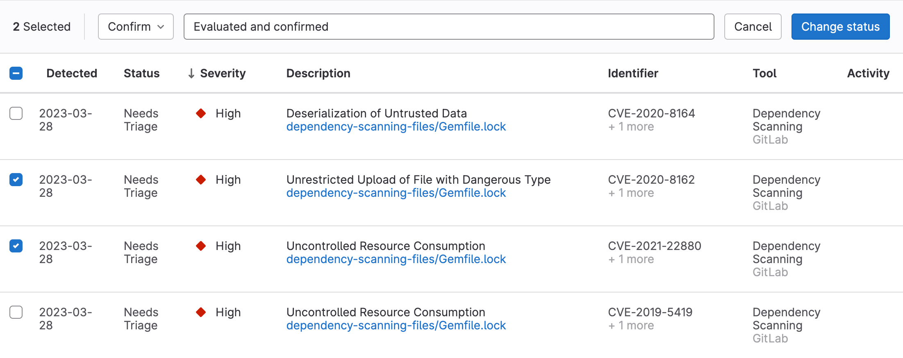
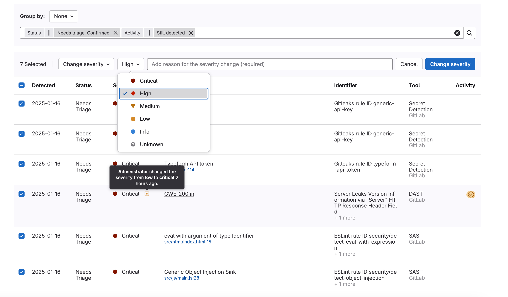



- Tier: 旗舰版
- Offering: JihuLab.com，私有化部署



漏洞报告提供代码库中发现的安全漏洞的统一视图。按严重程度、报告类型、扫描器（仅限项目）和其他属性对漏洞进行排序，以确定哪些问题需要优先处理。通过状态指示器和活动图标跟踪漏洞的整个生命周期，展示修复进展。

访问每个漏洞的详细信息，包括通用漏洞评分系统（CVSS）评分和文件位置（如果可用）。筛选和分组相似漏洞，以便系统化处理。

出于性能原因，如果漏洞总数超过 1000，漏洞报告会将计数显示为 **1000+**，而不是精确数字。此限制仅影响页面顶部显示的计数。您仍然可以在表格中找到所有漏洞。

议题 [547510](https://gitlab.com/gitlab-org/gitlab/-/issues/547510)中提出了显示精确计数的改进方案。要查找精确计数，请使用[议题 480378](https://gitlab.com/gitlab-org/gitlab/-/issues/480378#workarounds)中的一种变通方法。

> [!note]
> 在 JihuLab.com 上，漏洞在最后一次更新一年后会被[归档](../vulnerability_archival/_index.md)。

## 漏洞报告的内容

该报告包含默认分支的数据，展示所有成功的安全扫描作业的累积结果。扫描结果会在作业完成后显示，或者当流水线被手动作业阻塞时显示。

对于项目和群组，漏洞报告包含：

- 每个严重程度级别的漏洞总数。
- 常见漏洞属性的筛选器。
- 每个漏洞的详细信息，以表格形式呈现。

对于某些漏洞，详细信息包括指向默认分支中相关文件和行号的链接。对于 CVE 漏洞，您还可以在漏洞报告中查看 KEV 状态、CVSS 和 EPSS 评分以及可达性信息。

对于项目，漏洞报告还包含：

- 时间戳，显示默认分支最后更新的时间，包括指向最新流水线的链接。针对非默认分支运行的流水线不会更新时间戳。
- 最近一次流水线中发生的失败次数。选择失败通知可查看该流水线页面的 **失败作业** 选项卡。

**活动**列包含图标，用于指示对该行漏洞采取的活动（如果有）：

- 议题 ：链接到为该漏洞创建的议题。
- 合并请求 ：链接到为该漏洞创建的合并请求。
- 已检查圆圈 ：该漏洞已被修复。
- 误报 ：扫描器确定此漏洞为误报。
- 解决方案 ：表示该漏洞有可用的解决方案。
- 漏洞解决方案 ：表示该漏洞有可用的 AI 解决方案。
- 误报检测 ：表示极狐GitLab Duo 已分析此漏洞是否存在误报。将鼠标悬停在图标上可查看置信度评分和解释。

要打开为漏洞创建的议题，请将鼠标悬停在**活动**条目上，然后选择链接。
议题图标（）表示议题的状态。如果启用了 [Jira 议题支持](../../../integration/jira/configure.md)，**活动**条目中的议题链接会指向 Jira 中的议题。与极狐GitLab 议题不同，Jira 议题的状态不会显示在极狐GitLab UI 中。

**活动**列中的红色**恶意软件**徽章表示该漏洞已被识别为恶意软件，依据是
[极狐GitLab 恶意软件公告](../gitlab_advisory_database/_index.md#gitlab-malware-advisories)。

当漏洞源自多项目流水线设置时，此页面会显示源自所选项目的漏洞。

## 查看漏洞报告

查看漏洞报告以列出项目或群组中的所有漏洞。

先决条件：

- 您必须对项目或群组拥有安全管理员、开发者、维护者或所有者角色。

要查看漏洞报告：

1. 在顶部栏中，选择**搜索或跳转到**并找到您的项目或群组。
1. 在左侧边栏中，选择**安全** > **漏洞报告**。

## 筛选漏洞

您可以在漏洞报告中筛选漏洞，以便更高效地进行分类。

您可以按以下条件筛选：

<!-- vale gitlab_base.SubstitutionWarning = NO -->

- **状态**：漏洞的当前[状态](../vulnerabilities/_index.md#vulnerability-status-values)：需要分类、已确认、已忽略或已解决。
  已忽略的漏洞可以按忽略原因一起筛选，也可以单独筛选。
- **严重程度**：漏洞的严重程度值：严重、高、中、低、信息、未知。
- **报告类型**：检测到漏洞的报告类型，例如 SAST 或容器模糊测试。
- **扫描器**：识别漏洞的具体扫描器。
- **活动**：漏洞的其他属性，例如漏洞是否有议题、合并请求或可用的解决方案。
- **标识符**：漏洞的标识符（需要[高级漏洞管理](#advanced-vulnerability-management)。如果没有高级漏洞管理，则仅适用于漏洞数量最多为 20,000 的项目和群组）。
- **项目**：筛选特定项目中的漏洞（仅适用于群组）。
- **可达性**：按漏洞的可达性状态筛选：是、未找到或不可用。要使用此筛选器，您必须启用[高级漏洞管理](#advanced-vulnerability-management)。
- **有效性检查**：按漏洞的有效性状态筛选：活跃、不活跃或可能活跃。要使用此筛选器，您必须启用[高级漏洞管理](#advanced-vulnerability-management)。
- **恶意软件**：按漏洞是否已被识别为恶意软件筛选：是或否。在项目中，此筛选器名为**恶意软件（仅限默认分支）**。要使用此筛选器，您必须启用[高级漏洞管理](#advanced-vulnerability-management)。
- **跟踪引用**：按跟踪引用（检测到漏洞的分支或标签）筛选漏洞（仅适用于项目）。要使用此筛选器，您必须启用[高级漏洞管理](#advanced-vulnerability-management)。
- **策略违规**：按绕过原因筛选漏洞。显示当用户从警告模式的安全策略中绕过安全策略违规时引入的漏洞。用户从警告模式的策略中绕过任何违规时都必须提供原因。要使用此筛选器，您必须启用[高级漏洞管理](#advanced-vulnerability-management)。

<!-- vale gitlab_base.SubstitutionWarning = YES -->

### 筛选漏洞

筛选漏洞报告以聚焦于一部分漏洞。

要筛选漏洞列表：

1. 在顶部栏中，选择**搜索或跳转到**并找到您的项目。
1. 在左侧边栏中，选择**安全** > **漏洞报告**。
1. 可选。要移除默认筛选器，请选择**清除**（）。
1. 在漏洞列表上方，选择筛选栏。
1. 在出现的下拉列表中，选择要筛选的属性，然后从下拉列表中选择值。
1. 在筛选字段外点击。漏洞严重程度总数和匹配漏洞列表会更新。
1. 要按多个属性筛选，请重复前三个步骤。多个属性通过逻辑 AND 连接。

### 报告类型筛选器

您可以根据检测到漏洞的报告类型筛选漏洞。默认情况下，漏洞报告会列出所有报告类型的漏洞。

使用**手动添加**属性筛选手动添加的漏洞。

### 扫描器筛选器

对于项目，您可以根据检测到漏洞的扫描器筛选漏洞。默认情况下，漏洞报告会列出所有[扫描器](../detect/_index.md)的漏洞。

### 项目筛选器

项目筛选器的内容有所不同：

- **安全中心**：仅包含您[已添加到个人安全中心](../security_center/_index.md#add-projects-to-the-security-center)的项目。
- **群组**：群组中的所有项目。
- **项目**：不适用。

### 活动筛选器

活动筛选器的行为与其他筛选器不同。每个类别中只能选择一个值。要移除筛选器，请从活动筛选器下拉列表中选择要移除的筛选器。

使用活动筛选器时的选择行为：

- **活动**
  - **所有活动**：具有任何活动状态的漏洞（等同于忽略此筛选器）。选择此项会取消选择所有其他活动筛选器选项。
- **检测**
  - **仍然检测到**（默认）：在流水线对 `default` 分支的最新扫描中仍然检测到的漏洞。
  - **不再检测到**：在流水线对 `default` 分支的最新扫描中不再检测到的漏洞。
- **议题**
  - **有关联议题**：具有一个或多个关联议题的漏洞。
  - **没有关联议题**：没有关联议题的漏洞。
- **合并请求**
  - **有关联合并请求**：具有一个或多个关联合并请求的漏洞。
  - **没有关联合并请求**：没有关联合并请求的漏洞。
- **有可用解决方案**
  - **有解决方案**：可以[通过自动化合并请求解决](../vulnerabilities/_index.md#resolve-a-vulnerability-with-a-merge-request)的漏洞。
  - **没有解决方案**：没有自动化合并请求解决方案可用的漏洞。
- **极狐GitLab Duo 解决方案**：
  - **漏洞解决方案可用**：具有可用 AI 解决方案的漏洞。
  - **漏洞解决方案不可用**：没有可用 AI 解决方案的漏洞。
- **极狐GitLab Duo 误报检测**：
  - **误报**：被极狐GitLab Duo 标记为可能误报的漏洞。
  - **未识别为误报**：未被识别为误报或未被极狐GitLab Duo 标记的漏洞。

**极狐GitLab Duo (AI)** 筛选器在以下情况下可用：

- 安全中心漏洞报告：[安全中心](../security_center/_index.md#add-projects-to-the-security-center)中的任何项目已开启其**极狐GitLab Duo** 开关。
- 群组漏洞报告：对于该群组，**极狐GitLab Duo 功能**设置为**默认开启**。
- 项目漏洞报告：对于该项目，**极狐GitLab Duo** 开关已开启。

### 可达性筛选器

对于群组和项目，您可以根据[可达性值](../dependency_scanning/static_reachability.md#reachability-values)筛选漏洞。默认情况下，漏洞报告会列出具有任何可达性值的漏洞。

此筛选器需要[高级漏洞管理](#advanced-vulnerability-management)。

### 有效性检查筛选器

对于群组和项目，您可以根据[有效性检查值](../vulnerabilities/validity_check.md)筛选漏洞。默认情况下，漏洞报告会列出具有可能活跃状态的漏洞。

此筛选器需要[高级漏洞管理](#advanced-vulnerability-management)。

### 恶意软件筛选器

> [!flag]
> 此功能的可用性由功能标志控制。

对于群组和项目，您可以根据漏洞是否已被识别为恶意软件进行筛选。默认情况下，漏洞报告会列出具有任何恶意软件状态的漏洞。

恶意软件检测仅在项目的默认分支上运行，因此该筛选器仅涵盖在该分支上发现的漏洞。
在项目漏洞报告中，您还可以[按跟踪引用筛选](#tracked-ref-filter)，该筛选器名为**恶意软件（仅限默认分支）**。
在没有跟踪引用筛选器的群组漏洞报告中，该筛选器名为**恶意软件**。

仅当跟踪引用筛选器单独设置为默认分支时，您才能选择恶意软件状态。对于任何其他跟踪引用选择，该筛选器会显示消息
`To filter by malware, remove the filter for other tracked refs`，而不是**是**和
**否**选项。
如果您已经应用了恶意软件筛选器，然后更改跟踪引用筛选器，极狐GitLab 会移除恶意软件筛选器。

此筛选器需要[高级漏洞管理](#advanced-vulnerability-management)。

### 跟踪引用筛选器

> [!flag]
> 此功能的可用性由功能标志控制。

对于项目，您可以按跟踪引用（极狐GitLab 跟踪安全发现的分支或标签）筛选漏洞。您可以一次选择多个引用，选项分组在**分支**和**标签**下，外加一个**所有跟踪引用**选项。默认情况下，该筛选器设置为项目的默认分支。

此筛选器需要[高级漏洞管理](#advanced-vulnerability-management)。

## 分组漏洞

您可以在漏洞报告页面上对漏洞进行分组，以便更高效地进行分类。

您可以按以下条件分组：

- 状态
- 严重程度
- 报告类型
- 扫描器
- OWASP 十大安全风险 2017
- OWASP 十大安全风险 2021（需要[高级漏洞管理](#advanced-vulnerability-management)）

### 分组漏洞

要对漏洞进行分组：

1. 在顶部栏中，选择**搜索或跳转到**并找到您的项目或群组。
1. 在左侧边栏中，选择**安全** > **漏洞报告**。
1. 从**分组依据**下拉列表中，选择一个分组。

漏洞会根据您选择的分组进行分组。每个分组默认折叠，每个分组的漏洞总数显示在其名称旁边。要查看每个分组中的漏洞，请选择该分组的名称。

## 查看漏洞详情

要查看漏洞的更多详细信息，请选择漏洞的**描述**。将打开[漏洞详情](../vulnerabilities/_index.md)页面。

## 更改漏洞状态

在排查漏洞过程中，您可以更改其状态，包括忽略漏洞。

当漏洞被忽略时，审计日志会记录是谁忽略的、何时忽略的以及忽略的原因。您无法删除漏洞记录，因此永久记录始终保留。

先决条件：

- 您必须对项目拥有安全管理员、维护者或所有者角色。`admin_vulnerability` 权限已在极狐GitLab 17.0 中从开发者角色中[移除](https://gitlab.com/gitlab-org/gitlab/-/issues/412693)。

要更改漏洞状态：

1. 在顶部栏中，选择**搜索或跳转到**并找到您的项目。
1. 在左侧边栏中，选择**安全** > **漏洞报告**。
1. 要选择：
   - 一个或多个漏洞，请选择每个漏洞旁边的复选框。
   - 页面上的所有漏洞，请选择表头中的复选框。
1. 在**设置状态**下拉列表中，选择所需状态。
1. 如果选择了**忽略**状态，请在**设置忽略原因**下拉列表中选择所需原因。
1. 在**添加评论**输入框中，您可以提供评论。对于**忽略**状态，评论是必填项。
1. 选择**更改状态**。

所选漏洞的状态会更新，漏洞报告的内容会刷新。

## 更改或覆盖漏洞严重程度

> [!flag]
> 此功能的可用性由功能标志控制。

在某些情况下，您可能需要调整检测到的漏洞的严重程度，以更好地反映您组织的优先级。例如，扫描器可能报告较低的严重程度，但根据您的环境或设置，您可能认为它更严重。此功能允许您覆盖扫描器分配的默认严重程度。

先决条件：

- 您必须对项目拥有安全管理员、维护者或所有者角色，或拥有 `admin_vulnerability` 权限。

要手动覆盖漏洞的严重程度：

1. 在顶部栏中，选择**搜索或跳转到**并找到您的项目。
1. 转到**安全** > **漏洞报告**。
1. 选择漏洞：
   - 要选择单个漏洞，请选择每个漏洞旁边的复选框。
   - 要选择页面上的所有漏洞，请选择表头中的复选框。
1. 在**选择操作**下拉列表中，选择**更改严重程度**。
1. 在**选择严重程度**下拉列表中，选择所需的严重程度级别。
1. 在**添加严重程度更改原因（必填）**文本框中，简要说明更改严重程度的原因。
1. 选择**更改严重程度**。

对于每个选定的漏洞：

- 其严重程度会在**漏洞详情页面**和**漏洞报告**中更新。
- 其严重程度旁会添加一个徽章，表示严重程度已被覆盖。
- 手动严重程度调整会记录在漏洞的**历史记录**中。

## 阻止用户覆盖漏洞严重程度

> [!flag]
> 此功能的可用性由功能标志控制。

在某些环境中，您可能需要阻止用户覆盖漏洞的严重程度。`hide_vulnerability_severity_override` 功能标志允许管理员在漏洞报告中隐藏严重程度覆盖功能。此功能有助于组织在各项目之间保持标准化的漏洞严重程度评级。启用后，此功能会：

- 从漏洞报告的操作下拉列表中隐藏**更改严重程度**选项。
- 阻止用户通过 UI 手动更改严重程度级别，确保基于扫描器结果进行一致的漏洞评分。
- 禁用与修改漏洞严重程度相关的所有 API 端点，在所有访问方式中保持一致性。

要启用 `hide_vulnerability_severity_override` 标志，请参阅[启用和禁用部署在功能标志后的极狐GitLab 功能](../../../administration/feature_flags/_index.md)。

## 将漏洞添加到现有议题

您可以在漏洞报告中将一个或多个漏洞链接到现有议题。

先决条件：

- 您必须对项目拥有安全管理员、维护者或所有者角色，或在自定义角色中拥有 `admin_vulnerability` 权限。`admin_vulnerability` 权限已在极狐GitLab 17.0 中从开发者角色中[移除](https://gitlab.com/gitlab-org/gitlab/-/issues/412693)。

要将漏洞附加到现有议题：

1. 在顶部栏中，选择**搜索或跳转到**并找到您的项目或群组。
1. 转到**安全** > **漏洞报告**。
1. 选择漏洞：
   - 要选择单个漏洞，请选择每个漏洞旁边的复选框。
   - 要选择页面上的所有漏洞，请选择表头中的复选框。
1. 在**选择操作**下拉列表中，选择**附加到现有议题**。
1. 在**输入议题 URL 或 <#议题 ID>**文本框中，输入议题的 ID 以自动补全，或添加议题的 URL。您可以输入多个议题以将漏洞添加到其中。
1. 选择**添加**。

每个选定的漏洞都将链接到所有指定的议题。

## 将漏洞添加到新议题

您可以将一个或多个漏洞链接到新议题。

先决条件：

- 您必须对项目拥有安全管理员、维护者或所有者角色，或在自定义角色中拥有 `admin_vulnerability` 权限。`admin_vulnerability` 权限已在极狐GitLab 17.0 中从开发者角色中[移除](https://gitlab.com/gitlab-org/gitlab/-/issues/412693)。

要将漏洞附加到新议题：

1. 在顶部栏中，选择**搜索或跳转到**并找到您的项目或群组。
1. 转到**安全** > **漏洞报告**。
1. 选择漏洞：
   - 要选择单个漏洞，请选择每个漏洞旁边的复选框。
   - 要选择页面上的所有漏洞，请选择表头中的复选框。
1. 在**选择操作**下拉列表中，选择**附加到新议题**。
1. 选择**创建议题**。

您将被重定向到一个新议题。每个选定的漏洞都已链接到该议题。

## 批量运行 AI 任务流

> [!flag]
> 此功能的可用性由功能标志控制。

您可以同时对多个漏洞运行极狐GitLab Duo SAST 误报检测和漏洞解决功能。有关更多信息，请参阅
[解决多个漏洞](../vulnerabilities/agentic_vulnerability_resolution.md#resolve-multiple-vulnerabilities)和[分析多个漏洞](../vulnerabilities/false_positive_detection.md#analyze-multiple-vulnerabilities)。

## 按检测日期排序漏洞

默认情况下，漏洞按严重程度级别排序，严重程度最高的漏洞列在顶部。

要按每个漏洞的检测日期排序，请选择“检测时间”列标题。

## 导出

您可以导出漏洞报告中列出的漏洞的详细信息。导出格式为 CSV（逗号分隔值）。所有漏洞都会包含在内，因为筛选器不适用于导出。

包含的字段有：

- 状态（有关状态值如何导出的详细信息，请参阅下表。）
- 群组名称
- 项目名称
- 报告类型
- 扫描器名称
- 漏洞
- 基本信息
- 附加信息
- 严重程度
- [CVE](https://cve.mitre.org/)（通用漏洞披露）
- [CWE](https://cwe.mitre.org/)（通用弱点枚举）
- 其他标识符
- 检测时间
- 位置
- 活动：如果漏洞在默认分支上已解决，则返回 `true`，否则返回 `false`。
- 评论
- 完整路径
- CVSS 向量
- [忽略原因](../vulnerabilities/_index.md#vulnerability-dismissal-reasons)
- 漏洞 ID

> [!note]
> 完整详情可通过我们的
> [作业产物 API](../../../api/job_artifacts.md#download-a-single-artifact-file-by-reference-name) 获取。
> 使用 `gl-*-report.json` 报告文件名之一代替`*artifact_path`
> 以获取例如检测到漏洞的文件路径。

漏洞报告中显示的状态字段值与漏洞导出中包含的值不同。请使用以下参考表进行匹配。

| 漏洞报告 | 漏洞导出 |
|:---------------------|:---------------------|
| 需要分类         | detected             |
| 已忽略            | dismissed            |
| 已解决             | resolved             |
| 已确认            | confirmed            |

### 导出详情

要导出漏洞报告中列出的所有漏洞的详细信息，请选择**导出**。

当导出的详细信息可用时，您会收到一封电子邮件。要下载导出的详细信息，请选择电子邮件中的链接。

> [!note]
> 某些 CSV 阅读器对行数或列大小有限制，
> 这可能使它们与较大的导出文件不兼容。漏洞导出不会
> 考虑各个程序的限制。

## 手动添加漏洞

当漏洞不在极狐GitLab 漏洞数据库中时，可以手动添加漏洞。您只能在项目的漏洞报告中添加漏洞。

要手动添加漏洞：

1. 在顶部栏中，选择**搜索或跳转到**并找到您的项目。
1. 在左侧边栏中，选择**安全** > **漏洞报告**。
1. 选择**提交漏洞**。
1. 填写字段并提交表单。

新创建的漏洞详情页面会打开。

## 高级漏洞管理

极狐GitLab 主要使用 PostgreSQL 在漏洞报告和依赖项列表中进行筛选。由于数据库索引限制和应用多个筛选器时的性能挑战，极狐GitLab 使用[高级搜索](../../search/advanced_search.md)来实现特定的漏洞和依赖项管理功能。

高级搜索支持以下功能：

1. 在项目或群组的漏洞报告中按 OWASP 2021 类别对数据进行分组。
1. 在项目或群组的漏洞报告中根据漏洞的标识符进行筛选。
1. 在项目或群组的漏洞报告中根据可达性值进行筛选。
1. 在项目或群组的漏洞报告中根据有效性检查状态进行筛选。
1. 在项目或群组的漏洞报告和依赖项列表中根据恶意软件状态进行筛选。
1. 在项目的漏洞报告和依赖项列表中根据跟踪引用进行筛选。
1. 在项目或群组的漏洞报告中根据策略违规绕过原因进行筛选。
1. 在[新安全仪表板](../security_dashboard/_index.md)中筛选面板和整个仪表板数据。

高级搜索仅用于这些特定功能，包括当它们与其他[筛选器](#filter-vulnerabilities)结合使用时。其他筛选器在独立使用时，继续使用标准的 PostgreSQL 筛选。

> [!note]
> 在极狐GitLab 私有化部署上，从早于极狐GitLab 18.7 的版本升级后，在数据迁移完成期间，高级漏洞管理功能可能会暂时不可用，通常持续几个小时。
> 迁移完成后，全部功能将可用。

### 要求

要使用高级漏洞管理中的功能：

- 您必须[启用高级搜索](../../search/advanced_search.md#use-advanced-search)。
- 在极狐GitLab 私有化部署上，[设置高级搜索](../../../integration/advanced_search/elasticsearch.md#enable-advanced-search)后，确保选中**使用高级搜索进行搜索**复选框。

## 运维漏洞

**运维漏洞**选项卡列出了[运维容器扫描](../../clusters/agent/vulnerabilities.md)发现的漏洞。
此选项卡出现在项目、群组和安全中心漏洞报告中。
