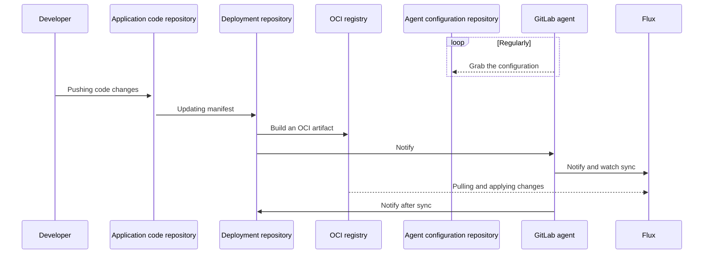



- Tier: 基础版，专业版，旗舰版
- Offering: JihuLab.com，私有化部署



极狐GitLab 集成 [Flux](https://fluxcd.io/flux/) 以实现 GitOps。
要开始使用 Flux，请参阅 [Flux for GitOps 教程](getting_started.md)。

借助 GitOps，您可以从一个 Git 代码仓库管理容器化集群和应用，该代码仓库：

- 是您系统的唯一事实来源。
- 是您运维系统的唯一场所。

通过将极狐GitLab、Kubernetes 和 GitOps 结合使用，您可以获得：

- 极狐GitLab 作为 GitOps 操作器。
- Kubernetes 作为自动化和收敛系统。
- 极狐GitLab CI/CD 用于持续集成。
- 代理用于持续部署和集群可观测性。
- 内置的自动漂移修复。
- 通过[服务器端应用](https://kubernetes.io/docs/reference/using-api/server-side-apply/)进行资源管理，实现透明的多方字段管理。

<a id="deployment-sequence"></a>

## 部署顺序

此图展示了 GitOps 部署中的代码仓库和主要参与者：



您应同时使用 Flux 和 `agentk` 进行 GitOps 部署。Flux 使集群状态与源保持同步，而 `agentk` 简化了 Flux 的设置，提供集群到极狐GitLab 的访问管理，并在极狐GitLab UI 中可视化集群状态。

<a id="oci-for-source-control"></a>

### 使用 OCI 进行源代码管理

您应使用 OCI 镜像作为 Flux 的源控制器，而不是 Git 代码仓库。[极狐GitLab 容器镜像仓库](../../packages/container_registry/_index.md)支持 OCI 镜像。

| OCI 镜像仓库 | Git 代码仓库 |
| ---          | ---              |
| 专为大规模提供容器镜像而设计。 | 专为对源代码进行版本控制和存储而设计。 |
| 不可变，支持安全扫描。 | 可变。 |
| 默认 Git 分支可以存储集群状态而不会触发同步。 | 默认 Git 分支在用于存储集群状态时会触发同步。 |

<a id="repository-structure"></a>

## 代码仓库结构

为简化配置，每个团队使用一个交付代码仓库。您可以将交付代码仓库按应用打包为多个 OCI 镜像。

有关代码仓库结构的更多建议，请参阅 [Flux 文档](https://fluxcd.io/flux/guides/repository-structure/)。

<a id="immediate-git-repository-reconciliation"></a>

## 即时 Git 代码仓库协调

通常，Flux 源控制器会按配置的间隔协调 Git 代码仓库。这可能导致 `git push` 与集群状态协调之间出现延迟，并导致从极狐GitLab 进行不必要的拉取。

极狐GitLab Kubernetes Agent 会自动检测引用了代理所连接实例中极狐GitLab 项目的 Flux `GitRepository` 对象，
并为该实例配置一个 [`Receiver`](https://fluxcd.io/flux/components/notification/receivers/)。当极狐GitLab Kubernetes Agent 检测到对其有权访问的代码仓库执行了 `git push` 时，`Receiver` 会被触发，Flux 会使用代码仓库中的任何变更来协调集群。

要使用即时 Git 代码仓库协调，您必须有一个运行以下组件的 Kubernetes 集群：

- 极狐GitLab Kubernetes Agent。
- Flux `source-controller` 和 `notification-controller`。

即时 Git 代码仓库协调可以缩短推送与协调之间的时间，但它并不保证每个 `git push` 事件都会被接收。您仍应将
[`GitRepository.spec.interval`](https://fluxcd.io/flux/components/source/gitrepositories/#interval)
设置为可接受的时长。

> [!note]
> 代理只能访问代理配置项目和所有公开项目。
> 除代理配置项目外，代理无法立即协调任何私有项目。
> 允许代理访问私有项目的提议见[议题 389393](https://gitlab.com/gitlab-org/gitlab/-/issues/389393)。

<a id="custom-webhook-endpoints"></a>

### 自定义 webhook 端点

当极狐GitLab Kubernetes Agent 调用 `Receiver` webhook 时，
代理默认使用 `http://webhook-receiver.flux-system.svc.cluster.local`，
这也是 Flux bootstrap 安装所设置的默认 URL。要配置自定义端点，请将 `flux.webhook_receiver_url` 设置为代理可以解析的 URL。例如：

```yaml
flux:
  webhook_receiver_url: http://webhook-receiver.another-flux-namespace.svc.cluster.local
```

对于按以下格式配置的[服务代理 URL](https://kubernetes.io/docs/tasks/access-application-cluster/access-cluster-services/)，有特殊处理：`/api/v1/namespaces/[^/]+/services/[^/]+/proxy`。例如：

```yaml
flux:
  webhook_receiver_url: /api/v1/namespaces/flux-system/services/http:webhook-receiver:80/proxy
```

在这些情况下，极狐GitLab Kubernetes Agent 会使用可用的 Kubernetes 配置
和上下文连接到 API 端点。如果您在集群外运行代理，并且尚未为 Flux 通知控制器[配置 `Ingress`](https://fluxcd.io/flux/guides/webhook-receivers/#expose-the-webhook-receiver)，则可以使用此方式。

> [!warning]
> 您应仅配置受信任的服务代理 URL。
> 当您提供某个服务代理 URL 时，
> 极狐GitLab Kubernetes Agent 会发送典型的 Kubernetes API 请求，其中包含
> 向 API 服务进行身份验证所需的凭据。

<a id="token-management"></a>

## 令牌管理

要使用某些 Flux 功能，您可能需要多个访问令牌。此外，您可以使用多种令牌类型来达到相同的结果。

本节为您可能需要的令牌提供指导，并在可能的情况下提供令牌类型建议。

<a id="gitlab-access-by-flux"></a>

### Flux 访问极狐GitLab

要访问极狐GitLab 容器镜像仓库或 Git 代码仓库，Flux 可以使用：

- 项目或群组部署令牌。
- 项目或群组部署密钥。
- 项目或群组访问令牌。
- 个人访问令牌。

该令牌不需要写入权限。

如果可以使用 `http` 访问，您应使用项目部署令牌。如果您需要 `git+ssh` 访问，则应使用部署密钥。要比较部署密钥和部署令牌，请参阅[部署密钥](../../project/deploy_keys/_index.md)。

自动创建、轮换和报告部署令牌的支持提议见[议题 389393](https://gitlab.com/gitlab-org/gitlab/-/issues/389393)。

<a id="flux-to-gitlab-notification"></a>

### Flux 到极狐GitLab 的通知

如果您将 Flux 配置为从 Git 源同步，[Flux 可以在极狐GitLab 流水线中注册外部作业状态](https://fluxcd.io/flux/components/notification/providers/#git-commit-status-updates)。

要从 Flux 获取外部作业状态，您可以使用：

- 项目或群组部署令牌。
- 项目或群组访问令牌。
- 个人访问令牌。

该令牌需要 `api` 范围。为尽量减小令牌泄露时的攻击面，您应使用项目访问令牌。

将 Flux 作为作业集成到极狐GitLab 流水线中的提议见[议题 405007](https://gitlab.com/gitlab-org/gitlab/-/issues/405007)。
