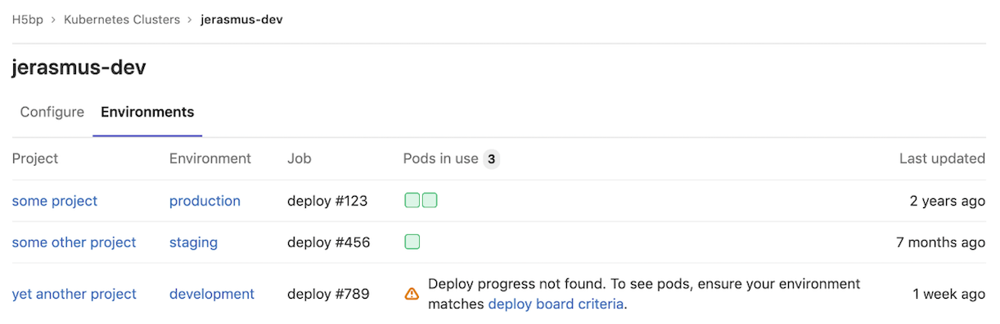



- Tier: 专业版，旗舰版
- Offering: JihuLab.com，私有化部署



> [!flag]
> 此功能在极狐GitLab 私有化部署上默认不可用。要使其可用，管理员可以启用名为 `certificate_based_clusters`的[功能标志](../../administration/feature_flags/_index.md)。

集群环境提供了一个整合视图，展示哪些 CI [环境](../../ci/environments/_index.md)已部署到 Kubernetes 集群。此视图：

- 显示项目以及与部署相关的环境。
- 显示该环境的 pod 状态。

借助集群环境，您可以深入了解：

- 哪些项目部署到了集群。
- 每个项目的环境使用了多少个 pod。
- 用于部署到该环境的 CI 作业。

对集群环境的访问权限仅限于[群组维护者和所有者](../permissions.md#group-permissions)。

## 用法

要实现以下目的：

- 跟踪集群的环境，您必须成功
  [部署到 Kubernetes 集群](../project/clusters/deploy_to_cluster.md)。
- 正确显示 pod 使用情况，您必须
  [启用部署面板](../project/deploy_boards.md#enabling-deploy-boards)。

在成功部署到群组级或实例级集群后：

1. 转到您群组的 **Kubernetes** 页面。
1. 选择**环境**标签页。

此页面仅包含成功部署到集群的部署。非集群环境不包含在内。
