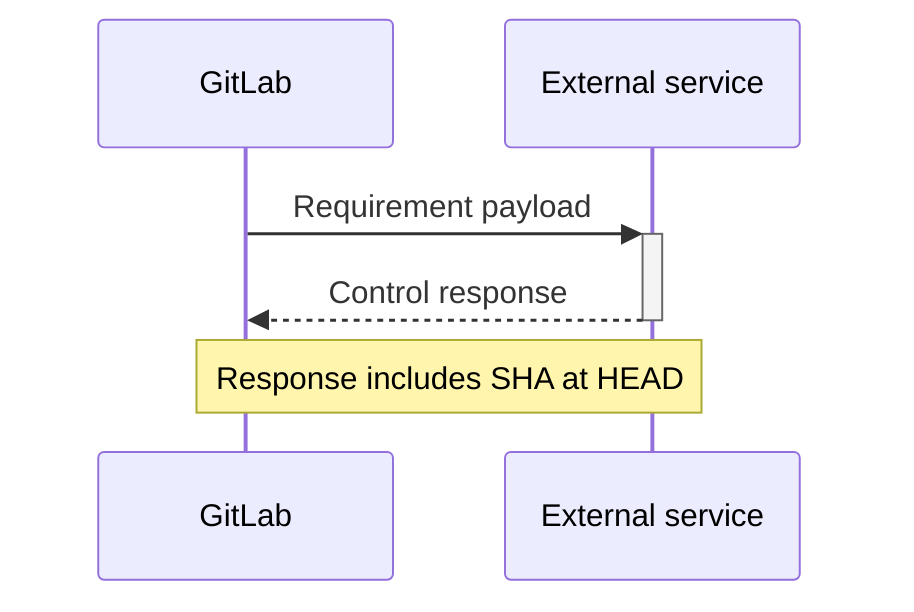



- Tier: 专业版，旗舰版
- Offering: JihuLab.com，私有化部署



您可以创建一个合规框架，它作为一个标记，用于标识您的项目具有特定的合规要求或需要额外的监督。

在旗舰版中，合规框架可以选择性地对其应用的项目强制执行
[合规流水线配置](../compliance_pipelines.md)和
[安全策略](../../application_security/policies/enforcement/_index.md#scope)。

合规框架在顶级群组上创建。如果项目被移出其现有的顶级群组，其框架将被移除。

每个项目最多可以应用 20 个合规框架。

如需查看点击式演示，请参阅[自定义合规框架](https://gitlab.navattic.com/custom-compliance)。
<!-- Demo published on 2025-10-09 -->

<a id="prerequisites"></a>

## 先决条件

- 要创建、编辑和删除合规框架，用户必须具有以下任一条件：
  - 顶级群组的所有者或安全管理员角色。
  - 被分配了具有 `admin_compliance_framework`
    [自定义权限](../../custom_roles/abilities.md#compliance-management)的[自定义角色](../../custom_roles/_index.md)。
- 要向项目添加或从项目中移除合规框架，该项目所属的群组必须具有
  合规框架。

<a id="create-a-compliance-framework-from-a-template"></a>

## 从模板创建合规框架



- Tier: 旗舰版
- Offering: JihuLab.com，私有化部署



您可以从预定义的开箱即用（OOTB）模板创建合规框架，而无需从头构建。模板包含与常见合规标准对齐的预配置要求和控制项，因此您可以快速开始，无需手动设置。

以下模板可供使用：

| 模板 | 描述 |
|----------|-------------|
| CIS CSC v8.1 | 互联网安全中心控制项 v8.1 框架，涵盖基础、基础和组织安全控制项。 |
| CSA CCM v4 | 云安全联盟云控制矩阵 v4 框架，用于云安全保证。 |
| Cyber Essentials | 英国政府支持的 Cyber Essentials 计划，涵盖五项关键技术控制项。 |
| DORA | 数字运营韧性法案框架，用于金融行业 ICT 风险管理。 |
| FedRAMP High | 联邦风险与授权管理计划高基线，用于美国联邦云服务。 |
| FedRAMP Low | 联邦风险与授权管理计划低基线，用于美国联邦云服务。 |
| FedRAMP Moderate | 联邦风险与授权管理计划中基线，用于美国联邦云服务。 |
| IRAP Official | 澳大利亚信息安全注册评估师计划 Official 分类框架。 |
| IRAP Protected | 澳大利亚信息安全注册评估师计划 Protected 分类框架。 |
| IRAP 机密 | 澳大利亚信息安全注册评估师计划机密分类框架。 |
| IRAP 绝密 | 澳大利亚信息安全注册评估师计划绝密分类框架。 |
| ISO 27001:2022 | 信息安全管理体系国际标准。 |
| NIST 800-171 Rev. 3 CMMC | NIST SP 800-171 第 3 版网络安全成熟度模型认证框架。 |
| NIST SP 800-218 | NIST 安全软件开发框架（SSDF）v1.1。 |
| NIST 800-53 Revision 5 | NIST SP 800-53 第 5 版信息系统的安全与隐私控制项。 |
| SOC 2 | 系统与组织控制 2 框架，其要求映射到 COSO 原则，涵盖漏洞扫描、访问控制和变更管理。 |
| TISAX | 可信信息安全评估交换框架，用于汽车行业信息安全要求。 |

<a id="create-a-framework-from-a-template-by-using-the-ui"></a>

### 使用 UI 从模板创建框架

要从模板创建合规框架：

1. 在顶部栏中，选择**搜索或跳转到**并找到您的群组。
1. 在左侧边栏中，选择**安全** > **合规中心**。
1. 在该页面上，选择**框架**标签页。
1. 选择**新建框架**。
1. 选择**从模板创建**。
1. 浏览可用模板并选择一个以预览其要求和控制项。
1. 可选。覆盖**名称**、**描述**或**颜色**以自定义框架。
1. 可选。选择**设为默认**以将此框架设为该群组的默认框架。
1. 选择**创建框架**。

该框架创建时会预先填充模板中的所有要求和控制项。之后您可以编辑该框架，根据需要添加、移除或修改要求。

如需基于 API 创建，请参阅[从模板创建合规框架](../../../api/graphql/compliance_frameworks.md#create-a-compliance-framework-from-a-template)。

<a id="import-a-compliance-framework"></a>

## 导入合规框架

借助此功能，您可以使用共享或备份的合规框架。JSON 文件不得与现有合规框架同名。

JSON 模板库可从
[合规遵循模板](https://gitlab.com/gitlab-org/software-supply-chain-security/compliance/engineering/compliance-adherence-templates)项目获取。
这些预定义模板提供完整的框架。它们无需手动设置，可帮助您快速开始。

<a id="import-a-predefined-compliance-framework"></a>

### 导入预定义的合规框架

要导入预构建的合规框架：

1. 前往[合规遵循模板](https://gitlab.com/gitlab-org/software-supply-chain-security/compliance/engineering/compliance-adherence-templates)项目。
1. 浏览可用的框架模板并下载您所需框架的 JSON 文件。
1. 在顶部栏中，选择**搜索或跳转到**并找到您的群组。
1. 在左侧边栏中，选择**安全** > **合规中心**。
1. 在该页面上，选择**框架**标签页。
1. 选择**新建框架**。
1. 选择**导入框架**。
1. 在出现的对话框中，从本地系统选择 JSON 文件。
1. 如果导入成功，新的合规框架将出现在列表中。

您的框架现在可以应用到项目了。请参阅[将合规框架应用到项目](#apply-a-compliance-framework-to-a-project)。

<a id="import-a-compliance-framework-from-a-json-file"></a>

### 从 JSON 文件导入合规框架

要使用 JSON 模板导入合规框架：

1. 在顶部栏中，选择**搜索或跳转到**并找到您的群组。
1. 在左侧边栏中，选择**安全** > **合规中心**。
1. 在该页面上，选择**框架**标签页。
1. 选择**新建框架**。
1. 选择**导入框架**。
1. 在出现的对话框中，从本地系统选择 JSON 文件。

如果导入成功，新的合规框架将出现在列表中。任何错误都会显示出来以供更正。

<a id="create-edit-or-delete-a-compliance-framework"></a>

## 创建、编辑或删除合规框架

您可以使用合规框架报告或合规项目报告来创建、编辑或删除合规框架。

有关使用合规框架报告的更多信息，请参阅：

- [创建新的合规框架](../compliance_center/compliance_frameworks_report.md#create-a-new-compliance-framework)。
- [编辑合规框架](../compliance_center/compliance_frameworks_report.md#edit-a-compliance-framework)。
- [删除合规框架](../compliance_center/compliance_frameworks_report.md#delete-a-compliance-framework)。

有关使用合规项目报告的更多信息，请参阅：

- [创建新的合规框架](../compliance_center/compliance_projects_report.md#create-a-new-compliance-framework)。
- [编辑合规框架](../compliance_center/compliance_projects_report.md#edit-a-compliance-framework)。
- [删除合规框架](../compliance_center/compliance_projects_report.md#delete-a-compliance-framework)。
  子群组和项目可以访问其顶级群组上创建的所有合规框架。但是，无法通过子群组或项目创建、编辑
  或删除合规框架。项目所有者可以选择要应用到其项目的框架。

<a id="apply-a-compliance-framework-to-a-project"></a>

## 将合规框架应用到项目

您可以将多个合规框架应用到一个项目，但无法将合规框架应用到个人命名空间中的项目。

要将合规框架应用到项目，请通过
[合规项目报告](../compliance_center/compliance_projects_report.md#apply-a-compliance-framework-to-projects-in-a-group)应用该合规框架。

您可以使用 [GraphQL API](../../../api/graphql/reference/_index.md#mutationprojectupdatecomplianceframeworks) 将一个或多个
合规框架应用到一个项目。

如果您使用 GraphQL 在子群组上创建合规框架，且用户具有正确的权限，则该框架会创建在根祖先上。极狐GitLab UI 会呈现只读视图以阻止此行为。

要通过合规框架将合规框架应用到项目：

1. 在顶部栏中，选择**搜索或跳转到**并找到您的群组。
1. 在左侧边栏中，选择**安全** > **合规中心**。
1. 在该页面上，选择**项目**标签页。
1. 悬停在某个合规框架上，选择**编辑框架**标签页。
1. 选择**项目**部分。
1. 从列表中选择项目。
1. 选择**更新框架**。

<a id="default-compliance-frameworks"></a>

## 默认合规框架

群组所有者可以设置默认合规框架。默认框架会应用到在该群组中创建的所有新项目和导入的项目。它不会影响已应用框架的现有项目。默认框架无法删除。

设置为默认的合规框架带有一个 `default` 标记。

<a id="set-and-remove-a-default-by-using-the-compliance-center"></a>

### 使用合规中心设置和移除默认框架

要从[合规项目报告](../compliance_center/compliance_projects_report.md)设为默认（或移除默认）：

1. 在顶部栏中，选择**搜索或跳转到**并找到您的群组。
1. 在左侧边栏中，选择**安全** > **合规中心**。
1. 在该页面上，选择**项目**标签页。
1. 悬停在某个合规框架上，选择**编辑框架**标签页。
1. 选择**设为默认**。
1. 选择**保存更改**。

要从[合规框架报告](../compliance_center/compliance_frameworks_report.md)设为默认（或移除默认）：

1. 在顶部栏中，选择**搜索或跳转到**并找到您的群组。
1. 在左侧边栏中，选择**安全** > **合规中心**。
1. 在该页面上，选择**框架**标签页。
1. 悬停在某个合规框架上，选择**编辑框架**标签页。
1. 选择**设为默认**。
1. 选择**保存更改**。

<a id="remove-a-compliance-framework-from-a-project"></a>

## 从项目中移除合规框架

要从群组中的一个或多个项目中移除合规框架，请通过
[合规项目报告](../compliance_center/compliance_projects_report.md#remove-a-compliance-framework-from-projects-in-a-group)移除该合规框架。

<a id="export-a-compliance-framework-as-a-json-file"></a>

## 将合规框架导出为 JSON 文件

借助此功能，您可以共享和备份合规框架。

要从合规中心导出合规框架：

1. 在顶部栏中，选择**搜索或跳转到**并找到您的群组。
1. 在左侧边栏中，选择**安全** > **合规中心**。
1. 在该页面上，选择**框架**标签页。
1. 找到您要导出的合规框架。
1. 选择垂直省略号（）。
1. 选择**导出为 JSON 文件**。

JSON 文件将下载到您的本地系统。

<a id="json-template-structure-and-schema"></a>

### JSON 模板结构和架构

合规框架 JSON 模板遵循特定的架构结构，该结构定义了框架元数据、要求和关联的控制项。了解此结构有助于您创建自定义模板或修改现有模板，以满足您组织的特定合规需求。

<a id="framework-properties"></a>

#### 框架属性

每个 JSON 模板包含以下顶级属性：

| 属性 | 类型 | 必填 | 描述 |
|----------|------|----------|-------------|
| `name` | String | 是 | 合规框架的显示名称。 |
| `description` | String | 是 | 框架用途的详细描述。 |
| `color` | String | 是 | 框架的十六进制颜色代码（例如 `#1f75cb`）。 |
| `requirements` | Array | 否 | 定义合规控制项的要求对象数组。 |

<a id="requirements-structure"></a>

#### 要求结构

`requirements` 数组中的每个要求包含：

| 属性 | 类型 | 必填 | 描述 |
|----------|------|----------|-------------|
| `name` | String | 是 | 合规要求的名称。 |
| `description` | String | 是 | 该要求强制执行内容的详细描述。 |
| `controls` | Array | 是 | 实现该要求的控制项对象数组。 |

<a id="control-structure"></a>

#### 控制项结构

`controls` 数组中的每个控制项定义一项特定检查：

| 属性 | 类型 | 必填 | 描述 |
|----------|------|----------|-------------|
| `name` | String | 是 | 极狐GitLab 控制项 ID（例如 `scanner_sast_running`）。 |
| `control_type` | String | 是 | 对于极狐GitLab 控制项，始终为 `"internal"`。 |
| `expression` | Object | 是 | 定义该控制项的评估逻辑。 |

<a id="expression-object"></a>

#### 表达式对象

`expression` 对象定义如何评估该控制项：

| 属性 | 类型 | 必填 | 描述 |
|----------|------|----------|-------------|
| `field` | String | 是 | 要评估的字段名称（与控制项名称匹配）。 |
| `operator` | String | 是 | 比较运算符（`=`、`>=`、`<=`、`>`、`<`）。 |
| `value` | Mixed | 是 | 预期值（布尔值、数字或字符串）。 |

<a id="example-json-template-structure"></a>

#### 示例 JSON 模板结构

以下是一个简化示例，展示了完整结构：

```json
{
  "name": "Example Compliance Framework",
  "description": "Example framework demonstrating JSON structure",
  "color": "#1f75cb",
  "requirements": [
    {
      "name": "Security Scanning Requirement",
      "description": "Ensure security scanning is enabled for all projects",
      "controls": [
        {
          "name": "scanner_sast_running",
          "control_type": "internal",
          "expression": {
            "field": "scanner_sast_running",
            "operator": "=",
            "value": true
          }
        },
        {
          "name": "minimum_approvals_required_2",
          "control_type": "internal",
          "expression": {
            "field": "minimum_approvals_required",
            "operator": ">=",
            "value": 2
          }
        }
      ]
    }
  ]
}
```

<a id="requirements"></a>

## 要求



- Tier: 旗舰版
- Offering: JihuLab.com，私有化部署



在极狐GitLab旗舰版中，您可以为合规框架定义特定的**要求**。要求由一个或多个控制项组成，这些控制项是针对被分配该框架的项目的配置或行为的检查。每个要求最多包含五个控制项。

每个控制项都包含极狐GitLab 在计划或触发的扫描期间用于评估项目遵循情况的逻辑。有关
如何跟踪遵循情况的更多详细信息，请参阅[合规状态报告](../compliance_center/compliance_status_report.md)。

您可以使用极狐GitLab 合规控制项或外部控制项来满足框架要求。

<a id="gitlab-compliance-controls"></a>

### 极狐GitLab 合规控制项

极狐GitLab 合规控制项可用于极狐GitLab 合规框架。控制项是针对被分配到合规框架的项目的配置或行为的检查。

组合使用极狐GitLab 合规控制项，帮助您满足
[合规标准](compliance_standards.md)。

> [!note]
> 检查运行中扫描器的安全扫描器控制项无法检测到在[子流水线](../../../ci/pipelines/downstream_pipelines.md#parent-child-pipelines)中
> 配置的扫描器。要使这些控制项通过，您必须在父流水线中配置安全扫描器。
> 有关更多信息，请参阅
> [议题 595632](https://gitlab.com/gitlab-org/gitlab/-/work_items/595632)。

<!-- Updates to control names must be reflected also in compliance_standards.md -->

| 控制项名称                                             | 控制项 ID                                                 | 描述 |
|:---------------------------------------------------------|:-----------------------------------------------------------|:------------|
| API 安全运行                                     | `scanner_api_security_running`                             | 确保在项目的默认分支流水线中配置并运行了 [API 安全扫描](../../application_security/api_security/_index.md)。 |
| 至少一次审批                                    | `minimum_approvals_required_1`                             | 确保合并请求在合并前[需要至少一次审批](../../project/merge_requests/approvals/_index.md)。 |
| 至少两次审批                                   | `minimum_approvals_required_2`                             | 确保合并请求在合并前[需要至少两次审批](../../project/merge_requests/approvals/_index.md)。 |
| 已启用 Auth SSO                                         | `auth_sso_enabled`                                         | 确保为项目启用了[单点登录（SSO）身份验证](../../group/saml_sso/_index.md)。 |
| 禁止作者批准合并请求               | `merge_request_prevent_author_approval`                    | 确保合并请求的作者[无法批准自己的更改](../../project/merge_requests/approvals/_index.md)。 |
| 已禁用分支删除                                 | `branch_deletion_disabled`                                 | 确保[分支无法被删除](../../project/repository/branches/protected.md)。 |
| 已启用 CI/CD 作业令牌范围                            | `cicd_job_token_scope_enabled`                             | 确保启用了 [CI/CD 作业令牌](../../../ci/jobs/ci_job_token.md)范围限制。 |
| 代码更改需要代码所有者                         | `code_changes_requires_code_owners`                        | 确保代码更改需要[代码所有者](../../project/codeowners/_index.md)批准。 |
| 需要代码所有者批准                             | `code_owner_approval_required`                             | 确保配置了[代码所有者文件](../../project/codeowners/_index.md)。 |
| 代码质量运行                                     | `scanner_code_quality_running`                             | 确保在项目的默认分支流水线中配置并运行了[代码质量扫描](../../../ci/testing/code_quality.md)。 |
| 禁止提交者批准合并请求           | `merge_request_prevent_committers_approval`                | 确保[已向合并请求提交的用户无法批准它](../../project/merge_requests/approvals/_index.md)。 |
| 容器扫描运行                               | `scanner_container_scanning_running`                       | 确保在项目的默认分支流水线中配置并运行了[容器扫描](../../application_security/container_scanning/_index.md)。 |
| DAST 运行                                             | `scanner_dast_running`                                     | 确保在项目的默认分支流水线中配置并运行了[动态应用安全测试（DAST）](../../application_security/dast/_index.md)。 |
| 默认分支受保护                                 | `default_branch_protected`                                 | 确保默认分支启用了[保护规则](../../project/repository/branches/protected.md)。 |
| 默认分支禁止直接推送                | `default_branch_protected_from_direct_push`                | [阻止直接推送到默认分支](../../project/repository/branches/protected.md)。 |
| 默认分支用户可合并                           | `default_branch_users_can_merge`                           | 控制[用户是否可以将更改合并到默认分支](../../project/repository/branches/protected.md)。 |
| 默认分支用户可推送                            | `default_branch_users_can_push`                            | 控制[用户是否可以直接推送到默认分支](../../project/repository/branches/protected.md)。 |
| Duo Agentic 任务流审计事件流                  | `duo_agentic_flow_audit_events_streaming`                  | 确保群组级别有活跃的[审计事件流目标](../audit_event_streaming.md)捕获极狐GitLab Duo Agent Platform 事件。当该群组禁用 Agent Platform 时通过。 |
| 依赖扫描运行                              | `scanner_dep_scanning_running`                             | 确保在项目的默认分支流水线中配置并运行了[依赖扫描](../../application_security/dependency_scanning/_index.md)。**注意**：在极狐GitLab 私有化部署实例上（从 18.4 起），由于产物差异，使用[基于 SBOM 的依赖扫描](../../application_security/dependency_scanning/dependency_scanning_sbom/_index.md)时此控制项可能会失败。请参阅[兼容性注意事项](../../application_security/dependency_scanning/dependency_scanning_sbom/troubleshooting_ds_sbom_analyzer.md#compliance-framework-compatibility)。 |
| 确保每个代码仓库有两名管理员                 | `ensure_2_admins_per_repo`                                 | 确保为每个项目分配了[至少两名所有者](../../project/members/_index.md)。 |
| 已启用错误跟踪                                   | `error_tracking_enabled`                                   | 确保为项目启用了[错误跟踪](../../../operations/error_tracking.md)。 |
| 已禁用强制推送                                      | `force_push_disabled`                                      | 阻止[强制推送](../../project/repository/branches/protected.md)到代码仓库。 |
| 项目存在 Forks                              | `has_forks`                                                | 确保项目已被 [forked](../../project/repository/forking_workflow.md) |
| 极狐GitLab 许可证级别旗舰版                            | `gitlab_license_level_ultimate`                            | 确保极狐GitLab 实例使用的是[旗舰版许可证](https://about.gitlab.com/pricing/feature-comparison/)。 |
| 具有有效的 CI/CD 配置                            | `has_valid_ci_config`                                      | 确保项目具有[有效的 CI/CD 配置](../../../ci/yaml/_index.md)。 |
| IaC 扫描运行                                     | `scanner_iac_running`                                      | 确保在项目的默认分支流水线中配置并运行了[基础设施即代码（IaC）扫描](../../application_security/iac_scanning/_index.md)。 |
| 禁止内部可见性                         | `project_visibility_not_internal`                          | 确保项目未设置为[内部可见性](../../public_access.md)。 |
| 已启用议题跟踪                                   | `issue_tracking_enabled`                                   | 确保为项目启用了[议题跟踪](../../project/issues/_index.md)。 |
| 许可证合规运行                               | `scanner_license_compliance_running`                       | 确保在项目的默认分支流水线中配置并运行了[许可证合规扫描](../license_approval_policies.md)。 |
| 合并请求提交重置审批                    | `merge_request_commit_reset_approvals`                     | 确保[合并请求的新提交会重置审批](../../project/merge_requests/approvals/settings.md)。 |
| 合并请求审批规则禁止编辑            | `merge_requests_approval_rules_prevent_editing`            | 确保[合并请求审批规则](../../project/merge_requests/approvals/settings.md)无法被编辑。 |
| 合并请求需要代码所有者批准               | `merge_requests_require_code_owner_approval`               | 确保合并请求需要[代码所有者](../../project/codeowners/_index.md)批准。 |
| 已配置模型实验访问级别                | `model_experiments_access_level_configured`                | 确保[机器学习模型实验](../../project/ml/experiment_tracking/_index.md)仅限项目成员访问。 |
| 已配置模型注册表访问级别                   | `model_registry_access_level_configured`                   | 确保[机器学习模型注册表](../../project/ml/model_registry/_index.md)仅限项目成员访问。 |
| 成员多于管理员                                 | `more_members_than_admins`                                 | 确保分配给项目的管理员[（所有者或维护者）](../../project/members/_index.md)少于成员总数。 |
| Package Hunter 无未分类发现                     | `package_hunter_no_findings_untriaged`                     | 确保所有 [Package Hunter](../../application_security/triage/_index.md) 发现都已分类。 |
| 项目未归档                                     | `project_archived`                                         | 检查[项目是否已归档](../../project/settings/_index.md)。通常 `false` 表示合规。 |
| 项目未标记为删除                          | `project_marked_for_deletion`                              | 检查[项目是否已标记为删除](../../project/settings/_index.md)。`false` 表示合规。 |
| 项目流水线非公开                             | `project_pipelines_not_public`                             | 确保[项目流水线不公开可见](../../../ci/pipelines/settings.md)。不考虑[项目可见性](../../public_access.md)。 |
| 项目代码仓库存在                                | `project_repo_exists`                                      | 确保项目存在 [Git 代码仓库](../../../topics/git/_index.md)。 |
| 项目可见性非公开                            | `project_visibility_not_public`                            | 确保项目未设置为[公开可见性](../../public_access.md)。 |
| 存在受保护分支                                 | `protected_branches_set`                                   | 确保项目包含[受保护分支](../../project/repository/branches/protected.md)。 |
| 已启用推送保护                                  | `push_protection_enabled`                                  | 确保为项目启用了[密钥推送保护](../../application_security/secret_detection/secret_push_protection/_index.md)。 |
| 要求分支为最新                                | `require_branch_up_to_date`                                | 确保[合并前源分支与目标分支保持最新](../../project/merge_requests/methods/_index.md)。 |
| 要求线性历史                                   | `require_linear_history`                                   | 通过禁止合并提交来确保[线性提交历史](../../project/merge_requests/methods/_index.md#fast-forward-merge)。 |
| 在组织级别要求 MFA                        | `require_mfa_at_org_level`                                 | 确保在组织级别要求[多因素身份验证](../../profile/account/two_factor_authentication.md)。 |
| 要求贡献者使用 MFA                             | `require_mfa_for_contributors`                             | 确保[贡献者已启用多因素身份验证](../../profile/account/two_factor_authentication.md)。 |
| 要求签名提交                                  | `require_signed_commits`                                   | 确保要求[签名提交](../../project/repository/signed_commits)。 |
| 推送时重置审批                                  | `reset_approvals_on_push`                                  | 确保向合并请求推送新提交时[审批会被重置](../../project/merge_requests/approvals/settings.md)。 |
| 要求解决讨论                             | `resolve_discussions_required`                             | 确保在允许合并前必须解决所有[讨论](../../discussions/_index.md)。 |
| 限制推送/合并访问                               | `restrict_push_merge_access`                               | 限制谁可以推送到[受保护分支](../../project/repository/branches/protected.md)或合并到其中。 |
| 受限构建访问                                  | `restricted_build_access`                                  | 确保[对构建产物和流水线输出的受限访问](../../../ci/pipelines/settings.md)。 |
| 审查并归档陈旧代码仓库                    | `review_and_archive_stale_repos`                           | 确保审查并[归档](../../project/settings/_index.md)陈旧代码仓库。 |
| 审查并移除不活跃用户                         | `review_and_remove_inactive_users`                         | 确保审查并移除[不活跃用户](../../../administration/admin_area.md)。 |
| SAST 运行                                             | `scanner_sast_running`                                     | 确保在项目的默认分支流水线中配置并运行了[静态应用安全测试](../../application_security/sast/_index.md)（SAST）。 |
| 密钥检测运行                                 | `scanner_secret_detection_running`                         | 确保在项目的默认分支流水线中配置并运行了[密钥检测扫描](../../application_security/secret_detection/_index.md)。 |
| 安全 Webhook                                          | `secure_webhooks`                                          | 确保 [Webhook](../../project/integrations/webhooks.md) 已安全配置。 |
| 已启用陈旧分支清理                             | `stale_branch_cleanup_enabled`                             | 确保启用了[陈旧分支的自动清理](../../project/repository/branches/_index.md)。 |
| 要求状态检查                                   | `status_checks_required`                                   | 确保在允许合并前必须通过[状态检查](../../project/merge_requests/status_checks.md)。 |
| 已配置状态页                                   | `status_page_configured`                                   | 确保为项目配置了[状态页](../../../operations/incident_management/status_page.md)。 |
| 代码仓库的严格权限                         | `strict_permissions_for_repo`                              | 确保为代码仓库访问设置了[严格权限](../../permissions.md)。 |
| 已启用 Terraform                                        | `terraform_enabled`                                        | 确保为项目启用了 [Terraform 集成](../../../administration/terraform_state.md)。 |
| 用户定义的 CI/CD 变量仅限维护者   | `project_user_defined_variables_restricted_to_maintainers` | 确保只有具有维护者角色或更高角色的用户才能在[触发流水线时传递用户定义的变量](../../../ci/variables/_index.md)。 |
| 漏洞 SLO 天数超过阈值                  | `vulnerabilities_slo_days_over_threshold`                  | 确保[漏洞在 SLO 阈值（180 天）内得到处理](../../application_security/vulnerabilities/_index.md)。 |

<a id="external-controls"></a>

### 外部控制项

外部控制项是对外部系统的 API 调用，用于请求外部控制项或要求的状态。

您可以创建一个向第三方工具发送数据的外部控制项。

当运行[合规扫描](../compliance_center/compliance_status_report.md#scan-timing-and-triggers)时，极狐GitLab 会发送通知。然后，用户或自动化工作流可以从极狐GitLab 外部更新控制项的状态。

通过此集成，您可以与第三方工作流工具（如 ServiceNow）或您选择的自定义工具集成。第三方工具
会响应一个关联状态。然后该状态会显示在[合规状态报告](../compliance_center/compliance_status_report.md)中。

您可以为每个单独的项目配置外部控制项。外部控制项不会在项目之间共享。如果外部控制项保持待处理状态超过六小时，状态检查将失败。

<a id="add-external-controls"></a>

#### 添加外部控制项

要在创建或编辑框架时添加外部控制项：

1. 在顶部栏中，选择**搜索或跳转到**并找到您的群组。
1. 在左侧边栏中，选择**安全** > **合规中心**。
1. 在该页面上，选择**框架**标签页。
1. 选择**新建框架**或编辑现有框架。
1. 在**要求**部分中，选择**新建要求**。
1. 选择**添加外部控制项**。
1. 在字段中编辑**外部控制项名称**、**外部 URL** 和 **`HMAC` 共享密钥**。
1. 可选。关闭**启用 Ping** 开关，以控制极狐GitLab 在合规扫描期间是否向外部服务发送通知。
1. 选择**保存对框架的更改**以保存该要求。

<a id="ping-enabled-setting"></a>

#### 启用 Ping 设置

**启用 Ping** 设置控制极狐GitLab 是否每 12 小时从外部系统请求外部控制项状态更新。

- 启用（默认）：极狐GitLab 每 12 小时自动向外部服务 URL 发送 HTTP 请求，并根据响应更新外部控制项状态。
- 禁用：极狐GitLab 不向外部服务发送通知，外部控制项在合规框架 UI 中显示**已禁用**徽章。要请求
  外部控制项的状态，您必须手动使用[外部控制项 API](../../../api/external_controls.md)。

<a id="external-control-lifecycle"></a>

#### 外部控制项生命周期

外部控制项具有异步工作流。[合规扫描](../compliance_center/compliance_status_report.md#scan-timing-and-triggers)会随时向外部服务发出负载。



收到负载后，外部服务可以运行任何所需的处理。然后，外部服务可以使用 REST API 将其响应回传到合并请求。

外部控制项可以具有以下三种状态之一。

| 状态    | 描述 |
|:----------|:------------|
| `pending` | 默认状态。未收到外部服务的响应。 |
| `pass`  | 收到外部服务的响应，且外部控制项被外部服务批准。 |
| `fail`  | 收到外部服务的响应，且外部控制项被外部服务拒绝。 |

如果极狐GitLab 外部发生了某些变化，您可以[使用 API 设置外部控制项的状态](../../../api/external_controls.md)。您无需先等待发送负载。

<a id="external-control-payload-example"></a>

#### 外部控制项负载示例

当极狐GitLab 在合规扫描期间向外部服务发送通知时，它会在负载中包含详细的项目信息。以下是 JSON 负载结构的示例：

```json
{
  "id": 123456,
  "description": "Project for compliance testing and validation",
  "name": "Compliance Test Project",
  "name_with_namespace": "acme-corp / engineering / security / compliance-test-project",
  "path": "compliance-test-project",
  "path_with_namespace": "acme-corp/engineering/security/compliance-test-project",
  "created_at": "2024-01-15T10:30:00.000Z",
  "tag_list": ["compliance", "security"],
  "topics": ["governance", "audit"],
  "ssh_url_to_repo": "git@gitlab.com:acme-corp/engineering/security/compliance-test-project.git",
  "http_url_to_repo": "https://gitlab.com/acme-corp/engineering/security/compliance-test-project.git",
  "web_url": "https://gitlab.com/acme-corp/engineering/security/compliance-test-project",
  "avatar_url": "https://gitlab.com/uploads/-/system/project/avatar/123456/avatar.png",
  "star_count": 5,
  "last_activity_at": "2024-11-20T14:25:30.000Z",
  "visibility": "private",
  "namespace": {
    "id": 654321,
    "name": "Security Group",
    "path": "security",
    "kind": "group",
    "full_path": "acme-corp/engineering/security",
    "parent_id": 654320,
    "avatar_url": "https://gitlab.com/uploads/-/system/group/avatar/654321/avatar.png",
    "web_url": "https://gitlab.com/groups/acme-corp/engineering/security"
  },
  "container_registry_image_prefix": "registry.gitlab.com/acme-corp/engineering/security/compliance-test-project",
  "_links": {
    "self": "https://gitlab.com/api/v4/projects/123456",
    "issues": "https://gitlab.com/api/v4/projects/123456/issues",
    "merge_requests": "https://gitlab.com/api/v4/projects/123456/merge_requests",
    "repo_branches": "https://gitlab.com/api/v4/projects/123456/repository/branches",
    "labels": "https://gitlab.com/api/v4/projects/123456/labels",
    "events": "https://gitlab.com/api/v4/projects/123456/events",
    "members": "https://gitlab.com/api/v4/projects/123456/members",
    "cluster_agents": "https://gitlab.com/api/v4/projects/123456/cluster_agents"
  },
  "marked_for_deletion_at": null,
  "marked_for_deletion_on": null,
  "packages_enabled": true,
  "empty_repo": false,
  "archived": false,
  "resolve_outdated_diff_discussions": false,
  "container_expiration_policy": {
    "cadence": "1d",
    "enabled": false,
    "keep_n": 10,
    "older_than": "90d",
    "name_regex": ".*",
    "name_regex_keep": null,
    "next_run_at": "2024-01-16T10:30:00.000Z"
  },
  "repository_object_format": "sha1",
  "issues_enabled": true,
  "merge_requests_enabled": true,
  "wiki_enabled": true,
  "jobs_enabled": true,
  "snippets_enabled": true,
  "container_registry_enabled": true,
  "service_desk_enabled": true,
  "can_create_merge_request_in": false,
  "issues_access_level": "enabled",
  "repository_access_level": "enabled",
  "merge_requests_access_level": "enabled",
  "forking_access_level": "enabled",
  "wiki_access_level": "enabled",
  "builds_access_level": "enabled",
  "snippets_access_level": "enabled",
  "pages_access_level": "private",
  "analytics_access_level": "enabled",
  "container_registry_access_level": "enabled",
  "security_and_compliance_access_level": "private",
  "releases_access_level": "enabled",
  "environments_access_level": "enabled",
  "feature_flags_access_level": "enabled",
  "infrastructure_access_level": "enabled",
  "monitor_access_level": "enabled",
  "model_experiments_access_level": "enabled",
  "model_registry_access_level": "enabled",
  "package_registry_access_level": "enabled",
  "emails_disabled": false,
  "emails_enabled": true,
  "show_diff_preview_in_email": true,
  "shared_runners_enabled": true,
  "lfs_enabled": true,
  "creator_id": 111222,
  "import_status": "none",
  "open_issues_count": 3,
  "description_html": "<p>Project for compliance testing and validation</p>",
  "updated_at": "2024-11-20T14:25:30.000Z",
  "public_jobs": true,
  "shared_with_groups": [],
  "only_allow_merge_if_pipeline_succeeds": false,
  "allow_merge_on_skipped_pipeline": null,
  "request_access_enabled": true,
  "only_allow_merge_if_all_discussions_are_resolved": false,
  "remove_source_branch_after_merge": true,
  "printing_merge_request_link_enabled": true,
  "merge_method": "merge",
  "merge_request_title_regex": null,
  "merge_request_title_regex_description": null,
  "squash_option": "default_off",
  "enforce_auth_checks_on_uploads": true,
  "suggestion_commit_message": null,
  "merge_commit_template": null,
  "squash_commit_template": null,
  "issue_branch_template": null,
  "warn_about_potentially_unwanted_characters": true,
  "autoclose_referenced_issues": true,
  "max_artifacts_size": null,
  "approvals_before_merge": 0,
  "mirror": false,
  "external_authorization_classification_label": "",
  "requirements_enabled": true,
  "requirements_access_level": "enabled",
  "security_and_compliance_enabled": false,
  "compliance_frameworks": ["SOC 2 Compliance Framework"],
  "merge_pipelines_enabled": false,
  "merge_trains_enabled": false,
  "merge_trains_skip_train_allowed": false,
  "only_allow_merge_if_all_status_checks_passed": false,
  "allow_pipeline_trigger_approve_deployment": false,
  "prevent_merge_without_jira_issue": false,
  "auto_duo_code_review_enabled": false,
  "duo_remote_flows_enabled": true,
  "duo_foundational_flows_enabled": true,
  "spp_repository_pipeline_access": false,
  "project_control_compliance_status": {
    "status": "pending",
    "compliance_requirements_control_id": 100001,
    "project_id": 123456,
    "compliance_requirement_id": 200001,
    "namespace_id": 654321,
    "id": 300001,
    "created_at": "2024-11-26T10:00:00.000Z",
    "updated_at": "2024-11-26T10:00:00.000Z",
    "requirement_status_id": null
  }
}
```

外部服务可以使用此信息执行其合规检查，然后使用[外部控制项 API](../../../api/external_controls.md) 响应相应的控制项状态。

<a id="add-requirements"></a>

### 添加要求

要在创建或编辑框架时添加要求：

1. 在顶部栏中，选择**搜索或跳转到**并找到您的群组。
1. 在左侧边栏中，选择**安全** > **合规中心**。
1. 在该页面上，选择**框架**标签页。
1. 选择**新建框架**或编辑现有框架。
1. 在**要求**部分中，选择**新建要求**。
1. 在对话框中添加**名称**和**描述**。
1. 选择**添加极狐GitLab 控制项**以添加更多控制项。
1. 在控制项下拉列表中搜索并选择一个控制项。
1. 选择**保存对框架的更改**以保存该要求。

<a id="edit-requirements"></a>

### 编辑要求

要在创建或编辑框架时编辑要求：

1. 在顶部栏中，选择**搜索或跳转到**并找到您的群组。
1. 在左侧边栏中，选择**安全** > **合规中心**。
1. 在该页面上，选择**框架**标签页。
1. 选择**新建框架**或编辑现有框架。
1. 在**要求**部分中，选择**操作** > **编辑**。
1. 在对话框中编辑**名称**和**描述**。
1. 选择**添加极狐GitLab 控制项**以添加更多控制项。
1. 在控制项下拉列表中搜索并选择一个控制项。
1. 选择  以移除控制项。
1. 选择**保存对框架的更改**以保存该要求。

<a id="troubleshooting"></a>

## 故障排除

使用合规框架时，您可能会遇到以下问题。

<a id="error-unable-to-determine-the-correct-upload-url"></a>

### 错误：`Unable to determine the correct upload URL`

如果已存在与 JSON 模板同名的合规框架，您将在[合规框架导入](#import-a-compliance-framework-from-a-json-file)期间遇到此错误。
