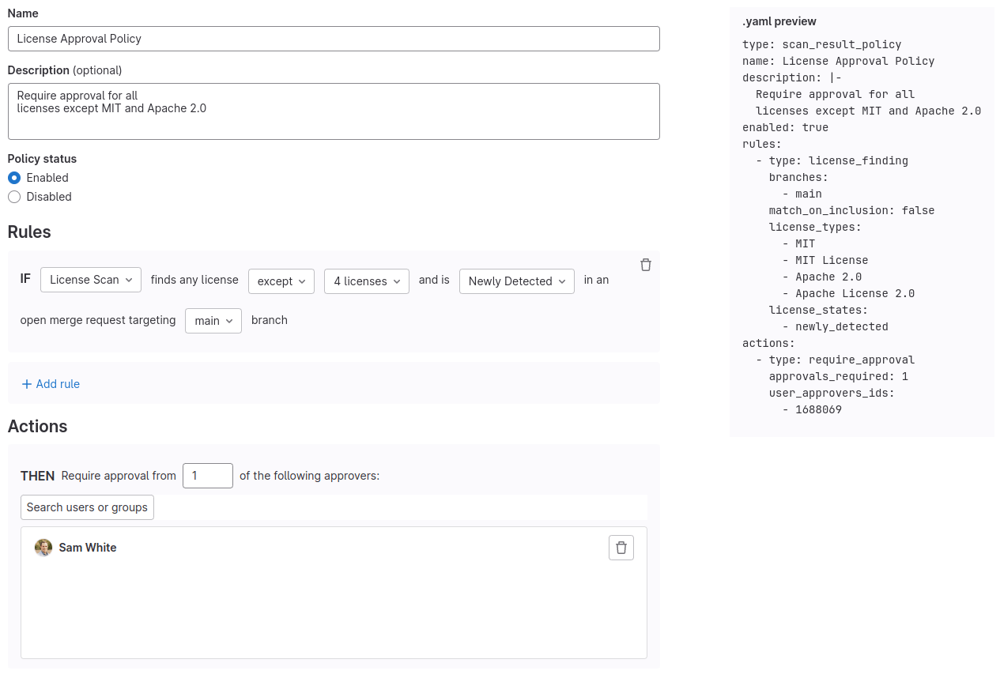
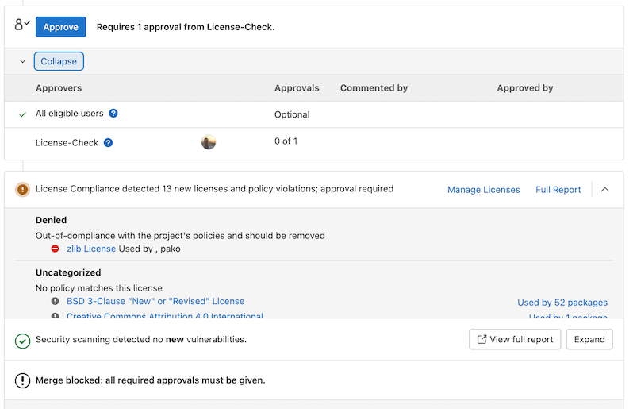



- Tier: 旗舰版
- Offering: JihuLab.com，私有化部署



使用许可证审批策略指定条件，以确定在合并合并请求之前何时需要审批。

许可证审批策略仅适用于[受保护](../project/repository/branches/protected.md)的目标分支。

以下视频概述了这些策略。

## 创建新许可证审批策略的先决条件

许可证审批策略依赖依赖项扫描作业的输出来验证是否满足要求。如果未正确配置依赖项扫描，因而没有与打开的合并请求相关的依赖项扫描作业运行，则该策略没有可用于验证要求的数据。当安全策略缺少用于评估的数据时，默认情况下它们会故障关闭，并假定该合并请求可能包含漏洞。您可以使用 `fallback_behavior` 属性选择退出默认行为，并将策略设置为故障打开。故障打开的策略会解除所有无效且无法执行的规则的阻止。

为确保策略得到执行，您应在目标开发项目上启用依赖项扫描。您可以通过以下几种不同方式实现：

- 创建[扫描执行策略](../application_security/policies/scan_execution_policies.md)，强制在所有目标开发项目中运行依赖项扫描。
- 与您的开发团队协作，在各项目的`.gitlab-ci.yml` 文件中配置[依赖项扫描](../application_security/dependency_scanning/_index.md)，或使用[安全配置](../application_security/detect/security_configuration.md)启用它。

许可证审批策略需要来自[极狐GitLab 支持的软件包](license_scanning_of_cyclonedx_files/_index.md#supported-languages-and-package-managers)的许可证信息。

## 创建新许可证审批策略

创建许可证审批策略以强制执行许可证合规。

创建许可证审批策略：

1. [将安全策略项目关联](../application_security/policies/enforcement/security_policy_projects.md#link-to-a-security-policy-project)到您的开发群组、子群组或项目（需要所有者角色）。
1. 在顶部栏中，选择**搜索或跳转到**，然后找到您的项目。
1. 在左侧边栏中，选择**安全** > **策略**。
1. 创建新的[合并请求审批策略](../application_security/policies/merge_request_approval_policies.md)。
1. 在您的策略规则中，选择**许可证扫描**。

## 定义哪些许可证需要审批的条件

以下类型的条件可用于确定哪些许可证为“已批准”或“已拒绝”并需要审批。

- 当检测到明确禁止的许可证列表中的任何许可证时。
- 当检测到任何许可证时，但明确列为可接受的许可证除外。

## 将合并请求分支中检测到的许可证与默认分支中的许可证进行比较的条件

以下类型的条件可用于根据默认分支中存在的许可证确定是否需要审批：

- 可以将已拒绝的许可证配置为仅当该已拒绝的许可证属于默认分支中尚不存在的依赖项时才需要审批。
- 可以将已拒绝的许可证配置为当该已拒绝的许可证存在于默认分支中已存在的任何组件中时需要审批。

如果发现违反许可证审批策略的许可证，它会阻止该合并请求并指示开发者将其移除。除非许可证审批策略的合格审批人批准该合并请求，否则在移除 `denied` 许可证之前，该合并请求无法合并。

## 故障排除

### 许可证审批策略因 `unknown` 许可证而阻止合并请求

在某些情况下，许可证审批策略可能因 `unknown` 许可证而阻止合并请求。

> [!note]
> 在 [`licenses` 字段](../application_security/policies/merge_request_approval_policies.md#licenses_with_package_exclusion-object)中使用 PURL 的软件包级排除
> 不适用于 `unknown` 许可证。`licenses` 字段仅支持 [SPDX 许可证名称](https://spdx.org/licenses)
> 匹配，而 `unknown` 不是有效的 SPDX
> 许可证名称。如果您配置了带 PURL 排除的已拒绝 `unknown` 许可证，则在合并请求审批评估期间会忽略该
> 排除，该合并请求
> 仍会被阻止。流水线的**许可证**标签页似乎遵循该排除，
> 但合并请求审批小组件不会。这些视图使用不同的评估
> 路径。

这可能发生在以下任一情况中：

- 依赖项扫描作业未能识别特定组件的许可证。
- 使用了扫描工具无法识别的新许可证或不常见的许可证。
- 组件的元数据中缺少许可证信息，或许可证信息不完整。

要解决此问题：

1. 查看流水线页面中的**许可证**标签页，以确定哪些组件具有
   `unknown` 许可证，或查看由极狐GitLab
   安全机器人生成的 `out-of-policy` 许可证。
1. 手动调查这些组件以确定其实际许可证。
1. 如果无法确定许可证或许可证不可接受，请移除或替换
   受影响的组件。

如果您需要临时允许使用 `unknown` 许可证进行合并：

1. 编辑您的许可证审批策略。
1. 将 `unknown` 添加到允许的许可证列表中。
1. 解决问题后，从允许的许可证列表中移除 `unknown`，以
   保持适当的许可证合规。

处理许可证合规问题时，请务必咨询您的法律团队，尤其是在处理 `unknown` 许可证时。
