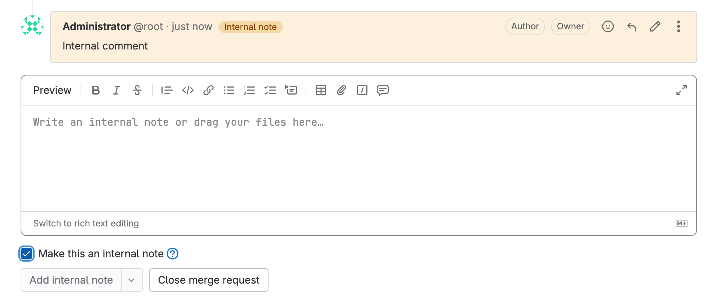
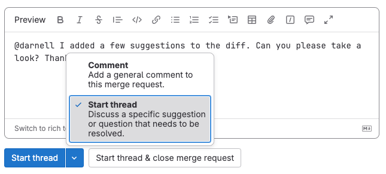



- Tier: 基础版，专业版，旗舰版
- Offering: JihuLab.com，私有化部署



极狐GitLab 鼓励通过评论、讨论串和[为代码建议更改](../project/merge_requests/reviews/suggestions.md)进行沟通。评论支持 [Markdown](../markdown.md) 和[快速操作](../project/quick_actions.md)。

有两种类型的评论：

- 标准评论。
- 讨论串中的评论，您可以[解决](../project/merge_requests/_index.md#manage-comment-threads)它。

您可以在提交差异评论中[建议代码更改](../project/merge_requests/reviews/suggestions.md)，用户可以通过用户界面接受这些更改。

## 可以添加评论的位置

您可以在以下位置创建评论：

- 提交差异。
- 提交。
- 设计。
- 史诗。
- 议题。
- 合并请求。
- 代码片段。
- 任务。
- OKR。
- Wiki 页面。

每个对象最多可以有 5,000 条评论。

## 提及

您可以在极狐GitLab 实例中使用 `@username` 或 `@groupname` 提及用户或群组（包括[子群组](../group/subgroups/_index.md#mention-subgroups)）。极狐GitLab 会通过待办事项和电子邮件通知所有被提及的用户。用户可以在[通知设置](../profile/notifications.md)中自行更改此设置。

您可以快速查看哪些评论与您有关，因为极狐GitLab 会以不同的颜色高亮显示对您自己（当前已认证用户）的提及。

当您在工作项或合并请求中提及某人时，他们将成为[参与者](../participants.md)。

### 提及所有成员

避免在评论和描述中提及 `@all`。`@all` 不仅会提及项目、议题或合并请求的参与者，还会提及该项目父群组的所有成员。所有这些用户都会收到电子邮件通知和待办事项，并可能将其视为垃圾信息。

在评论和描述中输入 `@all` 会显示为纯文本，而不会提及所有用户。在此更改之前 Markdown 文本中已有的 `@all` 提及保持不变，仍为链接。

您可以在[群组设置](../group/manage.md#disable-email-notifications)中禁用通知和提及。

### 在议题或合并请求中提及群组

当您在评论中提及某个群组时，该群组的每个成员都会在其待办事项列表中添加一个待办事项。

1. 在顶部栏中，选择**搜索或跳转到**，然后找到您的项目。
1. 转到您的合并请求或议题：
   - 对于合并请求，选择**代码** > **合并请求**，然后找到您的合并请求。
   - 对于议题，选择**计划** > **工作项**，然后找到您的议题。
1. 在评论中，输入 `@`，后跟用户、群组或子群组命名空间。
   例如，`@alex`、`@alex-team` 或 `@alex-team/marketing`。
1. 选择**评论**。

极狐GitLab 会为所有群组和子群组成员创建待办事项。

有关更多信息，请参阅[提及子群组](../group/subgroups/_index.md#mention-subgroups)。

## 向合并请求差异添加评论

当您向合并请求差异添加评论时，这些评论会保留，即使您：

- 在变基后强制推送。
- 修改提交。

要添加提交差异评论：

1. 在顶部栏中，选择**搜索或跳转到**，然后找到您的项目。
1. 在左侧边栏中，选择**代码** > **合并请求**，然后找到您的合并请求。
1. 选择**提交**选项卡，然后选择提交消息。
1. 开始评论：
   - 要对整个文件发表评论，请找到您要评论的文件，然后
     在文件标题中，选择**对此文件发表评论** ()。
   - 要对特定行发表评论，请找到您要评论的行号。将鼠标悬停在该行号上，
     然后选择**评论** ()。要选择更多行，
     请拖动**评论** () 图标。
     - 当评论表单出现时，您可以[更改所选行的范围](#edit-the-comment-line-range)。
1. 输入您的评论。
1. 提交您的评论：
   - 要立即添加评论，请选择**立即添加评论**，或使用键盘快捷键：
     - macOS：<kbd>Shift</kbd>+<kbd>Command</kbd>+<kbd>Enter</kbd>
     - 所有其他操作系统：<kbd>Shift</kbd>+<kbd>Control</kbd>+<kbd>Enter</kbd>
   - 要让评论在您完成评审之前保持未发布状态，请选择**开始评审**，或使用键盘快捷键：
     - macOS：<kbd>Command</kbd>+<kbd>Enter</kbd>
     - 所有其他操作系统：<kbd>Control</kbd>+<kbd>Enter</kbd>

该评论显示在合并请求的**概览**选项卡上。

该评论不会显示在您项目的**代码** > **提交**页面上。

> [!note]
> 当您的评论包含对合并请求中所含提交的引用时，
> 它会在合并请求的上下文中转换为链接。
> 例如，`28719b171a056960dfdc0012b625d0b47b123196` 会变为 `28719b17`，它链接到
> `https://gitlab.example.com/example-group/example-project/-/merge_requests/12345/diffs?commit_id=28719b171a056960dfdc0012b625d0b47b123196`。

### 编辑评论行范围

> [!flag]
> 此功能的可用性由功能标志控制。

在开启了[快速差异](../project/merge_requests/changes.md#rapid-diffs)的合并请求上，当您打开评论表单时，您可以更改评论适用的行。

您只能在首次创建评论时更改行范围。保存后该选项不可用。

要在打开评论表单后调整评论行范围：

1. 选择**编辑行范围** () 开始编辑。范围的第一行上会出现一个控制柄
   和一个取消按钮，最后一行上会出现另一个控制柄，
   该控制柄会获得焦点。
1. 使用鼠标或键盘调整范围。
   - 使用鼠标，将其中一个控制柄拖动到新行。
   - 使用键盘，请使用以下按键：

     | 按键 | 操作 |
     |-----|--------|
     | <kbd>Left</kbd> | 将焦点移到第一行控制柄。 |
     | <kbd>Right</kbd> | 将焦点移到最后一行控制柄。 |
     | <kbd>Up</kbd> | 将获得焦点的控制柄向上移到上一行可容纳评论的行。 |
     | <kbd>Down</kbd> | 将获得焦点的控制柄向下移到下一行可容纳评论的行。 |
     | <kbd>Enter</kbd> | 确认新范围。 |
     | <kbd>Escape</kbd> | 取消编辑并保留之前的范围。 |

控制柄不能越过差异中的节分隔符，该分隔符用 `@@` 语法表示。要跨节发表评论，请在每个节中分别添加评论。

## 通过发送电子邮件回复评论

如果您配置了[“通过电子邮件回复”](../../administration/reply_by_email.md)，您可以通过发送电子邮件回复评论。

- 当您回复标准评论时，会创建另一条标准评论。
- 当您回复讨论串中的评论时，会在该讨论串中创建一条回复。
- 当您[向议题电子邮件地址发送电子邮件](../project/issues/managing_issues.md#copy-issue-email-address)时，
  会创建一条标准评论。

您可以在电子邮件回复中使用 [Markdown](../markdown.md) 和[快速操作](../project/quick_actions.md)。

### 评论回复过期

创建标准评论或讨论串评论的电子邮件回复受两年[保留策略](../../administration/reply_by_email.md#retention-policy-for-notifications)约束。

## 编辑评论

您可以随时编辑自己的评论。任何拥有维护者或所有者角色的人也可以编辑他人发表的评论。

要编辑评论：

1. 在评论上，选择**编辑评论** ()。
1. 进行编辑。
1. 选择**保存更改**。

### 编辑评论以添加提及

默认情况下，当您提及用户时，极狐GitLab 会为他们[创建待办事项](../todos.md#actions-that-create-to-do-items)，并向他们发送[通知电子邮件](../profile/notifications.md)。

如果您编辑现有评论以添加之前不存在的用户提及，极狐GitLab 会：

- 为被提及的用户创建待办事项。
- 向被提及的用户发送通知电子邮件。

## 通过锁定讨论阻止评论

您可以阻止议题或合并请求中的公开评论。这样做后，只有项目成员可以添加和编辑评论。

先决条件：

- 在合并请求中，您必须拥有开发者、维护者或所有者角色。
- 在议题中，您必须拥有计划者、报告者、开发者、维护者或所有者角色。

要锁定议题或合并请求：

1. 在顶部栏中，选择**搜索或跳转到**，然后找到您的项目。
1. 转到您的合并请求或议题：
   - 对于合并请求，选择**代码** > **合并请求**，然后找到您的合并请求。
   - 对于议题，选择**计划** > **工作项**，然后找到您的议题。
1. 在右上角，选择**合并请求操作**或**议题操作**
   ()，然后选择**锁定讨论**。

极狐GitLab 会在页面详情中添加一条系统评论。

在重新打开已关闭的议题或合并请求之前，您必须解锁其中所有已锁定的讨论。

## 对机密条目的评论

只有有权访问机密条目的用户才会收到该条目评论的通知。如果该条目之前不是机密的，没有访问权限的用户可能会显示为参与者。当该条目为机密时，这些用户不会收到通知。

可以收到通知的用户：

- 分配给该条目的用户，无论其角色如何。
- 创建该条目的用户，前提是他们拥有访客、计划者、报告者、开发者、维护者或所有者角色。
- 在该条目所属群组或项目中拥有计划者、报告者、开发者、维护者或所有者角色的用户。

## 添加内部评论

使用内部评论来保护添加到公开议题、史诗、Wiki 页面或合并请求中的信息。内部评论与公开评论不同：

- 只有至少拥有报告者角色的项目成员才能查看内部评论。
- 您无法将内部评论转换为常规评论。
- 对内部评论的所有回复也是内部的。
- 内部评论会显示**内部评论**徽章，并以与公开评论不同的
  颜色显示：

先决条件：

- 您必须拥有该项目的报告者、开发者、维护者或所有者角色。

要添加内部评论：

1. 在议题、史诗、Wiki 页面或合并请求上，在**评论**文本框中输入评论。
1. 在评论下方，选择**将此设为内部评论**。
1. 选择**添加内部评论**。

您也可以将整个[议题标记为机密](../project/issues/confidential_issues.md)，或创建[机密合并请求](../project/merge_requests/confidential.md)。

## 仅显示评论

在包含许多评论的讨论中，筛选讨论以仅显示评论或更改历史（[系统评论](../project/system_notes.md)）。系统评论包括描述更改、其他极狐GitLab 对象中的提及，或标记、指派人和里程碑的更改。极狐GitLab 会保存您的偏好，并将其应用于您查看的每个议题、合并请求或史诗。

1. 在合并请求、议题或史诗上，选择**概览**选项卡。
1. 在页面右侧，从**排序或筛选**下拉列表中，选择一个筛选条件：
   - **显示所有活动**：显示所有用户评论和系统评论。
   - **仅显示评论**：仅显示用户评论。
   - **仅显示历史**：仅显示活动评论。

## 更改活动排序顺序

反转默认顺序，并以最新条目位于顶部的排序方式与活动动态交互。极狐GitLab 会将您的偏好保存在本地存储中，并将其应用于您查看的每个议题、合并请求或史诗。议题和史诗共享相同的排序偏好，而合并请求则保持各自独立的偏好。

要更改活动排序顺序：

1. 打开一个议题，或在合并请求或史诗中打开**概览**选项卡。
1. 向下滚动到**活动**标题。
1. 在页面右侧，更改排序顺序：
   - **议题和史诗**：从**排序或筛选**下拉列表中，选择**最新优先**或**最早优先**（默认）。
   - **合并请求**：使用排序方向箭头按钮在**排序方向：升序**（最早优先，默认）或**排序方向：降序**（最新优先）之间切换。

## 查看描述更改历史



- Tier: 专业版，旗舰版
- Offering: JihuLab.com，私有化部署



您可以在历史记录中查看描述的更改。

要比较更改，请选择**与上一版本比较**。

## 将议题指派给发表评论的用户

您可以将议题指派给发表评论的用户。

1. 在评论中，选择**更多操作** () 菜单。
1. 选择**指派给评论作者**。
1. 要取消指派评论者，请再次选择该按钮。

## 通过回复标准评论创建讨论串

当您回复标准评论时，您会创建一个讨论串。

先决条件：

- 您必须拥有访客、计划者、报告者、开发者、维护者或所有者角色。
- 您必须位于议题、合并请求或史诗中。不支持提交和代码片段中的讨论串。

要通过回复评论创建讨论串：

1. 在评论的右上角，选择**回复评论** ()
   以显示回复区域。
1. 输入您的回复。
1. 选择**回复**或**立即添加评论**（取决于您在 UI 中的回复位置）。

极狐GitLab 会将顶部评论转换为讨论串。

## 不回复评论创建讨论串

您可以在不回复标准评论的情况下创建讨论串。

先决条件：

- 您必须拥有访客、计划者、报告者、开发者、维护者或所有者角色。
- 您必须位于议题、合并请求、提交或代码片段中。

要创建讨论串：

1. 输入评论。
1. 在评论下方，**评论**的右侧，选择向下箭头 ()。
1. 从列表中，选择**开始讨论串**。
1. 再次选择**开始讨论串**。

## 解决讨论串

当对话完成时，您可以解决该讨论串。已解决的讨论串会被折叠，但用户仍然可以添加评论。

已解决的讨论串稍后可以由任何有权解决讨论串的用户重新打开。要重新打开已解决的讨论串，请展开该讨论串并选择**重新打开讨论串**。

先决条件：

- 您必须位于史诗、议题、任务、目标、关键结果或合并请求中。
- 您必须拥有开发者、维护者或所有者角色，或者是该议题或合并请求的作者。

要解决讨论串：

1. 转到该讨论串。
1. 执行以下操作之一：
   - 在原始评论的右上角，选择**解决讨论串** ()。
   - 在最后一条回复下方，在**回复**字段中，选择**解决讨论串**。
   - 在最后一条回复下方，在**回复**字段中，输入文本，选中**解决讨论串**复选框，然后选择**立即添加评论**。

可以执行相同的操作来重新打开讨论串。

合并请求提供更灵活的[讨论串管理选项](../project/merge_requests/_index.md#manage-comment-threads)，例如：

- 将未解决的讨论串移动到新议题。
- 在所有讨论串解决之前阻止合并。

## 使用极狐GitLab Duo Chat 总结议题讨论



- Tier: 专业版，旗舰版
- Add-on: 极狐GitLab Duo Enterprise、极狐GitLab Duo with Amazon Q
- Offering: JihuLab.com，私有化部署





- [默认 LLM](../gitlab_duo/model_selection.md#default-models)
- Amazon Q 的 LLM：Amazon Q Developer
- 适用于[自部署模型的极狐GitLab Duo](../../administration/gitlab_duo_self_hosted/_index.md)



生成议题讨论的摘要。

先决条件：

- 您必须拥有查看该议题的权限。

要生成议题讨论摘要：

1. 在议题中，滚动到**活动**部分。
1. 选择**查看摘要**。

议题中的评论最多会总结为 10 个列表项。您可以基于该回答提出后续问题。

数据使用：当您使用此功能时，议题上所有评论的文本都会发送到大语言模型。
