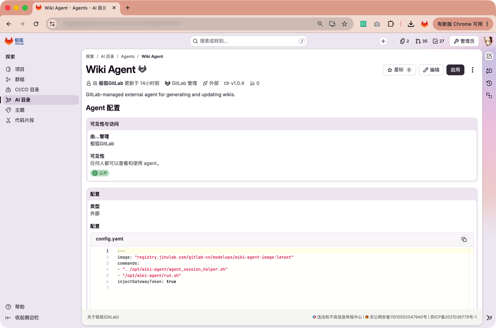
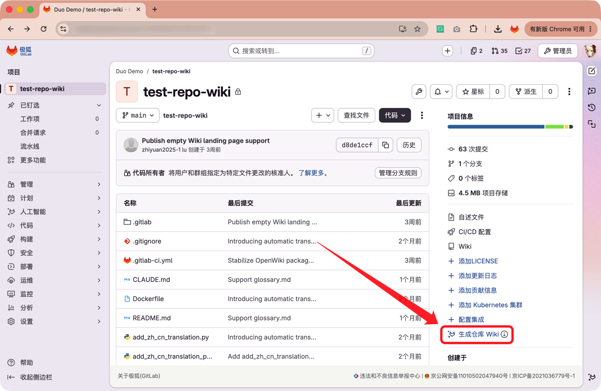



- Tier: 专业版，旗舰版
- Offering: JihuLab.com，私有化部署





- [极狐GitLab Duo Agent Platform 模型选择](../model_selection.md)





- Wiki Agent 在极狐GitLab 19.4 中 [引入](https://jihulab.com/gitlab-cn/gitlab/-/merge_requests/3801)。
- 从项目概览页生成仓库 Wiki 的操作在极狐GitLab 19.4 中
  [引入](https://jihulab.com/gitlab-cn/gitlab/-/merge_requests/3802)。



Wiki Agent 是由极狐GitLab 维护的外部 Agent。它分析当前项目的代码仓库，并在同一项目的 Wiki 中生成或更新仓库文档。

Wiki Agent 作为 CI/CD 作业在 Runner 上运行。



## 配置 Wiki Agent

配置 Wiki Agent 后，项目成员可以从项目概览页生成仓库 Wiki。

先决条件：

- 您必须具有项目的维护者或所有者角色。
- 您必须满足[极狐GitLab Duo Agent Platform 先决条件](../_index.md#prerequisites)。
- 平台和项目必须开启 **允许任务流执行**。
- 顶级群组必须开启 **允许外部代理**。
- 项目必须启用 Wiki。
- 极狐GitLab Duo Agent Platform 必须可以连接 AI 网关。
- 项目必须有可用的 Runner，该 Runner 具有 `gitlab--duo` 标签并支持运行容器镜像。

在 JihuLab.com 上，顶级群组所有者可以在 **设置** > **极狐GitLab Duo** >
**更改配置** 中开启 **允许外部代理**。
在私有化部署上，实例管理员必须先开启任务流执行，然后顶级群组所有者在
**设置** > **通用** > **极狐GitLab Duo 功能** 中开启 **允许外部代理**。

要配置 Wiki Agent：

1. 在顶部栏中，选择 **搜索或跳转到** > **探索**。
1. 选择 **AI 目录**，然后选择 **Agents** 标签页。
1. 选择由极狐GitLab 维护的 **Wiki Agent**。
   您自己创建的同名 Agent 无法用于项目概览页中的 Wiki 生成功能。
1. 在右上角，选择 **启用**。
1. 在 **项目** 中，选择要使用 Wiki Agent 的项目。
1. 选择 **启用**。

## 生成项目 Wiki

使用 Wiki Agent 根据当前项目的代码仓库生成或更新项目 Wiki。

先决条件：

- 您必须具有项目的开发者、维护者或所有者角色，并拥有创建 Wiki 和运行任务流的权限。
  群组或自定义角色设置可能进一步限制这些权限。
- 项目必须启用 Wiki。
- 项目必须启用由极狐GitLab 维护的 Wiki Agent。

要生成项目 Wiki：

1. 打开项目的概览页。
1. 在右下角选择 **生成仓库 Wiki**。



极狐GitLab 启动 Wiki Agent 后，会直接转到新会话。您也可以选择 **人工智能** > **会话** 查看运行状态。会话完成后，回到项目概览页，点击右侧的 **Wiki** 查看生成项目 Wiki。

## 模型和凭据

Wiki Agent 支持极狐GitLab 提供的模型，并使用极狐GitLab Duo Agent Platform 的模型选择。

AI 网关令牌由平台自动注入 Wiki Agent 的作业。您无需在项目的 CI/CD 变量中添加模型提供商 API 密钥。

## 故障排查

### “生成仓库 Wiki”按钮不可见

如果项目概览页中没有 **生成仓库 Wiki** 按钮，请确认：

- 您使用个人账号登录，而不是服务账号或机器人账号。
- 您具有项目的开发者、维护者或所有者角色，并拥有创建 Wiki 和运行任务流的权限。
- 平台和项目已开启 **允许任务流执行**，顶级群组已开启 **允许外部代理**。
- 项目已启用 Wiki。
- 项目已启用由极狐GitLab 维护的 Wiki Agent。
- Wiki Agent 在该项目中具有处于启用状态的触发器。

具有相同名称的自定义 Agent 不会显示该按钮。

### AI 目录中没有 Wiki Agent

升级已有极狐GitLab 维护的外部 Agent 的私有化部署实例时，升级过程会自动补充 Wiki Agent。

如果私有化部署实例从未初始化极狐GitLab 维护的外部 Agent，请让管理员使用
[AI Catalog Rake 任务](../../../administration/raketasks/ai_catalog.md#seed-ai-catalog-external-agents)
填充外部 Agent。
完成任务后，在 **AI 目录** 中搜索名称完全匹配的 **Wiki Agent**。
SaaS（JihuLab.com）用户无法运行此 Rake 任务。

### Wiki Agent 会话一直处于等待状态

Wiki Agent 的作业需要可用的 CI/CD Runner。
请确认 Runner：

- 处于在线状态并可用于该项目。
- 具有 `gitlab--duo` 标签。
- 使用支持运行 `registry.jihulab.com/gitlab-cn/modelops/wiki-agent-image:latest` 镜像的执行器。
- 可以访问容器镜像仓库和 AI 网关。

有关 Runner 配置，请参阅
[配置 Runner 以执行流程](../flows/execution/_index.md#configure-runners-to-execute-flows)。

### Wiki Agent 作业无法下载镜像

在纯离线环境中，如果 Runner 尝试从公网拉取默认镜像，
作业可能在执行脚本前因镜像下载失败而停止。
默认镜像为 `registry.jihulab.com/gitlab-cn/modelops/wiki-agent-image:latest`。

先准备 Runner 可以拉取的内网镜像：

1. 在联网环境中为 Runner 的架构拉取默认镜像，再将镜像导入内网镜像仓库。
1. 在 Runner 侧[配置内网镜像仓库的认证](../../../ci/docker/using_docker_images.md#access-an-image-from-a-private-container-registry)。

在使用 Linux 软件包安装的极狐GitLab 服务器上，打开 Rails 控制台：

```shell
sudo gitlab-rails console
```

对于源码安装，请参阅[使用 Rails 控制台](../../../administration/operations/rails_console.md)。

将以下代码中的 `image` 替换为已准备好的内网镜像地址，然后在 Rails 控制台中运行它： 

```ruby
image = 'registry.example.com/ai/wiki-agent:offline'

agent = Ai::Catalog::Item.not_deleted.for_project(nil).where(
  item_type: :third_party_flow,
  verification_level: :gitlab_maintained,
  name: 'Wiki Agent'
).sole
new_version = nil

agent.with_lock do
  source = agent.latest_version
  raise 'Latest version is not released' unless source&.released?

  definition = source.definition.deep_dup
  definition['image'] = image
  yaml = definition.fetch('yaml_definition')
  entries = YAML.parse(yaml).root.children.each_slice(2)
  node = entries.find { |key, _| key.value == 'image' }&.last
  unless node.is_a?(Psych::Nodes::Scalar) && node.start_line == node.end_line
    raise 'Expected a single-line image value in YAML'
  end

  lines = yaml.lines
  lines[node.start_line][node.start_column...node.end_column] = image.to_json
  definition['yaml_definition'] = lines.join
  new_version = agent.build_new_version(
    version: agent.next_version_number(bump_level: :patch),
    schema_version: source.schema_version,
    definition: definition,
    release_date: Time.current
  )
  new_version.save!
  agent.update!(
    latest_version: new_version,
    latest_released_version: new_version
  )
end

puts [
  agent.id,
  new_version.version,
  new_version.definition['image']
]
```

执行完毕后，在项目中执行以下操作：

1. 选择 **人工智能** > **Agents** > **Wiki Agent**。
1. 在新版本提示中，选择 **更新**。
1. 从项目概览页启动新会话。
