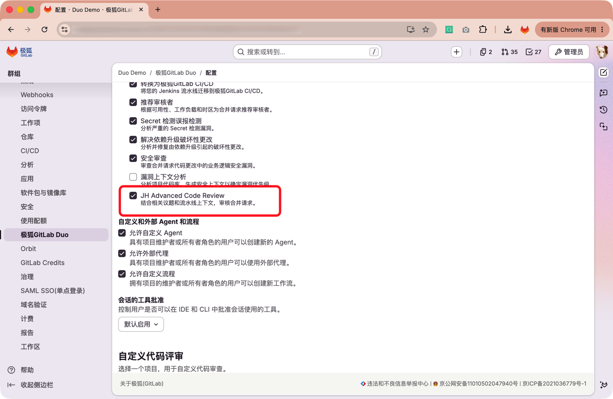



- Tier: 专业版，旗舰版
- Offering: JihuLab.com，私有化部署
- Status: 实验





- [引入](https://jihulab.com/gitlab-cn/gitlab/-/merge_requests/3685)于极狐GitLab 19.3。



极狐增强版 Code Review Flow 在用户界面中显示为 **JH Advanced Code Review**。
它是极狐GitLab Duo Agent Platform 的内置任务流。
它在评审合并请求时，除分析代码差异和代码仓库上下文外，
还会读取相关议题和流水线失败信息，并以简体中文发布行评论、评审摘要和审核结论。

该任务流会先读取已有讨论，避免重复发布相同的发现结果。
对于已经修复的问题，它可以回复并解决相应讨论。
对于仍然存在的问题，它会保留讨论，并发布新增发现结果和评审摘要。

<a id="prerequisites"></a>

## 先决条件

要使用 JH Advanced Code Review：

- 满足[极狐GitLab Duo Agent Platform 的先决条件](../../_index.md#prerequisites)。
- 对项目具有开发者、维护者或所有者角色。
- 为顶级群组[开启任务流执行和内置任务流](_index.md#turn-foundational-flows-on-or-off)，
  并开启 **JH Advanced Code Review**。
- 为项目配置带有 `gitlab--duo` 标签且使用支持 Docker 镜像的执行器的
  [Runner](../execution/_index.md#configure-runners-to-execute-flows)，或开启极狐GitLab 托管 Runner。
- 对于极狐GitLab 私有化部署，配置支持 JH Advanced Code Review 的极狐GitLab Duo AI 网关。

项目会继承顶级群组的内置任务流设置。
开启任务流后，极狐GitLab 会准备名为 **JihuLab Duo** 的服务账号。
该账号的基础用户名为 `JihuLabDuo`。
如果该用户名已被占用，实际用户名会包含用于确保唯一性的后缀。
以下示例使用基础用户名。如果服务账号的实际用户名不同，请使用实际用户名。

<a id="turn-on-jh-advanced-code-review"></a>

## 开启 JH Advanced Code Review

顶级群组所有者可以为群组及其项目开启此任务流。

### 在 JihuLab.com 上开启任务流

要开启 JH Advanced Code Review：

1. 在顶部栏中，选择**搜索或跳转到**并找到您的顶级群组。
1. 选择**设置** > **极狐GitLab Duo**。
1. 选择**更改配置**。
1. 在**任务流执行**下，选中**允许任务流执行**和**允许内置任务流**。
1. 选中 **JH Advanced Code Review**。
1. 选择**保存更改**。



### 在极狐GitLab 私有化部署上开启任务流

实例管理员必须先为实例开启任务流执行和内置任务流。
然后，顶级群组所有者必须为顶级群组选择 **JH Advanced Code Review**。

有关实例和群组设置步骤，请参阅
[在极狐GitLab 私有化部署上开启内置任务流](_index.md#on-gitlab-self-managed)。

<a id="request-a-complete-review"></a>

## 启动完整审查

在创建合并请求后，您可以请求一次完整审查。

要启动完整审查：

1. 在左侧边栏中，选择**代码** > **合并请求**，然后打开合并请求。
1. 使用以下任一方式请求审核：
   - 在右侧边栏的**审核人**中，将 `@JihuLabDuo` 指派为审核人。
   - 在评论框中输入 `/assign_reviewer @JihuLabDuo`，然后发布评论。
1. 要查看任务流进度，请在左侧边栏中选择**人工智能** > **会话**。

审查完成后，返回合并请求概览查看评审摘要和讨论。
在合并请求的**变更**中，查看对应代码行上的评审意见。

要在后续提交后重新审查合并请求，请在 JihuLab Duo 审核人旁选择**重新请求审核**。

<a id="ask-follow-up-questions"></a>

## 追问评审结果

在 JihuLab Duo 发布评审结果后，您可以在现有讨论中提及服务账号并提出后续问题。
提及服务账号只回复当前讨论，不会启动新的完整审查。

例如，在包含评审意见的讨论中输入：

```plaintext
@JihuLabDuo 请解释这条审查意见。
```

任务流会读取该讨论中的已有评论，并按需读取相关文件或议题，然后回复当前讨论。

<a id="usage-and-model"></a>

## 用量和模型

JH Advanced Code Review 按极狐GitLab Duo Agent Platform 的实际用量消耗 Credits，
而不是按审查次数收取固定用量。
实际用量取决于合并请求的大小、可用上下文和任务流调用模型的次数。

此任务流使用为极狐GitLab Duo Agent Platform 配置的模型。
群组所有者或实例管理员可以[选择 Agent Platform 使用的模型](../../model_selection.md)。
极狐GitLab Duo 代码评审或 Agentic 代码评审的模型设置不控制此任务流。

<a id="troubleshooting"></a>

## 故障排查

### JihuLab Duo 未出现在审核人列表中

确认顶级群组已开启任务流执行、内置任务流和 **JH Advanced Code Review**。
如果设置已经开启，请等待服务账号创建完成，再刷新合并请求。

### 审查未启动

确认您已将 JihuLab Duo 指派为审核人，或使用 `/assign_reviewer` 快速操作请求审核。
仅在评论中提及 `@JihuLabDuo` 会启动追问流程，不会启动完整审查。

如果任务流会话已创建但未开始运行，请确认项目中有可用的 Runner，
并且该 Runner 具有 `gitlab--duo` 标签和支持 Docker 镜像的执行器。
