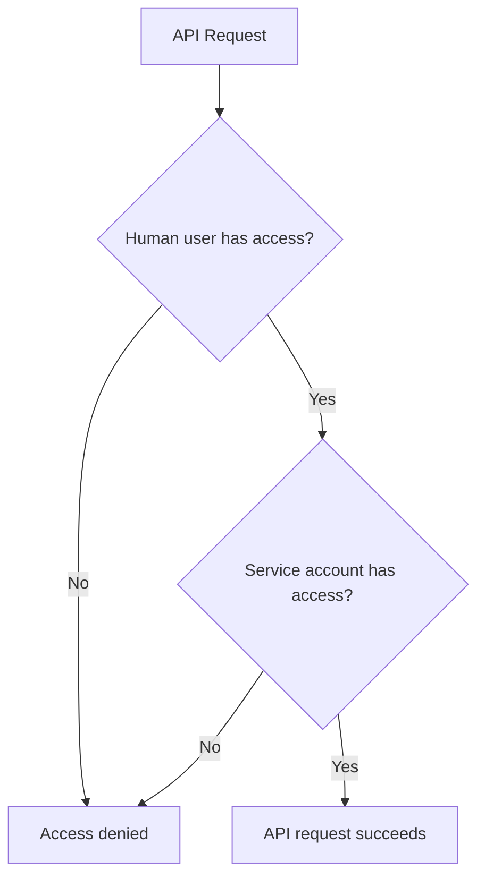



- Tier: 旗舰版
- Add-on: GitLab Duo with Amazon Q
- Offering: 私有化部署



> [!note]
> GitLab Duo with Amazon Q 不能与其他极狐GitLab Duo 附加组件组合使用。

在 re:Invent 2024 上，Amazon 宣布了 GitLab Duo with Amazon Q 集成。
通过此集成，您可以自动执行任务并提高工作效率。

GitLab Duo with Amazon Q：

- 可以在议题和合并请求中执行各种任务。
- [包含许多其他极狐GitLab Duo 功能](../gitlab_duo/feature_summary.md)。

如需查看点击式演示，请参阅 [GitLab Duo with Amazon Q 产品导览](https://gitlab.navattic.com/duo-with-q)。
<!-- Demo published on 2025-04-23 -->

如需获取 GitLab Duo with Amazon Q 订阅，请联系您的客户经理。

或者，如需申请试用，[请填写此表单](https://about.gitlab.com/partners/technology-partners/aws/#form)。

## 设置 GitLab Duo with Amazon Q

当您拥有 GitLab Duo with Amazon Q 订阅且使用极狐GitLab 17.11 或更高版本时，您可以
[在您的实例上设置 GitLab Duo with Amazon Q](setup.md)。

## 在议题中使用 GitLab Duo with Amazon Q

要为议题调用 GitLab Duo with Amazon Q，您将使用[快速操作](../project/quick_actions.md)。

### 将想法转化为合并请求

将议题中的想法转化为包含建议实现的合并请求。

Amazon Q 使用议题标题和描述以及项目上下文，创建一个包含用于解决该议题的代码的合并请求。

#### 从议题描述中

1. 创建新议题，或打开现有议题，然后在右上角选择**编辑**。
1. 在描述框中，输入 `/q dev`。
1. 选择**保存更改**。

#### 从评论中

1. 在议题的评论中，输入 `/q dev`。
1. 选择**评论**。

### 升级 Java

Amazon Q 可以分析 Java 8 或 11 代码，并确定将代码更新到 Java 17 所需的 Java 更改。

[查看演练](https://gitlab.navattic.com/duo-q-transform)。

先决条件：

- 您必须[为项目配置 Runner 和 CI/CD 流水线](../../ci/_index.md)。
- 您的 `pom.xml` 文件必须具有 [source 和 target](https://maven.apache.org/plugins/maven-compiler-plugin/examples/set-compiler-source-and-target.html)。

要升级 Java：

1. 创建一个议题。
1. 在议题标题和描述中，说明您想要升级 Java。
   您无需输入版本详细信息。Amazon Q 可以确定版本。
1. 保存议题。然后，在评论中，输入 `/q transform`。
1. 选择**评论**。

CI/CD 作业启动。系统会显示一条评论，其中包含详细信息以及指向该作业的链接。

- 如果作业成功，则会创建一个包含升级所需代码更改的合并请求。
- 如果作业失败，评论会提供有关潜在修复方法的详细信息。

## 在合并请求中使用 GitLab Duo with Amazon Q

要为合并请求调用 GitLab Duo with Amazon Q，您将使用[快速操作](../project/quick_actions.md)。

### 评审合并请求

Amazon Q 可以分析您的合并请求并针对您的代码提出改进建议。它可以发现安全问题、质量问题、效率低下以及其他错误。

[您可以设置 Amazon Q 在您打开或重新打开合并请求时自动评审](setup.md#enter-the-arn-in-gitlab-and-enable-amazon-q)，也可以手动启动评审。

要手动启动：

1. 打开您的合并请求。
1. 在**概览**标签页的评论中，输入 `/q review`。
1. 选择**评论**。

Amazon Q 会对合并请求的更改执行评审，并在评论中显示结果。

### 根据反馈进行代码更改

Amazon Q 可以根据审核人反馈进行代码更改。

1. 打开一个有审核人反馈的合并请求。
1. 在**概览**标签页中，转到您想要处理的评论。
1. 在该评论下方，在**回复**框中，输入 `/q dev`。
1. 选择**立即添加评论**。

Amazon Q 会根据审核人的评论和反馈，对合并请求提出更改建议。

### 生成单元测试

使用 Amazon Q 为您的代码生成新的单元测试。

#### 从议题中

1. 创建一个议题。
1. 使用以下选项之一请求为您的代码生成测试：
   - 在议题描述中，描述您的请求并选择**保存更改**。
   - 在评论中，输入 `/q dev` 并选择**评论**。

Amazon Q 会创建一个包含建议测试的合并请求。

#### 从合并请求中

1. 打开您的合并请求。
1. 在**更改**标签页中，在您想要添加测试的位置留下行内评论。在反馈中
   尽可能包含详细信息，例如文件名、类名和行号。
1. 在评论中，在新的一行输入 `/q dev` 并选择**立即添加评论**。

Amazon Q 会使用建议的测试更新合并请求。

## 身份验证和授权

GitLab Duo with Amazon Q 使用复合身份来验证请求。

> [!note]
> 产品其他区域对复合身份的支持
> 已在[议题 511373](https://gitlab.com/gitlab-org/gitlab/-/issues/511373)中提出。

用于验证请求的令牌由两个身份组合而成：

- 主要作者，即 Amazon Q [服务账号](../profile/service_accounts.md)。
  此服务账号是实例范围的，并在使用 Amazon Q 快速操作的项目上具有开发者角色。该服务账号是令牌的所有者。
- 次要作者，即提交快速操作的人类用户。
  此用户的 `id` 包含在令牌的范围内。

此复合身份可确保 Amazon Q 发起的任何活动都正确归属于 Amazon Q 服务账号。同时，复合身份可确保人类用户不会发生[权限提升](https://en.wikipedia.org/wiki/Privilege_escalation)。

此[动态范围](https://github.com/doorkeeper-gem/doorkeeper/pull/1739)会在 API 请求授权期间进行检查。当请求授权时，极狐GitLab 会验证服务账号和发起快速操作的用户是否都具有足够的权限。

<!-- Video published on 2025-05-30 -->
