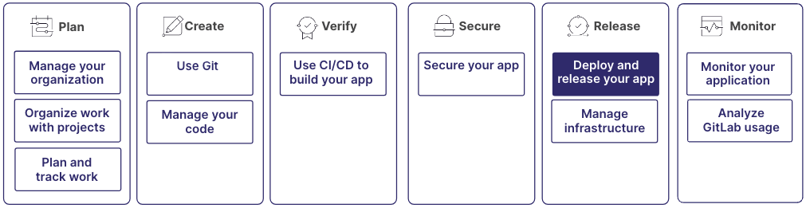

从预览应用程序开始，到将其部署到生产环境并呈现给用户为止。管理容器和软件包，使用持续集成来交付应用程序，并使用功能标志和增量发布以可控的方式发布应用程序。

这些流程属于一个更大的工作流：

## 第 1 步：存储并访问项目的产物

使用软件包和仓库，在极狐GitLab 中安全地存储和分发项目的依赖项、库及其他产物。

软件包仓库支持多种软件包格式，包括 Maven、NPM、NuGet、PyPI 和 Conan。它提供了一个集中位置，用于跨项目存储和分发软件包。将软件包仓库与极狐GitLab CI/CD 流水线集成，以自动执行软件包发布，并确保开发和部署工作流顺畅。

容器镜像仓库用作 Docker 镜像的私有仓库。使用它可以在您的组织内或公开地存储、管理和分发 Docker 和 OCI 镜像。将容器镜像仓库与极狐GitLab CI/CD 集成，以构建、测试和部署容器化应用程序。

更多信息，请参见：

- [软件包和仓库](../packages/_index.md)

## 第 2 步：跨环境部署应用程序

使用环境来管理和跟踪应用程序在不同阶段（例如开发、预发布和生产）的部署。每个环境都可以有自己的独特配置、变量和部署设置。

设置好环境后，您可以对其进行监控。虽然您主要在部署位置（例如在 AWS 中）监控部署，但极狐GitLab 也提供仪表板。如果部署到 Kubernetes，您可以在极狐GitLab UI 中监控实时集群状态。

您还可以在合并请求中创建临时环境。这样，团队成员就可以在将更改提交到主分支之前对其进行评审和测试。这些临时环境称为审查应用。

更多信息，请参见：

- [环境](../../ci/environments/_index.md)
- [部署到 AWS](../../ci/cloud_deployment/_index.md)
- [部署到 Kubernetes](../clusters/agent/_index.md)
- [Kubernetes 仪表板](../../ci/environments/kubernetes_dashboard.md)
- [环境仪表板](../../ci/environments/environments_dashboard.md)
- [运维仪表板](../operations_dashboard/_index.md)
- [审查应用](../../ci/review_apps/_index.md)

## 第 3 步：通过持续交付功能保持合规

为防止意外或未经授权的部署，从而维护生产系统的稳定性和完整性，请使用受保护环境。受保护环境提供了一种方式来保护和控制对生产等关键环境的部署。通过定义受保护环境，您可以限制对特定用户或角色的访问，确保只有获得授权的人员才能部署更改。

部署安全是持续交付流水线的一部分，有助于确保部署的可靠性和安全性。极狐GitLab 提供内置的安全机制，例如在部署失败时自动回滚，以及定义自定义健康检查以验证部署是否成功的能力。

部署审批为您的部署流程增加了一层额外的控制和协作。您可以定义审批规则，要求指定的审批人在部署可以继续之前对其进行评审和批准。审批可以根据不同的标准设置，例如环境、分支或正在部署的特定更改。

更多信息，请参见：

- [受保护环境](../../ci/environments/protected_environments.md)
- [部署安全](../../ci/environments/deployment_safety.md)
- [部署审批](../../ci/environments/deployment_approvals.md)

## 第 4 步：将发布产物交付给公开或内部用户

使用发布功能将应用程序打包并分发给最终用户，包括发布说明、二进制资产和其他相关信息。您可以从任何分支创建发布。

将发布与环境集成，以便每当您部署到特定环境（例如生产环境）时自动创建发布。您可以在每次发布时收到通知，并且如果您想控制谁可以创建、更新和删除发布，可以指定权限。

更多信息，请参见：

- [发布](../project/releases/_index.md)

## 第 5 步：安全地发布更改

要将应用程序逐步部署到一部分用户或服务器，请使用增量发布。在向整个用户群发布之前，您可以先在较小范围内监控和评估影响。

极狐GitLab 中的功能标志提供了一种在应用程序中启用或禁用特定功能的方式，而无需进行完整部署。您可以使用功能标志安全地测试新功能、执行 A/B 测试，或逐步向用户引入更改。

通过使用功能标志，您可以将代码部署与功能发布解耦，从而更好地控制用户体验，并降低引入缺陷或意外行为的风险。

更多信息，请参见：

- [增量发布](../../ci/environments/incremental_rollouts.md)
- [功能标志](../../operations/feature_flags.md)

## 第 6 步：部署静态网站

借助 GitLab Pages，您可以展示项目的文档、演示或营销页面。直接从极狐GitLab 中的代码仓库创建静态网站。GitLab Pages 支持 Jekyll、Hugo 和 Middleman 等静态站点生成器，以及纯 HTML、CSS 和 JavaScript。要开始使用，请创建一个新项目或使用现有项目，配置 GitLab Pages 设置，并将内容推送到代码仓库。每当您将更改推送到指定分支时，极狐GitLab 都会自动构建并部署您的网站。

更多信息，请参见：

- [GitLab Pages](../project/pages/_index.md)

## 第 7 步：使用 Auto Deploy 的预设部署方案

Auto Deploy 是一个采用预设方案的 CI 模板，除其他事项外，它还负责构建和部署您的应用程序。您可以使用环境变量微调 Auto DevOps 流水线。

更多信息，请参见：

- [Auto Deploy](../../topics/autodevops/stages.md#auto-deploy)
