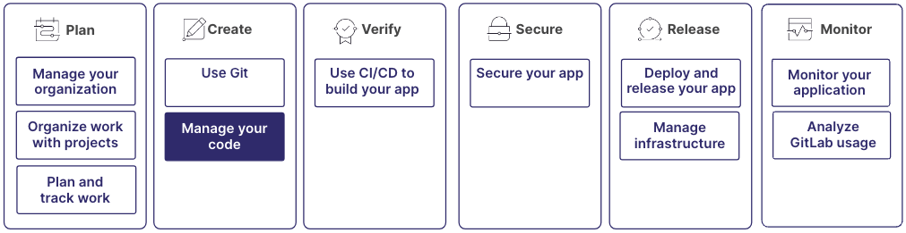

极狐GitLab 提供覆盖整个软件开发生命周期的工具，从代码创建到交付。

进一步了解如何在极狐GitLab 中创建和管理代码。该流程包括编写代码、进行代码评审、通过版本控制提交代码，并随时间推移持续更新。

此流程是更大工作流的一部分：

## 第 1 步：创建代码仓库

项目是一个集中的位置，您可以在这里与他人协作、跟踪议题、管理合并请求、自动化 CI/CD 流水线，以及完成许多其他工作。

每个项目都包含一个代码仓库，您可以在其中存储代码、文档以及与软件开发工作相关的其他文件。对代码仓库中文件所做的更改会被跟踪，因此您可以查看历史记录。

代码仓库侧重于源代码的版本控制，而项目则为整个开发生命周期提供全面的环境。

更多信息，请参见[创建代码仓库](../project/repository/_index.md#create-a-repository)。

## 第 2 步：编写代码

您可以通过多种方式、在多种位置编写代码。

您可以使用极狐GitLab UI，直接在浏览器中开发。您有两种选择：

- 纯文本编辑器，称为 Web Editor，可用于编辑单个文件。
- 功能更全面的编辑器，称为 Web IDE，可用于编辑多个文件。

更喜欢在本地工作？使用 Git 将代码仓库克隆到您的计算机，并在您选择的 IDE 中进行开发。然后，您可以使用某个极狐GitLab 编辑器扩展来协助与极狐GitLab 交互。

不想使用前两种方式？启动远程开发环境，在云端工作。

您还可以通过创建独立工作区来进一步拆分开发环境。工作区是独立的开发环境，用于确保不同项目互不干扰。

更多信息，请参见：

- [从 UI 在代码仓库中创建文件](../project/repository/_index.md#add-a-file-from-the-ui)
- [在 Web IDE 中打开文件](../project/web_ide/_index.md#from-a-file)
- [使用工作区创建远程开发环境](../workspace/_index.md)
- [可用的编辑器扩展](../../editor_extensions/_index.md)

如需编写代码方面的其他帮助，请使用代码建议。

## 第 3 步：保存更改并推送到极狐GitLab

更改准备就绪后，您应将其提交到极狐GitLab，以便与团队中的其他人共享。

要提交更改，请先复制这些更改：

- 从您的本地计算机，在您自己的分支中
- 到极狐GitLab，在远程计算机上，复制到 `default branch`。

要在分支之间复制文件，您需要创建一个合并请求。具体做法取决于您在何处编写代码以及使用哪些工具创建代码。但总体思路是创建一个合并请求，提议将源分支的内容合并到目标分支中。

更多信息，请参见：

- [使用 Git 创建合并请求](../../tutorials/make_first_git_commit/_index.md)
- [在添加、编辑或上传文件时使用 UI 创建合并请求](../project/merge_requests/creating_merge_requests.md)

## 第 4 步：进行代码评审

在您创建了提议更改代码库的合并请求后，您可以让他人评审您的提议。代码评审有助于保持代码质量和一致性。这也是团队成员之间分享知识的机会。

合并请求会显示提议的更改与您要合并到的分支之间的差异。

审核人可以查看更改，并在特定代码行上留下评论。审核人还可以直接在差异中提出更改建议。

审核人可以批准更改，或在合并前请求进一步更改。极狐GitLab 会跟踪评审状态，并在获得必要批准之前阻止合并。

您的组织可能设有保护规则，要求特定审批或阻止某些操作。例如，对于您正在更改的文件，您可能需要代码所有者的审批，或者您的合并请求可能需要达到一定数量的审批才能合并。

更多信息，请参见：

- [请求评审您的合并请求](../project/merge_requests/reviews/_index.md#request-a-review)
- [为合并请求添加建议](../project/merge_requests/reviews/suggestions.md#create-suggestions)
- [合并请求审批](../project/merge_requests/approvals/_index.md)
- [代码所有者](../project/codeowners/_index.md)

## 第 5 步：合并合并请求

在您的更改可以合并之前，合并请求通常需要获得其他人的批准，并且需要有一条通过的 CI/CD 流水线。这些要求因组织而异，但通常包括确保：

- 代码更改符合您组织的准则。
- 提交信息清晰，并链接到相关议题。

受保护分支和其他代码仓库保护措施可能会阻止您直接合并，或要求执行额外步骤。如果您无法合并更改，请与您的团队确认已实施的保护规则。

如果在您创建分支之后、将其合并到目标分支之前，其他人编辑了某个文件，就可能发生合并冲突。您必须先解决所有冲突，然后才能合并。

更多信息，请参见：

- [合并冲突](../project/merge_requests/conflicts.md)
- [合并方法](../project/merge_requests/methods/_index.md)
- [保护您的代码仓库](../project/repository/protect.md)
