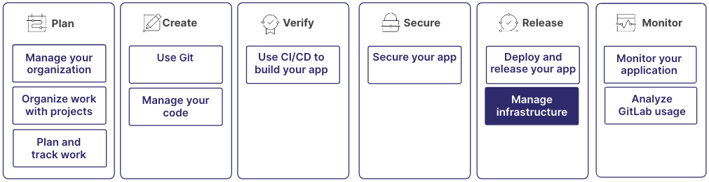

随着 DevOps 和 SRE 方法的兴起，基础设施管理已变得可编码且可自动化。您现在可以在基础设施管理中采用软件开发的最佳实践。

传统运维团队的日常工作已经发生变化，与传统软件开发更加相似。与此同时，软件工程师更有可能掌控其整个 DevOps 生命周期，包括部署和交付。

极狐GitLab 提供各种功能，可加速并简化您的基础设施管理实践。

基础设施管理是更大工作流的一部分：

## 第 1 步：使用代码管理您的基础设施

极狐GitLab 与 Terraform 深度集成，可运行基础设施即代码流水线并支持各种流程。Terraform 被视为云基础设施预配的标准。各种极狐GitLab 集成可帮助您：

- 无需任何设置即可快速上手。
- 像处理代码变更一样，在合并请求中围绕基础设施变更进行协作。
- 使用模块注册表进行扩展。

更多信息，请参见：

- [基础设施即代码](../infrastructure/iac/_index.md)

## 第 2 步：与 Kubernetes 集群交互

极狐GitLab 与 Kubernetes 的集成可帮助您安装、配置、管理、部署集群应用并对其进行故障排除。借助极狐GitLab Kubernetes Agent，您可以连接防火墙后面的集群，实时访问 API 端点，为生产环境和非生产环境执行基于拉取或基于推送的部署，以及更多功能。

更多信息，请参见：

- [在云中创建 Kubernetes 集群](../clusters/create/_index.md)
- [将 Kubernetes 集群与极狐GitLab 连接](../clusters/agent/_index.md)

## 第 3 步：使用 Runbook 记录流程

Runbook 是一组记录在案的流程，说明如何执行某项任务，例如启动、停止、调试或对系统进行故障排除。在极狐GitLab 中，Runbook 使用 Markdown 创建。它们可以包含各种元素，包括文本、代码片段、图片和链接。

极狐GitLab 中的 Runbook 可与其他极狐GitLab 功能集成，例如 CI/CD 流水线和议题。您可以根据特定事件或条件自动触发 Runbook，例如当流水线成功或创建议题时。此外，用户还可以将 Runbook 链接到议题、合并请求和其他极狐GitLab 对象。

更多信息，请参见：

- [可执行 Runbook 在极狐GitLab 中的工作方式](../project/clusters/runbooks/_index.md)
