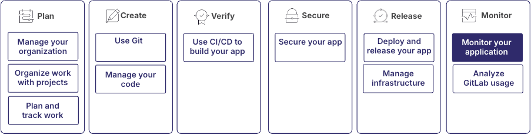

监控是维护和优化应用程序的关键环节。极狐GitLab 可观测性功能帮助您跟踪错误、分析应用程序性能并响应事件。

这些能力是更广泛的 DevOps 工作流的一部分：

所有这些功能都可以独立使用。例如，您可以在不使用错误跟踪的情况下使用链路跟踪或事件管理。不过，为了获得最佳体验，请将这些功能结合使用。

## 第 1 步：确定要使用的项目

您可以将已用于存储应用程序源代码的同一项目用于监控。

对于包含多个服务和代码仓库的大型应用程序，您应创建一个专用项目，以集中存储从系统不同组件收集的所有遥测数据。这种方法有以下几项好处：

- 所有开发和运维团队都能访问数据，便于协作。
- 来自不同来源的数据可以在同一位置查询和关联，从而加快调查速度。
- 它为所有可观测性数据提供单一可信来源，使维护和更新更加容易。
- 它通过将用户权限集中在一个项目中，简化了管理员的访问管理。

要启用可观测性功能，您需要拥有项目的管理员或所有者角色。

有关更多信息，请参见：

- [创建项目](../project/_index.md)

## 第 2 步：使用错误跟踪功能追踪应用程序错误

错误跟踪帮助您识别、确定优先级并调试应用程序中的错误。应用程序生成的错误由 Sentry SDK 收集，
然后存储在极狐GitLab 或 Sentry 后端。

有关更多信息，请参见：

- [错误跟踪的工作原理](../../operations/error_tracking.md#how-error-tracking-works)

## 第 3 步：管理告警和事件

设置事件管理功能，以协作方式排查问题并解决事件。

有关更多信息，请参见：

- [事件管理](../../operations/incident_management/_index.md)

## 第 4 步：分析和改进

利用收集到的数据和洞察，持续改进您的应用程序和监控流程：

1. 创建洞察仪表板，以分析已创建和已关闭的议题
   或事件，并评估事件响应的表现。
1. 创建可执行 runbook，帮助值班工程师自主修复事件。
1. 定期审查您的监控设置，并调整采样阈值，或随着应用程序的发展添加新的指标。
1. 开展事件后评审，找出应用程序和事件响应流程中可改进的方面。
1. 利用监控中获得的洞察，为您的开发优先级和技术债务削减工作提供依据。

有关更多信息，请参见：

- [洞察仪表板](../project/insights/_index.md)
- [可执行 runbook](../project/clusters/runbooks/_index.md)
