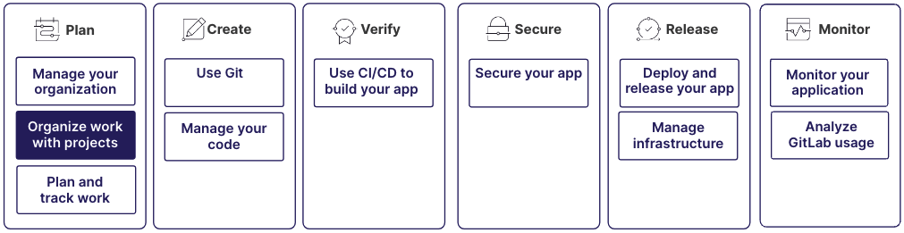

极狐GitLab 中的项目用于组织特定开发项目的所有数据。项目是您与团队协作、存储文件和管理任务的地方。

使用项目可以：

- 编写并保存代码
- 跟踪议题和任务
- 协作处理代码变更
- 测试并部署您的应用

项目的创建和维护是更大工作流的一部分：

## 第 1 步：创建项目

首先在极狐GitLab 中创建一个新项目，用于存放您的代码库、文档和相关资源。

项目包含一个代码仓库。代码仓库包含与您的工作相关的所有文件、目录和数据。

创建项目时，请检查并配置以下设置，使其符合您的开发工作流和协作需求：

- 可见性级别
- 合并请求审批
- 议题跟踪
- CI/CD 流水线
- 议题或合并请求等实体的描述模板

更多信息，请参见：

- [创建项目](../project/_index.md)
- [管理项目](../project/working_with_projects.md)
- [项目可见性](../public_access.md)
- [项目设置](../project/settings/_index.md)
- [描述模板](../project/description_templates.md)

## 第 2 步：保护并控制对项目的访问

使用以下工具管理对项目的安全访问：

- 项目访问令牌：为自动化工具或外部系统授予特定访问权限，以实现安全集成。
- 部署密钥：为您的代码仓库授予只读访问权限，以便将项目安全地部署到外部系统。
- 部署令牌：为项目的代码仓库和镜像仓库授予临时的有限访问权限，以实现安全部署和自动化。

更多信息，请参见：

- [项目访问令牌](../project/settings/project_access_tokens.md)
- [部署密钥](../project/deploy_keys/_index.md)
- [部署令牌](../project/deploy_tokens/_index.md)

## 第 3 步：协作并共享项目

您可以将多个项目邀请到一个群组中，这有时称为 `sharing a project with a group`。每个项目都有自己的代码仓库、议题、合并请求和其他功能。

将多个项目放在一个群组中后，团队成员可以协作处理各个项目，同时还能从全局视角了解群组中完成的所有工作。

要进一步细化对项目的访问权限，您可以向群组添加子群组。

更多信息，请参见：

- [共享项目](../project/members/sharing_projects_groups.md)
- [子群组](../group/subgroups/_index.md)

## 第 4 步：提升项目的可发现性和辨识度

使用搜索框可在您的极狐GitLab 实例中快速查找特定的项目、议题、合并请求或代码片段。

要让项目更易于查找：

- 使用保留的项目和群组名称为您的项目创建一致且易于识别的命名方案。
- 为项目的 `README` 文件添加徽章。徽章可以显示重要信息，
  例如构建状态、项目健康状况、测试覆盖率或版本号。
- 为项目分配主题。主题是帮助您组织和查找项目的标记。

更多信息，请参见：

- [保留的项目和群组名称](../reserved_names.md)
- [搜索](../search/_index.md)
- [徽章](../project/badges.md)
- [项目主题](../project/project_topics.md)

## 第 5 步：提升开发效率并保持代码质量

使用代码智能功能来提高您的工作效率并维护高质量的代码库，例如：

- 代码导航
- 悬停信息
- 自动补全

代码智能是一系列工具，可帮助您高效地浏览、分析和维护代码库。

要快速定位并跳转到项目中的特定文件，请使用文件查找器。

更多信息，请参见：

- [代码智能](../project/code_intelligence.md)
- [文件](../project/repository/files/_index.md)

## 第 6 步：将项目迁移到极狐GitLab

使用文件导出功能将项目从其他系统或其他极狐GitLab 实例迁移到极狐GitLab。

当您将经常访问的代码仓库迁移到极狐GitLab 时，可以使用项目别名继续通过其原始名称访问它。

在 JihuLab.com 上，您可以将项目从一个命名空间转移到另一个命名空间。转移实际上是将项目移动到另一个群组，以便其成员拥有访问权限或所有权。

更多信息，请参见：

- [导入并迁移到极狐GitLab](../import/_index.md)
- [项目别名](../project/working_with_projects.md#project-aliases)
- [将项目转移到另一个命名空间](../project/working_with_projects.md#transfer-a-project)
