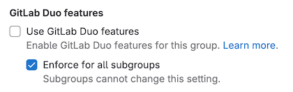



- Tier: 专业版，旗舰版
- Add-on: 极狐GitLab Duo Pro 或 Enterprise
- Offering: JihuLab.com，私有化部署



对于极狐GitLab Duo Pro 或 Enterprise，您可以为群组、项目或实例开启或关闭极狐GitLab Duo。

> [!note]
> 此信息适用于极狐GitLab 18.1 及更早版本。对于极狐GitLab 18.2 及更高版本，请查看[最新文档](turn_on_off.md)。

当为群组、项目或实例关闭极狐GitLab Duo 时：

- 访问代码、议题和漏洞等资源的极狐GitLab Duo 功能不可用。
- 代码建议不可用。
- 极狐GitLab Duo Chat 不可用。

## 为群组或子群组





在极狐GitLab 17.8 至 18.1 中，请按照以下说明为群组（包括其子群组和项目）开启或关闭极狐GitLab Duo。

先决条件：

- 您必须拥有该群组的所有者角色。

要为群组或子群组开启或关闭极狐GitLab Duo：

1. 在顶部栏中，选择**搜索或跳转到**，找到您的群组或子群组。
1. 根据您的部署类型和群组层级，前往设置：
   - 对于 JihuLab.com 顶级群组：选择**设置** > **极狐GitLab Duo**，然后选择**更改配置**。
   - 对于 JihuLab.com 子群组：选择**设置** > **通用**，然后展开 **极狐GitLab Duo 功能**。
   - 对于极狐GitLab 私有化部署（所有群组和子群组）：选择**设置** > **通用**，然后展开 **极狐GitLab Duo 功能**。
1. 选择一个选项。
1. 选择**保存更改**。





在极狐GitLab 17.7 中，请按照以下说明为群组（包括其子群组和项目）开启或关闭极狐GitLab Duo。

> [!note]
> 在极狐GitLab 17.7 中：
>
> - 对于 JihuLab.com，极狐GitLab Duo 设置页面仅适用于顶级群组，不适用于子群组。
> - 对于极狐GitLab 私有化部署，群组或子群组无法使用极狐GitLab Duo 设置页面。

先决条件：

- 您必须拥有该群组的所有者角色。

要为顶级群组开启或关闭极狐GitLab Duo：

1. 在顶部栏中，选择**搜索或跳转到**，找到您的顶级群组。
1. 选择**设置** > **极狐GitLab Duo**。
1. 选择**更改配置**。
1. 选择一个选项。
1. 选择**保存更改**。





在极狐GitLab 17.4 至 17.6 中，请按照以下说明为群组及其子群组和项目开启或关闭极狐GitLab Duo。

> [!note]
> 在极狐GitLab 17.4 至 17.6 中：
>
> - 对于 JihuLab.com，极狐GitLab Duo 设置页面仅适用于顶级群组，不适用于子群组。
> - 对于极狐GitLab 私有化部署，群组或子群组无法使用极狐GitLab Duo 设置页面。

先决条件：

- 您必须拥有该群组的所有者角色。

要为顶级群组开启或关闭极狐GitLab Duo：

1. 在顶部栏中，选择**搜索或跳转到**，找到您的顶级群组。
1. 选择**设置** > **极狐GitLab Duo**。
1. 选择**更改配置**。
1. 选择一个选项。
1. 选择**保存更改**。





在极狐GitLab 17.3 及更早版本中，请按照以下说明为群组及其子群组和项目开启或关闭极狐GitLab Duo。

先决条件：

- 您必须拥有该群组的所有者角色。

要为群组或子群组开启或关闭极狐GitLab Duo：

1. 在顶部栏中，选择**搜索或跳转到**，找到您的群组或子群组。
1. 选择**设置** > **通用**。
1. 展开 **权限和群组功能**。
1. 选中或清除 **使用极狐GitLab Duo 功能** 复选框。
1. 可选。选中 **强制所有子群组** 复选框，将该设置级联到
   所有子群组。

   





## 为项目





在极狐GitLab 17.4 至 18.1 中，请按照以下说明为项目开启或关闭极狐GitLab Duo。

先决条件：

- 您必须拥有该项目的维护者或所有者角色。

要为项目开启或关闭极狐GitLab Duo：

1. 在顶部栏中，选择**搜索或跳转到**，找到您的项目。
1. 在左侧边栏中，选择**设置** > **通用**。
1. 展开 **可见性、项目功能、权限**。
1. 在 **极狐GitLab Duo** 下，开启或关闭该开关。
1. 选择**保存更改**。





在极狐GitLab 17.3 及更早版本中，请按照以下说明为项目开启或关闭极狐GitLab Duo。

1. 使用极狐GitLab GraphQL API
   [`projectSettingsUpdate`](../../api/graphql/reference/_index.md#mutationprojectsettingsupdate)
   变更。
1. 将
   [`duo_features_enabled`](../../api/graphql/getting_started.md#update-project-settings)
   设置设为 `true` 或 `false`。





## 为实例



- Offering: 私有化部署







在极狐GitLab 17.7 至 18.1 中，请按照以下说明为实例开启或关闭极狐GitLab Duo。

先决条件：

- 您必须是管理员。

要为实例开启或关闭极狐GitLab Duo：

1. 在右上角，选择**管理员**。
1. 在左侧边栏中，选择 **极狐GitLab Duo**。
1. 选择**更改配置**。
1. 选择一个选项。
1. 选择**保存更改**。





在极狐GitLab 17.4 至 17.6 中，请按照以下说明为实例开启或关闭极狐GitLab Duo。

先决条件：

- 您必须是管理员。

要为实例开启或关闭极狐GitLab Duo：

1. 在右上角，选择**管理员**。
1. 在左侧边栏中，选择**设置** > **通用**。
1. 展开 **极狐GitLab Duo 功能**。
1. 选择一个选项。
1. 选择**保存更改**。





在极狐GitLab 17.3 及更早版本中，请按照以下说明为实例开启或关闭极狐GitLab Duo。

先决条件：

- 您必须是管理员。

要为实例开启或关闭极狐GitLab Duo：

1. 在左侧边栏中，选择底部的**管理区域**。
1. 选择**设置** > **通用**。
1. 展开 **AI 赋能的功能**。
1. 选中或清除 **使用 Duo 功能** 复选框。
1. 可选。选中 **强制所有子群组** 复选框，将该设置级联
   到实例中的所有群组。




