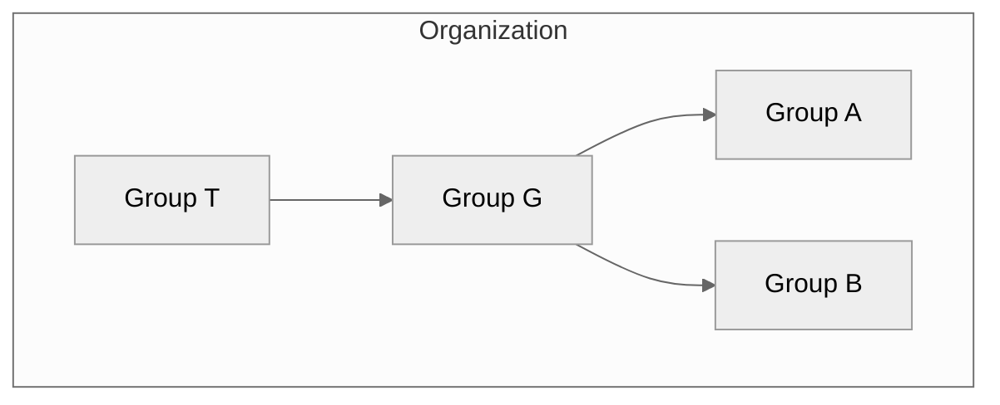



- Tier: 基础版，专业版，旗舰版
- Offering: JihuLab.com，私有化部署



在极狐GitLab 中，您可以使用群组同时管理一个或多个相关项目。

您可以使用群组与所有群组成员沟通，并管理项目的权限。如果有人可以访问群组，他们就可以访问该群组中的所有项目。

您还可以查看群组中项目的所有议题和合并请求，以及有关群组活动的分析。

对于大型组织，您还可以创建[子群组](subgroups/_index.md)。

有关创建和管理群组的更多信息，请参见[管理群组](manage.md)。

## 群组层级

群组以树形结构组织：

- **顶级群组**是在组织“根”级别创建的群组。一个组织可以有一个或多个顶级群组。顶级群组可以包含一个或多个子群组。
- **父群组**是包含一个或多个子群组的群组。
- **子群组**是另一个群组的一部分的群组。

例如，在下图中：

- 该组织有四个群组：一个顶级群组（T），其中包含一个子群组（G），以及 G 内的两个子群组（A 和 B）。
- T 是顶级群组，也是 G 的父群组。
- G 是 T 的子群组（子级），也是 A 和 B 的父群组。
- A 和 B 是 G 的子群组（子级）。

## 群组结构

设置群组的方式取决于您的用例、团队规模和访问要求。下表描述了构建群组结构的最常见模型。

<!-- vale gitlab_base.Simplicity = NO -->

| 模型 | 结构 | 用例 |
| ----- | --------- | --------- |
| 简单 | 所有项目使用一个群组。 | 在小型团队中工作，或针对需要无缝协作和资源访问的特定解决方案（例如营销网站）工作。 |
| 团队 | 为不同类型的团队（例如产品和工程）使用不同的群组或子群组。 | 在大型组织中工作，其中一些团队自主工作，或需要集中式资源以及外部团队成员的有限访问权限。 |
| 客户 | 为每个客户使用一个群组。 | 为需要不同资源和访问级别的多个客户提供定制解决方案。 |
| 功能 | 为一种类型的功能（例如 AI/ML）使用一个群组或子群组。 | 开发复杂产品，其中某项功能需要特定资源和主题专家的协作。 |

<!-- vale gitlab_base.Simplicity = YES -->

> [!note]
> 在极狐GitLab 私有化部署上，如果您想查看整个组织的概览，应创建一个顶级群组。
> 有关创建所有群组的组织视图的更多信息，
> [请参见史诗 9266](https://gitlab.com/groups/gitlab-org/-/work_items/9266)。
> 顶级群组通过完整的
> [安全仪表板与中心](../application_security/security_dashboard/_index.md)、
> [漏洞报告](../application_security/vulnerability_report/_index.md)、
> [合规中心](../compliance/compliance_center/_index.md)和
> [价值流分析](value_stream_analytics/_index.md)，提供对整个组织的洞察。

### 群组结构的推荐限制

群组在成员数量、层级深度或群组共享数量方面没有强制限制。但是，大型或深度嵌套的结构可能会降低性能。仪表板可能加载缓慢，权限计算可能超时，某些操作可能返回 `500` 错误。为保持群组响应迅速，请保持在以下推荐限制范围内：

| 结构 | 推荐限制 | 最大限制 | 超出推荐限制后可能出现的症状 |
| --------- | ----------------- | ------------- | ------------------------------------------- |
| 每个群组的成员数 | 少于 1,000 | 无 | 性能下降。成员数达到 1,500 或更多时，操作可能超时或返回 `500` 错误。 |
| 每个父群组的子群组数 | 少于 100 | 无 | 导航和权限计算变慢。 |
| 层级深度 | 五层或更少 | 20 层 | 数据库查询可能超时。 |

推荐限制不同于最大限制。最大限制是极狐GitLab 强制执行的技术上限。如果群组超出推荐限制，仍然受支持。

当这些限制叠加时，性能问题最为严重。例如，一个同时具有深层嵌套和大量子群组的群组，比单独存在任一情况时更容易导致数据库查询超时。

推荐限制反映了当前的性能表现。有关帮助您从大型、深度嵌套结构迁移到性能更优结构的计划工作的详细信息，请参见
[史诗 21582](https://gitlab.com/groups/gitlab-org/-/epics/21582)。

#### 保持在推荐限制范围内

如果群组接近或超过推荐限制，您可以使用以下变通方法来降低性能影响。

对于大型群组成员：

- 将成员超过 1,000 人的群组拆分为更小的功能群组，每个群组成员不超过 500 人。
  例如，将所有工程师组成的单一群组替换为前端、后端和基础设施工程师的独立群组。
- 将每个较小的群组分别与项目和群组共享，而不是共享一个大型群组。
- 对于批量成员变更，使用[群组成员 API](../../api/group_members.md)，并在请求之间设置延迟，以保持在[成员管理速率限制](../../administration/instance_limits.md#rate-limits)范围内。

对于深层或宽泛的层级结构：

- 将层级保持在五层或更少。
- 对于组织中不需要共享继承成员关系的部分，使用独立的顶级群组，而不是将所有内容嵌套在一个层级下。
- 减少单个父群组下的直接子群组数量。

对于群组共享：

- 当您需要管理单个成员权限时，将群组直接添加到项目中，而不是通过嵌套群组共享。
- 如果新的子群组未从共享群组继承权限，请将共享的角色更改为其他值，然后再改回来，以触发权限重新计算。
- 当您一次执行大量群组共享操作时（例如批量操作或自动化），请一次运行一个或以有限并发运行，而不是全部并行运行。
  针对成员众多的群组同时执行大量共享操作可能会造成数据库争用并降低实例响应能力。
- 群组到群组（嵌套）共享的访问权限传播时间预计比直接项目共享更长，因为它以延迟批处理更新的方式应用。

对于从身份提供商同步的大型层级结构：

- 配置 [LDAP 同步](../../administration/auth/ldap/ldap_synchronization.md)
  间隔，以避免对身份提供商造成速率限制。
  同步期间的速率限制错误可能会阻止用户或移除群组成员关系。

## 群组可见性

与项目一样，群组可以配置为对以下对象可见：

- 匿名用户。
- 所有已认证用户。
- 仅显式群组成员。

应用程序设置级别上对[可见性级别](../../administration/settings/visibility_and_access_controls.md#restrict-visibility-levels)
的限制也适用于群组。如果设置为内部，则匿名用户的探索页面为空。群组页面有一个可见性级别图标。

用户无法创建可见性级别高于其直接父群组的子群组或项目。

## 探索群组

要探索所有公开或内部群组：

1. 在顶部栏中，选择**搜索或跳转到**。
1. 从下拉列表中，选择**探索**。
1. 在左侧边栏中，选择**群组**。

## 查看您所属的群组

要查看您拥有直接或间接成员关系的群组：

1. 在顶部栏中，选择**搜索或跳转到**。
1. 从下拉列表中，选择**查看我的所有群组**。

此页面显示您通过以下方式所属的群组：

- 子群组的父群组成员关系。
- 群组或子群组中项目的直接或继承成员关系。

### 查看非活跃群组

群组在待删除或已归档时处于非活跃状态。

要查看所有非活跃群组：

1. 在顶部栏中，选择**搜索或跳转到**。
1. 从下拉列表中，选择以下任一项：
   - **查看我的所有群组**以筛选您所属的群组。
   - **探索**以筛选公开或内部群组。
1. 选择**非活跃**选项卡。

列表中的每个非活跃群组都会显示一个徽章，表明该群组已归档或待删除。

如果群组待删除，列表还会显示：

- 群组计划最终删除的时间。
- **恢复**操作。恢复群组时：
  - **待删除**标记会被移除。群组不再计划删除。
  - 群组会从**非活跃**选项卡中移除。

## 查看群组

群组概览页面显示有关群组及其成员、子群组和项目的信息，例如：

- 群组描述
- 最近活动
- 已创建的合并请求和议题数量
- 已添加的成员数量
- 子群组和项目
- 共享项目
- 已归档项目

要查看群组：

- 在顶部栏中，选择**搜索或跳转到**并找到您的群组。

您可以搜索群组的子群组和项目，并按升序或降序对它们进行排序。

您可以在 `https://gitlab.example.com/-/g/<id>` 处使用群组的 ID 而非名称来访问群组。例如，如果您的群组 `example-group`的 ID 为 `123456`，您可以在
`https://gitlab.example.com/example-group` 或 `https://gitlab.example.com/-/g/123456` 访问该群组。

## 查找群组 ID

如果您想使用[极狐GitLab API](../../api/_index.md) 与群组交互，可能需要群组 ID。

要查找群组 ID：

1. 在顶部栏中，选择**搜索或跳转到**并找到您的群组。
1. 在群组概览页面的右上角，选择**操作**（）。
1. 选择**复制群组 ID**。

## 查看群组活动

要查看群组活动：

1. 在顶部栏中，选择**搜索或跳转到**并找到您的群组。
1. 在左侧边栏中，选择**管理** > **活动**。
1. 可选。要按贡献类型筛选活动，请选择一个选项卡：

   - **全部**：群组成员在群组和群组项目中的所有贡献。
   - **推送事件**：群组项目中的推送事件。
   - **合并事件**：群组项目中已接受的合并请求。
   - **议题事件**：群组项目中已开启和关闭的议题。
   - **评论**：群组成员在群组项目中发布的评论。
   - **Wiki**：群组中 Wiki 页面的更新。
   - **设计**：群组项目中添加、更新和移除的设计。
   - **团队**：加入和离开群组项目的群组成员。

## 创建群组

要创建群组：

<!-- vale gitlab_base.FutureTense = NO -->

1. 在右上角，选择**新建**（）和**新建群组**。
1. 选择**创建群组**。
1. 在**群组名称**文本框中，输入群组名称。有关不能用作群组名称的词语列表，请参见
   [保留名称](../reserved_names.md)。
1. 在**群组 URL** 文本框中，输入用于[命名空间](../namespace/_index.md)的群组路径。
1. 选择群组的[**可见性级别**](../public_access.md)。
1. 可选。要个性化您的极狐GitLab 体验：
   - 对于**谁将使用此群组？**，选择一个选项。
   - 从**您将使用此群组做什么？**下拉列表中，选择一个选项。
1. 可选。要邀请成员加入群组，请在**电子邮件 1** 文本框中输入您要邀请的用户的电子邮件地址。要邀请更多用户，请选择**邀请另一位成员**并输入用户的电子邮件地址。
1. 选择**创建群组**。

<!-- vale gitlab_base.FutureTense = YES -->

## 编辑群组名称、描述和头像

您可以从群组常规设置中编辑群组详情。

先决条件：

- 您必须拥有群组的所有者角色。

要编辑群组详情：

1. 在顶部栏中，选择**搜索或跳转到**并找到您的群组。
1. 在左侧边栏中，选择**设置** > **常规**。
1. 在**群组名称**文本框中，输入您的群组名称。请参见[群组名称限制](../reserved_names.md)。
1. 可选。在**群组描述（可选）**文本框中，输入您的群组描述。
   描述限制为 500 个字符。
1. 可选。在**群组头像**下，选择**选择文件**，然后选择一张图片。理想的图片尺寸为 192 x 192 像素，允许的最大文件大小为 200 KB。
1. 选择**保存更改**。

## 离开群组

当您离开群组时：

- 您不再是该群组、其子群组和项目的成员，并且无法做出贡献。
- 所有分配给您的议题和合并请求都将被取消分配。

要离开群组：

1. 在顶部栏中，选择**搜索或跳转到**并找到您的群组。
1. 在群组概览页面的右上角，选择**操作**（）。
1. 选择**离开群组**，然后再次选择**离开群组**。

## 计划删除群组

默认情况下，当您首次删除群组时，它会进入待删除状态。再次删除群组可立即将其移除。

先决条件：

- 您必须拥有群组的所有者角色。
- 如果群组包含任何项目，则必须[允许所有者删除项目](../../administration/settings/visibility_and_access_controls.md#restrict-project-deletion-to-administrators)。

要删除群组及其内容：

1. 在顶部栏中，选择**搜索或跳转到**并找到您的群组。
1. 在群组概览页面的右上角，选择**操作**（）。
1. 选择**删除**。
1. 在确认对话框中，输入群组路径并选择**是，删除群组**。

您也可以从群组仪表板删除群组：

1. 在顶部栏中，选择**搜索或跳转到** > **查看我的所有群组**。
1. 为您要删除的群组选择（）。
1. 选择**删除**。
1. 在确认对话框中，输入群组路径并选择**是，删除群组**。

此操作会添加一个后台作业来计划删除群组。在 JihuLab.com 上，群组会在 30 天后删除。在极狐GitLab 私有化部署上，
您可以通过[实例设置](../../administration/settings/visibility_and_access_controls.md#deletion-protection)修改保留期。

当群组计划删除时，已计划的 CI/CD 流水线将停止运行。

如果计划删除群组的用户在删除发生之前失去了对该群组的访问权限（例如，离开群组、角色被降级或被禁止进入群组），删除作业将改为恢复该群组，并且该群组不再计划删除。

> [!warning]
> 如果计划删除群组的用户在作业运行之前重新获得所有者角色或管理员访问权限，则该作业将永久删除该群组。

## 立即删除群组

如果您不想等待，可以立即删除群组。

先决条件：

- 您必须拥有群组的所有者角色。
- 您已[计划删除群组](#schedule-a-group-for-deletion)。

要永久删除已计划删除的群组：

1. 在顶部栏中，选择**搜索或跳转到**并找到您的群组。
1. 在群组概览页面的右上角，选择**操作**（）。
1. 选择**永久删除**。
1. 在确认对话框中，输入群组路径并选择**是，删除群组**。

此操作会删除群组、其子群组、项目以及所有相关资源，包括议题和合并请求。

## 恢复群组

要恢复已计划删除的群组：

1. 在顶部栏中，选择**搜索或跳转到**并找到您的群组。
1. 在群组概览页面的右上角，选择**操作**（）。
1. 选择**恢复**。

## 使用操作菜单管理群组

您可以查看所有群组的列表，并使用**操作**菜单管理它们。

先决条件：

- 除离开群组外，所有可用操作都需要所有者角色。

要访问群组的**操作**菜单：

1. 在顶部栏中，选择**搜索或跳转到** > **查看我的所有群组**。
1. 在**群组**页面上，找到您的群组并选择**操作**菜单（）。
1. 选择一个操作。

根据群组的状态，以下操作可用：

| 群组状态      | 可用操作       |
| ---------------- | ----------------------- |
| 活跃           | **编辑**、**归档**、**转移**、**离开群组**、**删除** |
| 已归档         | **取消归档**、**离开群组**、**删除** |
| 待删除 | **恢复**、**离开群组** |

## 请求访问群组

作为用户，如果管理员允许，您可以请求成为群组成员。

1. 在顶部栏中，选择**搜索或跳转到** > **查看我的所有群组**。
1. 在右上角，选择**探索群组**。
1. 在**搜索**文本框中，输入您要加入的群组名称。
1. 在搜索结果中，选择群组名称。
1. 在群组页面上，在群组名称下方，选择**请求访问**。

最多十位最近活跃的群组所有者会收到包含您请求的电子邮件。任何群组所有者都可以批准或拒绝该请求。

如果您在请求获批之前改变主意，请选择**撤回访问请求**。

## 查看群组成员

要查看群组成员：

1. 在顶部栏中，选择**搜索或跳转到**并找到您的群组。
1. 在左侧边栏中，选择**管理** > **成员**。

表格显示成员的：

- **账号**名称和用户名。
- 其[成员关系](../project/members/_index.md#membership-types)的**来源**。
  具有多个来源的群组成员会在**成员**表格中显示两次，并计为独立成员。
  具有提升角色（如所有者或维护者）的群组成员会覆盖后代群组和项目中限制较少的角色。
  例如，具有所有者角色的群组成员可以在后代子群组或项目中被直接分配开发者角色。
  但是，由于该成员同时被分配了所有者角色，因此他们拥有所有者范围的权限。[议题 502458](https://gitlab.com/gitlab-org/gitlab/-/work_items/502458)
  提议对此行为进行更改，使成员的来源显示最高有效角色。
- 群组中的[**角色**](../project/members/_index.md#which-roles-you-can-assign)。
- 其群组成员关系的**到期**日期。
- 与其账号相关的**活动**。

要查看所有命名空间成员（及其各自占用的席位），请在顶级命名空间中[查看**使用配额**页面](../../subscriptions/manage_seats.md#view-seat-usage)。

## 筛选和排序群组成员

要在群组中查找成员，您可以排序、筛选或搜索。

### 筛选群组

筛选群组以查找成员。默认情况下，会显示群组和子群组中的所有成员。

在群组成员列表中，条目可以显示以下徽章：

- **SAML**，表示该成员连接了 [SAML 账号](saml_sso/_index.md)。
- **Enterprise**，表示顶级群组的该成员是[企业用户](../enterprise_user/_index.md)。

1. 在顶部栏中，选择**搜索或跳转到**并找到您的群组。
1. 在左侧边栏中，选择**管理** > **成员**。
1. 在成员列表上方，在**筛选成员**文本框中输入您的搜索条件。要查看：
   - 群组的直接成员，请选择**成员关系 = 直接**。
   - 群组的继承、共享和继承共享成员，请选择**成员关系 = 间接**。
   - 启用或禁用双重身份验证的成员，请选择 **2FA = 已启用**或 **2FA = 已禁用**。
   - 顶级群组中作为[企业用户](../enterprise_user/_index.md)的成员，请选择**企业 = 是**。

### 搜索群组

您可以按姓名、用户名或[公开电子邮件](../profile/_index.md#set-your-public-email)搜索成员。

1. 在顶部栏中，选择**搜索或跳转到**并找到您的群组。
1. 在左侧边栏中，选择**管理** > **成员**。
1. 在成员列表上方，在**筛选成员**框中输入搜索条件。
1. 在**筛选成员**框的右侧，选择放大镜（）。

### 排序群组成员

您可以按**账号**、**授予访问权限时间**、**角色**或**上次登录时间**对成员进行排序。

1. 在顶部栏中，选择**搜索或跳转到**并找到您的群组。
1. 在左侧边栏中，选择**管理** > **成员**。
1. 在成员列表上方，在右上角，从**账号**列表中选择
   要筛选的条件。
1. 要在升序和降序之间切换排序，请在**账号**列表右侧选择
   箭头（ 或 ）。

## 将用户添加到群组

您可以授予用户对群组中所有项目的访问权限。

先决条件：

- 您必须拥有群组的所有者角色。
- 对于极狐GitLab 私有化部署实例：
  - 如果[禁用了新用户账号创建](../../administration/settings/sign_up_restrictions.md#disable-new-user-account-creation)，则必须由管理员添加用户。
  - 如果[不允许用户邀请](../../administration/settings/visibility_and_access_controls.md#prevent-invitations-to-groups-and-projects)，则必须由管理员添加用户。
  - 如果[启用了管理员审批](../../administration/settings/sign_up_restrictions.md#turn-on-administrator-approval-for-role-promotions)，则必须由管理员批准邀请。

1. 在顶部栏中，选择**搜索或跳转到**并找到您的群组。
1. 在左侧边栏中，选择**管理** > **成员**。
1. 选择**邀请成员**。
1. 如果用户：

   - 拥有极狐GitLab 账号，请输入用户的用户名。
   - 没有极狐GitLab 账号，请输入用户的电子邮件地址。

1. 选择[默认角色](../permissions.md)或[自定义角色](../custom_roles/_index.md)。
1. 可选。对于**访问到期日期**，输入或选择一个日期。
   从该日期起，用户将无法再访问该项目。

   如果您输入了访问到期日期，群组成员将在其访问权限到期前七天收到电子邮件通知。

   > [!warning]
   > 维护者在其角色到期前拥有完整权限，包括延长
   > 自己的访问到期日期的能力。

1. 选择**邀请**。
   如果您通过以下方式邀请用户：

   - 极狐GitLab 用户名，该用户会被添加到成员列表中。
   - 电子邮件地址，该用户会收到电子邮件邀请，并提示其创建账号。
     如果邀请未被接受，极狐GitLab 会在两天、五天和十天后发送提醒电子邮件。
     未被接受的邀请会在 90 天后自动删除。

未自动添加的成员会显示在**已邀请**选项卡上。此选项卡包括以下用户：

- 尚未接受邀请的用户。
- 正在等待[管理员审批](../../administration/moderate_users.md)的用户。
- 超出群组用户上限的用户。

### 查看待提升的用户

如果[角色提升的管理员审批](../../administration/settings/sign_up_restrictions.md#turn-on-administrator-approval-for-role-promotions)已开启，则将现有用户提升为计费角色的成员请求需要管理员审批。

要查看待提升的用户：

1. 在顶部栏中，选择**搜索或跳转到**并找到您的群组。
1. 在左侧边栏中，选择**管理** > **成员**。
1. 选择**角色提升**选项卡。

如果未显示**角色提升**选项卡，则该群组没有待处理的提升。

## 从群组中移除成员

先决条件：

- 您必须拥有所有者角色。
- 该成员必须拥有群组的直接成员关系。如果
  成员关系是从父群组继承的，则只能从父群组中移除该成员。

要从群组中移除成员：

1. 在顶部栏中，选择**搜索或跳转到**并找到您的群组。
1. 在左侧边栏中，选择**管理** > **成员**。
1. 在您要移除的成员旁边，选择垂直省略号（）。
1. 选择**移除成员**。
1. 可选。在**移除成员**确认对话框中，选择一个或两个复选框：
   - **同时从子群组和项目中移除直接用户成员关系**
   - **同时取消将该用户分配给关联的议题和合并请求**
1. 选择**移除成员**。

极狐GitLab 管理员还可以[确保被移除的用户无法再次邀请自己](../project/members/_index.md#ensure-removed-users-cannot-invite-themselves-back)。

## 将项目添加到群组

您可以通过两种方式将新项目添加到群组：

- 选择一个群组，然后选择**新建项目**。然后您可以继续[创建您的项目](../project/_index.md)。
- 在创建项目时，从下拉列表中选择一个群组。

  

### 指定谁可以将项目添加到群组

默认情况下，至少具有以下角色的用户可以：

- 开发者角色可以在群组下创建项目。此默认值可以更改。
- 维护者角色可以将项目 fork 到群组中。此默认设置可防止具有开发者角色的用户 forking 包含受保护分支的项目，并且无法更改。

要指定哪些角色可以在群组中创建项目：

1. 在顶部栏中，选择**搜索或跳转到**并找到您的群组。
1. 在左侧边栏中，选择**设置** > **常规**。
1. 展开**权限和群组功能**部分。
1. 从**创建项目所需的最低角色**中，选择一个选项。
1. 选择**保存更改**。

有关全局更改此设置的更多信息，请参见[创建项目所需的默认最低角色](../../administration/settings/visibility_and_access_controls.md#define-which-roles-can-create-projects)。
