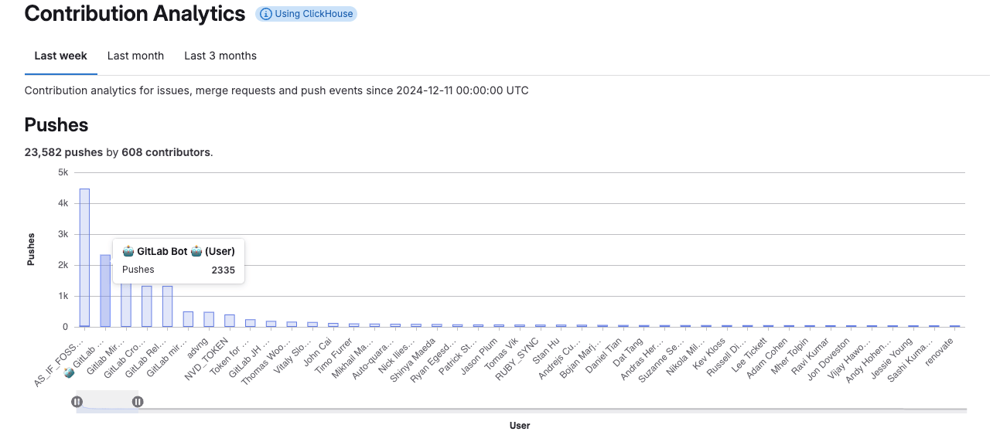



- Tier: 专业版，旗舰版
- Offering: JihuLab.com，私有化部署



贡献分析可让您概览群组成员在过去一周、一个月或三个月内产生的[贡献事件](../../profile/contributions_calendar.md#user-contribution-events)。交互式柱状图和详细表格按群组成员显示贡献事件（推送事件、议题和合并请求）。

使用贡献分析可深入了解团队活动和个人表现，并将这些信息用于：

- 工作量平衡：分析群组在一段时间内的贡献，找出表现优异的群组成员或可能需要额外支持的成员。
- 团队协作：评估贡献的平衡情况，例如代码推送与评审或批准的比例，以确保采用协作式开发实践。
- 培训机会：找出群组成员可能受益于指导或培训的方面，例如较低的合并请求批准率或议题解决率。
- 回顾评估：将贡献分析纳入回顾，评估团队达成目标的有效程度以及可能需要调整的地方。

## 跟踪

贡献分析基于推送事件，因为相比唯一提交，推送事件能提供更可靠的贡献视图。当提交被推送到多个分支时，统计唯一提交可能会导致重复计数。通过改为跟踪推送事件，极狐GitLab 可确保每次贡献都被准确计数。

例如，用户在一次推送中将三个提交推送到分支 A。之后，该用户又将这些提交中的两个从分支 A 推送到分支 B。极狐GitLab 会记录五个提交，尽管该用户只产生了三个唯一提交。

## 查看贡献分析

要查看贡献分析：

1. 在顶部栏中，选择**搜索或跳转到**，然后找到您的群组。
1. 在左侧边栏中，选择**分析** > **贡献分析**。
1. 可选。筛选结果：

   - 要查看上周、上个月或过去三个月的贡献分析，请选择三个标签页之一。
     所选时间段将应用于所有图表和表格。
   - 要放大柱状图以仅显示部分群组成员，
     请选择图表下方的滑块 ()，并沿轴滑动它们。
   - 要按某一列对贡献表排序，请选择列标题或箭头
     ( 表示降序， 表示升序)。

1. 可选。要查看群组成员的贡献，您可以：

   - 在**贡献分析**柱状图上，将鼠标悬停在带有该成员姓名的柱上。
   - 在**每位群组成员的贡献**表格中，选择该成员的姓名。
     系统会显示该成员的极狐GitLab 个人资料，您可以查看其[贡献日历](../../profile/contributions_calendar.md)。

要获取用户贡献的指标，您还可以使用 [GraphQL API](../../../api/graphql/reference/_index.md#groupcontributions)。

## 使用 ClickHouse 的贡献分析

在 JihuLab.com 上，贡献分析通过 ClickHouse Cloud 集群运行。
在极狐GitLab 私有化部署上，当您配置 ClickHouse 集成后，ClickHouse `events` 表会自动从 PostgreSQL `events` 表填充数据。对于大型安装，此过程可能需要一些时间。表完全同步后，新事件会在大约三分钟后出现在 ClickHouse 中。

有关更多信息，请参阅：

- [ClickHouse 集成指南](../../../integration/clickhouse.md)
- [GitLab 中的 ClickHouse 使用情况](https://handbook.gitlab.com/handbook/engineering/architecture/design-documents/clickhouse_usage/)
