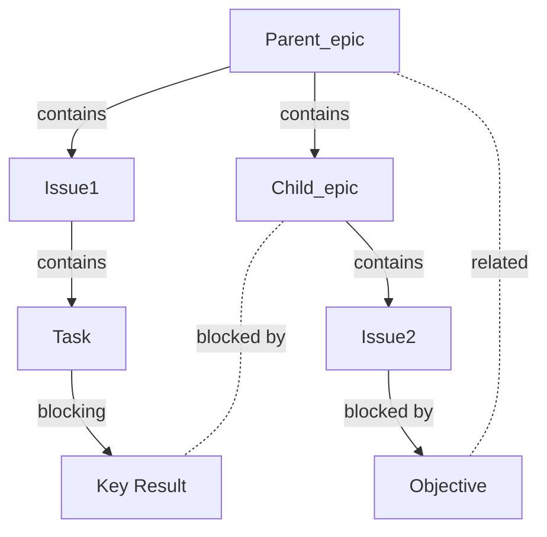



- Tier: 专业版，旗舰版
- Offering: JihuLab.com，私有化部署



极狐GitLab 中的史诗通过将工作项组织到工作层级中，来协调和跟踪大型举措。史诗让复杂项目变得可管理。它们可以：

- 将大型功能拆分为可交付的更小成果，从而带来增量价值。
- 通过计划的开始和结束日期跟踪相关工作项的进度。
- 组织关于功能范围和需求的讨论与决策。
- 创建将任务与战略目标关联起来的层级结构。
- 构建可视化路线图，以监控目标进展。

团队使用史诗来跨多个迭代进行协调，并跟踪长期目标的进展。

在旗舰版中，[嵌套史诗](../../work_items/child_items.md#work-with-multi-level-hierarchies)通过符合敏捷框架的工作层级提供额外的结构。将复杂项目拆分为更易管理的子史诗，子史诗还可以进一步包含各自的议题和任务集合。这种嵌套结构有助于保持清晰，并确保覆盖项目的各个方面，而不会忽视总体目标。

## 史诗与其他项之间的关系

史诗与其他项之间可能存在的关系包括：

- 一个史诗是一个或多个议题的父项。
- 一个史诗是一个或多个[子史诗](../../work_items/child_items.md#work-with-multi-level-hierarchies)的父项。仅限旗舰版。
- 一个史诗与一个或多个任务、目标或关键结果[相关联](linked_epics.md)。

关系示例：

### 来自不同群组层级的子议题

您可以将来自不同群组层级的议题添加到史诗中。为此，请在[添加现有议题](../../work_items/child_items.md#add-an-existing-issue-to-an-epic)时粘贴议题 URL。

## 作为工作项的史诗

我们改变了史诗的外观，将其迁移到统一的工作项框架，以更好地满足我们敏捷规划产品的产品需求。

更多信息，请参见[史诗 9290](https://gitlab.com/groups/gitlab-org/-/work_items/9290) 以及以下博客文章：

- [先睹为快：极狐GitLab 中全新的敏捷规划体验](https://about.gitlab.com/blog/first-look-the-new-agile-planning-experience-in-gitlab/)（2024 年 6 月）
- [推出全新的史诗体验，改进敏捷规划](https://about.gitlab.com/blog/unveiling-a-new-epic-experience-for-improved-agile-planning/)（2024 年 7 月）

如果您在尝试此变更时遇到任何问题，可以使用[反馈议题](https://gitlab.com/gitlab-org/gitlab/-/issues/494462)提供更多详细信息。

### 工作项 Markdown 参考

您可以在极狐GitLab 风格 Markdown 字段中使用`[work_item:123]`引用工作项。更多信息，请参见 [极狐GitLab 特定引用](../../markdown.md#gitlab-specific-references)。
