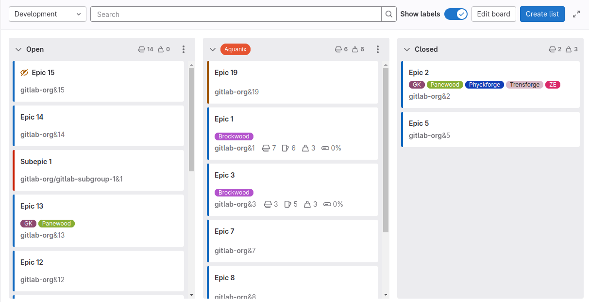
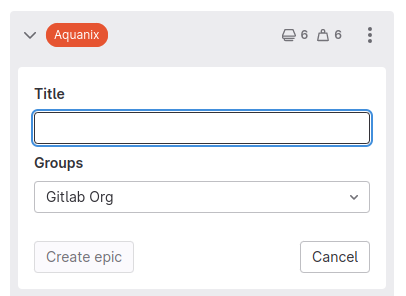



- Tier: 专业版，旗舰版
- Offering: JihuLab.com，私有化部署



史诗看板基于现有的[史诗跟踪功能](_index.md)和[标记](../../project/labels.md)构建。您的史诗会以卡片形式显示在垂直列表中，并按分配的标记进行组织。

在每个列表的顶部，您可以看到列表中的史诗数量 () 以及其中所有史诗的总权重 ()。

要查看史诗看板：

1. 在顶部栏中，选择**搜索或跳转到**，然后找到您的群组。
1. 在左侧边栏中，选择**计划** > **史诗看板**。

## 创建史诗看板

先决条件：

- 您必须具有群组的计划者、报告者、开发者、维护者或所有者角色。

要创建新的史诗看板：

1. 在顶部栏中，选择**搜索或跳转到**，然后找到您的群组。
1. 在左侧边栏中，选择**计划** > **史诗看板**。
1. 在左上角，选择带有当前看板名称的下拉列表。
1. 选择**创建新看板**。
1. 输入新看板的标题。
1. 可选。要隐藏开启或已关闭列表，请清除**显示开启列表**和**显示已关闭列表**复选框。
1. 可选。设置看板范围：
   1. 在**范围**旁边，选择**展开**。
   1. 在**标记**旁边，选择**编辑**，然后选择要用作看板范围的标记。
1. 选择**创建看板**。

现在您可以[添加一些列表](#create-a-new-list)。要稍后更改这些选项，请[编辑看板](#edit-the-scope-of-an-epic-board)。

## 删除史诗看板

先决条件：

- 您必须具有群组的计划者、报告者、开发者、维护者或所有者角色。
- 群组中至少存在两个看板。

要删除活动史诗看板：

1. 在史诗看板页面的左上角，选择下拉列表。
1. 选择**删除看板**。
1. 选择**删除**。

## 您可以在史诗看板上执行的操作

- [创建新列表](#create-a-new-list)。
- [移除现有列表](#remove-a-list)。
- [筛选史诗](#filter-epics)。
- 创建工作流，例如使用[议题看板](../../../tutorials/plan_and_track.md)时。
- [移动史诗和列表](#move-epics-and-lists)。
- 更改史诗标记（通过在看板列表之间拖动史诗）。
- 关闭史诗（通过将其拖动到**已关闭**列表）。
- [编辑看板范围](#edit-the-scope-of-an-epic-board)。

### 创建新列表

先决条件：

- 您必须具有群组的计划者、报告者、开发者、维护者或所有者角色。

要创建新列表：

1. 在顶部栏中，选择**搜索或跳转到**，然后找到您的群组。
1. 在左侧边栏中，选择**计划** > **史诗看板**。
1. 在右上角，选择**新建列表**。
1. 将鼠标悬停或在两个列表之间移动键盘焦点。
1. 选择**新建列表**。
   新列表面板将打开。

   
1. 在**新建列表**列中，展开**选择标记**下拉列表，然后选择要用作列表范围的标记。
1. 选择**添加到看板**。

新列表将插入到看板上与新列表面板相同的位置。

要移动和重新排序列表，请拖动它们。

或者，您可以选择看板最右端的**新建列表**。新列表将插入到列表的最右端，位于**已关闭**之前。

### 移除列表

移除列表不会对史诗和标记产生任何影响，因为移除的只是列表视图。如果需要，您随时可以再次创建它。

先决条件：

- 您必须具有群组的计划者、报告者、开发者、维护者或所有者角色。

要从史诗看板中移除列表：

1. 在要移除的列表顶部，选择**列表设置**图标 ()。
   列表设置侧边栏将在右侧打开。
1. 选择**移除列表**。
1. 在确认对话框中，选择**确定**。

### 从史诗看板创建史诗

先决条件：

- 您必须具有群组的计划者、报告者、开发者、维护者或所有者角色。
- 您必须先[创建列表](#create-a-new-list)。

要从史诗看板中的列表创建史诗：

1. 在列表顶部，选择**新建史诗** () 图标。
1. 输入新史诗的标题。
1. 选择**创建史诗**。

### 编辑史诗

当您从史诗看板中选择史诗卡片时，[史诗会在抽屉中打开](manage_epics.md#open-epics-in-a-drawer)。在那里，您可以编辑所有字段，包括描述、评论或相关条目。

### 筛选史诗

使用史诗看板顶部的筛选器仅显示您想要的结果。这类似于史诗列表中使用的筛选，因为史诗和标记中的元数据会在史诗看板中重复使用。

您可以按以下条件筛选：

- 作者
- 标记

### 查看工作项数量、权重和史诗进度

史诗看板上的史诗会显示其工作项、权重和进度的摘要。要查看开启和已关闭工作项的数量以及已完成和未完成的权重，请将鼠标悬停在工作项图标 、权重图标  或进度图标  上。

### 移动史诗和列表

您可以通过拖动来移动史诗和列表。

先决条件：

- 您必须具有群组的计划者、报告者、开发者、维护者或所有者角色。

要移动史诗，请选择史诗卡片并将其拖动到其当前列表中的另一个位置，或拖动到另一个列表中。了解可能的影响，请参阅[在列表之间拖动史诗](#dragging-epics-between-lists)。

要移动列表，请选择其顶部栏，然后水平拖动。您不能移动**开启**和**已关闭**列表，但可以在编辑史诗看板时隐藏它们。

#### 将史诗移动到列表开头

当您有很多史诗时，手动将史诗从看板列表底部一直拖到顶部很不方便。您可以使用菜单快捷方式将史诗移动到列表顶部。

即使其他史诗被筛选器隐藏，您的史诗也会移动到列表顶部。

先决条件：

- 您必须至少具有群组的计划者角色。

要将史诗移动到列表开头：

1. 在史诗看板中，将鼠标悬停在要移动的史诗卡片上。
1. 选择**卡片选项** ()，然后选择**移动到列表开头**。

#### 将史诗移动到列表末尾

当您有很多史诗时，手动将史诗从看板列表顶部一直拖到底部很不方便。您可以使用菜单快捷方式将史诗移动到列表底部。

即使其他史诗被筛选器隐藏，您的史诗也会移动到列表底部。

先决条件：

- 您必须至少具有群组的计划者角色。

要将史诗移动到列表末尾：

1. 在史诗看板中，将鼠标悬停在要移动的史诗卡片上。
1. 选择**卡片选项** ()，然后选择**移动到列表末尾**。

#### 在列表之间拖动史诗

当您在列表之间拖动史诗时，结果会因源列表和目标列表而异。

|                       | 到开启         | 到已关闭   | 到标记 B 列表                  |
| --------------------- | -------------- | ---------- | ------------------------------ |
| **从开启**            | -              | 关闭史诗   | 添加标记 B                     |
| **从已关闭**          | 重新打开史诗   | -          | 重新打开史诗并添加标记 B       |
| **从标记 A 列表**     | 移除标记 A     | 关闭史诗   | 移除标记 A 并添加标记 B        |

### 编辑史诗看板范围

先决条件：

- 您必须具有群组的计划者、报告者、开发者、维护者或所有者角色。

要编辑史诗看板范围：

1. 在右上角，选择**配置看板** ()。
1. 可选：
   - 编辑看板的标题。
   - 显示或隐藏开启和已关闭列。
   - 选择其他标记作为看板范围。
1. 选择**保存更改**。
