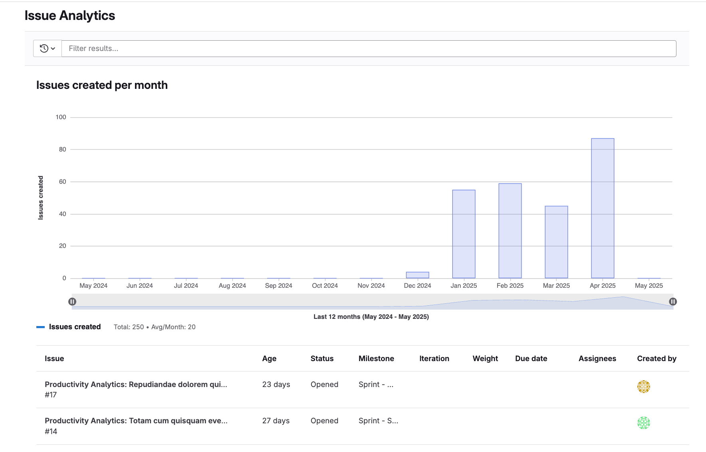
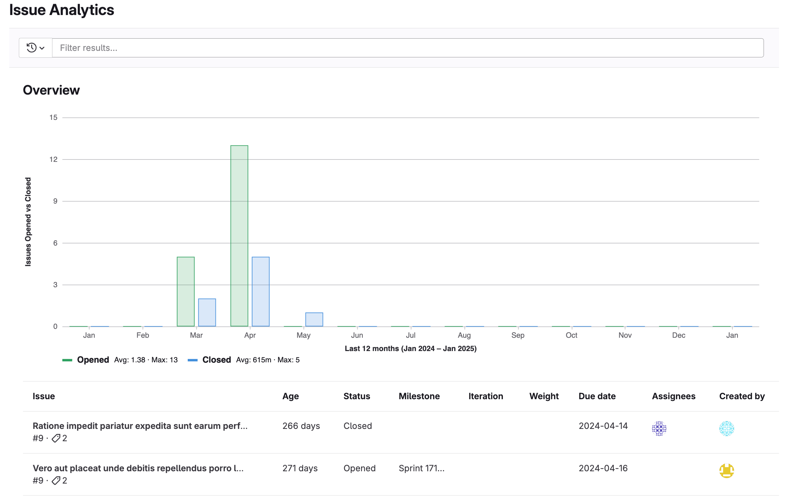



- Tier: 专业版，旗舰版
- Offering: JihuLab.com，私有化部署



议题分析可让您深入了解群组或项目中每月创建的议题。条形图展示每月打开和关闭的议题数量。表格根据全局页面筛选条件显示前 100 个议题，并包含每个议题的以下详细信息：

- 名称
- 存在时长
- 状态
- 里程碑
- 迭代
- 权重
- 截止日期
- 指派人
- 作者

## 查看议题分析

查看议题分析：

1. 在顶部栏中，选择**搜索或跳转到**，然后找到您的项目或群组。
1. 在左侧边栏中，选择**分析** > **议题分析**。要查看某个月的议题总数，请将鼠标悬停在条形上。
1. 可选。要筛选结果，请在**搜索或筛选结果**文本框中输入您的条件：

   - 作者
   - 指派人
   - 里程碑
   - 标记
   - 我的回应
   - 权重

1. 可选。要更改显示的月份总数，请将参数 `months_back=n` 附加到 URL。
   例如，`https://gitlab.com/groups/gitlab-org/-/issues_analytics?months_back=15`
   会显示 GitLab.org 群组 15 个月的数据图表。

您还可以通过**新建议题**下钻报告，从[价值流仪表板](../../analytics/value_streams_dashboard.md)访问议题分析。

### 增强的议题分析



- Tier: 旗舰版
- Offering: JihuLab.com，私有化部署



增强的议题分析会显示额外的指标 `Issues closed`，它表示所选时间段内群组中已解决议题的总数。您可以使用此指标来改善整体周转时间以及为客户交付的价值。

