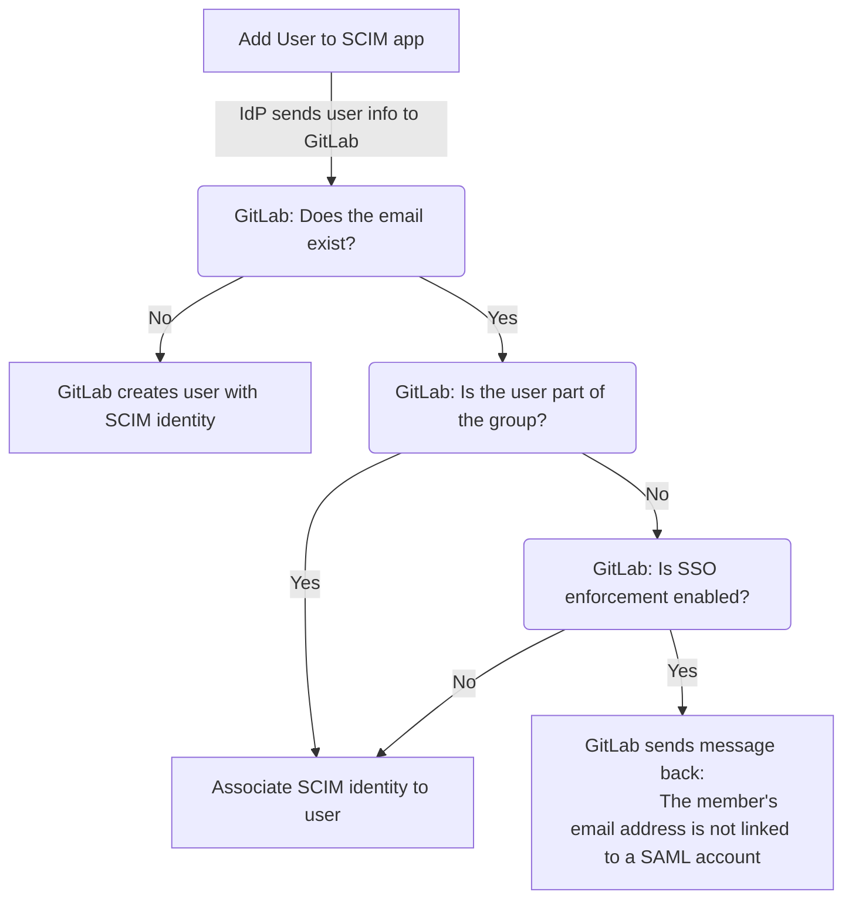
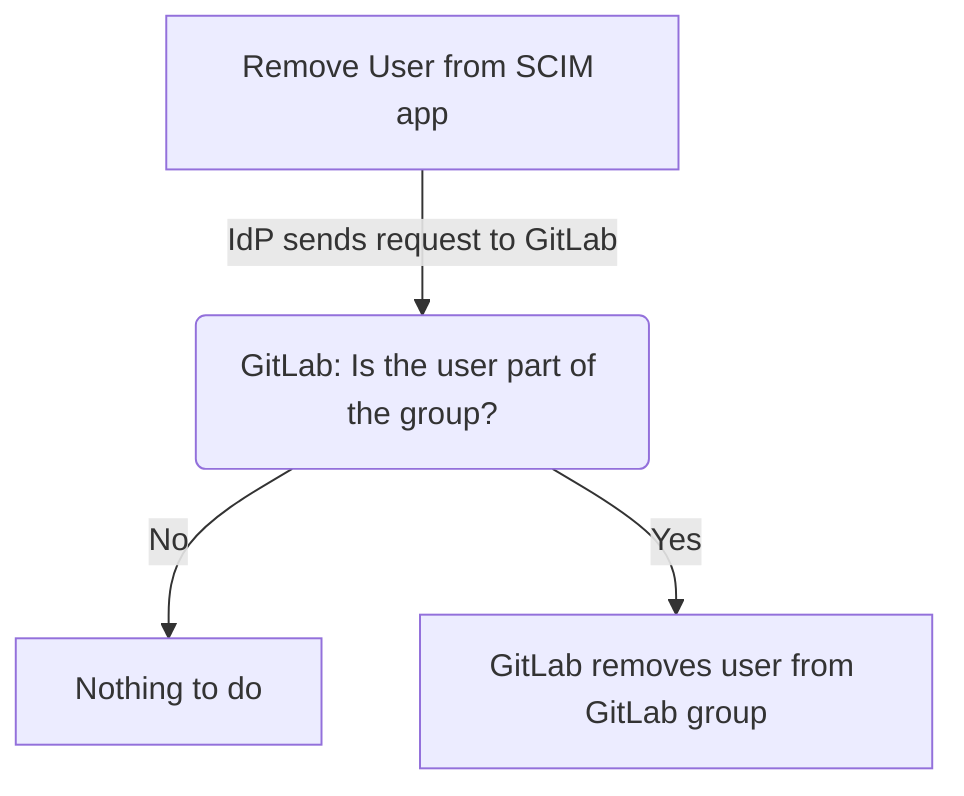



- Tier: 专业版，旗舰版
- Offering: JihuLab.com



您可以使用开放标准跨域身份管理系统（SCIM）自动执行以下操作：

- 创建用户。
- 移除用户（停用 SCIM 身份）。
- 重新添加用户（重新激活 SCIM 身份）。

极狐GitLab SAML SSO SCIM 不支持更新用户。

为极狐GitLab 群组启用 SCIM 后，该群组的成员关系会在极狐GitLab 与身份提供商之间同步。

[极狐GitLab 内部群组 SCIM API](../../../development/internal_api/_index.md#group-scim-api) 实现了 [RFC7644 协议](https://www.rfc-editor.org/info/rfc7644/)的一部分。
身份提供商可以使用[极狐GitLab 内部群组 SCIM API](../../../development/internal_api/_index.md#group-scim-api) 来开发 SCIM 应用。

要在极狐GitLab 私有化部署上设置 SCIM，请参阅[为极狐GitLab 私有化部署配置 SCIM](../../../administration/settings/scim_setup.md)。

## 配置极狐GitLab

先决条件：

- 必须已配置[群组单点登录](_index.md)。

要配置极狐GitLab SAML SSO SCIM：

1. 在顶部栏中，选择**搜索或跳转到**，然后找到您的群组。
1. 在左侧边栏中，选择**设置** > **SAML SSO**。
1. 选择**生成 SCIM 令牌**。
1. 在配置您的身份提供商时，保存：
   - **您的 SCIM 令牌**字段中的令牌。
   - **SCIM API 端点 URL** 字段中的 URL。

## 配置身份提供商

极狐GitLab 支持与多个身份提供商配合使用 SCIM。其他身份提供商可能仍可与极狐GitLab 配合使用，但尚未经过测试，因此不受支持。如需不受支持提供商的帮助，请直接联系该提供商。极狐GitLab 支持可以帮助审查相关日志条目。

### 配置 Okta

在 Okta 的[单点登录](_index.md)设置期间创建的 SAML 应用必须针对 SCIM 进行设置。

先决条件：

- 您必须使用 Okta [生命周期管理](https://www.okta.com/products/lifecycle-management/)产品。在 Okta 上使用 SCIM
  需要此产品层级。
- [已配置极狐GitLab](#configure-gitlab)。
- 已按照 [Okta 设置说明](_index.md#okta)所述设置
  [Okta](https://developer.okta.com/docs/guides/build-sso-integration/saml2/main/)的 SAML 应用。
- 您的 Okta SAML 设置与[配置步骤完全一致](_index.md)，尤其是 NameID 配置。

要为 SCIM 配置 Okta：

1. 登录 Okta。
1. 在右上角，选择 **管理员**。该按钮在**管理**区域中不可见。
1. 在 **应用程序** 标签页中，选择 **浏览应用程序目录**。
1. 搜索 **GitLab**，找到并选择 **GitLab** 应用。
1. 在 GitLab 应用概览页面上，选择 **添加**。
1. 在 **应用程序可见性** 下，选中两个复选框。目前 GitLab 应用不支持 SAML
   身份验证，因此不应向用户显示该图标。
1. 选择 **完成** 完成应用添加。
1. 在 **预配** 标签页中，选择 **配置 API 集成**。
1. 选择 **启用 API 集成**。
   - 对于 **基本 URL**，粘贴您从极狐GitLab SCIM 配置页面上的 **SCIM API 端点 URL** 复制的 URL。
   - 对于 **API 令牌**，粘贴您从极狐GitLab SCIM
     配置页面上的 **您的 SCIM 令牌** 复制的 SCIM 令牌。
1. 要验证配置，请选择 **测试 API 凭据**。
1. 选择 **保存**。
1. 保存 API 集成详细信息后，左侧会出现新的设置标签页。选择 **到应用**。
1. 选择 **编辑**。
1. 为 **创建用户** 和 **停用用户** 都选中 **启用** 复选框。
1. 选择 **保存**。
1. 在 **分配** 标签页中分配用户。已分配的用户会在您的极狐GitLab 群组中创建和管理。

### 配置 Microsoft Entra ID

先决条件：

- [已配置极狐GitLab](#configure-gitlab)。
- 已配置[群组单点登录](_index.md)。

为
[Azure Active Directory](https://learn.microsoft.com/en-us/entra/identity/enterprise-apps/view-applications-portal)
的[单点登录](_index.md)设置期间创建的 SAML 应用必须针对 SCIM 进行设置。有关示例，请参阅[示例配置](example_saml_config.md#scim-mapping)。

> [!note]
> 您必须完全按照以下说明配置 SCIM 预配。如果配置错误，您将遇到用户预配
> 和登录方面的问题，解决这些问题需要花费大量精力。如果您在任何步骤中遇到问题或有疑问，请联系极狐GitLab 支持。

要为 SCIM 配置 Microsoft Entra ID：

1. 在您的应用中，转到 **预配** 标签页并选择 **开始**。
1. 将 **预配模式** 设置为 **自动**。
1. 使用以下值完成 **管理员凭据**：
   - 极狐GitLab 中的 **SCIM API 端点 URL** 用于 **租户 URL** 字段。
   - 极狐GitLab 中的 **您的 SCIM 令牌** 用于 **密钥令牌** 字段。
1. 选择 **测试连接**。如果测试成功，请在继续之前保存配置，否则请参阅
   [故障排除](troubleshooting.md)信息。
1. 选择 **保存**。

保存后，会出现 **映射** 和 **设置** 部分。

#### 配置映射

在 **映射** 部分下，首先预配群组：

1. 选择 **预配 Microsoft Entra ID 群组**。
1. 在属性映射页面上，关闭 **已启用** 开关。极狐GitLab 不支持 SCIM 群组预配。
   保持群组预配启用不会破坏 SCIM 用户预配，但会导致
   Entra ID SCIM 预配日志中出现可能令人困惑和误导的错误。

   > [!note]
   > 即使 **预配 Microsoft Entra ID 群组** 已禁用，映射部分也可能显示“Enabled: Yes”。此行为是一个显示错误，您可以放心忽略。

1. 选择 **保存**。

接下来，预配用户：

1. 选择 **预配 Microsoft Entra ID 用户**。
1. 确保 **已启用** 开关设置为 **是**。
1. 确保所有 **目标对象操作** 均已启用。
1. 在 **属性映射** 下，配置映射以匹配
   [已配置的属性映射](#configure-attribute-mappings)：
   1. 可选。在 **customappsso 属性** 列中，找到 `externalId` 并将其删除。
   1. 编辑第一个属性，使其具有：
      - **源属性**为 `objectId`
      - **目标属性**为 `externalId`
      - **匹配优先级**为 `1`
   1. 更新现有的 **customappsso** 属性，以匹配
      [已配置的属性映射](#configure-attribute-mappings)。
   1. 删除下表中不存在的任何其他属性。如果不删除它们，它们不会造成问题，
      但极狐GitLab 不会使用这些属性。
1. 在映射列表下，选中 **显示高级选项** 复选框。
1. 选择 **编辑 customappsso 的属性列表** 链接。
1. 确保 `id` 是主字段和必填字段，并且 `externalId` 也是必填字段。
1. 选择 **保存**，这将返回属性映射配置页面。
1. 要关闭 **属性映射** 配置页面，请选择右上角的 `X`。

#### 配置设置

在 **设置** 部分下：

1. 可选。如果需要，选中 **发生故障时发送电子邮件通知** 复选框。
1. 可选。如果需要，选中 **防止意外删除** 复选框。
1. 如有必要，选择 **保存** 以确保所有更改均已保存。

配置完映射和设置后，返回应用概览页面并选择 **开始预配**，以对极狐GitLab 中的用户启动自动 SCIM 预配。

> [!warning]
> 同步后，更改映射到 `id` 和 `externalId`的字段可能会导致错误。这些错误包括
> 预配错误、重复用户，并且可能会阻止现有用户访问极狐GitLab 群组。

#### 配置属性映射

> [!note]
> 在 Microsoft 从 Azure Active Directory 过渡到 Entra ID 命名方案期间，您可能会注意到
> 用户界面中存在不一致之处。如果您遇到问题，可以查看本文档的旧版本或联系极狐GitLab 支持。

在[为 SCIM 配置 Entra ID](#configure-microsoft-entra-id) 时，您需要配置
属性映射。有关示例，请参阅[示例配置](example_saml_config.md#scim-mapping)。

下表提供了极狐GitLab 所需的属性映射。

| 源属性                                                           | 目标属性               | 匹配优先级 |
|:---------------------------------------------------------------------------|:-------------------------------|:--------------------|
| `objectId`                                                                 | `externalId`                   | 1                   |
| `userPrincipalName` 或 `mail` 1                                 | `emails[type eq "work"].value` |                     |
| `mailNickname`                                                             | `userName`                     |                     |
| `displayName` 或 `Join(" ", [givenName], [surname])` 2          | `name.formatted`               |                     |
| `Switch([IsSoftDeleted], , "False", "True", "True", "False")` 3 | `active`                       |                     |

1. 当 `userPrincipalName` 不是电子邮件地址或无法投递时，使用 `mail` 作为源属性。
1. 如果您的 `displayName` 与 `Firstname Lastname`的格式不匹配，请使用 `Join` 表达式。
1. 这是一种表达式映射类型，而不是直接映射。在 **映射类型** 下拉列表中选择 `Expression`。

每个属性映射都有：

- 一个 **customappsso 属性**，对应**目标属性**。
- 一个 **Microsoft Entra ID 属性**，对应**源属性**。
- 一个匹配优先级。

对于每个属性：

1. 编辑现有属性或添加新属性。
1. 从下拉列表中选择所需的源属性和目标属性映射。
1. 选择 **确定**。
1. 选择 **保存**。

如果您的 SAML 配置与[推荐的 SAML 设置](_index.md#azure)不同，请选择映射属性并相应修改它们。您映射到 `externalId` 目标属性的源属性必须与用于 SAML `NameID`的属性匹配。

如果某个映射未在表中列出，请使用 Microsoft Entra ID 默认值。有关所需属性的列表，请参阅[内部群组 SCIM API](../../../development/internal_api/_index.md#group-scim-api) 文档。

## 用户访问

在同步过程中，所有新用户：

- 获得极狐GitLab 账号。
- 通过邀请电子邮件收到加入群组的邀请。
  您可以[使用已验证域名绕过电子邮件确认](_index.md#bypass-user-email-confirmation-with-verified-domains)。

### 受限访问下的预配行为

当启用[受限访问](../../../subscriptions/manage_seats.md#restricted-access)且没有可用的订阅席位时，通过 SCIM 预配的用户会被分配最小访问权限角色。

发生这种情况时，用户会成功创建并具有最小访问权限（响应为 `HTTP 201 Created`），并且用户的 `roles` 属性会反映此分配。如果没有可用席位，后续的角色更新操作可能会失败。

有关更多信息，请参阅[使用 SAML、SCIM 和 LDAP 时的预配行为](../../../subscriptions/manage_seats.md#provisioning-behavior-with-saml-scim-and-ldap)。

下图描述了将用户添加到 SCIM 应用时发生的情况：

在预配期间：

- 检查极狐GitLab 用户账号是否存在时，会同时考虑主电子邮件和辅助电子邮件。
- 重复的用户名通过在创建用户时添加后缀 `1` 来处理。例如，如果 `test_user` 已
  存在，则使用 `test_user1`。如果 `test_user1` 已存在，极狐GitLab 会递增后缀以查找未使用的用户名。如果尝试 4 次后仍未找到未使用的用户名，则会在用户名后附加一个随机字符串。

在后续访问中，新用户和现有用户可以通过以下方式访问群组：

- 通过身份提供商的仪表板。
- 直接访问链接。

有关角色信息，请参阅[群组 SAML](_index.md#user-access-and-management) 页面。

### 通过 SCIM 为极狐GitLab 群组创建的用户的密码

极狐GitLab 要求所有用户账号都设置密码。对于使用 SCIM 预配创建的用户，极狐GitLab 会自动生成随机密码，用户无需在首次登录时设置密码。有关极狐GitLab 如何为通过 SCIM 为极狐GitLab 群组创建的用户生成密码的更多信息，请参阅[通过集成身份验证创建的用户的生成密码](../../profile/user_passwords.md)。

### 关联 SCIM 和 SAML 身份

如果已配置[群组 SAML](_index.md) 并且您已有 JihuLab.com 账号，用户可以关联其 SCIM 和 SAML 身份。用户应在开启同步之前执行此操作，因为同步处于活动状态时，现有用户可能会出现预配错误。

要关联您的 SCIM 和 SAML 身份：

1. 将您的 JihuLab.com 用户账号中的[主电子邮件](../../profile/_index.md#change-your-primary-email)地址
   更新为与您身份提供商中的用户个人资料电子邮件地址一致。
1. [关联您的 SAML 身份](_index.md#link-saml-to-your-existing-gitlabcom-account)。

### 移除访问权限

在身份提供商上移除或停用用户，以移除其对以下内容的访问权限：

- 顶级群组。
- 所有子群组和项目。

在身份提供商根据其配置的计划执行同步后，该用户的成员关系会被撤销，他们将失去访问权限。该用户的极狐GitLab 账号不会被删除，它会继续存在于 JihuLab.com 上。

通过 SCIM 取消预配用户不会移除已关联的 SAML 身份。

如果您已配置[企业用户](../../enterprise_user/_index.md)，您可以[删除该用户](../../enterprise_user/_index.md#delete-an-enterprise-user)。

启用 SCIM 时，这不会自动移除没有 SAML 身份的现有用户。

### 重新激活访问权限

在通过 SCIM 移除或停用用户后，您可以通过将该用户添加到 SCIM 身份提供商来重新激活该用户。

在身份提供商根据其配置的计划执行同步后，该用户的 SCIM 身份会被重新激活，其群组成员关系也会恢复。由于已关联的 SAML 身份在取消预配期间会保留，用户可以立即使用 SSO 登录。
